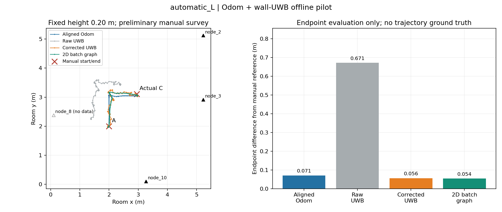
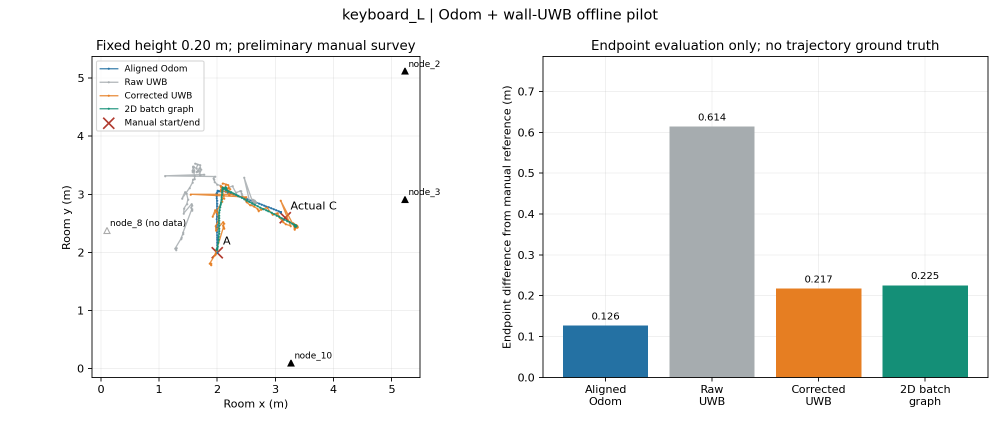
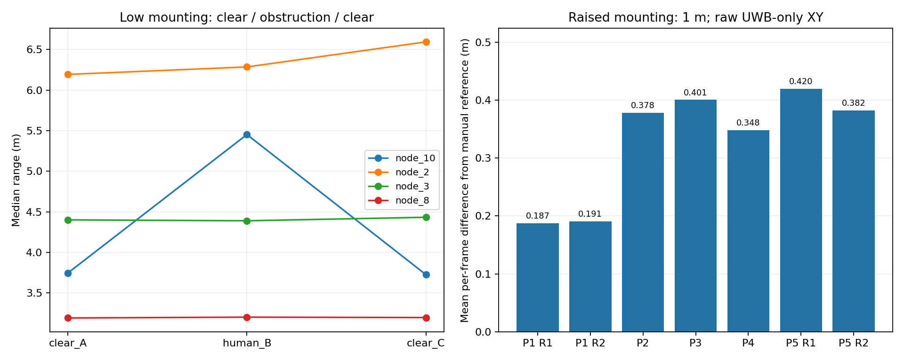

# 2026-10-10—11 墙面 UWB 与 Car2 单车融合实验归档

本次备份共包含 **28 份原始 bag、126,830 条 ROS 消息、38,239,103 字节原始 bag**。
压缩包 SHA256 核验通过，28 份 bag 均完成离线读取，11 份现场已回报校验值全部匹配。
原始 bag、逐消息距离 CSV 和旧分析目录保留在现场备份中；本目录提交清单、备注、精选图表和紧凑结果。

本次完成的是墙面参考节点测距、固定高度 UWB 二维解算，以及 **Car2 单车离线 UWB + Odom 融合试验**。
一维脚本和结果为现场原始版本；二维批量因子图于 2026-10-15 离线实现并运行。
二维模型使用位置与朝向状态，固定天线高度；IMU 仅作诊断。在线融合、iSAM2 和双车协同融合仍待实现。

## 文件入口

- [实验与方法报告](REPORT.md)：实验过程、统计结果、解释边界与后续工作。
- [复现步骤](REPRODUCE.md)：原始脚本与新分析程序的运行方法。
- [完整 bag 清单](results/bag_manifest.csv)、[详细清单](results/bag_manifest.json)、[28 份 bag 的 SHA256](results/SHA256SUMS.txt)。
- [坐标、校准与模型配置](session_config.json)、[静态校准复核](results/calibration.json)。
- [二维结果表](results/two_dimensional_comparison.csv)、[二维完整结果](results/two_dimensional_summary.json)。
- [原始备注](source_notes/)：逐字保留备份中的 27 份现场文本；其中 `pending` 等旧状态由本报告说明，不静默改写原件。
- [四个现场脚本及校验值](results/source_scripts.json)：脚本位于仓库 `tools/field_session_20261010_11/`。
- [Car2 快速启动指南](../../CAR2_QUICK_START.md)。

## 二维 L 形终点比较

所有数值均为最终静止窗口估计位置到人工实测终点的平面距离，单位 m。
初始点和初始朝向用于 Odom 对齐及因子图先验，实际终点仅用于评价。

| 实验 | 对齐 Odom | 原始 UWB | 静态偏置校正 UWB | 二维批量因子图 |
|---|---:|---:|---:|---:|
| 键盘 L 形 | 0.126 | 0.614 | 0.217 | 0.225 |
| 自动 L 形 | 0.071 | 0.671 | 0.056 | 0.054 |

自动轨迹的融合终点略接近实测点，键盘轨迹则由 Odom 给出更小终点差。
两条轨迹、人工坐标和未测外参不足以证明融合有普遍精度优势，尤其不能把毫米级差异解释为显著改进。
没有连续轨迹真值，未计算或宣称轨迹 RMSE/ATE。

## 静态与人体遮挡试验

低位安装时，人体遮挡阶段 N10 相对两次无遮挡参考的中位数平均值增加约 1.718 m。
但 N2 在两次无遮挡参考之间也变化约 0.401 m，说明整体环境/传播条件并未完全恢复。
抬高到 1 m 后 P1 两次静态解算更稳定；这一变化同时涉及高度、支撑和周边环境，不能单独归因于高度。

## 已纠正的关键记录

1. N3、N2 位于右侧墙面，其 x 坐标为 `5.33 - 0.10 = 5.23 m`；不能继续使用最早误记的 `0.10 m`。
2. P5 实测坐标修正为 **[2.02, 4.00, 1.00] m**。保留旧坐标备注和原始 bag，选用已修正参考坐标的分析结果。
3. 两份 L 形均只有 **N10、N2、N3** 测距；N8 全程没有数据。未把缺失值补为零或假造第四条测距。
4. 键盘 L 形两段直线实际使用负的 `linear.x`，即倒车。结合首段向房间 +y 行进的现场记录，初始车头朝向按 -y 推定；未用终点反拟合旋转矩阵。
5. 自动 L 形实际终点为 **[2.95, 3.11, 0.20] m**；键盘 L 形实际终点为 **[3.17, 2.60, 0.20] m**。计划点不作为实际终点真值。
6. 自动转向控制器打印的收敛角度属于控制返回时的反馈。独立转向包最终 Odom 净变化约 -97.6°，并非打印的 -89.8°；制动后仍需复核稳定角度。

现场备份目录：`~/uwb_field_tests/20261010/` 和 `~/uwb_field_tests/20261011/`。
上述日期沿用目录和文件命名；原始消息时间、录包时间均保留，未进行主机时钟校正。
