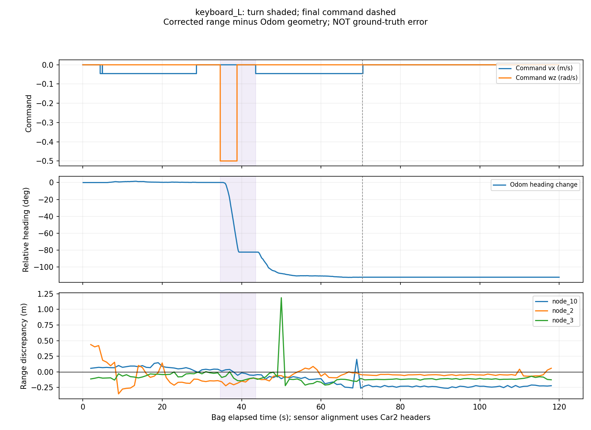
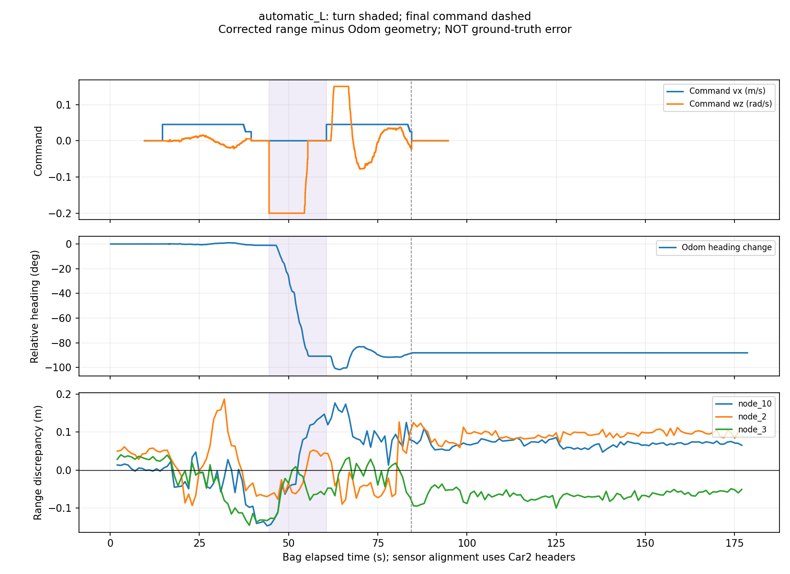

# 两份 L 形的分段诊断

本次继续分析使用相同原始 bag、Anchor 坐标、静态校正量和因子图权重，没有按实测终点挑选参数。
主要二维终点结果维持首版报告的结论。新增程序为 `tools/diagnose_october_L_segments.py`。

## 起点窗口修正

键盘包首次非零平移命令约在第 4.378 s，原先从传感器起始时刻取五秒的评价窗口会混入短暂运动。
起点窗口现改为“最多五秒，并在首次运动命令前 0.5 s 结束”，且必须至少保留一秒。

- 键盘包采用约 [0.168, 3.878] s；自动包仍为约 [0.152, 5.152] s。
- 该修正影响起点 UWB 统计和位移差评价，未改变两条轨迹报告的最终静止位置或终点差。
- 主要终点数值仍为：键盘 Odom 0.126 m / 图 0.225 m，自动 Odom 0.071 m / 图 0.054 m。

## 一、键盘轨迹从哪里开始出现不一致

下表是每条链路“中位测距 - 冻结校正量 - 人工坐标三维几何距离”。它包含人工参考坐标/外参误差，不能全归为 UWB 硬件误差。

| 链路 | 键盘起点残差 (m) | 键盘终点残差 (m) | 自动起点残差 (m) | 自动终点残差 (m) |
|---|---:|---:|---:|---:|
| N10 | +0.064 | -0.147 | +0.014 | +0.015 |
| N2 | +0.414 | -0.036 | +0.051 | +0.119 |
| N3 | -0.102 | -0.055 | +0.034 | -0.077 |

键盘数据在起点附近已经与校准时条件不一致：N2 多出约 0.414 m，其起点窗口测距标准差约 0.162 m。
因此不能把键盘融合终点较差全部归因于中间转弯或 N8 缺失；该包在第一段之前已有链路残差。
终点 N10 残差变为约 -0.147 m，也表明单次静态校正不能完全描述整段轨迹。
传播条件、朝向、安装外参和人工参考误差均是候选来源；现有数据无法唯一归因。

因子图和对齐 Odom 的分离情况如下。这里比较两个估计，**不是全轨迹误差**：

| 阶段 | 键盘：图与 Odom 距离中位数 (m) | 自动：图与 Odom 距离中位数 (m) |
|---|---:|---:|
| 第一段平移 | 0.121 | 0.054 |
| 转弯及停留 | 0.148 | 0.071 |
| 第二段平移 | 0.216 | 0.095 |
| 末段静止 | 0.355 | 0.020 |

键盘包的图在第二段和末段更接近校正 UWB 给出的偏移位置；其终点比 Odom 差，与这个传感器/模型不一致相符。
这不是证明 Odom 整条轨迹正确，也不证明图优化器实现错误；缺少连续真值时只能报告终点评价和一致性诊断。

## 二、自动轨迹的终点较好能说明什么

自动起点的三条残差约 1–5 cm，比键盘起点小。末段图与 Odom 只相距约 2 cm，二者没有发生大的终点分离。
但自动终点 N2/N3 仍分别有约 +0.119 / -0.077 m 的链路残差。
因此约 5 cm 的位置终点差不等于每条测距都达到约 5 cm，也不能由此宣称全轨迹或其他场景同样准确。
自动第二段还存在明显的航向纠偏，转完后朝向并非始终恒定；终点接近也不等于中间路径严格呈直角或直线。

## 三、末段静止长度是否改变结论

使用同一校准、同一模型、同一权重，分别截到最后平移命令后约 10 s、30 s，以及完整录制末尾。
各版本在车辆已经停止的区间评价终点，没有从中挑选最好结果替换基线。

| 轨迹 | 平移结束后约 10 s | 约 30 s | 完整录制 |
|---|---:|---:|---:|
| 键盘图终点差 (m) | 0.203 | 0.236 | 0.225 |
| 自动图终点差 (m) | 0.044 | 0.047 | 0.054 |

三个截断下，键盘图仍不如该包 Odom 的约 0.126 m；自动图的终点差变化约 1 cm。
长时间静止并未单独解释键盘结果，但说明评价窗口和重复观测数量会影响结果，应固定并明确报告。
末段多个八秒窗口中 Odom x/y 跨度均为零，校正 UWB 位置仍有变化；这些变化应与真实位移区分。

## 四、N8 缺失的时间界限

全部 28 份 bag 的目标可见性见 [N8_visibility.csv](results/N8_visibility.csv)。N8 本身作为源节点时，不要求它在自身目标列表出现。

- 05:24 返回包中 N8 为 2491/2491 帧；05:45 失败尝试中为 1410/1410 帧。
- 从 07:39 包开始，所有后续键盘 L 形、自动转向和自动 L 形均没有 N8。
- 时间界限沿用录制机器文件名；缺失发生在中间关机充电/重新连接空档。
- 现有数据支持优先检查 N8 供电与设备状态，但无法证明具体断电、射频、配置或桥接原因。

## 当前可采取的下一步

保留当前基线和失败结果，不用调整权重把这两条终点凑得更好。下一次现场补测外参、核验停止后的稳定状态，并在四节点可见时录重复正反向轨迹。
同一四节点包可在离线分别使用三/四节点进行配对比较。新增代码仍需目标 Melodic VM 回放验收后再将草稿 PR 转为可合并状态。
