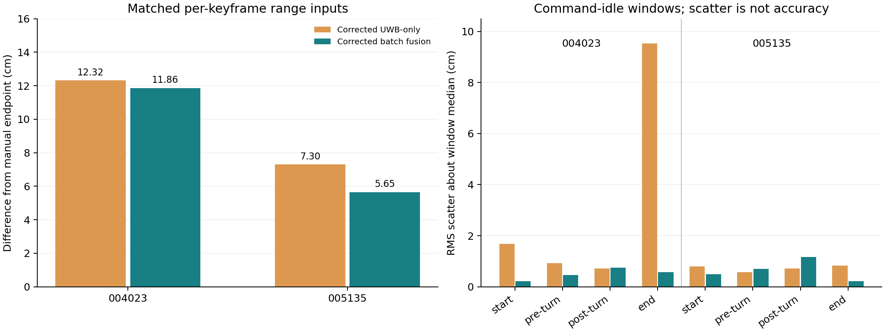

# 单车融合收益与修正适用范围（第二轮）

完整方法、结果和限制见 [REPORT.md](REPORT.md)。本目录使用普通Markdown、Python、CSV、JSON和PNG文件，不包含原始bag或压缩归档。

本轮固定P1修正和原因子图参数，使用相同逐关键帧测距与鲁棒损失，对比UWB-only与融合；补充静止窗、转弯关联及一次预设5秒全墙距因子缺失诊断。没有进行权重搜索。

| Oct18包 | 修正UWB-only终点差 | 修正批量融合终点差 |
| --- | ---: | ---: |
| 004023 | 0.1232 m | 0.1186 m |
| 005135 | 0.0730 m | 0.0565 m |

终点额外收益约0.46/1.65cm，人工参考不确定度未知，不能声称显著精度优势。8个指令静止窗口中5个位置散布减小、3个增大。N10转弯前后存在约30–33cm的“实测变化−候选Odom几何变化”，但真实中间位置、转角、外参与传播作用尚未分离。



## 文件入口

- `analyze_benefit.py`、`protocol.json`：计算前冻结的协议及实际分析源码。
- `results/endpoint_comparison.csv`：相同口径的终点比较；与上一轮整窗中位数UWB-only口径不同，详见报告。
- `results/stationary_diagnostics.csv`：8个窗口、3种方案的24条记录；散布不等于精度。
- `results/turn_association.csv`、`correction_scope.csv`：转弯关联诊断及修正后的验证残差范围。
- `results/dropout_diagnostics.csv`：每包移除20个因子、5个关键帧的批量图试算；使用前后观测，不是在线恢复验证，完整图不是地面真值。
- `results/trajectories.csv`、`keyframe_support.csv`、`summary.json`：逐帧估计、因子支撑、优化状态与来源。
- `results/report_verification.json`、`SHA256SUMS.txt`：实际产物检查与目录文件校验。
- `evidence/antenna_mount_survey_20261018.txt`：原安装备注；坐标轴已明确，几何中心与Odom原点的对应关系仍待核实。

## 复现

使用Python 3及NumPy、SciPy；从仓库根目录运行下列命令，并指定未使用过的输出目录：

```bash
OPENBLAS_NUM_THREADS=1 PYTHONDONTWRITEBYTECODE=1 python \
  docs/field_tests/20261018/single_car_benefit_20261021/analyze_benefit.py \
  --review-zip /path/to/uwb_single_car_rebuilt_20261020_final_review.zip \
  --transfer-dir docs/field_tests/20261018/single_car_transfer_20261021 \
  --output /path/to/new_benefit_results
```

原审阅ZIP是既有输入依赖，位于仓库`delivery/uwb-rebuilt-20261020`分支，本PR不重复上传。PR31来源目录已在main。程序校验其文件SHA及两份解码缓存，再执行分析。

本轮新增分析仍为Python 3离线诊断，不代表Python 2/Melodic、catkin节点、实时或双车融合验收。IMU没有作为融合因子加入。未重复运行并宣称上一轮29项测试为本轮新测试；实际检查见报告。

下一步优先核实参考点与外参，并进行预先定义的参数灵敏度试验；保留全部结果，不依据这两个已反复检查的终点挑选“最终测试成绩”。
