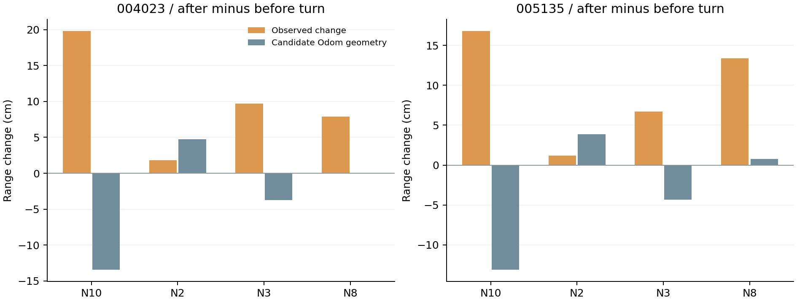

# 单车融合第二轮：相同输入的收益与修正适用范围

日期：2026-10-21（香港时间）。基础为已合并PR31，main=`bf9f70bf69fde122ef5c8d56e8314a0a61c61552`。计算时的会话目录不是Git仓库；旧本地副本的未提交改动原样保留。分析在独立目录完成，不操作实车或修改原始数据。本PR随后按用户要求归档报告与产物，不修改在线节点或既有融合器。

## 核心结论

1. 固定修正的主要收益已在上一轮出现。本轮采用相同逐关键帧测距、相同修正和相同鲁棒损失，融合在两个人工终点上仅比UWB-only改善约0.46/1.65cm；测量不确定度未知，不能声称有统计显著的绝对精度优势。
2. 融合对这两包终点停止段的抖动抑制更明显，但并非所有停止窗口都改善，8个窗口中5个散布下降、3个上升。平滑和低抖动都不能替代独立精度评价。
3. 固定修正仍具有位置/场次适用限制，验证案例残差约−21.0至+13.3cm。转弯前后N10存在约30–33cm的候选几何解释差；外参、真实中间位置和传播作用未分离，不把它叫作已证实的朝向偏差。
4. 人为去掉5个关键帧的全部墙距因子后，批量图仍输出有限位置，与完整图的最大差约2.5/3.0cm。这是利用前后数据的离线插值诊断，不是在线恢复能力或已知真值误差。

## 1. 如何公平比较

方案A沿用PR31候选起点对齐的Odom；F沿用PR31的D（P1修正后的完整批量图）；U独立求每个关键帧的天线XY。U和F使用同样的188个关键帧、同样的四条原B分箱中位数、同样的P1修正、固定天线高度0.20m，以及range_sigma=0.20m和同一伪Huber残差变换。

U没有Odom、初始位置/朝向先验或前后帧约束。每帧从三个固定种子(2.665,2.69)、(0,0)、(5.33,5.38)求解，在成功解中选代价最低者；种子不含人工终点、Odom或上一帧位置。F额外使用整段Odom、软先验和前后墙距，因此不能把它的非因果批量结果当成实时滤波性能。

评价窗口仍是004023的[81.848289054,86.848289054)、005135的[83.814045340,88.814045340)，每个5帧；人工终点只进入评价函数。

| 包 | A Odom终点差cm | U修正UWB-only终点差cm | F修正融合终点差cm | U→F减少cm |
| --- | ---: | ---: | ---: | ---: |
| 004023 | 28.55 | 12.32 | 11.86 | 0.46 |
| 005135 | 24.57 | 7.30 | 5.65 | 1.65 |

上一轮11.70/6.99cm的UWB-only结果是“整个停止窗四个测距中位数再做普通无权解算”。本轮改为“每个原关键帧解算、同鲁棒损失，再对5个位置取中位数”，因此为12.32/7.30cm。这是预先声明的比较口径变化，不是改参考点或挑窗口，不能直接混合两种数值。

## 2. 停止窗口稳定性

initial为首个有效状态到首次前进前0.5秒；pre-turn为首次前进停止2秒后到转弯开始；post-turn为转弯停止2秒后到第二次前进；endpoint沿用原评价窗。窗口由指令边界确定，不按误差选取。每个窗口Odom平移路径为0，IMU偏置修正后角速度也接近零，支持静止解释，但不是独立运动真值；有些窗口只有3–4帧。

散布定义为每个位置相对该窗位置中位数的距离平方均值再开方，单位cm。不是相对真值的RMSE。

| 包 | 窗口 | 位置帧数 | U散布cm | F散布cm |
| --- | --- | ---: | ---: | ---: |
| 004023 | initial | 9 | 1.688 | 0.216 |
| 004023 | idle_before_turn | 3 | 0.922 | 0.457 |
| 004023 | idle_after_turn | 3 | 0.723 | 0.757 |
| 004023 | endpoint | 5 | 9.524 | 0.569 |
| 005135 | initial | 12 | 0.802 | 0.491 |
| 005135 | idle_before_turn | 3 | 0.574 | 0.701 |
| 005135 | idle_after_turn | 4 | 0.722 | 1.159 |
| 005135 | endpoint | 5 | 0.833 | 0.212 |

004023终点存在原始测距波动，U位置散布9.52cm、F约0.57cm；005135终点为0.83→0.21cm。另一方面，004023转后、005135转前/转后的F散布较大，说明时间约束也可能将前后不一致观测传播到停止段。不能笼统表述融合让所有静止段更稳定。


## 3. 固定P1修正的空间/场次范围

复用上一轮独立参考验证表，不新增标定，不将下面残差回填参数。每节点5个位置/包案例，包括同一(2,3)位置的两次记录；不能当作独立统计样本。

| 节点 | 修正后最小残差cm | 修正后最大残差cm | 绝对残差平均cm |
| --- | ---: | ---: | ---: |
| node_10 | -13.01 | -4.73 | 8.00 |
| node_2 | -21.00 | 2.07 | 7.77 |
| node_3 | -4.24 | 3.33 | 2.44 |
| node_8 | -9.50 | 13.27 | 8.69 |

N2与N8的残差随案例变号且范围约23cm；N10在这些验证点持续为负，N3较小。这提示应继续验证位置/安装/传播依赖，而不是把P1值当成通用硬件常数。本轮不依据这些评价数据再拟合偏差或重新赋权。

## 4. 转弯关联诊断

比较转弯前后两个指令静止窗的原始测距中位数变化，再与候选起点对齐Odom及[0.12,−0.08]m天线水平外参预测的几何距离变化比较。约90度转弯会移动偏置安装的天线，不能简单假定天线位置不变；Odom记录的转前后车体中位位置差约4.12/4.91cm也纳入预测。

| 包 | 节点 | 实测距离变化cm | 候选Odom几何变化cm | 实测−候选cm |
| --- | --- | ---: | ---: | ---: |
| 004023 | node_10 | 19.80 | -13.41 | 33.21 |
| 004023 | node_2 | 1.80 | 4.73 | -2.93 |
| 004023 | node_3 | 9.70 | -3.74 | 13.44 |
| 004023 | node_8 | 7.90 | -0.07 | 7.97 |
| 005135 | node_10 | 16.80 | -13.09 | 29.89 |
| 005135 | node_2 | 1.20 | 3.89 | -2.69 |
| 005135 | node_3 | 6.70 | -4.31 | 11.01 |
| 005135 | node_8 | 13.40 | 0.74 | 12.66 |

N10两包都实测增加约16.8–19.8cm，而候选模型预测减少约13cm，差约29.9–33.2cm；N3差约11.0–13.4cm。这是可重复的排查线索，但中间天线真实位置、实际转角、外参和车体参考点未独立测定，因此还无法分离模型错误、车体运动和传播影响。不能由此直接构造一个按yaw修正的模型。



## 5. 固定5秒测距缺失试算

在每包第二段前进开始后[5,10)秒，移除中心落入该区间的全部墙距因子，其他设置不变。每包移除20个因子、5个关键帧。UWB-only在这种全墙距缺失下没有输出；融合依赖Odom及前后墙距保持连续状态。

| 包 | 缺失窗s | 移除墙距因子 | 融合有限位置帧 | 与完整图最大差cm |
| --- | --- | ---: | ---: | ---: |
| 004023 | [61.331000, 66.331000) | 20 | 5/5 | 2.55 |
| 005135 | [63.034135, 68.034135) | 20 | 5/5 | 2.97 |

不将完整图当真值，也不将差约2.5/3.0cm当实际误差。批量图会用到缺失窗后的观测；若要证明在线抗掉线，需要按时间顺序运行的算法与独立动态参考，当前没有这些证据。被移除的修正测距与预测的绝对残差中位数为10.38/8.83cm，也只表示与测量的一致性。

## 6. 下一步应做什么

- 保持P1固定修正融合为实验基线，保留UWB-only和Odom；不以当前两包终点调权重。
- 安装原备注已明确X向前、Y向左，Car2偏移[0.12,−0.08]m相对“近似底盘几何中心”测量，并明示odom_origin_correspondence为pending verification（原文保留于evidence/）。优先核实这个几何中心是否对应base_footprint/Odom原点，不重复要求用户提供已记录的轴方向。CAR2_QUICK_START中的odom_frame_id名称是启动参数；仅凭odom_combined命名不能确定底层是否已融合IMU，需厂商节点配置或源码。当前线索不足以靠换求解器解决。
- 下一次针对性补测：在相同区域记录转前/转后天线中心的实际XYZ与车头朝向，明确天线是否因绕车体转动而移动；可用0→90→0的重复布置检查可重复性，标定和评价记录分开。不能只写“原地转弯”便假定天线中心固定。
- 之后用未参与方法选择的位置/朝向/重复包检验固定修正。动态精度需中途独立停点或连续参考，目前不能声称F的整段轨迹优于U。
- 本轮没有加入IMU因子，也没有修改双车算法。

## 7. 验证与复现

已校验合并目录SHA清单覆盖的30个文件（清单自身不自校验）、两份解码缓存与原输入manifest一致；A/F四个终点评价复现至1e−12m；合成三维测距加固定偏差后恢复指定平面位置；不足3条距离不输出U位置；188个匹配关键帧、24个停止窗口/方法记录、8个转弯节点案例及两次缺失试算均保存。没有调权重、选最优参数或重复声称旧测试为新测试。

复现需Python 3、numpy和scipy，原审阅ZIP以及PR31合并目录。输出目录必须全新：

```bash
OPENBLAS_NUM_THREADS=1 PYTHONDONTWRITEBYTECODE=1 python analyze_benefit.py \
  --review-zip /path/to/uwb_single_car_rebuilt_20261020_final_review.zip \
  --transfer-dir /path/to/docs/field_tests/20261018/single_car_transfer_20261021 \
  --output /path/to/new_benefit_results
```

协议在protocol.json中，计算前冻结。输入、源码和软件版本见results/summary.json的provenance。HTML版本内附所有新脚本、CSV、JSON和Markdown的独立下载项，不包含原始bag或压缩包。
