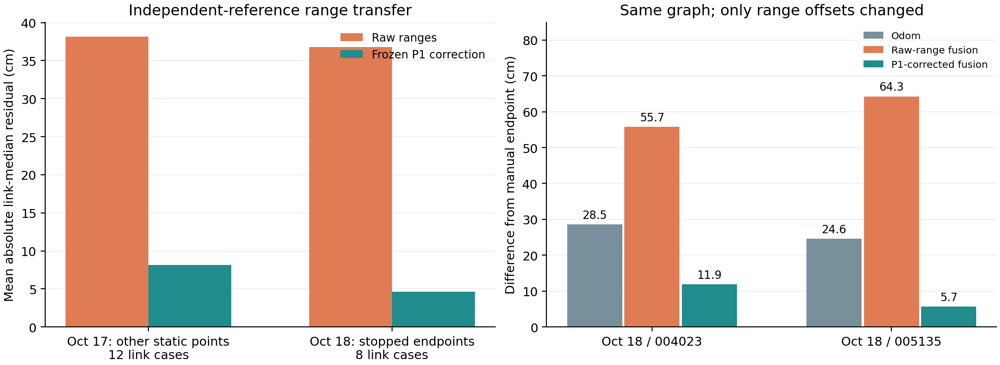

# 单车固定测距修正迁移审查（2026-10-21）

先阅读 [完整报告](REPORT.md)。本目录是可直接浏览的代码、Markdown、CSV、JSON和PNG，不包含原始bag或压缩交付包。

## 本轮回答的问题

10月17日独立P1静态包算出的固定链路修正，能否减轻其他位置及10月18日两包的测距/几何差异？在原模型与权重不变时，融合终点是否改善？

| Oct18包 | 仅Odom | 原始测距融合 | 固定P1修正融合 |
| --- | ---: | ---: | ---: |
| 004023 | 0.2855 m | 0.5575 m | 0.1186 m |
| 005135 | 0.2457 m | 0.6426 m | 0.0565 m |

只改变测距偏差项，未按Oct18终点拟合。A/B原基线在本轮精确复现。结果主要支持静态修正有效，并未证明因子图本身相对修正UWB-only有稳定优势：同停止窗的修正UWB-only位置差约0.1170/0.0699 m，融合为0.1186/0.0565 m；二者估计方式不同。

## 文件入口

- `analyze_static_transfer.py` / `protocol.json`：独立P1标定、静态/终点测距迁移，以及辅助UWB-only解算。
- `fusion_transfer_trial.py`：复用昨晚审阅包的源码与分箱，仅修改固定测距偏差；无新筛选、IMU或双车因子。
- `results/range_transfer.csv`、`point_summary.csv`、`summary.json`：各节点和参考位置的统计、来源与输入SHA。
- `results/fusion_trial/`：固定试算参数、终点表、逐关键帧轨迹及优化状态。
- `results/fusion_trial/archived_sources/`：按原运行时哈希保留的旧分析源码快照；不覆盖主仓库同名工具。
- `results/inputs/`：配置与原备注，包括明确标识为更正前的旧备注；以REPORT中的更正引用为准。
- `results/verification.json` / `SHA256SUMS.txt`：实际数值回归、合成几何检查及目录内文件哈希。

## 复现与边界

复现命令见REPORT第6节。需要原始10/17、10/18输入和上一轮审阅ZIP；它们是输入依赖，本PR不再次上传原始数据。原审阅包位于仓库 `delivery/uwb-rebuilt-20261020` 分支。将依赖路径换成本机路径，并使用全新输出目录。

Python 3离线分析；没有修改ROS驱动、现有在线节点或主目录融合器，不代表Melodic/Python 2或实时系统已验收。IMU只用于原有诊断。

手工参考、候选起点、天线/车体参考点、安装变化和传播偏差仍存在不确定性。P1不计作独立验证；历史结果已可见，本轮并非盲测。只有停止点参考，不报告轨迹ATE/RMSE。10/11是另一安装配置，不套用本轮修正。

本PR只供代码与方法审核，不自动合并。
