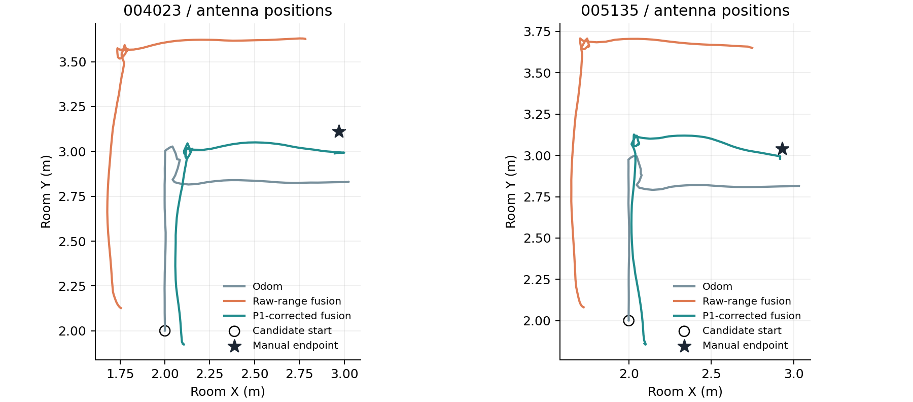

# 单车融合退化审查：静态修正迁移及固定因子图对照

日期：2026-10-21（香港时间）。原始数据只读；不连接实车、不启动ROS、不修改Git仓库或旧产物。

## 本轮结论

目前最有证据支持的改进方向是先验证测距偏差修正，而非重写因子图或继续增加跳变筛选。仅加入10月17日独立P1静态包所得的固定链路修正，保持原有模型、权重、先验、外参和评价窗口不变，两包10月18日单车融合的终点平面差均明显下降，且均小于本轮Odom基线。

这是历史数据上的探索性对照，支持持续测距/几何不一致是重要因素；不能据此唯一认定硬件偏差，不能证明整段轨迹精度，也不能直接验收通用标定、实时运行或双车协同。

## 1. 输入、参考与隔离

- 标定唯一来源：CAR2_P1_REINSTALL_STATIC_20261017_045257.bag，天线人工参考(2,2,0.20)m。
- 同日验证：055818与060940对应(2,3,0.20)m；053806对应更正后的(3,3,0.20)m。两个(2,3)包并非两个空间位置。
- 次日验证：004023与005135的人工终点分别为(2.97,3.11,0.20)m与(2.93,3.04,0.20)m；来源为审阅包U001/U002。墙节点沿用10/17最终配置。
- 10/17充电桌040643包无人工位置且有遮挡，不用于绝对几何评价。
- 10/11墙节点安装配置不同，本轮不套用10/17参数。
- P1参与计算修正，其自身零残差不是独立验证证据。其余点不参与修正估计。
- Oct18起点(2,2,0.20)m仍是候选值；朝向+Y为用户确认；base_footprint与几何中心重合及水平外参仍有假设。

节点坐标：N10=(3.26,0.10,2.355)、N2=(5.28,5.16,2.755)、N3=(5.28,2.86,2.355)、N8=(0.10,2.41,2.30)m。

## 2. 静态修正方法与结果

每个节点b=median(P1原始有效距离)−P1三维几何距离；验证时r_corrected=r_raw−b。不估计新的终点偏差，不按结果选择节点，不使用新增筛选。

| 节点 | 冻结修正b（m，需从测得距离中减去） |
| --- | ---: |
| node_10 | 0.608863618 |
| node_2 | 0.449737491 |
| node_3 | 0.201285960 |
| node_8 | 0.368514391 |

10/17验证使用整份静态包的链路中位数；10/18使用原审阅包已经固定的停止后[2,7)秒窗口，具体为004023的[81.848289054,86.848289054)、005135的[83.814045340,88.814045340)，传感器按header选取。静态末窗Odom位移均为0，但这不独立证明绝对物理静止。

下表单位均为cm。测距MAE是四个“链路中位数减人工几何距离”的绝对值平均；不是逐样本定位RMSE。UWB-only为四条中位数测距的固定高度无权最小二乘，仅作辅助诊断，未参与融合初始化。

| 验证数据 | 原始测距MAE | 修正测距MAE | 原始UWB-only位置差 | 修正UWB-only位置差 |
| --- | ---: | ---: | ---: | ---: |
| 10/17 (2,3)，055818 | 37.76 | 8.99 | 68.21 | 13.47 |
| 10/17 (2,3)，060940 | 36.59 | 10.76 | 70.86 | 17.14 |
| 10/17 (3,3)，053806 | 40.14 | 4.65 | 51.69 | 10.10 |
| 10/18 004023 停止段 | 35.05 | 5.90 | 50.39 | 11.70 |
| 10/18 005135 停止段 | 38.47 | 3.33 | 56.36 | 6.99 |

同日12个验证链路案例的MAE为38.16→8.13cm，次日8个终点链路案例为36.76→4.61cm；全部20个验证案例的绝对差都减小。这些案例共享节点和位置，不能当作20个独立统计样本。

修正后仍有明显残差：例如10/17同一点(2,3)的N2为−14.20/−21.00cm，说明P1固定偏差并非通用精确模型。不同朝向、安装、传播、人工参考误差等因素尚未分离。

## 3. 仅改变偏差项的因子图对照

从昨晚最终审阅包原封不动提取分析器及输入构造源码，校验其运行时源码哈希。复用已经解码并校验哈希的原始数据、原B方案测距分箱；先复算A/B，再运行D。原始两bag已在本轮直接读取并核对SHA；融合读取与其对应的已校验解码缓存。

- A：原候选起点/外参下的Odom传播。
- B：原始测距融合，额外偏差为零。
- D：同B，仅将偏差项换成上表P1固定修正；无Hampel、无Odom门限、无人为N10掩码。
- 所有方案保持1秒关键帧、±0.4秒聚合、每节点至少5值、原伪Huber损失，以及range_sigma=0.2m、odom_sigma=0.03m和2deg×sqrt(dt)、先验0.2m/5deg、外参[0.12,−0.08]m。IMU仍仅诊断。
- 人工终点仅交给优化后的评价函数；没有进入优化函数、偏差估计或观测筛选。

| 包 | A：Odom终点差cm | B：原始测距融合cm | D：固定P1修正融合cm |
| --- | ---: | ---: | ---: |
| 004023 | 28.55 | 55.75 | 11.86 |
| 005135 | 24.57 | 64.26 | 5.65 |




图中只有人工终点，计划L折线不是实测连续轨迹。曲线更接近终点不等同于全程更准确。

初始静止首末位移：004023的B/D为6.01/0.10cm，005135为9.52/0.89cm；候选起点到初始静止窗估计中位数的差仍约12.94/17.41cm，不能将其叫作已知起点误差。末评价窗首末位移004023的B/D为1.01/1.68cm（此项略变差），005135为1.14/0.60cm。并非所有指标都改善。

## 4. 解释与可执行决定

1. 保留A、原始B、旧筛选C和新D各自结果。此前零偏差B是有意的原始测距基线，不把未启用修正称为程序故障。
2. 当前证据支持优先完善“静态校准来源、可迁移性检查、残差监控”，暂不整套换求解器。
3. P1固定修正可作为新的实验基线，明确它适用于当前安装和已检查区域，尚非产品级标定。后续在未用于选择方法的位置/朝向/重复包上检验；本轮已有历史表可见，不能称盲测。
4. 仍需核实参考点、起点和Odom来源。若偏差随位置/朝向变化，采用分节点不确定度或进一步模型前，应先取得独立证据。
5. 将来单车基线稳定后复用每车的运动和墙距因子，再检验车间距离约束。此次没有修改或重跑双车模型。

## 5. 核验与限制

- 4个10/17原始包均匹配提交配置SHA；2个10/18原始包均匹配原审阅manifest SHA。
- P1全精度修正复现原冻结值至1微米以内；16行历史静态表32个数值的最大差为8.9e−16m。
- 独立合成位置检查验证三维距离、高度与修正符号。
- 原A/B终点4组复算与昨晚表格差均为0m；新D两次均ftol成功终止，评价窗口、状态数与因子数保持不变。
- 本轮未重新运行昨晚全部29项测试，不把旧测试计为本轮新测试；本轮执行的是上述输入、数值回归与合成几何检查。
- 人工测量不确定度未量化；同地点/同安装存在相关性；历史结果已可见。本次有力支持修正方向，尚不能证明唯一误差原因、全区域适用性、连续轨迹ATE/RMSE或实时性能。
- 原始bag、旧结果和Git仓库未修改；不提交、不推送、不合并。新脚本与结果在独立目录。包中不含原始bag。

## 6. 复现

需要Python 3及numpy/scipy/rosbags/matplotlib。本轮使用Python 3.12.14、numpy 2.3.5；具体版本以环境及结果记录为准。将以下路径替换为已有原文件，所有输出使用全新目录：

```bash
OPENBLAS_NUM_THREADS=1 PYTHONDONTWRITEBYTECODE=1 python analyze_static_transfer.py \
  --oct17-archive /path/to/uwb_20261017_field_session.tar.gz \
  --oct17-config results/inputs/oct17_session_config.json \
  --oct18-data /path/to/20261018 \
  --review-zip /path/to/uwb_single_car_rebuilt_20261020_final_review.zip \
  --output /path/to/new_static_results

OPENBLAS_NUM_THREADS=1 PYTHONDONTWRITEBYTECODE=1 python fusion_transfer_trial.py \
  --review-zip /path/to/uwb_single_car_rebuilt_20261020_final_review.zip \
  --static-summary /path/to/new_static_results/summary.json \
  --rosbags-path /path/to/python_packages \
  --output /path/to/new_fusion_trial
```

`--rosbags-path`只用于依赖不在默认Python路径的环境。静态脚本中为可选，融合脚本接受指向正常site-packages的路径。输出已存在会拒绝覆盖。包内CSV/JSON保留每个节点、每个位置、优化状态、参数与输入来源。
