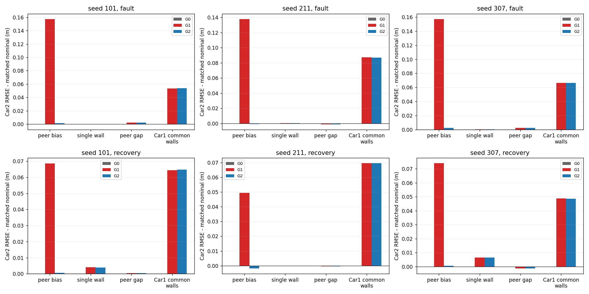

# 双车成熟门控基线：短报告

**结论：本批普通门控足以明显压制直接peer偏差，但不足以阻断Car1共同墙源错误向健康Car2传播。** 本轮没有观察到健康peer的已知q>3误拒绝；不需要扩大故障去制造它。这是成熟基线与已暴露seed开发诊断，不是新算法或正式独立验证。

固定读取基准`74fa210e7cf6aa322eaebce19530510edb605d22`。G0=原D0；G1=原D1，**其peer因子已经是pseudo-Huber**；G2仅加独立G0辅助图、同state/cutoff的新peer门控，q>3拒绝，unknown拒绝、missing另列。基础核、20s/六维联合状态、完整cross/affine prior、方向、sigma=.2m、外参、聚合和1s虚拟等待均未改。

45/45 DONE，0 FAILED/缺失/重复/额外；24条原结果精确SHA复用，21条新回放。15份输入、每单元63次联合发布，共2835次/5670逐车发布；每单元61次accepted、2次启动预测，三方法共同accepted共915个场景–seed–时刻。无求解/边缘化失败和实际Odom缺口；该可用率不是未知现场风险。全部有限与共同accepted均保留在[完整指标](review/metrics.csv)，下列故障/恢复段两口径相同，n=14/10；late n=16。XY主表为天线中心，base XY、两车yaw、相对天线XY与3D间距也全量交付。

## 直接peer偏差：普通门控有效

原[24,38)s Car1→Car2 +1.2m，三个seed均拒绝24–37s全部14个新peer，明显减轻原鲁棒图的残余传播。下表每格依次G0 / G1 / G2，单位m。

| seed | Car2 故障期XY RMSE | Car2 恢复期XY RMSE |
|---|---:|---:|
| 101 | 0.0190 / 0.1781 / 0.0220 | 0.0111 / 0.0788 / 0.0107 |
| 211 | 0.0132 / 0.1526 / 0.0136 | 0.0195 / 0.0696 / 0.0182 |
| 307 | 0.0187 / 0.1731 / 0.0186 | 0.0181 / 0.0898 / 0.0163 |

门控不是“从未协同”：G2保留故障前旧peer及联合prior，故障段不必与G0完全相同。工程q不含校准预测协方差，q=3不是NIS/保护级/规定误报概率。没有再加鲁棒损失，也不能把G1叫普通平方损失。

## Car1四墙共同+.30m：未越门限，仍传播

只改变Car1四墙原窗口，peer/Car2全部输入、运动、噪声与nominal逐条完全相同。辅助距离真值误差在故障段可达+.4209m，但三个seed的最大q仅2.0221/1.9550/2.0278，已知peer全部准入；G2几乎沿用G1的协同结果。

| seed | Car1故障期XY RMSE G0/G1/G2 | Car2故障期XY RMSE G0/G1/G2 | Car2恢复期XY RMSE G0/G1/G2 |
|---|---:|---:|---:|
| 101 | 0.2915 / 0.2154 / 0.2151 | 0.0190 / 0.0741 / 0.0742 | 0.0111 / 0.0746 / 0.0749 |
| 211 | 0.3231 / 0.2450 / 0.2451 | 0.0132 / 0.1018 / 0.1018 | 0.0195 / 0.0897 / 0.0897 |
| 307 | 0.3203 / 0.2415 / 0.2416 | 0.0187 / 0.0825 / 0.0824 | 0.0181 / 0.0645 / 0.0644 |

相对同seed nominal、严格同期比较，G2的健康Car2故障期XY RMSE增加+.0537/+.0870/+.0662m，恢复期增加+.0648/+.0695/+.0486m。G0同期Car2位姿数值变化仅约1.9–4.3e-7m，属于无peer联合停止准则量级，不应称实际传播。G1/G2反而改善Car1及相对位置：共同故障的相对XY RMSE由G0 .306–.335m降到G2 .153–.177m，间距由.294–.317m降到.122–.135m；这些真值收益不能抵消健康同伴绝对误差的代价。

这里出现的是**门控未触发的传播**，不是健康peer的高分误拒。公式上测距错与参照错都会影响一致性分数，但本轮没有实测到后者越阈值造成误拒，不能把候选机制冒称已出现。普通peer门控没有辨认/处理有偏墙源的职责，也没有给健康Car2的真误差提供上界。

## 分母、反例与代价

三个seed每个均为：正常61准入、2次启动unknown保守拒绝；peer_bias 47准入/14已知拒绝/2 unknown；peer_gap 48准入/13 missing/2 unknown。其它两墙故障均61准入/2 unknown。所有健康peer已知q拒绝为0，但正常健康约束**总拒绝2/63**，不可把unknown删掉后声称无准入代价。gap的14秒原缺测只产生25–37s共13个无聚合窗，边界窗有部分支持。

peer_bias按状态故障段漏过0/14；按“raw支持中含注入”口径则通过1/15，即38s的8/17混合边界，q=.056/.586/.057、聚合相对真值误差.012/.112/.019m，非完整+1.2m样本。完全故障支持窗均为0/13通过。两种分母及unknown均报告，不择有利定义，不把相关窗口当独立重复。详见[gate_counts](review/gate_counts.csv)、[混合边界](review/mixed_boundary.csv)。

正常协同并非每项更好：共同accepted 61时刻下，G2相对G0的Car2 XY变化约−.10/+.53/−1.54mm，yaw变化约−.034/+.176/+.025°，全部3seed均保留。单墙+1.2m及peer_gap的Car2增量主要为毫米量级、有正有负，未出现共同四墙场景那样的厘米级传播。共同四墙late的Car2 XY相对nominal在211/307略改善（−.00038/−.00074m），不是所有尾段指标都恶化；同期yaw RMSE却仍增加约2.19/2.23°。不以单点/单指标概括永续恶化。

故障38s结束后，38s混合raw支持仍在活动窗口直到59s前；59–63s虽已无直接故障raw留窗，prior仍有故障来源（共同四墙每臂60个直接墙因子祖先）。完整联合交叉和affine保留；临时拒绝从不清除旧历史。这里只证实来源与残留解并存，没有做prior回滚干预，不能独断其净影响幅度或称一律有害。

G2正常当前主图更新累计约.643–.645s、辅助约.506–.519s/63发布，辅助本身有明确额外成本；两张图各峰值126标量（合计252），非合成12维联合状态。完整新G2回放/日志记录约1.42–1.43s。G0/G1历史耗时分别注明复用，不作同期受控加速比。所有发布时间/队列是virtual，emit成本不含两Binner/全部I/O及最后元数据写出，不能写成实车实时延迟。

## 选题判断与核验边界

若选题只是这批直接peer +1.2m，成熟门控已经解决主要代价，应作为强基线，不能再以该收益声称创新。若目标包含在Car1共同墙源偏差下保护健康Car2，则值得进一步研究参照可信性/共享信息的责任边界：当前未越阈值也可发生明显传播。**本轮尚未证明任何新的可信性方法优于普通门控**，不能按本已暴露结果调阈值，也不能直接声称新算法或完整性保障。

10项门控合同、27项冻结回归、3项完整索引负测试、1项24旧cell无重放导出测试通过；首次旧CLI测试因无.git环境的3个元数据错误保留。分离公式读取器未导入估计器，独立核验2835接收窗、945辅助pose/prior=G0、876个已知q、3660目标代价、3780图prior链；仅抽首末120次消元做有限差分Schur，非全2520次FD。全部SHA/命令/来源/有限逐时刻数据与8张全seed图可取得。[方法](METHODS.md)、[交接](HANDOFF.md)、[大证据](ARTIFACTS.json)。

全部8张全seed同期图和来源图见[FIGURES](FIGURES.md)，全有限与分段补表见[TABLES](TABLES.md)。
