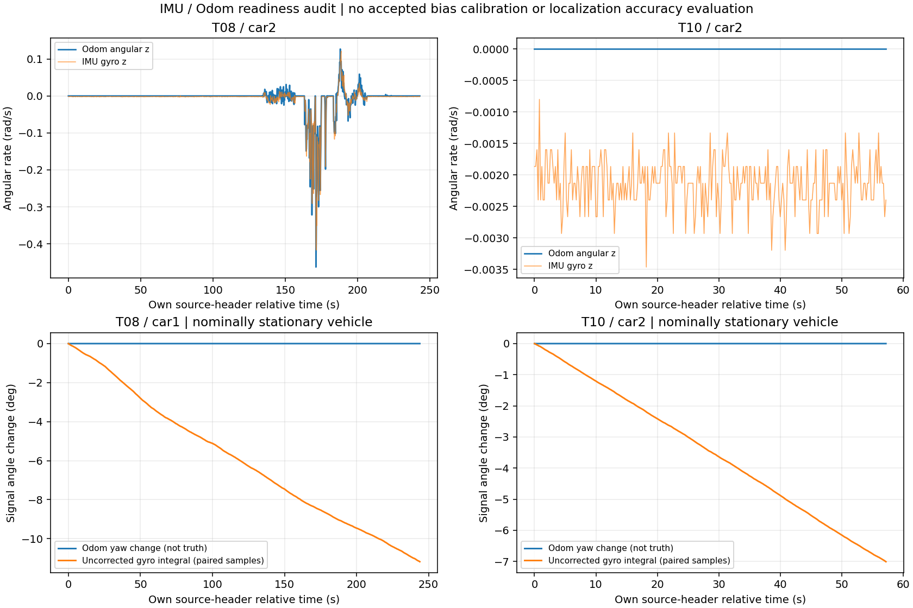

# 两车IMU/Odom审查：已经确认什么，怎样开始接入

对应历史[现场清单](../../20261024_SINGLE_CAR_CHECKLIST.md)第一、第二优先：实际启动/版本与Odom/IMU来源。该历史清单不是已执行证明，本轮没有追补勾选或改写历史记录。基准main为1c56e47784880862ac934385b64636845cedb342。

本轮只读取登记现场归档、T08/T10开发包及底盘源代码。16项相关测试通过，12,046对观测完成整数时间与一对一身份回读；T10全部4,619条IMU/Odom消息与PR51标准化表的原始记录/纳秒身份、全部IMU姿态/角速度/加速度及odom角速度逐值一致。没有访问小车、没有启动ROS/串口、没有运行或修改厂家程序，也没有实现/启用IMU融合。

## Car2：上位机代码路径已查明

归档car2_base_source.tar.gz SHA为1075a2dc3cb47bd260a9de34199e484e8256898eeb26f14b07ae65240c47f211，完整外层归档SHA及每个源文件SHA已重新核验。

- Robot_Vel.Z来自串口rx[6:8]，odom yaw由Robot_Pos.Z += Robot_Vel.Z * Sampling_Time积分，再转为odom四元数。
- IMU gyro_z来自另一个字段rx[18:20]，按GYROSCOPE_RATIO转换为rad/s；加速度另读字段并转换为m/s²。
- IMU四元数由陀螺仪和加速度计算，使用固定20Hz步长，积分反馈增益为0；这段代码未使用磁力计提供绝对yaw。
- 上位机没有直接把这份IMU四元数写入odom。但是MCU怎样算Robot_Vel.Z仍未知；不同串口字段、不同话题和高相关性均不能证明独立。
- 有robot_pose_ekf.launch且imu_used=true，不等于它在T08/T10中运行或这些/car*/odom就是其输出。bag连接的发布者保留在audit.json；没有按文件存在或名字含combined推断启用了EKF。

原归档缺Car1底盘源码，不能用Car2实现代替；两车历史运行二进制与源码/固件的精确绑定也未完整建立。当前源采集工具用于补齐可取得的版本证据，不能自动证明历史部署。

## 数据检查和新发现

两车IMU约20Hz；四组所有odom消息均在声明的2ms离线容差内配到唯一IMU消息。header差中位约30–48微秒，这只是上位机发布header接近，不是硬件同步/采样误差界，也不是在线准入策略。

| 数据 / 车辆 | IMU / Odom条数 | Odom有效间隔角度累加 | 未校正陀螺仪有效间隔积分 |
| --- | ---: | ---: | ---: |
| T08 / car1 | 4883 / 4879 | 0.00° | -11.19° |
| T08 / car2 | 4867 / 4861 | -92.61° | -125.58° |
| T10 / car1 | 1163 / 1161 | 1.66° | -6.42° |
| T10 / car2 | 1150 / 1145 | 0.00° | -7.03° |

角度积分分别在各源header自身的正向、≤100ms间隔计算，不把接收时间当采样时钟；两种流覆盖和缺口可能不同。数值是传感器输出，不是真实角度误差。T08 Car1及T10 Car2为实验安排中的静止车，未经独立连续视觉验收。

T08 Car2转弯时，gyro_z与odom angular_z的相关系数约0.969，诊断回归斜率约0.990、截距−0.00243rad/s。回归只用于描述两路关系，没有作为标定应用。静止车odom角速度常为0，相关性不可辨识，保存null而不是伪造为0。

T10 Car2原始gyro积分约−7°而odom角度累加为0；T08 Car1约−11.2°而odom为0。这支持对原始陀螺仪的低频偏移/零偏认真建模，不能原样增加强姿态约束。本轮5秒命令安静候选段只保存统计，**没有批准零偏或噪声标定**；接收端初始积压还会让5秒接收窗含有超过5秒源时间的数据。

图为配对样本的显示；积分表使用各流全部合格间隔，两者不强行插补成相同窗口。odom线不是角度真值。

两车加速度范数中位约9.75–9.79m/s²，与重力分量一致；Car2源码也未去重力。不应直接把这些值双积分为平面位移。IMU四元数范数中位约0.998313；本轮只在临时副本中归一化作诊断，原件保留。Car2快平方根实现中的long指针重解释存在需核对目标位宽/别名的可移植性风险，未将其诊断为实车故障，也未修改驱动。

发布协方差固定包含yaw/gyro_z的1e−6、其他角轴1e6和加速度全零。它们不构成已标定统计后验；ROS消息定义中加速度协方差全零代表未知，不代表测量无噪声。

## 接入决定

可以开始独立、默认关闭的IMU增量原型；先做**车体线速度 + gyro_z − bias**的平面传播，保留UWB观测。明确替换旧的odom角运动输入，不把原odom heading、IMU四元数和原始gyro再作为三份独立航向信息重复融合。应增加每车gyro bias状态及预登记工程过程模型；完整三维安装旋转、去重力和加速度双积分留到证据更充分时。

这不要求等待所有天线/视频标定才编写原型，但房间初始化/测距时钟/位置参考的未验收状态仍保留。下一步优先补Car1底盘源码和两车当前版本证据，检查gyro与车体Z轴约定；Car2转弯关系支持同号趋势，不替代实际安装确认。详见[接入计划](INTEGRATION_PLAN.md)、[当前来源采集命令](VM_COMMANDS.md)。旧三基线和PR54结果保持不变。

## 复现与来源

冻结执行源码d3439ebefc36eeee184131038b2f209838431cc4，16项测试为本审查6项+既有bag解析/校验10项。采集器在Python3临时fixture下实际验证打包和拒绝覆盖；Python2未运行，兼容性只作语法/接口审阅，未冒称车端实测。图及报告为后处理，不改变冻结审查。

复现命令见工具README；完整机器结果audit.json、带行号源码source_audit.json、全部配对pair_observations.csv.gz、PR51交叉核对和配对回读均在本目录。输入来自已登记Release，不需重复下载视频或录制路线。

官方语义：[sensor_msgs/Imu定义](https://github.com/ros/common_msgs/blob/noetic-devel/sensor_msgs/msg/Imu.msg)、[REP145](https://github.com/ros-infrastructure/rep/blob/master/rep-0145.rst)。后者为信息性草案，用来说明传感器坐标、重力及绝对yaw参考约定，不作为硬件符合性认证。
