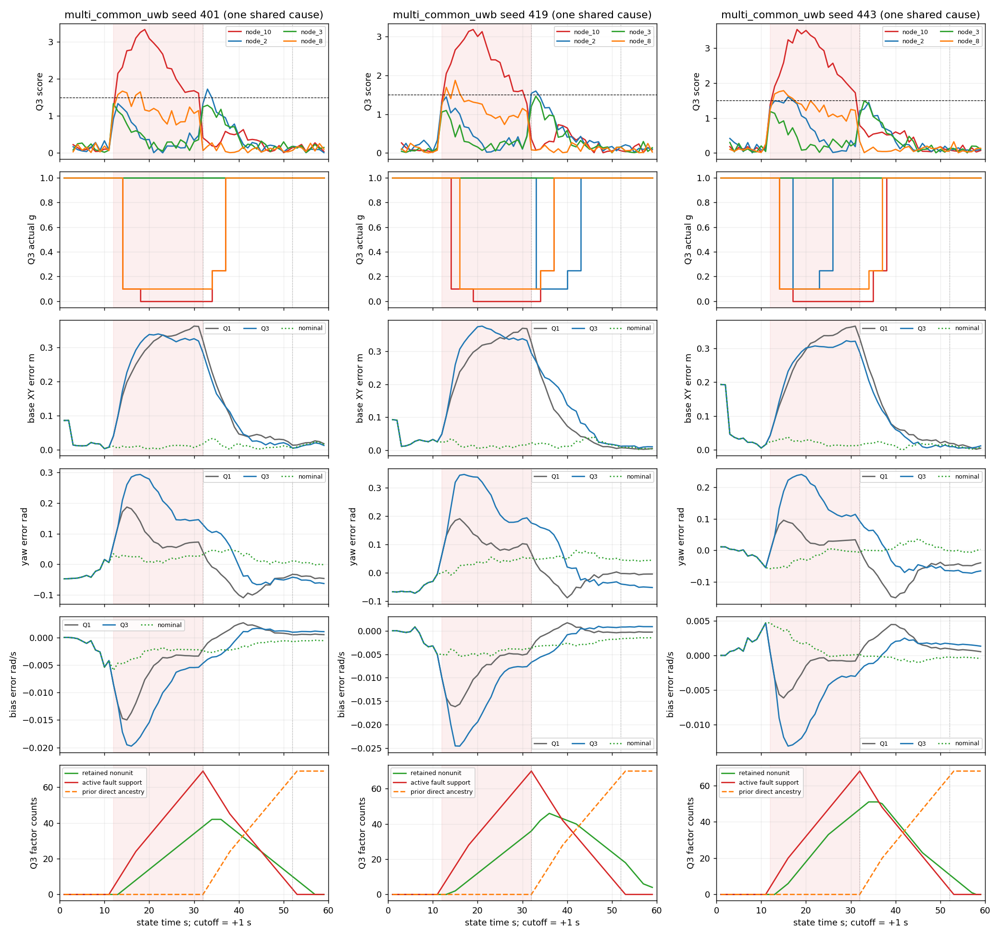
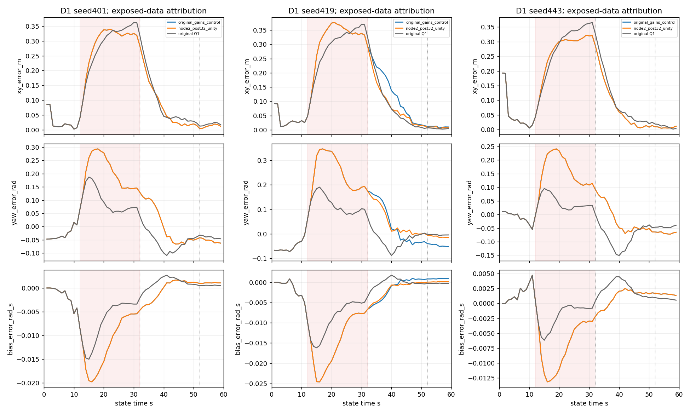

# 失效机制、反例与证据边界

阅读入口：[一页结论](CONCLUSION.md)、[逐事件表](EVENTS.md)、[干预登记](INTERVENTION_REGISTER.md)、[复核命令](COMMANDS.md)、[交接](HANDOFF.md)。图和紧凑结果在review，大证据按ARTIFACTS.json取得。

## 证据条件与同期定义

全部原始证据来自冻结执行`12a1d94379b58c5a759b1698425fb90d48587609`，非当前Git HEAD。完整归档SHA、每文件、96运行源码/配置及1298个复用validation文件匹配；原正式矩阵仍为96组，没有新正式验证。分析覆盖step/ramp/common的所有3seed及Q0–Q3，同时读取对应nominal完整输入和图；不是从汇总表推测。

9组输入对照逐记录核验：身份中的recipe/case不同，但header/receive整数ns、record_index、topic、Odom、gyro及非注入测距完全一致，真值压缩文件字节一致；改变值只等于登记的注入。recipe身份SHA不冒充文件字节SHA。原始events字节、config、源码及图文件SHA见外部verification.json；紧凑verification_summary和ARTIFACTS给取得方式。

每个图横轴统一为**状态时刻/原始测距header时刻**，原标签origin为零；关键帧实际为1.01、2.01…59.01s（回放origin是首条receive，比标签origin晚.01s）。分数、影子、主图首次倍率对齐同一state与`state+1s`接收截止；实际可获得时刻另列整数ns，不能混称当前保护。原始测距灰点和真值均只用于离线解释，未喂给检测器。触发前两帧、完整raw依赖、reference/main record ID、完整图与prior在`event_full_evidence.json.gz`。

重新核验135936个raw依赖、8496条实际入图倍率、4104个已知分数、4248份排除影子目标缺席/其余倍率1、6372条图previous链接及3762次prior链。另由独立规则重算4248次状态机与4248次sqrt(g)残差/J应用，90个全程指标与原值一致。F0不估bias；旧原生Q0缺逐消元详细字段，不能把其prior直接故障祖先计数0解释为无历史影响。Q1无质量factor ID，用同state/target重建ID并明确权重1；Q2/Q3和影子均用原ID。未发现重复缩放、目标链回流自身影子、未来截止或FSM实现与声明不一致的证据。

## 健康链：测距没有变坏，参照发生偏移

8次事件逐项见EVENTS。两次触发分数均≥1.5，连续计数warn=2，进入downweighted、实际g=.1；全部无健康链g0，随后低分持久性经g=.25试用再到1。不是把每帧计作新事件，时长按相邻实际availability，末帧不外推。Q2 step两次合计40.010224861链秒；Q3 step五次121.065614781链秒；Q3 ramp一次10.989941383链秒，吻合v1.1。

分数可分解为：

`corrected measurement − excluded prediction = (measurement − truth range) − (excluded prediction − truth range)`。

16个触发时刻健康测距误差−.03636～+.03658m；对应影子预测误差约−.40304～+.32456m。每个事件对应nominal同一时刻分数远低于1.5，健康scalar完全相同。故障node_10却仍在健康目标的影子中以g=1消费，8次触发时主图node_10的g为0/.1/1均有，影子node_10仍是1。这是跨链污染的直接数据和成对因果对照；不是主图后验残差反馈造成的连锁检测，也不是健康测距新增注入。

更准确的路径是：node_10原始故障→其他目标的排除图估计/历史prior偏移→对该健康目标的预测偏移→工程分数连续高→主图健康因子被削弱。每张影子保有自己的历史/先验，并不相互消费另一张影子的输出。排除node_10的自身影子不受node_10输入值影响；排除健康node_2的影子仍消费node_10，这两个结论相容。

反例完整保留在counterexamples.csv：step的Q2在401/443没有健康链误降权；ramp的Q2三个seed全部没有；node_8在所有单链场景均无误降权。因此“影子暴露于故障”不是“必然越阈值”。Q3和Q2具有不同角约束/估计自由度，其影子偏差方向和持续性不同；不能仅因Q3事件更多就判定存在代码错。

ramp/443的node_2在39.01/40.01s分数1.666/2.037，测距误差−.02886/+.00434m，而影子预测误差−.36211/−.40304m；40.01s才进入误降权，故障已结束8.01s，主图node_10已恢复1。此时影子窗口仍有故障raw支持因子，同时已有直接故障因子进入prior；日志足以证实两条历史路径均在，不能仅靠同期相关性分配它们各自造成多少误差。59.01s的prior-only干预进一步证明末期prior的条件效应，并不能倒推40.01s误报完全由prior独自产生。

## 共同故障：全部三个seed与yaw–bias机制

每seed是一个四链同源+.30m原因，跨链与跨帧均相关。全程59个有限输出均计入，含两次启动预测；无unknown/失败剔除。全程数值见CONCLUSION，阶段数值见下面的RECOVERY表和review/periods.csv。401/443的位置改善、419位置恶化；三个seed的yaw/bias全程均恶化。不能说两个位置改善抵销一个失效。

14.01–31.01s，三个seed的node_2/3测距误差均约+.295～+.303m，而排除node_2/3的预测也吸收同方向偏差（例如401约+.262/+.279m、419约+.259/+.293m），差值小不表示链健康。node_10影子预测误差却为负，node_8吸收较少，因而node_10/8优先降权，node_10之后g0。443另有node_2在17.01–26.01s短暂动作；401无此动作；419在故障结束后33.01–43.01s才动作。这些不同的时序共同决定图内信息分布，不是4次独立检测实验。

以原主图states和名义模型独立重算当前UWB的`Σ g·(原伪Huber导数)^2·h_xy h_xyᵀ`：故障段14.01–31.01s最小特征值Q3/Q1中位数401=.142、419=.143、443=.105。它是局部目标曲率比，不是标定协方差或可外推风险。一个天线的瞬时测距yaw列恰为XY两列乘旋转杆臂导数，不能给出独立yaw约束；yaw需通过运动和gyro/bias跨时约束。削弱部分已偏置墙约束会改变位置–yaw折中，并使gyro residual可由bias吸收。

同段`wrap(Δyaw−gyro_angle+b_left·dt)`平均绝对值Q1→Q3分别约.000161→.000135、.000160→.000131、.000202→.000137rad；gyro输入相同且真实bias=0，Q3真yaw/bias却更差。两组的yaw增量变化与`−Δbias·dt`之差最大仅.000083/.000169/.000229rad。这给出错误自洽的机制证据，而不是声称gyro真的发生漂移。日志中的prior也保留XY–yaw、XY–bias、yaw–bias交叉项，既有角因子和边缘化足以传递这一折中。

**419的位置退化不能只归因恢复尾段。** 故障期间XY RMSE已由Q1 .29699升至Q3 .32025m；结束0–20s又由.13292升至.15645m。D1仅取消node_2在32s后抑制，控制354个状态行通过、401/443严格无效应，419故障段完全不变，恢复0–20s降至.12291m，全程降至.20068m但仍差于Q1 .19044m。故晚发抑制是可确认的部分原因；故障段的选择性降权与状态折中仍占剩余退化，未把其细分为各链贡献。

## 残留：当前策略、冻结窗口、prior、真实误差分别看

结束后0–20s按[32,52)；20s以后按[52,60)，实际样本分别20和8。边界32.01s的±.4s聚合仍含部分注入raw；52.01s窗口仍留该聚合，直到53.01s才完全无注入raw支持。不能把52s当自动清零点。

Q3所有链当前倍率永久恢复1的状态时刻：step401/419/443为49.01/48.01/51.01s；ramp为37.01/37.01/51.01s；common为37.01/43.01/38.01s。这里是**离线检查剩余全尾段**的首次时刻，不是当时在线已经确认；available时刻另列recovery.csv。不同于v1只评价注入链的约37s恢复，健康链误动作可拖得更久。

首次倍率冻结不回溯。59.01s时step Q3的非单位倍率旧因子仍有13/12/12条，ramp443有11条，common419有4条；它们即使raw已健康、当前策略已1，仍改变目标函数。无此类旧倍率时，prior仍可能保留历史影响。

D2预登记14个59.01s快照、28次优化：原prior控制重解吻合，有限差分Jacobian检查通过；8个健康影子当前因子已与nominal数值相同，仅替换prior后全部回到对应nominal解（末状态最大差<5.1e-7）。共同故障Q1/Q3的6个主图中，5个当前倍率也已相同；419/Q3仍有4条旧node_2倍率，因此只解释prior替换的条件效应，不能宣称整个目标已还原nominal。原始raw已全退出窗口而prior-only仍改解，直接否定“经过20s就无历史影响”。

prior直接故障祖先是**来源计数，不是影响幅度或因果比例**。状态被全窗优化带偏后，即使最早直接故障因子尚未消元，也可能通过改变线性化点/伪Huber导数影响新prior。主图32.01s的prior已不同于nominal，但直接故障祖先仍0；33.01s起才逐步消费12.01s等直接故障支持因子。此后先验链不断继承，没有按20s自动遗忘。

反例：419/Q1末时刻yaw误差−.00417rad，换nominal prior后+.04441rad，反而更差；443/Q1换prior后位置约.00439→.00713m也变差。nominal本身有噪声，历史偏差可能偶然抵消误差。prior替换是机制试验，不是可在线取得的安全修复，不能据此宣称prior污染总是有害或已找出最佳重建时间。

## 已知、候选和未知

- **直接支持**：健康scalar未变而影子偏移；自身目标排除成立但故障仍在其他影子；声明FSM与一次sqrt(g)实现吻合；common选择性抑制造成较弱局部信息并允许yaw/bias错误自洽；419晚发node_2动作贡献部分恢复退化；末期prior确实仍改解。
- **有依据但未独立量化**：每条故障链在多链场景的边际贡献；Q2/Q3影子历史自由度各占多少；早期状态折中、伪Huber线性化、prior affine/曲率各自对40s误报或419故障段退化的比例。未运行额外拆分试验，不用相关性填补这些量。
- **未知**：真实多径/时钟/轴向误差中的可识别性、跨主机/实包收益、长期误报率，以及在线何时信任哪个参照或重建哪段prior。有限60s不提供更晚恢复时间；null为未观测/不适用，不填0。

本轮未确认新的v1代码缺陷，因此无最小代码修复或受影响代码版本扩展。暴露的是冻结设计的边界。诊断读器开发遇到F0 bias=null、原生Q1消元缺少质量ID/weight字段及Q0缺详细链字段，已在新读器中按真实schema区分；失败日志保留，未补造原日志字段、未修改v1。

## 下一版：只建议两项

1. **把受污染参照的冲突显式列为unknown候选依据。** 当前只检查数值秩/XY几何，不保证其余链无偏。新版本研究“多种排除参照不一致或共同偏移不可辨识时不作单链归责”的保守规则，保持unknown、缺测、健康不同。先冻结可观测输入和规则；以未暴露seed分组比较nominal误降权、单链检出延迟/漏检、共同原因整车XY/yaw/bias及unknown链秒。不能按本轮16个触发点调阈值，也不能保证多排除后仍可观测。
2. **将来源追踪延伸到有界历史重建与恢复判据。** 试验新版本重新读取未污染/重新判定的历史并重建prior，而非只恢复当前g或直接丢prior。先用合成有界受控故障证明不重复消费、不遗失交叉/affine、接收前缀因果和正常退化限度；与只恢复倍率的冻结v1作未暴露seed配对，按结束0–20s、>20s分别评位置/yaw/bias、稳定性、删失及成本。来源祖先不等于可在线识别污染，不能用真值决定回滚。419/Q1的误差抵消反例和443/Q1位置反例必须纳入验收，不能只验改善案例。

这两项是后续独立研究设计，未在本分支实现策略或搜索参数。

## 合并前导出口径修正

旧诊断读器将缺失bias作为0参与误差计算，属于诊断导出错误，影响Q0/Q2时序、Q2快照和两张Q2图中的伪零线；不影响冻结v1原始证据或Q1/Q3数值。现按显式`is None`判断：缺失bias与bias_error保持null/CSV空值，真实估计0.0仍计算与真值的差。所有派生数据已从原日志及原保存诊断解重新导出，未重跑96组、6次主图重建或28次快照求解。详见[导出修订记录](EXPORT_SEMANTICS_REVISION.md)。
