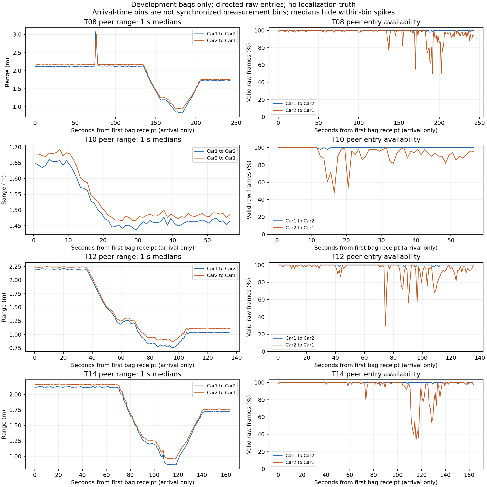

# 双车 UWB 离线接手交接（2026-10-26）

已完成资料复核、八包标准化/时间诊断、四个开发包观测分析和合成适配验证。当前结果支持观测诊断与接口验收，**实包定位比较仍受科学依赖阻塞**，没有新定位精度结论。

## 版本与保护

初始仓库 `/workspace/uwb-coop-localization-ros1` 为 `work` 分支，HEAD=`f14f8bd7c2a33c96f759919b50dff9cc00580014`，工作树干净。只读核对本地分支、worktree、远端全部分支和PR；当时没有开放PR，PR44已合并。fetch确认远端main为交接提交 `988a2d79cc2094485151a4f23850ec73c7c97d30`，据此建立本端独立worktree与分支 `analysis/20261026-sandbox-takeover`。原检出HEAD/分支未切换，未reset/clean/stash、删除旧锁或操作旧远程进程。本环境未见旧夜间进程，不能判断另一远端是否仍运行。

实际工作树 `/workspace/work/uwb-sandbox-20261026`；本端新数据根目录 `/workspace/work/uwb-handoff-20261026/data`，新日志/结果根目录 `/workspace/work/uwb-handoff-20261026/`。这些是本次机器上的位置；复现命令使用自行指定的外部目录。所有正式启动都使用新目录，没有用 `--resume`。先跑交接代码基础回归，开发后重跑以验证新增代码；不将各阶段预算重新累加成多轮6小时。各阶段准确commit/源码/配置/输入/输出哈希见 [source_versions.json](source_versions.json)。主代码验收版本为 `33f1991dd6f571c40fdd3a550440629bb92414bc`，其后的提交只整理本报告和入口。

## 实际完成与验证

| 项目 | 结果与证据 |
|---|---|
| 隔离依赖/原件 | Python 3.12.14，NumPy 2.2.6、SciPy 1.15.3、Matplotlib 3.10.9、rosbags 0.11.9；完整pip freeze随结果保存。38,399,544字节归档SHA=`b7cec6f75584e583e66946fd669dc7495d10e3bcbebc0b67fa480b65b53fd1bf`；prepare下载校验/安全解压及八包独立SHA均通过。 |
| 基础及最终回归 | 初始132项通过。主代码最终14/14作业、166项测试通过（原132项＋新增34项）；每项单次成功，无未解决失败/超时。[摘要](REGRESSION_SUMMARY.md)、[本轮工具73项日志](FIELD_TESTS.log)。 |
| 八包完整QC | 311,144条消息、52,758个Car1 Frame3校验通过，T10明确使用184755 retry。raw/bridge配对无距离或条目数不一致。 |
| 标准化导出 | ranges 1,044,751行（raw主观测522,787行，其余bridge不重复计量）；frames 210,261行；odom 42,078行；imu 42,152行；commands 13,076行。[分包计数](counts.json)。 |
| 独立回读验收 | 不调用导出转换函数，重新解码原bag，比较全部1,352,318行、40组typed字段签名及计数；全部匹配。覆盖距离/RSSI/quality、整数接收/header/设备时间、frame、姿态/速度与协方差。[证据](export_verification.json)。另有篡改距离与1ns时间偏移的失败检测测试。 |
| 时间与开发包诊断 | 所有车辆/话题时间间隔、负差、设备回绕/重置候选分开保存；仅T08/T10/T12/T14做原始链路、1s固定窗、RSSI/距离变化、到达批处理与双向peer差。[时间摘要](time_summary.csv)、[完整开发统计](development_diagnostics.json)。 |
| 合成适配 | raw-only、按到达时刻因果门控、Odom不使用未来插值/不读z为高度；独立车解相互隔离；3D斜距/lever-arm、反向里程、缺链路与局部退化测试通过。三方法60条状态/30次单步比较仅来自无噪声合成夹具，无实包调参。 |

所有epoch ns保留整数，CSV不经浮点读写。raw/bridge以车辆和精确header配对，原始record_index/link_index保留。空帧/缺peer单列frames表；非有限量写空或JSON null并注明原因，有限非正距离保留原值并标无效。Car2 odom.z为`driver_yaw_related_not_height`；原frame及协方差保留，不预填room对齐。Car1 packet时间按uint32核对，Car2 local_time按嵌入uint64原值保留，不将未知packet宽度或符号解释当成已确认。

## 关键观测及解释范围

| 开发包 | C1→C2有效raw帧% | C2→C1有效raw帧% | C1减此前最近C2距离中位m | P05/P95 m |
|---|---:|---:|---:|---|
| T08 | 99.79 | 96.73 | -0.0450 | -0.1290 / 0.0300 |
| T10 | 99.93 | 92.12 | -0.0270 | -0.0930 / 0.0430 |
| T12 | 99.72 | 94.98 | -0.0600 | -0.1430 / 0.0080 |
| T14 | 99.79 | 94.97 | -0.0460 | -0.1200 / 0.0290 |

分母为raw帧，与既有QC用bridge帧得到的百分比略异。双向差最大到达年龄30ms，允许一个C2条目对应多个C1条目；未声称采样同步/统计独立，不可据此校准偏差。各墙链路、RSSI与逐条跳变统计完整保留；例如T08 Car2 peer相邻有效条目最大下降约2.709m，提示需要对照视频/原始时序，不能自动定为NLOS或删除。

设备system_time全部相邻增量20ms、未见非正增量；header无重置/重复。raw接收-header中位数随包和车辆变化，例如Car1在T08为−8.791ms、T10为+3.663ms、T12为+15.487ms、T14为−35.917ms。负差和短间隔批量到达与时钟/调度混合，未套固定网络延迟，也未将接收间隔当无线掉包。canonical时间仅是同包首条接收起算的到达轴，设备与视频时间映射仍未验收。



图为1s中位数与实际raw帧比例，不能显示所有窗内尖峰，不是同步轨迹或真值。脚本 [plot_development.py](plot_development.py) 可重画；绘图运行时该新脚本尚未提交，已如实保存dirty=true及脚本SHA，数值阶段均在各自干净提交运行。

## 失败、阻塞与后续接口

没有未解决的执行失败。四个开发包的实包定位比较均标为 [BLOCKED](field_readiness.json)：base_footprint到天线外参未独立建立，room初始化/测量时钟关系未验证，独立视频参考尚未验收；T12额外缺实际初始XY，禁止由终点反求。T14实际遮挡材料/位置/时段未知，未按sleep反造阶段、未整包贴NLOS。合成参数只存在明确标记的synthetic配置中，不能用于新数据现场标定。

协调/视频端需回传契约规定的每片`frame_transforms.json`、`time_mapping.json`、独立P/Q验证与`reference_validation.json`，以及刚性标记/车体/天线关系及不确定性；若只通过停点，就只交checkpoints。另需T12实际起始几何及T14现场遮挡说明。T09/T11/T13/T15始终整包留出，只做健康/格式检查，没有计算其定位误差或据此选阈值。未启动车辆、ROS或串口，未修改原始数据、公共manifest/geometry或Release，不自动合并PR。

## 复现与结果位置

在本分支的仓库根目录执行；变量请设为新的Git外绝对路径，不能指向其他端已有输出。依赖安装可复用入口说明：

```bash
python3 -m venv "$VENV"
PYTHON="$VENV/bin/python"
"$PYTHON" -m pip install -r tools/field_20261024_25/requirements.txt -r tools/requirements-integrity-feasibility.txt
"$PYTHON" tools/field_20261024_25/prepare.py --data-root "$DATA_ROOT" --assets bags --extract
"$PYTHON" tools/field_20261024_25/run_nightly.py --data-root "$DATA_ROOT" --output "$OUTPUT_ROOT/nightly" --max-hours 5
"$PYTHON" tools/field_20261024_25/normalize.py --data-root "$DATA_ROOT" --output "$OUTPUT_ROOT/normalized"
"$PYTHON" tools/field_20261024_25/audit_exports.py --data-root "$DATA_ROOT" --normalized "$OUTPUT_ROOT/normalized" --output "$OUTPUT_ROOT/export_audit"
"$PYTHON" tools/field_20261024_25/development.py --normalized "$OUTPUT_ROOT/normalized" --output "$OUTPUT_ROOT/development"
"$PYTHON" tools/field_20261024_25/comparison_adapter.py --output "$OUTPUT_ROOT/synthetic"
"$PYTHON" docs/field_tests/20261024_25/sandbox_20261026_takeover/plot_development.py --development "$OUTPUT_ROOT/development" --output "$OUTPUT_ROOT/figures"
```

本次实际完整结果在 `/workspace/work/uwb-handoff-20261026/results/`，每个新计算阶段有run.json、源码/配置/输入/输出哈希、运行耗时与状态；runner另有tasks.jsonl及逐项stdout/stderr。本端日志在其父目录的各`.log`。原件在独立data目录；约492MiB标准化表和逐窗CSV不入Git。下载结果包包含完整结果/日志、代码补丁与git bundle；不含原始bag/视频、venv或下载缓存。包的SHA256及最终分支提交由下载目录SHA256SUMS和交接文件登记。本目录仅保存紧凑证据；完整time_diagnostics.json、CSV和各阶段run.json以结果包为准。
