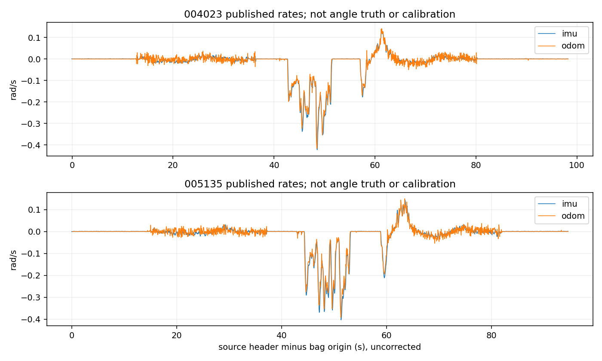

# 历史单车IMU因子图：B端输入与旧版复现

本轮执行用户的FGO更正，主线为现有20秒固定窗口因子图。旧EKF输入工具草稿已保存到独立分支提交`6b96801`，没有删除，也没有继续EKF实验。本分支从`112586ceb9ce674a083fb43f7d8afb7768a15aaf`建立，只修改B端新目录。

**已完成第一阶段：真实IMU输入、旧版复现和独立回读。F1–F3尚未执行。** 原始开发包只用004023、005135，SHA与更正文件及旧协议一致。无需下载视频、历史数据副本或访问车辆。它们是已使用的开发数据，不是新盲测。

## 输入与时间覆盖

输入包保留原始物理记录序号、到达顺序、话题/连接、整数header/receive ns、原始消息字节SHA；运动/UWB保留全部字段与协方差。所有记录均保留到达时钟节奏，包括不作为因子的other记录。另给出与旧入口一致的事件视图：旧IMU事件仍是占位，真实gyro/姿态/加速度在新的富字段流中；未把占位误作融合数据。

| 包 | 总记录 | Odom | 真实IMU | UWB帧 | 其他 |
|---|---:|---:|---:|---:|---:|
| 004023，原N10异常包 | 10,672 | 1,966 | 1,968 | 4,908 | 1,830 |
| 005135，原正常完成包 | 10,322 | 1,891 | 1,894 | 4,722 | 1,815 |

两流约20Hz，UWB约50Hz。按继承的未校正源时钟政策，004023的96个、005135的92个原发布区间，均有在`t+1s`截止前到达的IMU左右边界样本，诊断支持间隔未超过100ms。重复、倒退、接收积压及原始ns覆盖详见[diagnostics.json](results/diagnostics.json)与归档内逐区间CSV。100ms只是预声明的诊断门槛，不是IMU误差界或A端积分准入；没有删除缺测窗。

全部UWB帧的`quality`源字段为NaN，而距离有效。最终输入002将其保留为null及原字段路径，另标`measurement_numeric_status=required_values_finite`；不填零质量、不因此剔除测距或改权重。输入001保留在云端。两版旧事件视图压缩字节完全相同，[修订凭据](results/packet_revision_equivalence.json)确认没有因此重跑图优化。

header与receive仍是原记录域，不将其差解释为网络延迟/时钟偏差。发布角速度是ROS消息中的rad/s，可能已有MCU处理；不是未经处理ADC原始值。安装Z轴、采样时刻、固定协方差和零偏均未变成已标定事实。四元数/加速度仅保存诊断，不作绝对房间yaw或加速度双积分。

曲线接近不证明两路独立，也不是角度真值。新模型未运行，bias轨迹及其可观测性结论为空。

## 旧因子图复现

直接运行未修改的`run_single_car_fixed_lag.py`原三组对照；沿用20秒窗口、1秒关键帧/等待、原测距聚合/P1修正/外参/权重、初值和既定停止窗。NumPy2.3.5、SciPy1.17.0、rosbags0.11.8与原冻结依赖一致，BLAS/OMP单线程。旧模型将近似几何中心当作odom参考点仍是条件假设；不把后来场次的修正移植到这些历史包，也不把旧P1移植到T08/T10。

| 包 | 组 | 发布/图接受 | 求解失败 | 回放实耗s | 最大求解状态 |
|---|---|---:|---:|---:|---:|
| 005135 | 原全历史冷启动 | 92 / 90 | 0 | 3.976 | 92 |
| 005135 | 解析全历史热启动 | 92 / 90 | 0 | 3.079 | 92 |
| 005135 | 原20秒固定窗口 | 92 / 90 | 0 | 0.802 | 21 |
| 004023 | 原全历史冷启动 | 96 / 94 | 0 | 4.368 | 96 |
| 004023 | 解析全历史热启动 | 96 / 94 | 0 | 3.202 | 96 |
| 004023 | 原20秒固定窗口 | 96 / 94 | 0 | 0.864 | 21 |

共564行，含每组前两个预测启动状态；没有只保留552行图接受结果。所有组的发布时间、状态、聚合输入与归档一致，发布姿态最大分量差为0。固定窗口消元前瞬时最多22帧、求解最多21帧；这里仍是旧三维/帧，不冒称已验证四维/帧的84变量模型。原程序的30秒prefix检查实际执行并通过，包含真实边缘化。

原20秒组在冻结人工停止窗内的天线点中位数与人工末点差为：005135约0.047815m、004023约0.126884m。这是已有协议下的不确定度未知的开发停点诊断，**不是连续定位RMSE、精密真值或IMU收益**；它们没有用于选参数。各组完整耗时、初次跳变、常规修正、状态与终点窗统计均在归档原`comparison.json/updates.json`中，未删除异常包或预测启动段。实耗差异来自当前环境，不能替代车载实时或硬截止期验收。

## 独立核验与负例

- 导出器使用rosbags；独立原包核验使用另一个既有ROS1字节/嵌入schema解析器`field_20261024_25/bag_decoder.py`，全量核对20,994条身份和运动/UWB字段，包括协方差、非有限值、原消息SHA。没有导入在线图优化器或其Jacobian。[结果](results/packet_readback.json)
- 独立回读全部564行，按原始输入重新构造已到达Odom插值、±0.4s中位数/支持数和1秒发布截止；另与原归档逐行比较。读取器不调用图优化器或其评价器。[结果](results/baseline_readback.json)
- 对私有副本故意改gyro符号/单位、协方差、漏IMU、重复、浮点epoch、伪造未来接收身份和乱序，并重新封装文件哈希；8组均被原包回读拒绝，证明检查并非只看压缩文件SHA。原始输入未改。[负例](results/negative_checks.json)
- 当前25项B测试＋15项原固定窗口＋10项原顺序回放，共50项不同单元测试通过。边缘化检查器的四维随机线性fixture、航向来源和完整覆盖分母测试通过，**不代表A端尚未提供的F2/F3已通过**。

## 下一阶段条件

[旧航向静态审计](LEGACY_HEADING_SOURCES.json)确认：第一状态用冻结外部+Y先验，随后新帧预测、优化初值、第二启动状态和失败预测会使用旧Odom角增量。仅替换Odom yaw残差不足以保证F2/F3没有隐藏依赖。原平移量的body表达也用Odom yaw，必须继续披露其上游关联。

已准备[A端回读要求](A_READBACK_REQUIREMENTS.json)：四个航向来源阶段、显式odom回退及单列结果、完整位置/yaw/bias先验与仿射残差、消元常数/秩、incident/retained因子ID，以及全部依赖到达时间。独立Schur核验器检查给定线性化系统的Hessian、梯度和常数；非线性残差/数值Jacobian与真实gyro积分要等A冻结定义后另作绑定，不能据此假称完整目标函数已验证。

F0–F3必须共享平移、UWB、初值与评价口径；同时给全发布分母、失败/缺测/回退和共同有效时段，不把缺IMU段从总结果消去。到本阶段检查时，远端未见可消费的A端FGO冻结交接，因此F1–F3、新bias轨迹与新四维边缘化实包结果均**未执行**，不是执行失败。不另写优化器或空等；交付本阶段草稿PR，A交接后在新的干净组合执行树继续。
