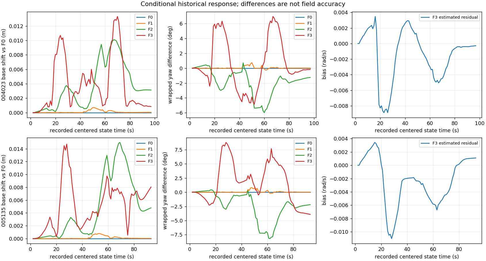

# B端：历史单车20秒IMU因子图闭环

004023（原N10异常开发包）与005135（正常开发包）的真实IMU整理、旧版复现、F0–F3条件性比较及独立回读已完成。**这是同输入下的模型响应核验，不是现场精度验收。** 没有第二套定位内核，也没有把EKF结果当FGO。

A使用PR58的冻结执行提交`e3a20fe04a6d53973696ec055dbc71eb135e0f77`；B适配器/八运行协议预先冻结于`db36166`，干净组合执行提交为`f00c8743ac9c47d967817af448d3cd3fc80e8b79`。A后来交付提交`5dd0a54`只增加合成报告，核心/协议未变；本端未重复其96次合成矩阵。PR57已合并，B草稿PR目标main，依赖A的PR58，不自动合并。

## 输入与固定条件

| 开发包 | 原消息 | Odom | 真实IMU | UWB帧 | F0–F3各发布数 |
|---|---:|---:|---:|---:|---:|
| 004023 | 10,672 | 1,966 | 1,968 | 4,908 | 96 |
| 005135 | 10,322 | 1,891 | 1,894 | 4,722 | 92 |

原bag SHA分别为`72d4a051005b0b109461842b6489aa2d07b08dd6f6e750c4b9a82aac8d8e1d82`、`63880adf78d5f07a9b12a87f7352f49e8f7be82d223bcdf60d96e257ba38b2ff`。20,994条身份、整数header/receive ns、原始消息SHA与融合字段已由独立字节解析器全量回读。保留其他话题的到达节奏、完整IMU三个角速度/协方差；orientation/acceleration不参与图。UWB原quality=NaN，保留null与来源路径，不改为零或删掉有效range。最终选`inputs_002`，001保留，两版旧事件流逐字节相同。[输入诊断](results/diagnostics.json)、[阶段1复现](STAGE1_REPORT.md)。

所有臂共享同一实际到达流、原Odom pose平移、历史几何/P1、外部初始先验、20秒窗口、1秒关键帧/等待、±0.4秒聚合、每链至少5样本及原优化预算。F0原角增量；F1 Odom角速度按新规则积分；F2 IMU积分且bias固定0；F3估计残余bias及随机游走。没有双叠Odom yaw和IMU角因子。

[参数证据表](PARAMETER_EVIDENCE.md)区分历史冻结参数与新工程假设。真实frame标签为`gyro_link`；“gyro +Z等于车体+Z”、header原epoch身份映射和A冻结噪声都**未经过历史物理标定**。严格物理分支继续BLOCKED，只有另列的条件探索执行。时钟API要求非负整数uncertainty，配置中100ms仅为显式未验证接口量，不是测得或假定可保证的误差上界；A映射/权重不使用该字段，物理界仍为null。近似几何中心→天线的历史[+.12,−.08]m不冒称物理base外参，不混入10/24后修正或T08/T10。

## 全覆盖与共同有效结果

八个名义CLI全部完成，共752条发布：全部有限；736条图接受，16条启动预测。两包各臂均0求解失败、0角增量缺口、0 Odom角回退。共同有效按四臂`estimate_valid`交集定义，不能以“有限坐标”替代。

| 包 | 每臂发布/有效 | 每臂启动预测 | 四臂共同有效 | 求解失败/全分母 | 缺角/回退 |
|---|---:|---:|---:|---:|---:|
| 004023 | 96 / 94 | 2 | 94 | 0 / 96 | 0 / 0 |
| 005135 | 92 / 90 | 2 | 90 | 0 / 92 | 0 / 0 |

下表是**相对F0的输出变化**，不是相对真值的误差，也不表示改善。完整全量与共同有效统计均在[summary](results/FGO_summary.json)，全部752个时刻在归档`FGO_report/publication_diagnostics.csv`，未筛选好片段。

| 包 | 臂 | 全量最大base变化m | 全量最大wrapped yaw变化deg | 单次更新p95 ms |
|---|---|---:|---:|---:|
| 004023 | F0 | 0 | 0 | 7.85 |
| 004023 | F1 | 0.000704 | 0.746 | 18.61 |
| 004023 | F2 | 0.010099 | 5.987 | 19.89 |
| 004023 | F3 | 0.013328 | 6.970 | 26.24 |
| 005135 | F0 | 0 | 0 | 7.62 |
| 005135 | F1 | 0.000799 | 0.799 | 19.51 |
| 005135 | F2 | 0.014993 | 8.187 | 24.70 |
| 005135 | F3 | 0.014731 | 8.778 | 25.10 |

F3零偏范围：004023为[−0.008878,+0.003480]rad/s，最终−0.000281；005135为[−0.011022,+0.003430]rad/s，最终+0.001093。它们是模型估计轨迹，既不证明真实零偏，也不证明可观测性。F1/F2的零是固定设计，F0无bias状态。初次接受的修正/相邻发布跳变、冻结停止窗内绕自身均值散布、全部耗时/虚拟排队均保留；停止窗散布不等于精度或独立停车确认。原人工终点没有参与新模型配置、评价参考校准或选参。

F3求解最多21帧84变量，消元前瞬时22帧88变量；F0–F2为63/66变量。实耗来自云端单线程，1秒等待另计；不是车载实时或物理延迟保证。小位置变化、大航向变化及有限bias不应被解释为精度提升。

## 独立核验范围

- 旧三组图两包共564行与旧归档完全一致；新F0两包188行也完全一致，最大姿态分量差0。不是仅比末点。
- B读取器不导入A图、Objective、解析Jacobian或A audit。逐行核对原始输入适配、Odom插值、UWB原始中位数/支持数及截止，独立重积分558段关键帧区间/11,718个左保持片段。所有依赖在原1秒截止前到达。
- F1–F3每次求解552个cost及F0两个终图cost独立重算通过；全部438次消元做B自己的有限差分/Schur投影，检查完整Hessian、梯度、affine offset、丢弃常数与先验链。最大信息矩阵绝对差6.67e−8，cost差1.43e−14。旧节点只消元一次，最老UWB/首平移/首角+bias/旧prior被消费，保留节点UWB不进入消元子图。[完整回读](results/FGO_readback.json)
- F2/F3启动使用声明外部航向；新关键帧/优化新增初值使用上个状态＋gyro−bias；缺角保持yaw；求解未接受时保留同一预测。逐时刻数值核对并结合固定源码审查，无隐藏Odom角回退。活动窗口完整warmstart向量没有独立字段，依赖固定源码检查，不能冒称逐元素日志核验。**原平移的body表达仍使用上游Odom yaw**，该关联没有消失。[航向与因子记录](FGO_SOURCE_AUDIT.json)
- 将每包接收到41秒处截断，按原EOF政策实际运行八个因果控制；每个发布38条，全部304条非耗时字段（包括prior/窗口与消元证据）与完整输入完全相同，包含真实边缘化，没有未来回写。[结果](results/prefix_verification.json)
- 六个重新封装SHA的故意损坏结果副本，gyro符号、未来依赖、隐藏yaw、bias交叉信息丢失、affine丢失、重复保留UWB，均被语义检查拒绝；原结果不变。[负例](results/FGO_negative.json)。阶段1另有八组原包负例。
- 本端执行B 33项、新A 43项、旧固定/顺序25项单元测试，均通过；A自身原37项/正式96次合成只引用其交付，不重复计为本端执行。未出现模型或检查失败；开发回读001记录未提交开发态，正式选ed08c1a的002，二者均保留。

完整命令、输入/参数/执行树/源文件SHA、版本与日志见[阶段2索引](results/STAGE2_SOURCE_VERSIONS.json)及[归档](ARTIFACTS.json)。仍缺的最小物理信息是历史gyro轴/符号、采样/打戳时钟及其界、物理odom原点与历史中心偏移的对应；连续精度结论还需要独立合格参考。T08/T10没有在本轮FGO中扩跑，既有资料原样保留；T09/T11/T13/T15未回放或误差调参。
