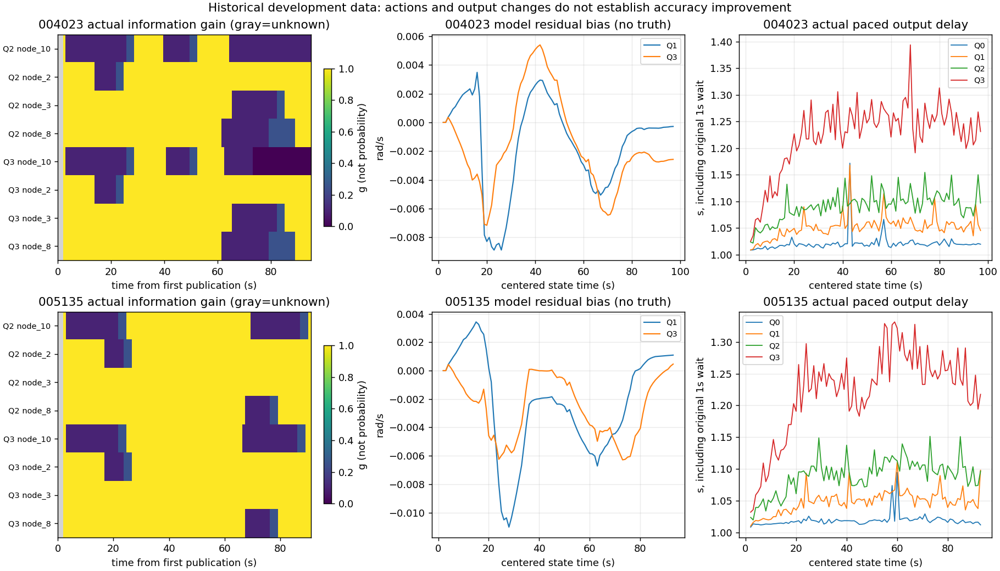

# 实包结论：规则实现通过，改善不能普遍判断

本轮完成真实004023/005135同条件Q0–Q3。代码/接口的原生公式、状态机、权重、截止、先验闭包、真实前缀与四链干预通过；策略确实改变信息倍率并进入目标函数。**尚不能判断总体现场定位精度改善。** 没有连续轨迹真值、完整故障时段标签或人工末点误差界；不报告全程RMSE/ATE、提升百分比或误报/漏报率。

## 全量、共同有效及停止窗

八条性能运行完整，004023每组96发布/94有效，005135每组92/90；全量752有限输出、736图接受、16启动预测，0求解失败/回退/gyro缺口。四组共同有效分别94、90，全部与共同口径都保存，unknown/失败预测未筛去。[八行完整表](FOUR_GROUPS.md)包含天线XY中位数、末点距离差、散布、候选静止漂移及实际延迟。逐时刻752行、逐链3008行及共同统计见[结果目录](results/)。

原停止窗固定：004023 `[81.848289054,86.848289054]`s，005135 `[83.81404534,88.81404534]`s，各5条有效输出。人工末点分别(2.97,3.11)m、(2.93,3.04)m，不确定度未知，停车记录没有独立精密时间界。本轮没有重选窗口或用末点调参数。

| 包/比较 | 人工末点距离差m | 窗内自身散布RMS m | 候选静止窗净位移m |
|---|---|---|---|
| 004023 Q0→Q2 | .126884→.113672 | .007892→.007328 | .013751→.020668 |
| 004023 Q1→Q3 | .128488→.062804 | .007991→.008652 | .013896→.024691 |
| 005135 Q0→Q2 | .047815→.050933 | .005432→.012434 | .014266→.035266 |
| 005135 Q1→Q3 | .054857→.061176 | .004081→.017253 | .010171→.048835 |

004023停点差下降而自身位移增加；005135停点差、散布和自身位移均增加。这支持有限开发诊断中的混合结果，不能将其解释为全程精度提升/恶化。散布RMS是绕自身中位数的变化，不是对真值RMSE；“静止”只沿用原候选停车窗，未补造独立站定确认。

首次图接受在中心化4秒。初次位置修正004023 Q0/Q2约.109756m、Q1/Q3约.109796m；005135约.146496/.146494m；未把初始跳变删掉。相对各自基线，Q2/Q3全时段最大base输出变化：004023约.213111/.210629m，005135约.179665/.185603m。对应最大wrapped yaw变化约3.263/11.095deg、5.713/18.415deg。它们是模型输出变化，不能当误差收益。

Q3相对Q1最大bias变化004023 .007078rad/s、005135 .005597rad/s。Q3最终bias分别−.002571/+ .000460rad/s，Q1分别−.000281/+ .001093rad/s。该量是模型残余bias，不是实际标定零偏；没有真值可判断哪个更准确。完整全量与共同有效统计、全部曲线均保留。

## 实际动作，不贴故障标签

触发定义为**已知判定时信息倍率向下变化**，包括停用升级和恢复反弹；一段降权的每个帧不重复算新触发。实际Q2/Q3触发：004023为6/7次，005135为4/4次。每组每条链最初2条unknown保留倍率1，不当正常；之后本批没有unknown保持降权。unknown链秒与已知降权链秒分别保存，baseline的unmonitored也单列。

004023 N10：Q2有3次触发、70条已知降权/恢复样本，约69.014链秒；Q3有4次触发、71条已知降权/恢复/停用样本，约70.055链秒，其中22条停用约20.994链秒。N2/N3/N8各有一次触发。这不表示所有链真实故障，也不表示N10整包异常。

005135 N10两方法各有2次触发，N2/N8各1次，N3无触发；没有停用。N10已知降权含试恢复持续约43.081/45.099链秒。正常完成记录不等于全观测无故障，所以不把这些称误报。每链/每车任意链暴露分母、unknown/降权/停用/恢复试用、事件起止完整保存，链秒不当车秒或独立试验。

恢复试用起点、策略回normal起点和再有三条已知normal的确认时刻分开。没有真实故障结束标签，恢复相对“故障结束”的延迟保持未知；不填0。停用只令新因子g0，不能移除已进入主状态/边缘化prior的历史信息。四链影子也共享Odom/gyro/初始先验和其他墙误差，不是真值参照。

## 同机实际发布时间和成本

为可比实际发布时间，Q0/Q1在同机同条件补测；旧数值376行完全一致，旧虚拟available时间不混入新比较。每包四个独立进程共享host anchor按原receive paced，实际可用时间以数据flush后的monotonic映射原receive轴；不是当年现场采样/ROS网络时延实测，更不是NTP精度保证。

| 包 | Q0/Q1/Q2/Q3平均实际发布延迟s | Q0/Q1/Q2/Q3平均完整发布周期wall ms |
|---|---|---|
| 004023 | 1.0211 / 1.0517 / 1.0914 / 1.2238 | 20.84 / 51.54 / 91.22 / 223.55 |
| 005135 | 1.0193 / 1.0492 / 1.0900 / 1.2216 | 19.17 / 49.03 / 89.85 / 221.45 |

完整发布周期从processing开始到数据flush，覆盖影子/质量判定、主图、后验诊断及写出；另列前主图（含影子/监测/日志）、主图、后主图诊断/flush阶段与各图solve/marginal耗时。原`complete_processor_wall_s`遗漏尾部诊断且含此前ingest，原列保留为不完整列，不能和完整周期相加或当纯CPU。此前消息ingest不在发布周期内，端到端仍看实际release delay；调度/排队没有无依据拆成纯计算。

Q3最大实际延迟1.3936/1.3313s；无跨下一发布截止积压，本两包也无EOF后才完成的发布。数量/状态由全部752条实际availability连接核对，不拿compute-ready当flush-ready。连续状态时刻参考覆盖0、实际可用时刻轨迹参考覆盖0；每组仅固定停点窗5条开发参照，不能据发布时间推算可获得时刻定位误差。

## 验收与边界

[B独立数学回读](results/native_readback.json)：2208 cost、1606边缘化、1840完整初值、23436 gyro片段；最大cost差约1.43e−14、信息矩阵差约6.68e−8。所有质量分数/原生状态/倍率/正信息与零信息行/缺测区分均通过。752 JSON/CSV/实际主图绑定、3008约束与原消息SHA/scalar sidecar连接通过。完整8运行/20控制无缺失、重复、额外或失败。

真实4前缀（152条原主发布值）与完整回放对应值一致；四目标×两方法×两包共16干预，608目标影子缓存/状态记录在17次真实消元后仍逐字段一致，主图变化。20个验证控制不计入8条性能回放，没有额外性能重跑。[控制证明](results/all_wall_controls.json)、[全集](results/complete_inventory.json)、[14组实包坏日志拒绝](results/semantic_negatives.json)。

B46项单元测试和A3项关闭路径回归通过。首次B开发读取误拒绝为独立三角函数2.3e−15浮点差，修正只涉及读器数值比较，不改阈值/模型/A代码、不重跑估计器；证据保留。未发现需私自修补的A内核问题。原F0缺逐次incident明细、原F3缺完整warmstart的日志限制已如实列明，未拿B新fixture代替实际检查。

最终三层：**代码/接口**在这两包及记录范围内独立检查通过；**策略动作**已如上实际发生并真实入图；**是否改善结果**存在开发停止窗差值下降与恶化并存，完整现场精度/检错能力仍**尚不能判断**。未扩跑T08/T10或留出包，不下载视频，不操作硬件，不改公共参数，不自动合并。
