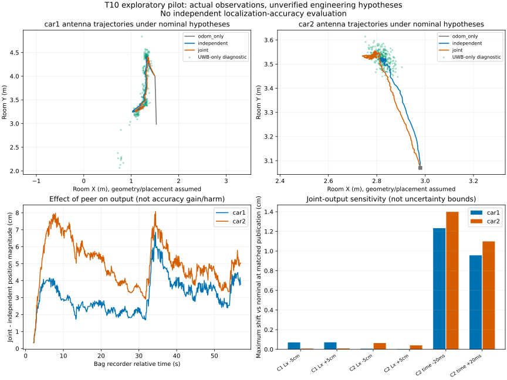

# T10有限试跑结果：可以解算，尚不是精度验证

实际执行版本：`98f1aaaf4ef48bacbdf84b3efdc2bee01292f993`，工作树干净。PR51严格配置与参考裁决未改；本轮不运行A端候选，也不打开整包留出。

## 执行与核验

- 7个假设配置×3种原有方法，属于1个开发实包，不是21次独立实车实验。实际运行约63.2秒。
- 23,982行状态逐行核验；数值失败事件0。准入/拒绝、原始记录、整数时间、as-of支持和每车协方差PSD均有回读记录。
- UWB-only额外诊断：Car1 267帧、Car2 270帧收敛，原始测距未校正；距离拟合残差中位数约0.262/0.374m，不能称为位置误差。

## 当前可说的结果

| 假设名义组 | Car1 | Car2 |
|---|---:|---:|
| 加入peer相对独立解的输出变化中位数 | 2.94cm | 4.88cm |
| 同上最大值 | 6.86cm | 8.08cm |
| 末10秒独立解输出变化 | 8.73cm | 1.42cm |
| 末10秒联合解输出变化 | 8.22cm | 2.46cm |

这些是估计输出的差异/变化，不是已验证的真实位置误差或协同收益。末10秒没有被升级为独立验真的连续静止区间。

安装杆臂X方向分别改变±5cm、同时保持初始天线位置时，这段近直线场景的联合输出相对名义组最大变化不到0.8mm；这只针对已测试因素，不能推广到转弯、其他杆臂方向或真实误差范围。Car2总时间调整±20ms时，联合输出最大变化约1.40cm，peer准入数为228/242/247；它们是数值敏感性，不是测得的时钟误差或定位上界。

## 原始输入还可以如何使用

1. 原始墙距可以直接解天线位置，base原点与跨机/视频时钟缺项不阻止这条单车诊断路径。
2. 原有三基线能在显式工程假设下执行；真正的source-backed入口继续BLOCKED，两个层次不能混用。
3. 当前应继续核查测距/几何一致性；不要仅因轨迹可解就宣布误差小，也不按人工终点反调偏置。
4. A端可复用本轮输入和假设配置，在自己的统一机制框架中重新冻结/执行；不能直接把不同估计器或版本的数值拼成方法对照。

协议中的终点排除范围见[PROTOCOL_CLARIFICATION.md](PROTOCOL_CLARIFICATION.md)：T10终点未用，Car2的T09人工末点明确作为初值假设。

## 限制与复现

几何中心作为base、名义起点/朝向、时间调整均为假设；测试步长不是实际误差范围。固定R/Q未标定。`uncertainty_ns`只是显式未验证的接口工程参数，本轮没有时钟误差界、协方差覆盖率、概率完好性或实包RMSE。

源工具：[README](../../../../tools/field_20261024_25/t10_exploratory/README.md)。紧凑数值见[summary.json](summary.json)，完整逐事件记录在Git外归档；源输入使用PR51可迁移T10包。

