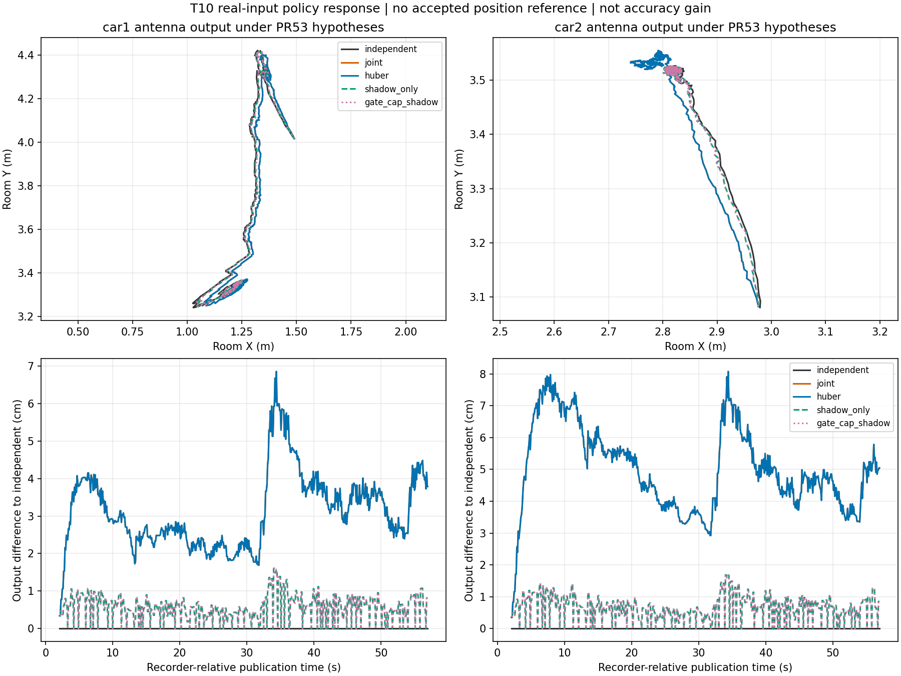

# T10实包：可靠性候选接入与条件性输出响应

PR52的六维SE(2)可靠性候选已接入PR53同一份T10真实观测、同一组假设。9种方法×7组配置全部执行完成。实际计算383.60秒；独立回读134.97秒。**这是同一包的7组敏感性检查，不是7次独立实车实验。**

## 已完成的验证

- 101项相关测试通过：原基线47、参数接口17、PR52集成25、PR53探索6、新桥接6。
- 71,946行发布状态，其中69,300行valid，未初始化行保留；数值失败0。
- 独立回读415,772次输入事件处理（同一59,396条输入在7配置下重复）、3,741,948条方法决策；复算peer几何/H、Huber/门控、实际增益/Joseph/限幅、隔离保持和观测/时间身份。
- 23,982行原有三基线与PR53逐行核验：位置/朝向最大分量差0，协方差及源记录身份保持一致。算法内核、候选、PR53配置构造器均为父PR原字节。
- 没有修改严格来源入口；其独立预检查仍退出2，14组来源参数未齐。探索结果未写回严格配置，参考仍为not_accepted。

## 名义配置结果

下表是各方法**天线XY输出相对独立融合输出的距离**，单位cm，同一发布时刻且同一源状态时刻，逐车各550个valid样本。它不是定位误差，也不是精度改善。

| 方法 | Car1中位数 | Car1最大值 | Car2中位数 | Car2最大值 |
| --- | ---: | ---: | ---: | ---: |
| 固定联合 | 2.94 | 6.86 | 4.88 | 8.08 |
| Huber／门控／限幅／门控+限幅 | 2.94 | 6.86 | 4.88 | 8.08 |
| 单独影子策略 | 0.59 | 1.60 | 0.68 | 1.68 |
| 完整候选 | 0.59 | 1.60 | 0.68 | 1.68 |

上图Huber与固定联合重合、完整候选与影子对照重合，故部分曲线被覆盖。上排为工程假设下的天线输出，不是真值；下排为相对independent的输出差异。

## 机制归因和边界

名义配置242次可用peer更新均未触发门控或限幅。全部7配置也没有出现门控拒绝或裁剪：名义及四组杆臂配置各242次，Car2时间−20ms为228次、+20ms为247次。所有配置中joint、Huber、gate-only、cap-only、gate+cap的发布/反馈轨迹完全一致；组合候选与shadow-only完全一致，逐发布状态精确相等，见POLICY_EQUIVALENCE.json。

因此，本轮减少的是**车间信息对输出的累积影响**。在这个数据条件下，变化由“不让peer反馈到独立核心＋最多200ms保持修正”的策略解释，无法支持门控或限幅的额外贡献。它也可能丢掉有用协同；结合PR52弱墙且正确peer场景的负结果，不能将“更接近独立解”写成“更准确”。没有现场RMSE/ATE、误差上界或概率完好性结论。

两种非反馈方法在名义组各有483/550个逐车valid输出携带非零保持修正，输出协方差为空并保存原因；没有用核心工程协方差冒充这些输出的校准后验。

## 输入与假设

只用T10成功重试，bag SHA为 `f2853240661be0cef53e77cee9a5a33f74cfb1524231d2eb94b2dcacaa57c558`。所有初始位置/朝向、基座至天线偏移、时钟映射及接口不确定度参数都原样继承PR53的明确工程假设。包括Car2的T09人工终点作为未验证的T10起点候选；没有读取T09定位结果。

固定PR52全部阈值与9方法；R/Q、peer方向、200ms有向链路抽样、60ms支持范围、准入及初始化绑定都相同。没有据T10结果调参，没有读取T10人工终点/视频进行拟合或评价，没有定位回放T09/T11/T13/T15。±5cm及±20ms为检查步长，不是已标定不确定度或实际误差界。

## 来源与复现

执行本地冻结提交：`e038868f2b1995a0b88f962ce80203a6e2a6460e`；公开相同源码树提交：`db2aac52cbd687f53f0456f00875859212487a84`。整棵Git树均为`237185c828ff8ef377c492471b833b1dd0d18227`。CLI推送缺少认证，随后使用已连接接口发布相同树，因此提交元数据不同；没有改动执行源码、配置或执行记录。运行前后源码哈希一致，正式运行工作树干净。

本轮使用NumPy2.3.5，PR53原运行使用2.4.1，跨环境原基线实际差值为零。逐源SHA、实际命令、测试、逐配置响应表和完整归档校验分别见SOURCE_IDENTITY.json、COMMANDS.md、TESTS.log、response_by_profile.csv、ARTIFACTS.json。独立回读沿用PR52的独立数学核验函数，不导入在线估计器；它属于项目内独立复算，未冒称第三方认证。

## 下一步

1. 在保留本轮固定策略的条件下，用T14开发包的遮挡记录或另行预登记的T10受控测距扰动，检查门控是否能触发、是否损失有效协同及故障后的恢复；扰动回放只报告相对未扰动解的响应，不能当作真实位置误差。
2. 视频空间/时间证据与停点评价继续单独验收，避免用同一批位置参考反过来拟合再报告精度。
3. 方案/参数/评价协议冻结后再开T09/T11/T13/T15整包留出；保留弱墙正确peer和自洽错误反例。
