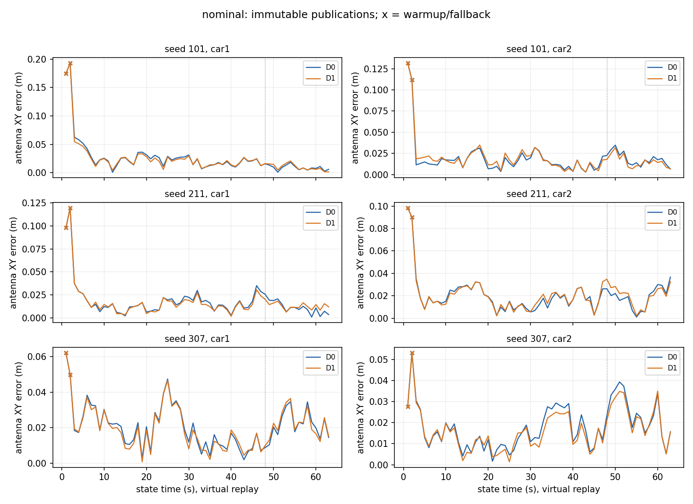
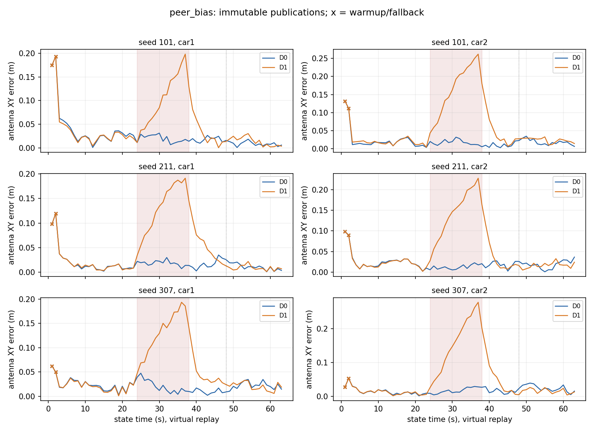
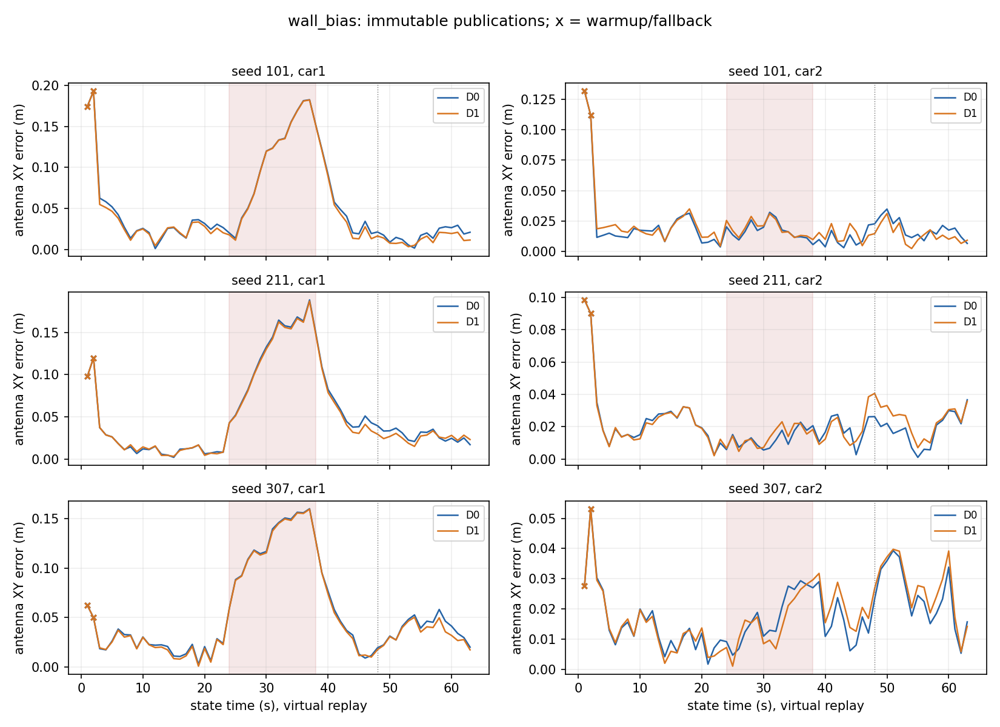
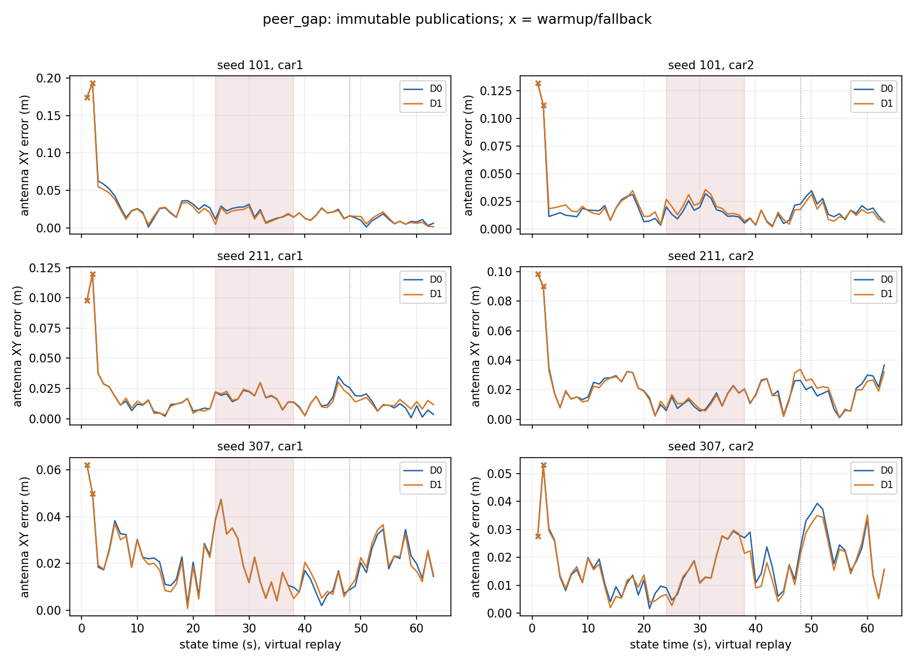

# 双车固定窗口 D0/D1 合成对照

状态：**DONE**。
正式预登记24组，索引24组，DONE 24组，FAILED/其他0组；SHA/结构问题0项。

回放均为 **virtual**：接收截止/1s等待由事件时钟驱动，计算耗时实测；不代表ROS或车载端到端实时性。这里只评价独立保存的合成真值，没有使用视频或实包全轨迹参考。

`all_finite`保留暖启动与数值回退；`joint_common_valid`仅含同seed/场景两臂两车共同accepted时刻。均使用原房间坐标和准确整数ns关联，不做事后刚体对齐。XY为天线中心二维欧氏误差，yaw为wrapped角误差；相对位置为两天线XY向量误差，间距为三维斜距误差。

## 每seed主结果（全部有限发布）

|seed|场景|臂|Car1 XY RMSE m|Car1 yaw RMSE °|Car2 XY RMSE m|Car2 yaw RMSE °|相对XY RMSE m|间距RMSE m|n C1/C2/pair|
|---|---|---|---:|---:|---:|---:|---:|---:|---|
|101|nominal|D0|0.0402|2.1283|0.0278|0.9871|0.0374|0.0338|63/63/63|
|101|nominal|D1|0.0393|2.0382|0.0280|0.9612|0.0355|0.0317|63/63/63|
|101|peer_bias|D0|0.0402|2.1283|0.0278|0.9871|0.0374|0.0338|63/63/63|
|101|peer_bias|D1|0.0697|1.2990|0.0937|3.0227|0.1513|0.1496|63/63/63|
|101|peer_gap|D0|0.0402|2.1283|0.0278|0.9871|0.0374|0.0338|63/63/63|
|101|peer_gap|D1|0.0391|2.0097|0.0284|0.9513|0.0357|0.0320|63/63/63|
|101|wall_bias|D0|0.0751|3.7140|0.0278|0.9871|0.0745|0.0384|63/63/63|
|101|wall_bias|D1|0.0739|3.6815|0.0280|1.0211|0.0717|0.0330|63/63/63|
|211|nominal|D0|0.0254|1.3977|0.0257|1.5013|0.0260|0.0172|63/63/63|
|211|nominal|D1|0.0248|1.4875|0.0260|1.6763|0.0244|0.0142|63/63/63|
|211|peer_bias|D0|0.0254|1.3977|0.0257|1.5013|0.0260|0.0172|63/63/63|
|211|peer_bias|D1|0.0751|2.3771|0.0804|2.1037|0.1497|0.1473|63/63/63|
|211|peer_gap|D0|0.0254|1.3977|0.0257|1.5013|0.0260|0.0172|63/63/63|
|211|peer_gap|D1|0.0252|1.4636|0.0257|1.5433|0.0251|0.0155|63/63/63|
|211|wall_bias|D0|0.0742|3.4793|0.0257|1.5013|0.0734|0.0242|63/63/63|
|211|wall_bias|D1|0.0727|3.5898|0.0270|1.7825|0.0710|0.0167|63/63/63|
|307|nominal|D0|0.0237|1.4475|0.0206|2.6733|0.0280|0.0191|63/63/63|
|307|nominal|D1|0.0232|1.5298|0.0192|2.6945|0.0253|0.0152|63/63/63|
|307|peer_bias|D0|0.0237|1.4475|0.0206|2.6733|0.0280|0.0191|63/63/63|
|307|peer_bias|D1|0.0718|3.5184|0.0902|3.1913|0.1582|0.1556|63/63/63|
|307|peer_gap|D0|0.0237|1.4475|0.0206|2.6733|0.0280|0.0191|63/63/63|
|307|peer_gap|D1|0.0235|1.5238|0.0196|2.7194|0.0263|0.0168|63/63/63|
|307|wall_bias|D0|0.0706|1.9620|0.0206|2.6733|0.0746|0.0218|63/63/63|
|307|wall_bias|D1|0.0694|1.9457|0.0217|2.7515|0.0731|0.0158|63/63/63|

## 正常代价及故障传播（共同有效时刻）

下表为每seed的D1−D0位置RMSE差；正值表示加入peer后误差更大。故障行另给Car2相对同seed正常场景、相同epoch的RMSE增量，再比较D1−D0；墙链故障直接污染Car1，Car2增量展示向另一车传播。peer缺测行表示约束损失/恢复效应。

|seed|场景|窗口|Car1 ΔRMSE m|Car2 ΔRMSE m|Car2 故障增量D0 m|Car2 故障增量D1 m|
|---|---|---|---:|---:|---:|---:|
|101|nominal|all|-0.0015|0.0003|—|—|
|101|peer_bias|fault|0.0939|0.1590|0.0000|0.1575|
|101|peer_bias|recovery|0.0365|0.0677|0.0000|0.0686|
|101|peer_bias|late|0.0061|0.0049|0.0000|0.0077|
|101|wall_bias|fault|-0.0004|0.0012|-0.0000|-0.0004|
|101|wall_bias|recovery|-0.0023|0.0033|-0.0000|0.0042|
|101|wall_bias|late|-0.0053|-0.0044|-0.0000|-0.0016|
|101|peer_gap|fault|-0.0022|0.0039|0.0000|0.0023|
|101|peer_gap|recovery|-0.0004|-0.0004|0.0000|0.0005|
|101|peer_gap|late|0.0011|-0.0028|0.0000|-0.0000|
|211|nominal|all|-0.0009|0.0005|—|—|
|211|peer_bias|fault|0.1202|0.1394|0.0000|0.1379|
|211|peer_bias|recovery|0.0540|0.0501|0.0000|0.0494|
|211|peer_bias|late|-0.0030|-0.0032|0.0000|-0.0045|
|211|wall_bias|fault|-0.0016|0.0017|0.0000|0.0002|
|211|wall_bias|recovery|-0.0035|0.0004|0.0000|-0.0003|
|211|wall_bias|late|-0.0028|0.0054|0.0000|0.0041|
|211|peer_gap|fault|0.0006|0.0003|0.0000|-0.0013|
|211|peer_gap|recovery|-0.0022|0.0003|0.0000|-0.0004|
|211|peer_gap|late|-0.0000|0.0007|0.0000|-0.0006|
|307|nominal|all|-0.0005|-0.0015|—|—|
|307|peer_bias|fault|0.1117|0.1544|0.0000|0.1569|
|307|peer_bias|recovery|0.0521|0.0717|0.0000|0.0740|
|307|peer_bias|late|-0.0007|-0.0089|0.0000|-0.0072|
|307|wall_bias|fault|-0.0009|-0.0021|-0.0000|0.0004|
|307|wall_bias|recovery|-0.0011|0.0041|0.0000|0.0064|
|307|wall_bias|late|-0.0042|0.0026|0.0000|0.0043|
|307|peer_gap|fault|-0.0001|0.0000|0.0000|0.0025|
|307|peer_gap|recovery|0.0010|-0.0037|0.0000|-0.0014|
|307|peer_gap|late|0.0004|-0.0016|0.0000|0.0001|

## 完整性、缺测及计算量

|seed|场景|臂|状态|发布时刻|accepted|warmup|失败/回退|peer可用/加入|耗时s|更新p95s|峰值标量|
|---|---|---|---|---:|---:|---:|---:|---|---:|---:|---:|
|101|nominal|D0|DONE|63|61|2|0|63/0|0.804|0.0105|126|
|101|nominal|D1|DONE|63|61|2|0|63/63|0.953|0.0135|126|
|101|peer_bias|D0|DONE|63|61|2|0|63/0|0.803|0.0105|126|
|101|peer_bias|D1|DONE|63|61|2|0|63/63|0.997|0.0197|126|
|101|peer_gap|D0|DONE|63|61|2|0|50/0|0.820|0.0108|126|
|101|peer_gap|D1|DONE|63|61|2|0|50/50|0.911|0.0131|126|
|101|wall_bias|D0|DONE|63|61|2|0|63/0|0.792|0.0106|126|
|101|wall_bias|D1|DONE|63|61|2|0|63/63|0.938|0.0159|126|
|211|nominal|D0|DONE|63|61|2|0|63/0|0.810|0.0107|126|
|211|nominal|D1|DONE|63|61|2|0|63/63|0.956|0.0134|126|
|211|peer_bias|D0|DONE|63|61|2|0|63/0|0.809|0.0105|126|
|211|peer_bias|D1|DONE|63|61|2|0|63/63|1.019|0.0204|126|
|211|peer_gap|D0|DONE|63|61|2|0|50/0|0.793|0.0105|126|
|211|peer_gap|D1|DONE|63|61|2|0|50/50|0.905|0.0131|126|
|211|wall_bias|D0|DONE|63|61|2|0|63/0|0.808|0.0108|126|
|211|wall_bias|D1|DONE|63|61|2|0|63/63|0.957|0.0137|126|
|307|nominal|D0|DONE|63|61|2|0|63/0|0.820|0.0106|126|
|307|nominal|D1|DONE|63|61|2|0|63/63|0.954|0.0134|126|
|307|peer_bias|D0|DONE|63|61|2|0|63/0|0.813|0.0106|126|
|307|peer_bias|D1|DONE|63|61|2|0|63/63|1.033|0.0172|126|
|307|peer_gap|D0|DONE|63|61|2|0|50/0|0.811|0.0105|126|
|307|peer_gap|D1|DONE|63|61|2|0|50/50|0.919|0.0132|126|
|307|wall_bias|D0|DONE|63|61|2|0|63/0|0.784|0.0106|126|
|307|wall_bias|D1|DONE|63|61|2|0|63/63|0.923|0.0132|126|

peer加入次数包括暖启动，表示向活动图加入了因子，不等同于accepted纠正次数。缺测后仍保留过去peer形成的相关先验；恢复时不清除该历史信息。

累计cell耗时：21.132s。所有失败/缺失cell均保留在metrics.json，未删选seed。
共同有效时间覆盖及逐车pre/fault/recovery/late完整指标见 `per_seed_vehicle.csv`、`per_seed_pair.csv`；正常代价/同期故障增量见 `paired_deltas.csv`。

误差传播同期图：

## 限制与核验

权重为预登记工程值；3个seed仅作描述性对照，不代表现场泛化精度。拟合peer残差变小不能独立证明定位更准，本报告的误差来自单独真值文件。固定外参和精确合成时钟不是历史安装/跨车同步的验收；未运行历史两包或任何留出包。

读取器没有导入graph/frontend/replay。核验matrix索引、每run输出哈希、实际输入与配置SHA、独立真值/标签manifest和D0/D1输入字节同一性。

全部登记SHA及24组索引一致。
