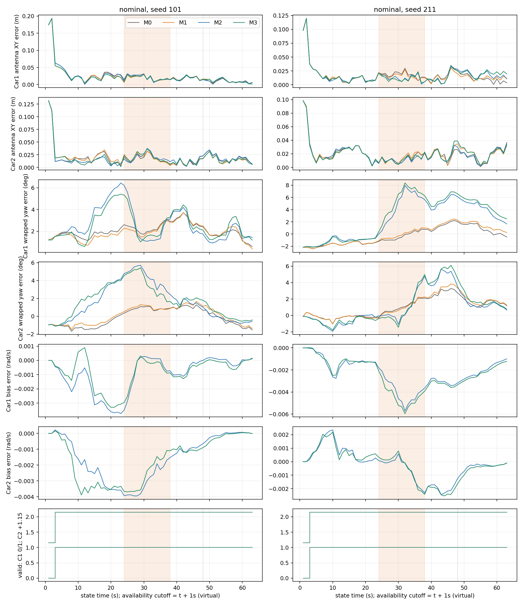
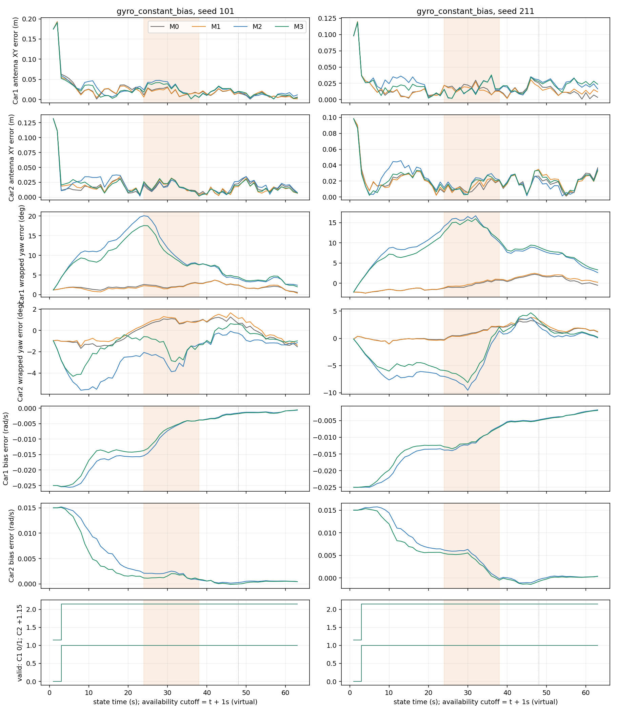
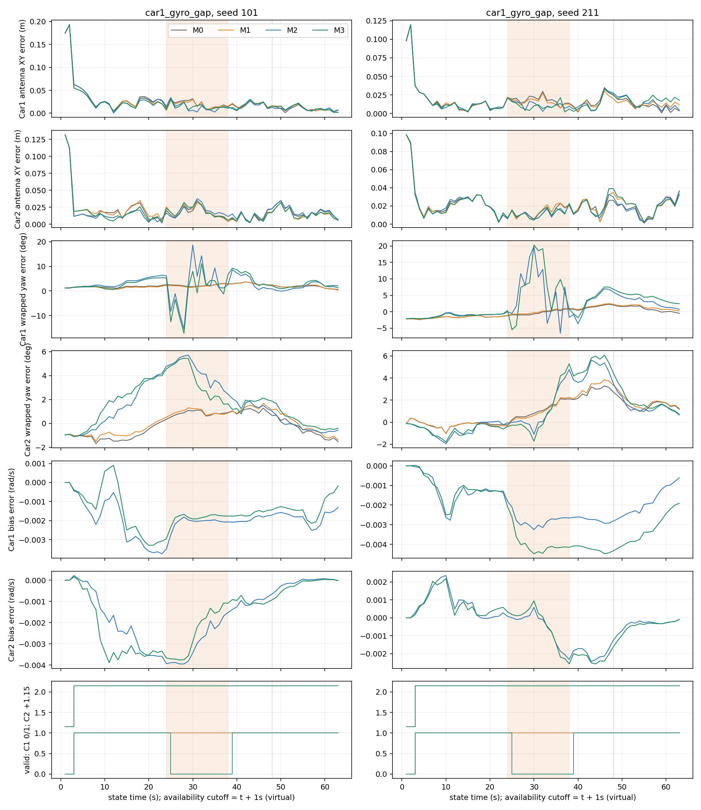
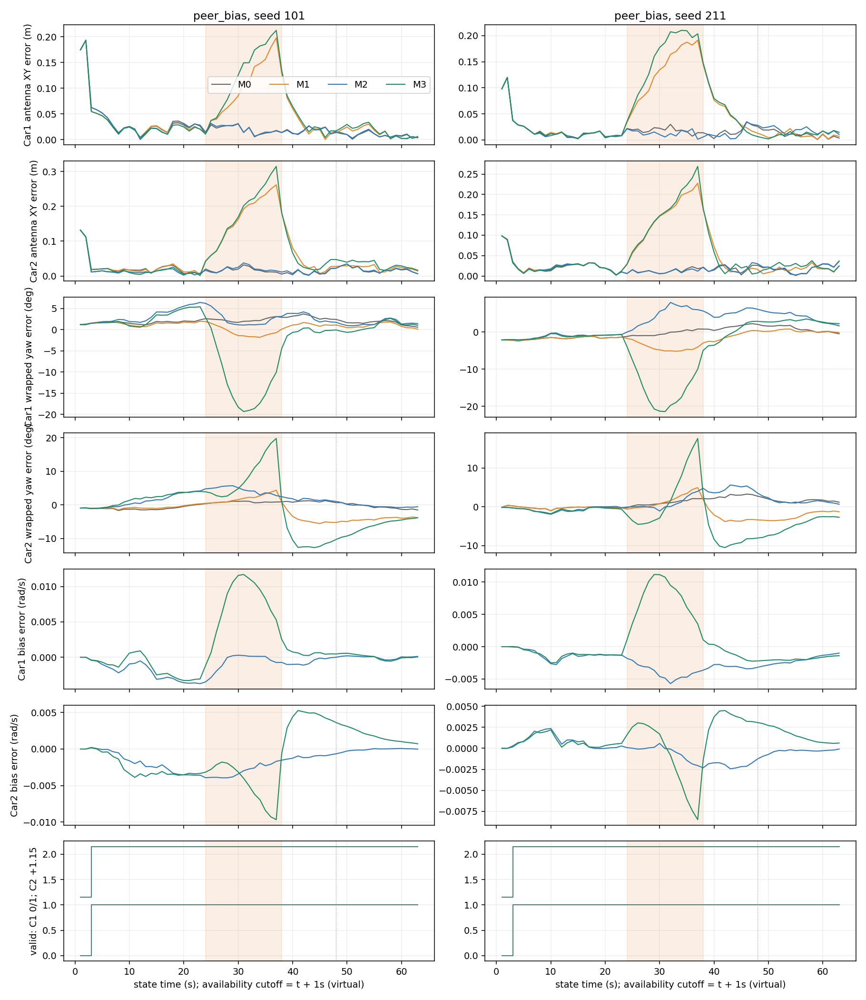
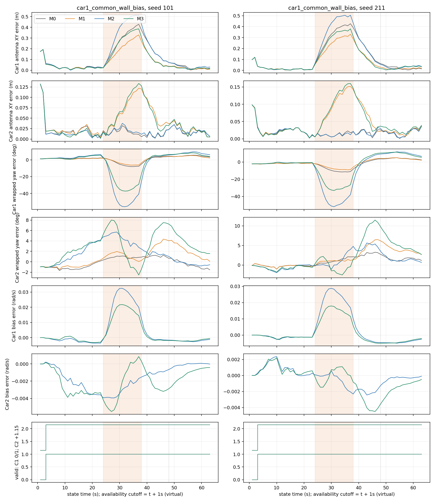
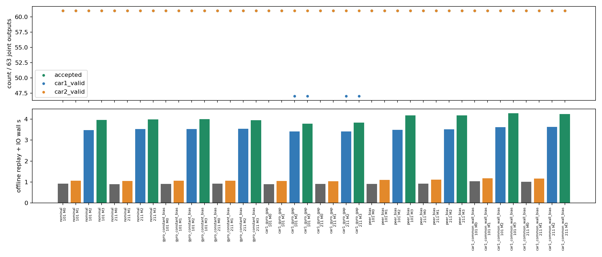

# 阶段A最终结果与证据边界

原[STAGE_A_REPORT](STAGE_A_REPORT.md)为发现BUG01前的阶段快照，原40输出保持不变；其28次拒绝来自实现错误，不能作为缺角固有表现。最终选择见RUN_INDEX，不覆盖原索引。合成执行源码0d3943d79569e5e8d3f7a1bbf4a1007a2932bc5f，两个必要M2修复为dc30dad99e0e3dd79d6cd6c6a7a38e4de62b667b。所有输入/config字节相同；仅替换已知错误单元，非重新选优。

## 合同、计数与解释

21项当前合同通过；含原六维路径精确回归、两套F3目标/成功解、跨消元独立解、解析/FD Jacobian、完整8维Schur、常数/affine/交叉篡改负例、不双算保留因子、prefix因果、单位/轴/frame负例、gyro缺口保持yaw、恒bias与yaw wrap、缺失bias/有效零bias。容差保持CHECKPOINT_01原值。冻结F0另27项、单车F3另43项通过，未重做单车矩阵。M2每车停止，仍用联合帧事务发布；一车失败时两车预测的政策及代价见MODEL。

最终2520次有限联合发布（5040车次），2440 accepted，80启动，0求解/消元失败，0Odom角回退；Car1有效2384，Car2有效2440。四个缺角IMU单元各14次Car1缺角无效（状态25–38s，对应区间[24,38]）；其余模型仍有有限预测/估计，未静默删除。每缺角案例共同有效47/63，其他共同有效61/63；共同accepted均61/63。因此缺角故障段共同有效只剩1/14，不能把这一稀少子集写成整段性能。全有限、每车有效、共同accepted、共同有效四套分母均保留。

独立读器核验40条全部2520组聚合、2440 accepted完整目标、2480分车积分区间/48484支持片段、1680次边缘化。FD Schur最大H绝对差7.935e−7、g6.443e−9、常数1.244e−14；最大目标cost差2.843e−14。M3 cross/位置-yaw-bias实际保留，M2无peer；记录真实factor身份与prior来源。21×8=168求解/22×8=176瞬时上界达成。F0实际126/132单独记录。

## 全部场景

完整逐seed四组数值在[SYNTHETIC_TABLES](SYNTHETIC_TABLES.md)。pre[3,24)、fault[24,38)、recovery[38,48)、late[48,63]为原分段；恒bias从初始化至末尾存在，这里的fault仅统一对照区间，不能解读成38s故障结束。含启动全程单独统计。late从故障后10s起，并不代表历史prior已清除。

- nominal：两车XY变化小，有改善也有代价；四个IMU相对F0的Car1 yaw比较全部恶化。不能宣称整体IMU收益。
- gyro_constant_bias：Car1真值+.025、Car2−.015rad/s；Car1 M2 bias RMSE .01243/.01285，M3 .01132/.01213rad/s，yaw仍约9–10°。有bias状态不保证完整恢复，且本轮无F2臂，不能分离“估计bias”相对固定零bias的净作用。
- car1_gyro_gap：不使用Odom角回退；持航向是新帧初猜，墙/平移优化仍可改变yaw。14个缺角状态无效但有限发布保留。BUG01修复后无额外solver_error，恢复后仍需查看yaw/bias历史，不能由当前角边有效推定可靠。
- peer_bias：+1.2m固定单方向peer仍为pseudo-Huber；故障期健康Car2协同XY增量M1−M0 .1590/.1394m，M3−M2 .1752/.1532m，IMU没有消除污染。恢复期分别 .0677/.0501 与 .0635/.0477m。
- car1_common_wall_bias：只改变Car1四墙、其余量测/运动/噪声值配对核验（场景与生成来源元数据区别保留）。健康Car2故障期/恢复期增量见REPORT。独立M2 Car2与nominal对应状态一致（无peer传播路径）；联合M3产生误差及bias变化，是本模型条件下实际协同传播证据。两个seed均出现，无需扩大故障制造结论。

墙故障下Car1 yaw与bias同时偏移，联合peer降低其部分误差并把代价传给Car2。公式中的Δyaw+b·dt与转动杆臂、body平移、墙距共同作用，是允许这些状态耦合的机制；独立读回证明这些因素确实入图。只有观察性同期证据，未做新的单因素干预，不能把噪声选择、弱可观测性、局部极值或旧prior中某一项定成唯一原因。

## 同期图

五图每个包含两seed、两车XY/yaw/bias及有效性，空bias不画零线。横轴是状态时刻，截止t+1s仅为virtual政策；橙区[24,38)。误差不作轨迹对齐。

成本逐单元在review/synthetic-readback-v2_costs.csv，包含整条离线回放+IO、update总时长/p95、峰值、失败与分母。M2有两次子求解；没有paced实车实时测量，不能把虚拟finish当ROS延迟。两个seed及相关链秒不是独立重复实验，不给显著性/误报概率/保护级。
