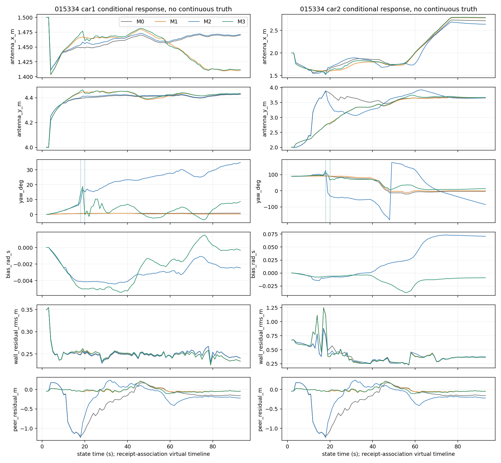
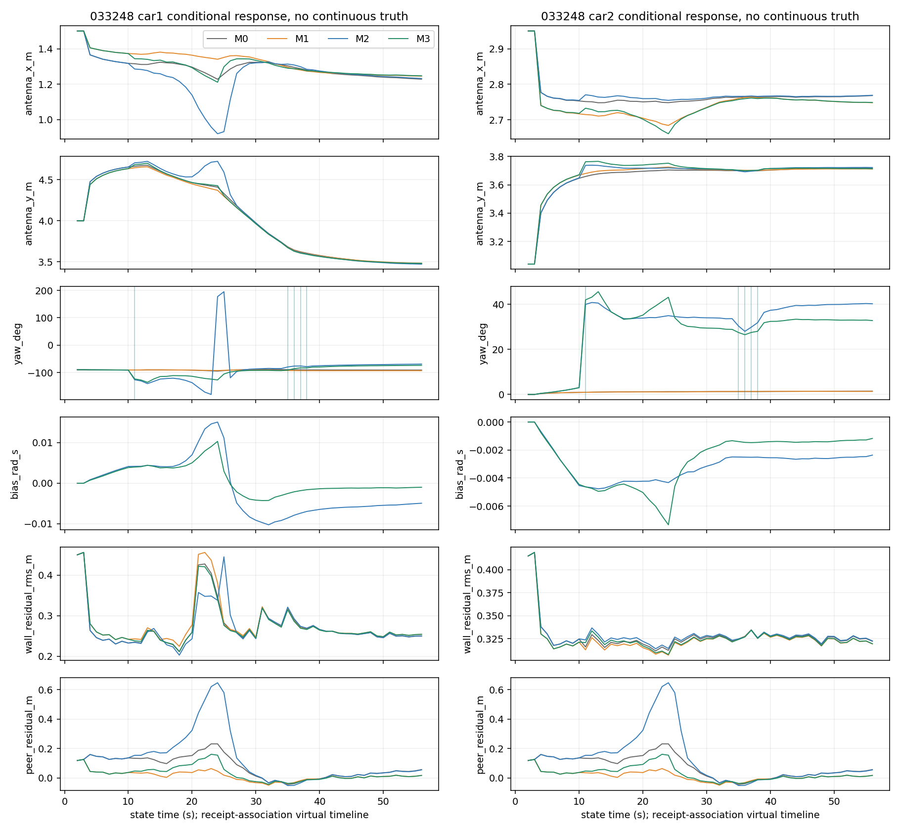

# 阶段B：两旧双车包条件开发

8个主运行于源码9a8ae25f8d6b8c89c3aa0e48478e3af8d9e018fc冻结后执行；BUG01仅两条M2另存dc30dad修复，其余6条复用原本轮输出。不是复用早期全历史原型，不要求其数值一致。本轮两包各组输入/config SHA相同，采用配置见configs/015334.json、033248.json；每包独立初始化，无跨包轨迹/bias/prior继承。

来源/批准级别见[FIELD_MODEL](FIELD_MODEL.md)与[FIELD_INPUTS](FIELD_INPUTS.json)。原bag只读，30288消息全部独立核验；原始三轴gyro、frame、整数header/receive、recordID和rawSHA均在rich_messages及events。没有用占位IMU、四元数房间yaw或加速度积分。18日杆臂相对近似几何中心与odom原点重合是假设，初始yaw是摆放假设；真实噪声、物理时钟、安装轴标定未验收。旧双车已有接收关联候选在本轮按车/流显式冻结，称conditional_development；严格物理分支BLOCKED。

## 覆盖与失败

|包|方法|有限/总发布|accepted|C1/C2有效|共同有效（四组）|gyro缺角C1/C2|求解失败|离线回放+IO s|update p95 ms|
|---|---|---:|---:|---:|---:|---:|---:|---:|---:|
|015334|M0|92/92|89|89/89|87|0/0|1|2.673|40.51|
|015334|M1|92/92|90|90/90|87|0/0|0|2.422|20.69|
|015334|M2|92/92|89|87/87|87|2/2|1|6.453|38.72|
|015334|M3|92/92|90|88/88|87|2/2|0|7.668|81.94|
|033248|M0|55/55|53|53/53|48|0/0|0|1.275|19.14|
|033248|M1|55/55|53|53/53|48|0/0|0|1.343|17.41|
|033248|M2|55/55|53|48/48|48|5/5|0|3.459|35.48|
|033248|M3|55/55|53|48/48|48|5/5|0|4.023|62.64|

015334共同accepted89/92、033248 53/55。每单元2次启动；015334 M0/M2在11s达到原max_nfev50后预测，未重调预算。M2为两子问题nfev合计55，其中Car2到50；仍沿用联合帧事务，任一失败时两车发布预测，不把Car1子解成功算联合成功。无missing Odom、无gyro unknown输入、无Odom角回退、无最终聚合peer缺测；原始单消息peer缺失见summary/counters，不与聚合有效冲突。合法缺角与优化accepted分别保留。

原IMU header无重复/倒序/>100ms间隔；015334每车1910/1896条、0332481160/1150条。接收关联间隔却有>100ms积压，形成015334每IMU方法2个双车缺角发布、033248每方法5个。该差异说明本候选的时间表达局限，不是实际IMU掉线证据。每条积分只用本截止已到达支持；同一物理消息顺序中跨话题receive微回退用额外prefix-max availability表示，不改原时间。

## 响应与停点开发诊断

预登记末5个发布；下表为四组共同有效的同5个时刻。XY栏为与既有人工终点坐标的平均距离，**不是轨迹RMSE/ATE**。yaw为估计角的圆均值，bias为估计均值，都没有真值。人工停点/时空绑定/卷尺不确定度未知；原033248终点坐标推算距离与卷尺还约差3.85cm，不择优参考。

|包|方法|n|C1人工点差m|C2人工点差m|C1 yaw°|C2 yaw°|C1 bias rad/s|C2 bias rad/s|估计斜距m|
|---|---|---:|---:|---:|---:|---:|---:|---:|---:|
|015334|M0|5|0.42782|0.66324|0.86166|-3.14164|—|—|1.46362|
|015334|M1|5|0.44041|0.63467|0.33167|-0.20901|—|—|1.57389|
|015334|M2|5|0.43147|0.68522|34.25362|-78.05186|-0.00243|0.07092|1.40530|
|015334|M3|5|0.44177|0.64572|7.93963|13.19517|-0.00026|-0.00916|1.57396|
|033248|M0|5|0.54547|0.70224|-91.10070|1.46571|—|—|1.55335|
|033248|M1|5|0.54668|0.70155|-93.34606|1.34279|—|—|1.51848|
|033248|M2|5|0.54100|0.70632|-69.80620|40.24057|-0.00514|-0.00247|1.55171|
|033248|M3|5|0.54343|0.70393|-74.24066|32.97171|-0.00108|-0.00127|1.51791|

015334 Car2末端M2 bias约+.071rad/s、M3约−.009rad/s，配合航向响应相差很大；在同gyro输入下peer改变目标约束的作用可见，但真实bias未知，不能把任一条称标定结果。033248也没有明显可据以验收的停点改善。不同yaw/bias、甚至小残差不证明房间轨迹更准确。固定静止窗（01533485–94.8s，0332480–5s）的响应均值/波动、全有限/每车有效/共同accepted/共同有效另见review/old-readback-v2_responses.csv.gz；不从这些窗口拟合参数。

## 读回与可复用门槛

独立标量读器核验588次聚合/发布、570 accepted完整目标、580分车积分/12176支持片段、420次全部边缘化。最大Schur H差5.335e−7、g3.629e−8、常数1.292e−11，均保持原容差。accepted目标cost误差≤1.422e−13。原F0失败候选只留末pose，无法独立复算它未接受的全窗口cost；本报告不将其当已验收解。新8维candidate完整保存，可回读；实际未接受candidate不写入状态。

两包×四组的31s接收前缀共8个合同控制，各28发布/7消元，与完整运行相应发布（剔除真实耗时及新增只读诊断字段）逐值相同。M0/M1同时精确回归当前冻结F0。前缀控制不是新增场景/主运行，未挑时刻调参。

独立读器不导入在线solver/Jacobian；它共享JSON配置、numpy线性代数。原包解码生产使用rosbags、读回使用嵌入message schema；bag envelope遍历函数共享，该范围披露在原字段读回receipt。前缀控制必然调用在线核，因此不冒充独立读器。

接口/合同已通过，允许阶段C输入核验；没有解除空间/物理同步/噪声验收缺项，也没有精度收益结论。
