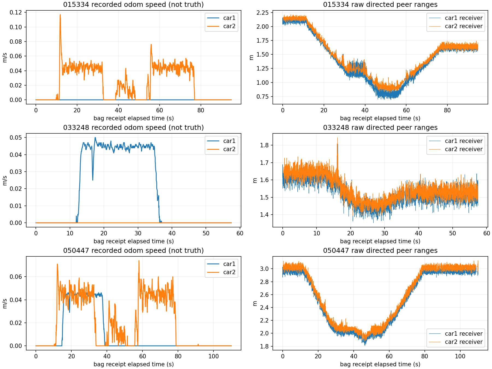

# 结果及使用边界

## 本次核实与历史记录分开

5个原bag SHA与catalog一致，输入运行前后未变。共82739条消息；74353条UWB/odom/IMU逐条解码，8386条cmd_vel/电压等辅助消息只计数。本次不使用辅助消息推断真实运动。与冻结旧read_bag的有效UWB值与数量一致；两者共享rosbags，不能称独立二进制解析器。整数纳秒作差与旧float秒算术允许5e-7s差。

原备注、人工摆位/终点、安装记录、人员经过候选均为历史证据，不是本轮重新测量。尤其045116没有借用050447的终点，异常不能自动归因遮挡。

## 运动与peer可用性

路程和运动由odom描述，不是真实轨迹。运动标记为水平twist>.02m/s对应1秒bin，静止标签不是安全保证。这里050447两车重叠19个bin；历史备注20个command bin使用不同信号和窗口，两者不应强行相等。

| 包 | 车 | odom路程m | UWB帧 | 有效peer | 运动bin | 双车重叠bin |
|---|---|---|---|---|---|---|
| 013206 | car1 | 0.0000 | 1766 | 1762 | 0 | 0 |
| 013206 | car2 | 0.0000 | 1739 | 1735 | 0 | 0 |
| 015334 | car1 | 0.0000 | 4760 | 4748 | 0 | 0 |
| 015334 | car2 | 2.1118 | 4729 | 3830 | 53 | 0 |
| 033248 | car1 | 1.0131 | 2888 | 2877 | 24 | 0 |
| 033248 | car2 | 0.0000 | 2861 | 2814 | 0 | 0 |
| 050447 | car1 | 1.0126 | 5522 | 5511 | 23 | 19 |
| 050447 | car2 | 2.1085 | 5490 | 5329 | 53 | 19 |
| 045116 | car1 | 1.0146 | 5771 | 5766 | 23 | 18 |
| 045116 | car2 | 2.0941 | 5740 | 5572 | 53 | 18 |

013206两车odom均未平移；015334仅Car2有odom运动；033248仅Car1；050447与045116均有两车运动重叠。这支持历史实验分类，但不能证明轮滑不存在或odom等于真实运动。

## 接收关联敏感性

下表30ms上限，按最小接收时间差贪心一对一。header差定义Car2−Car1；距离方向差也为Car2−Car1，单位m。全包静止和运动混合统计，不单独代表运动期间。完整5/10/20/30/50ms敏感性见PAIRING.csv。

| 包 | 匹配对数 | Car1可用 | Car2可用 | header差中位ms | 方向距离差中位m |
|---|---|---|---|---|---|
| 013206 | 1664 | 1762 | 1735 | 5.853 | 0.0500 |
| 015334 | 3716 | 4748 | 3830 | -29.611 | 0.0480 |
| 033248 | 2640 | 2877 | 2814 | -65.905 | 0.0220 |
| 050447 | 5059 | 5511 | 5329 | -45.215 | 0.0460 |
| 045116 | 5321 | 5766 | 5572 | -44.067 | 0.0440 |

050447在5/30/50ms上限分别匹配3199/5059/5150对；header差中位数约−45.35/−45.21/−45.22ms。配对数量随上限改变，消息头差仍存在，不能认为只调接收窗就解决采样同步。这个差值同时受时钟、发布、传输与采样关系影响，不是独立标定的时钟offset；本轮没有拟合偏移来消除它。

050447各传感器接收最大间隔约0.78–0.90s，不可简单当严格等间隔输入。两车IMU都标gyro_link，必须用车topic身份区分；相同frame字符串不是相同空间坐标系或外参已经标定的证据。所读gyro有限、消息头未倒退，不意味着噪声参数与时钟已经验收。

050447所有墙链及peer的quality有限数均0；不得把quality用于普通权重。peer有效率分别5511/5522与5329/5490，定义仅为唯一ID、有限正距离，不代表测距准确率。双向约4.6cm差可能包含多种因素，不是单一故障幅值或已标定常偏差。

## 对当前研究有用的内容

1. 静态包：用于稳定性、双向差异、时序及缺测的实际证据；不把时间相关采样当独立实验重复。
2. 015334/033248：分别暴露两车运动接口差异，验证参考点、转角与里程计数据处理；不复跑已存在的批量定位来重复生成端点表。
3. 050447：作为下一步实测观测回放主候选，045116作为保留异常的挑战案例。不能用正常包标签选择期望误差最小的方法，也不能将人员进入候选当已知故障标签。

现有tools/two_car_updated_comparison.py、two_car_imu_fgo及相关报告已经开展过实包条件开发。本次补的是从当前仓库原始字节到可审查输入的核验和与Moon_1模型的接口区分，不宣称首次完成实车协同定位。

## 阻塞与结论

当前可做数据接口、观测一致性、已有模型在声明假设下的开发回放；不能确认全程精度、罕见风险或保护级。当前模型适配的具体缺口是共同采样时间证据、每车odom原点与天线杆臂对应、房间坐标到各车局部odom的初始朝向，以及独立连续轨迹参考。

没有理由马上要求更多同路线重复bag。先利用现有记录；若另一台电脑有上述标定/参考记录，其优先级高于额外重复次数。本轮不新增求解，保留所有5包及其不利现象，formal_runs=0。

## 固定案例原始观测图

速度来自各车odom；距离曲线保留各自接收时刻，未将两方向强制对齐。没有以图选择更有利的包或裁剪异常。
