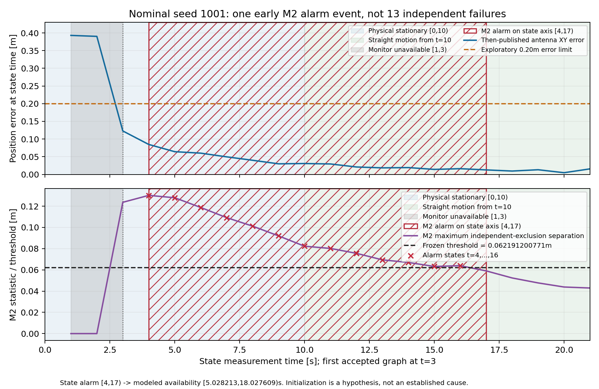

# 草稿PR审阅补充：统计口径、早期报警与M2先验独立性

本文件补充原[详细报告](results_reviewed/REPORT.md)和[一页结论](results_reviewed/CONCLUSION_ONE_PAGE_ZH.pdf)。原结果、协议、阈值、运行清单、旧版本及报告均保持原字节；本次仅从归档CSV核对和绘图，没有启动估计器、重跑测试或重新评价全部场景，也没有调阈值。

## 已确认的提交与范围

审阅开始时分支为 `experiment/integrity-feasibility-v1-20261022`，完整HEAD为 `f8097700fc36565fdeda76e2952c38833c9df3e6`，工作区干净。该提交含660个新增文件，包含监测代码、37项单车/监测测试、4项评价测试、冻结协议与阈值、31次估计器运行、完整逻辑运行/失败清单、全部逐时刻记录及报告。原v1生成失败和v1.1导入谱系亦在提交中。原固定窗口定位器、ROS launch/默认入口和原始bag均未修改。

本次审阅补充将以新提交附在f809770之后，保留其历史。仍以PR37 `13aeade4c6b13ffa55b0acfafe65c29136067c0f` 为实验基线；面向main创建草稿PR，不合并、不把监测器设为默认。

## 正常仿真：13秒的准确分母及事件计数

使用冻结诊断集的正常场景3次独立运行，种子1001、1002、1003；不包括选择阈值的5次正常开发运行，也不把其他故障场景的故障前/恢复段混入这个数字。原指标名normal_false_alarm_s在其他故障场景还包括恢复尾巴，其报警占用不自动等同于全程无故障条件下的纯误报。

每次仿真物理时域 `[0,90]`，归档有89次1Hz状态发布（状态时刻1至89秒），按冻结评价规则将状态保持到下一次状态，最后截止90秒，因此每次已发布状态评价区间为 `[1,90)`、89秒。每次 `[0,1)` 没有状态发布，不能计作可监测。

M1、M2在这3次运行中的可监测掩码逐状态完全相同：每次 `[1,3)` 为启动预测、2秒不可监测，`[3,90)` 为共同可监测区间、87秒。因此两种监测器均使用同一组 **261秒可监测评价时长**，并非各自挑选较有利区间。

| 正常诊断运行 | 物理时长/s | 已发布状态评价/s | M1可监测/s | M1不可监测/s | M2可监测/s | M2不可监测/s | M1报警/s | M2报警/s |
|---|---:|---:|---:|---:|---:|---:|---:|---:|
| seed1001 | 90 | 89 | 87 | 2 | 87 | 2 | 0 | 13 |
| seed1002 | 90 | 89 | 87 | 2 | 87 | 2 | 0 | 0 |
| seed1003 | 90 | 89 | 87 | 2 | 87 | 2 | 0 | 0 |
| 合计 | 270 | 267 | **261** | **6** | **261** | **6** | **0** | **13** |

准确表述：**可监测评价时长261秒；正常情况下M2报警13秒，占13/261≈4.98%，约5.0%。3次独立运行中1次出现报警，连续状态区间为 `[4,17)`，其余两次没有报警。** M1在相同261秒内报警0秒；两者各自6秒不可监测时间另列，不能默认为可信无报警。

计数方法为逐状态对 `[state_time_s,state_interval_end_s)` 求时长，并只累计可监测且 `alarm=True` 的区间。seed1001的13个相邻1秒区间（t=4至16）合并为 **1次连续报警事件**，不是13次独立误报。13/261是本批数据的报警时间占比，不是长期误报概率，不是每秒独立失败概率；3个种子不足以验证长期风险。若以全部已发布状态时域267秒为分母，13/267≈4.87%，该口径包含不可监测时段，不能与261秒口径混用。

证据见[同期图与审阅派生数据](pr_review/)，以及归档[seed1001区间表](results_reviewed/evaluated_runs/test_nominal_1001/intervals.csv)、[逐运行指标](results_reviewed/metrics.csv)、[原评价计数代码](../../../tools/evaluate_single_car_integrity.py)。本次没有改变原始指标，只补全分母和解读。

## `[4,17)`的物理阶段与同期误差

冻结轨迹是0–10秒静止，10–35秒直行（0.04m/s），35–45秒转弯，45–70秒直行，70–90秒静止。因此这次报警跨越 **`[4,10)`静止6秒 + `[10,17)`直行7秒**。估计器启动预测不可监测阶段是 `[1,3)`，首次接受图解的状态时刻是t=3；应将算法初始化阶段与车辆物理静止阶段分开。

同期天线XY位置误差约 **0.0142–0.0847m**，低于探索性0.20m误差门限；M2统计量约0.06322–0.13018m，阈值仍为0.062191200771030145m。阈值需要连续两次超过才触发，图中的报警点来自原记录，没有重新选择触发规则。

早期连续报警可能与初始先验及各独立排除解的收敛差异有关，但本轮没有初始化/先验消融或独立干预证据，**仅保留“可能与初始化有关，原因待核实”**，不将其解释为已证实原因，也不删除该段或调整阈值改善结果。

## 历史实测报警占比不等于仿真误报

历史包没有连续轨迹真值和逐时刻真实故障标签。其统计量是在回放中产生，再用冻结的仿真开发阈值事后回算报警；不冒称现场实时报警。原正常完成包并不保证每个传感器观测均无故障。

| 历史包 | M1报警状态/全部发布状态 | M2报警状态/全部发布状态 |
|---|---:|---:|
| 005135 | 6/92（约6.52%） | 78/92（约84.78%） |
| 004023 | 19/96（约19.79%） | 93/96（约96.88%） |

分母是包括各2次启动预测在内的全部发布状态数；启动不可监测状态仍单独保留，不当作可信。上述是历史实测的 **报警状态占比**，不能称真实误报率、真实故障检出率或全程实际误差越界漏警率，更不能与正常仿真的13/261时间占比混合。它提示阈值/模型迁移存在问题，不能据此直接部署监测器。

## 故障报警覆盖与实际位置误差越界检出

原指标 `detected_fault` 的预登记含义是“故障注入区间内某个状态的监测报警为真”，不是已经证明识别了故障原因，也不代表实际位置误差越界被及时发现。补充指标 `alarm_already_active_at_fault_onset`、`new_alarm_onset_during_fault` 等另记是否原已报警、是否出现新报警；不能把故障前延续的报警当作新发现故障。

实际位置误差只在已知真值仿真中评价，使用当时发布的天线XY和该状态真值，分别按0.20m、0.50m门限统计越界时长和“越界却未报警”时长，并将可用未报警与不可用越界分列。全部24次诊断未出现状态误差>0.50m，零越界不能证明对该门限风险有效。M1/M2只监测，三种方法位置和误差完全一致；本轮没有自动剔除带来的精度改进。

短异常中M1虽对故障内状态报警，但报警在异常恢复之后才可得；M2在正常seed1001报警时位置误差也没有超过0.20m。这两个例子说明故障区间报警覆盖、阈值误报和真实定位误差越界检出必须分别报告。

## 状态时刻、结果可获得时刻与真实墙钟

13秒以及 `[4,17)` 均位于 **状态测量时间轴**，不是直接实测的小车实时报警持续时间。对应M2结果在接收时钟工作者模型中可获得的连续区间为约 **`[5.028213,18.027609)`秒**，长度约12.999396秒；原数据另保存未限速执行的真实UTC及已用墙钟。

`state_time_s`是被估计状态的测量时刻；`result_available_receipt_s`以实测计算开销形成串行工作者模型，计入原1秒等待、触发延迟、求解、M1/M2计算及排队；`actual_output_utc`是离线未限速过程的真实墙钟。输入磁盘/rosbags解码不在ingest计时内。本轮没有ROS/车载真实实时调度验证，工作者模型可获得时间不能冒称实车报警时刻，延迟状态报警不能直接解释为当前车辆位置得到及时保护。

## M2：各排除假设的历史与边缘化先验是否独立

**是：每个假设从共同的初始先验分别开始，独立吸收从第一状态以来全部未排除锚观测的历史信息，并维护自己的边缘化先验。** 这里的“完整历史”是从起点开始独立递推其历史影响，不是永久保存全部非线性历史状态/因子。

- `IntegrityReplay`分别创建排除N10/N2/N3/N8的4个持久 `WindowGraph`。每个对象独立维护状态、Odom、未排除观测、热启动、QR先验矩阵/点/非零仿射偏移及消元次数；初始先验数值相同但内存独立。
- 每次向假设图输入前便删除其排除锚，故该锚从未进入该假设的显式窗口或旧观测先验。假设图不借用全量解的状态、初值或已吸收故障的边缘化先验；只共享已冻结的前端输入及模型。
- 窗口外旧状态相连因子在该假设自己的线性化点QR消元，历史信息保留在该假设自己的边界先验；最多21个求解状态。它是冻结线性化近似，窗口外非线性因子不保留、不重新线性化，不与全历史重线性化严格等价。
- 排除后几何不足、秩异常或失败均标记不可监测，不能当作可信无报警。四个排除图均有效时才形成M2整体监测结论。

可直接审核的测试和证据：

| 证据 | 具体核对内容 |
|---|---|
| `IntegrityTests.test_exclusion_history_and_qr_prior_independent_of_excluded_fault`，[测试源码](../../../tools/test_single_car_integrity.py#L61) | 只改变被排除锚b的观测后，经过真实边缘化的该假设先验矩阵/偏移/点及最终状态逐位不变；与全量先验不是同一对象且不共享矩阵内存；全量解实际发生变化；所有假设的显式观测/来源锚集合均不含各自被排除锚。该数值反事实检验使用锚b，不夸称四个锚分别都做过同样反事实测试。 |
| `IntegrityTests.test_full_locator_bitwise_identical_and_no_feedback` | 添加监测前后全量定位状态/状态码逐位一致，覆盖边缘化，确认无剔除反馈。 |
| `IntegrityTests.test_future_receipt_mutation_and_truncation_do_not_change_past` | 修改/截断未来消息后，既有全量/排除状态、先验与报警不变。 |
| `IntegrityTests.test_missing_data_and_insufficient_redundancy_not_trusted`、`test_rank_deficiency_is_unavailable_even_with_accepted_graph`、`test_solver_and_marginalization_failures_never_mean_no_alarm` | 缺测、秩异常及求解/消元异常不会成为可信结论。 |
| [既有37项测试日志](single_car_tests.log)及[4项指标日志](metric_tests.log) | 本轮试验时已经通过；本次准备PR只核对归档，不重跑。 |
| [既有完整产物校验](artifact_verification.json)、[校验源码](../../../tools/verify_single_car_integrity_artifacts.py) | 2769次发布、11076条假设记录的来源锚/排除观测计数/状态上限/有效性及时间边界检查；来源审计覆盖全部四假设。 |

## 审阅与发布边界

本次新文件只有本补充说明、从既有CSV生成的审阅图/分母核对证据，以及可重现该图的独立脚本。所有f809770原文件按原哈希保留。图只用于检查早期报警，不重新生成传感器、不重新选择阈值、不重新执行定位或全场景评价。

已知限制仍为：小样本、仿真阈值不能直接迁移实测、历史无连续真值、初始化相关原因未证实、边缘化近似未消融、0.50m严重误差未覆盖、可获得时间为工作者模型而非实车验证、无PL/概率完好性保证。本次仅发布草稿PR，不合并main，不变更默认运行方式。
