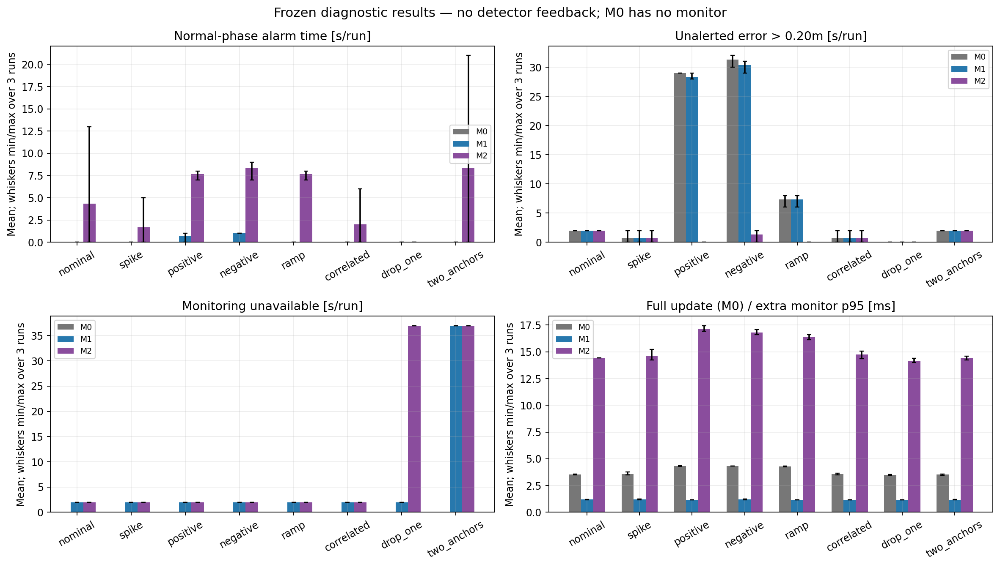

# 单车定位完好性监测可行性试验报告

## 结论与证据

[一页中文结论](CONCLUSION_ZH.md)。以下只解释本轮有限仿真和两份历史开发录包。

| 场景（各3次） | 最大状态误差/m | 测距故障中 M1 / M2 报警覆盖次数 | 未报警且误差>0.20m 的平均秒数 M0 / M1 / M2 | M1 / M2 不可用秒数 |
|---|---:|---:|---:|---:|
| 名义正常 | 0.393 | 可用性/失配另列 | 2.00 / 2.00 / 2.00 | 2.00 / 2.00 |
| 短时异常值 | 0.260 | 3 / 0 | 0.67 / 0.67 / 0.67 | 2.00 / 2.00 |
| 持续正偏 | 0.319 | 3 / 3 | 29.00 / 28.33 / 0.00 | 2.00 / 2.00 |
| 持续负偏 | 0.313 | 3 / 3 | 31.33 / 30.33 / 1.33 | 2.00 / 2.00 |
| 缓增偏差 | 0.262 | 0 / 3 | 7.33 / 7.33 / 0.00 | 2.00 / 2.00 |
| 相关性模型失配 | 0.344 | 可用性/失配另列 | 0.67 / 0.67 / 0.67 | 2.00 / 2.00 |
| 单锚缺测 | 0.171 | 可用性/失配另列 | 0.00 / 0.00 / 0.00 | 2.00 / 37.00 |
| 仅两锚 | 0.468 | 可用性/失配另列 | 2.00 / 2.00 / 2.00 | 37.00 / 37.00 |

## 固定现场与运行范围

实验仓库 `/home/ubuntu22/双车协同/uwb-coop-localization-ros1`；远端 `https://github.com/phyllis-TANG/uwb-coop-localization-ros1.git`；分支 `experiment/integrity-feasibility-v1-20261022`；基线完整HEAD `13aeade4c6b13ffa55b0acfafe65c29136067c0f`，运行期间未变更。原仓库 `/home/ubuntu22/uwb/uwb-coop-localization-ros1` 为干净的 `main`，完整HEAD `f0bc463b6b97d1ac85c2d6f4239d0d1bd30c9835`；远端main与指导值一致，差异来自本地停在PR35。详见 [现场快照](../environment_snapshot.json)。

现场已有PID 59092 roslaunch、59721 rosmaster、59734/59735/59736 UWB仿真/定位/可视化、61095 rosbag及61169 play、61305 Python等进程。它们不是本轮启动，均保持原状；快照保留全进程名称/启动时间。本轮只做离线文件回放，不接ROS主机、不启动真实小车、不覆盖旧结果、不推送或合并。未发现仓库AGENTS.md。

已阅读研究展望、顺序回放与固定窗口README/协议/REPORT/INTERPRETATION、固定窗口/前端/运行器/测试及P1静态迁移来源。原数值代码未修改；新代码与报告脚本的哈希分别记录。

本机Python 3.10.12 / NumPy 2.2.6 / SciPy 1.15.3 / rosbags 0.11.9；归档使用Python 3.12.14 / NumPy 2.3.5 / SciPy 1.17.0 / rosbags 0.11.8。实际复现差远低于1e-6m容差，但不把版本差异忽略。OpenBLAS/OMP单线程。

## A. 复现与输入审计

| 包 | 状态数 | 与原归档最大发布位置差/m | 原评价窗终点差/m |
|---|---:|---:|---:|
| 005135 | 92 | 4.97e-16 | 0.047815 |
| 004023 | 96 | 6.28e-16 | 0.126884 |

实测监测统计量在基线回放时即时计算，但当时尚未冻结仿真开发阈值。historical_monitor_timeseries.csv以最终冻结阈值做事后报警重建，明确标注retrospective；不将此回算冒充现场在线告警，不评价真实故障漏警率。

哈希核对的原始输入：005135 `63880adf78d5f07a9b12a87f7352f49e8f7be82d223bcdf60d96e257ba38b2ff`；004023 `72d4a051005b0b109461842b6489aa2d07b08dd6f6e750c4b9a82aac8d8e1d82`。全部发布时间、原始中位数、支持样本、Odom插值和求解状态与原归档一致。

墙锚XYZ沿用10.17 `session_config.json`：N10=[3.26,.10,2.355]、N2=[5.28,5.16,2.755]、N3=[5.28,2.86,2.355]、N8=[.10,2.41,2.30] m。P1原备注明确是既有人工测量、待复核，未给出测量协方差。仿真将它们作为精确生成几何，仅核对软件一致性；不能反推现场坐标准确。

P1来自 `CAR2_P1_REINSTALL_STATIC_20261017_045257.bag`，人工天线点[2,2,.20]m；本轮独立重算整包各链路raw中位数−三维几何距离，与冻结值一致。N10/N2/N3/N8修正为 .6088636184/.4497374906/.2012859605/.3685143909 m。符号：corrected=raw−bias。前端只检查raw和corrected正数，实际储存与统计始终保留raw；Objective中只减一次。单独测试几何和符号，未重复修正。校准仅适用于该安装及已有未变的10.18安装，不保证迁移到10.11或新现场。

原天线人工起点和+Y朝向是有不确定度的外部输入，先验位置sigma=.20m、朝向sigma=5°；不是无误差真值。杆臂[.12,-.08]m来自近似几何中心，是否为Odom参考点仍待确认。人工终点仅在原停止后评价窗做评价，未传给估计器或用于调参。两包无连续真值，不计算真实全程RMSE和误差越界漏警率。

时间：按bag记录接收顺序读取，header用于测量关联；不按整包header排序、不拟合时钟。t状态采用header在±.4s窗内且截止t+1s前已收到的raw中位数，每链路至少5样本，截止相等的消息计入。Odom插值两端都必须收到；EOF不虚构新时刻。receipt−header在实测中混合时钟偏移和传输，不称网络延迟。原诊断文件保留各topic时间差分位数及非递增次数。

缺测：保留每链路支持样本、当前可用锚数、缺少Odom包围区间、迟到已关闭窗计数。前两状态启动预测；失败求解仅保留预测、accepted_graph=false；排除图异常显式锁存为不可用；不制造新先验，不把失败候选解当成功。所有逐时刻状态和先验都在updates.jsonl。

静止审计用了预登记起始[3,8)s及原终点评价窗，共16个包×窗×链路条目。每条记录std、MAD、p05/p95、lag1/lag20自相关、实际采样间隔及窗内Odom路程。见[分链路稳定性](static_link_stability.csv)；不对人工位置未确认片段称绝对测距偏差。样本相关，不把帧数当独立实验数。

静止检查的具体结果：所有预登记窗内记录Odom路程为0，仍只作条件静止。004023起始N10 raw测距std约0.502m，005135对应窗约0.052m；004023终点N8约0.254m，005135约0.022m。lag1相关在不同链路/窗间约-0.225至0.711，lag20约-0.349至0.200（实际样本间隔约.02s，lag20不是20s）。这支持保留分链路与时间结构诊断，不支持把某个静止残差一概归因于恒定绝对偏差。

## B. 两个监测基线

M0完整复用原20s固定窗口：每秒状态、最多21个求解状态、QR消元仅消费旧状态相连因子；最多50次残差评价，TRF exact及1e-7容差。所有方法共用同一完整输入和全量定位结果。M1/M2不把检测反馈定位器，故三者位置误差完全一致；本轮不报告“改善定位精度”。

M1在本次全量求解后的监测回调中，使用上一条当时发布位姿及已收到Odom推进，形成尚未吸收当前测距的单步预测；比较当前raw测距中位数−一次P1修正与预测几何距离。统计量为各链路原始创新绝对值最大值/冻结range_sigma(.20m)，不是完整协方差白化、不是卡方分布假设。阈值1.000000来自5次正常开发运行0.995分位×1.25并设下限1.0；连续2次超阈值报警，一次不超或不可用就复位。

同时保留每链路原始测距、一次修正后测距、原始有符号创新、后验原始残差及标准化值、原模型signed pseudo-Huber变换残差、IRLS权重和加权残差；完整活动窗残差保存在原始JSONL。监测不依赖被鲁棒损失压小后的残差。range_sigma来自原模型且大于本仿真raw随机噪声.06m，不做有效样本数缩小；对相关噪声可能失配，单独诊断。

M2从相同初始先验分别建立排除N10/N2/N3/N8的4个WindowGraph；每个图从第一状态开始就不接收排除锚，独立维护状态、热启动、QR边缘化先验及仿射残差。只共享不可变前端raw中位数和Odom，绝不借用全量先验。统计量是全量与四个排除解当时天线XY距离的最大值，单位m。阈值0.062191201m依同一开发规则、下限.05m、连续2次触发。每条记录保存各假设先验矩阵/偏移/点、边缘化次数、源锚集合及历史链哈希。

有效性：M1要求全量求解接受、当前至少3锚、raw XY距离几何秩2；M2进一步要求四个排除图均成功且各有至少3个当前保留锚、几何秩2、加权目标Jacobian满列秩。相对秩容差1e-8、条件数上限1e8。单锚缺测时部分排除假设只剩2锚，因此M2整体“无法形成有效监测结论”，虽然其数值统计量仍保存。有限先验可能让代数图满秩，但不等于具有单锚故障冗余。规则保守，不能把仅两锚等同于所有运动下绝对不可定位。

这些是受文献启发的简化监测。2020固定窗口解分离论文还推导故障模型和风险界，本轮未实现这些概率推导。[原文DOI](https://doi.org/10.1109/LRA.2020.2975769)。2023工作利用不同参考配置的冗余和离散度检测节点异常，本轮没有复现其多机器人配置匹配/剔除算法。[原文](https://arxiv.org/abs/2303.17207)。这里所有解分离距离和Hessian信息都不命名为PL，不声称精确论文复现。

## C. 仿真协议、时效与评价

90秒：0–10静止，10–35以.04m/s直行，35–45原地左转90°，45–70直行，70–90静止；20Hz生成二维车体/朝向/天线真值，再独立生成Odom增量噪声、raw测距和接收时间。初始真实车体XY以sigma.20m、yaw以sigma5°独立偏离外部先验。Odom XY随机游走.004m/√s、yaw .003rad/√s、运行尺度误差sigma1%；range边际sigma.06m、名义AR1 rho=.2。生成器四个独立随机流分离起点、Odom、UWB和接收延迟。

故障：N10短异常[30,32)s +.50m；持续正/负[25,60)s ±.30m；渐增偏差[25,60)s从0线性增至.30m；相关失配同区间rho=.98且创新噪声按sqrt(1-rho²)缩放以保持边际尺度；单锚缺测N10；两锚场景仅保留N2/N8。持续35s超过20s窗，恢复后留30s。以上是探索注入，不能断言真实传感器必然如此。

接收：Odom延迟均匀.02–.03s，UWB .06–.08s；每401个UWB样本增加1.10s延迟，以FIFO递交避免悄悄重排消息头，产生可检查的迟到/缺样窗。生成器离线安排接收顺序；估计器只逐行读sensors.jsonl，严格拒绝未知字段。估计器配置只含模型/前端/预算/有效性规则，既无真值、故障标签、种子或场景区间，也不导入生成/评价程序。truth.csv与fault_labels.json仅由评价程序读取。

记录三种时间：state_time_s测量状态；result_available_receipt_s为以实测每事件ingest/求解/监测/串行日志开销形成的接收时钟工作者模型；actual_output_utc和unpaced_actual_output_elapsed_s为本次未限速执行的真实墙钟。工作者start=max(原接收时间,前一事件finish)，当前触发事件可能晚于t+1s，额外计入触发等待和排队。统计量生成时间在全量求解后，M2还等待四排除图完成；先前监测计算可拖延后续M0。输入磁盘/rosbags解码不在ingest模型计时内；未做真实实时调度或ROS网络测量，因此不会把虚拟可获得时间冒称实车实际报警延迟。

主要误差在每次当时发布状态的测量时刻计算；区间为[state_t,next_state_t)，最后截止90s，未覆盖启动0–1s另报。未报警越界总时长包含不可用期间，并另外分解“可用未报警”和“不可用越界”；M0无监测，始终没有新增报警，监测不可用列为不适用。同时在.05s评价网格以最新可获得结果保持，报告接收轴的延迟状态越界时间，以及不作Odom外推的旧位置对当前真值误差；后二者不能混同当前定位保护。

报警延迟以首个针对故障区间内状态的报警实际模型可获得时刻−故障开始计；它是预登记的报警覆盖指标，不必然代表从无报警到新报警；补充列记录是否原已报警和新报警起始，另记是否在故障恢复前可得。恢复要求连续3个恢复期状态误差低于.20/.50m，或监测可用且无报警；区分状态轴和接收轴，未达到记删失/未恢复。正常误报分别记录故障前和恢复后的报警占用时间，恢复尾巴不隐藏。

各运行均为独立种子完整重复，连续帧仅用于描述时长，不估计极低风险概率；.20/.50m都是探索性诊断门限，不是月球任务安全阈值。

## D. 全部结果与恢复

关键观察：持续正/负偏差M1均在约3.02–3.03s首次报警，但随后创新适应、报警消失，平均仍有28.33/30.33s误差>0.20m未报警。M2首次报警约4.03–5.05s，未报警越界分别0/1.33s；并未降低定位误差。渐增场景M1未报警，M2约16.04s后报警。短异常M1约2.02s后报警，均晚于[30,32)s恢复时刻，不能宣称及时发现；M2无故障内状态报警。

仿真阈值在两份实测开发包的事后回算：M1报警005135为6/92状态、004023为19/96；M2分别78/92和93/96。原正常完成包也几乎持续报警，说明仿真名义分布、参数和现场模型误差之间存在明显迁移问题；没有连续真值或逐帧真实故障标签，不能把上述计数称为真实误报率或检出率。下一步必须独立实测验证阈值/模型，不能直接部署这组数字。

本轮24次诊断没有任何当时发布状态误差超过0.50m，因此该门限越界未报警时间为0仅意味着本试验没有覆盖到该严重程度，不能证明对0.50m风险有效。名义最大.393m和两锚最大.468m主要出现在有不确定起点的启动预测阶段；启动不可用2s和初始无输出间隙都单列保留。

3条名义测试中M1无误报，M2在seed1001误报13s，其余两次无误报；可见5条正常开发运行不足以验证阈值跨初始先验变化的误报控制。两锚场景seed1702原本已有正常阶段报警，在25s统计窗边界仍有足够故障前样本时继续报警；这不是新发现两锚缺测。按预登记仍保存“故障内状态报警”指标，另增加alarm_already_active_at_fault_onset与新报警起始审计列；缺测/相关失配不列入测距故障检出统计。

正/负偏差恢复后，状态误差连续3次低于0.20m通常从恢复后3s开始；M2无报警恢复从7–9s开始，接收轴再增加约1.04s。渐增场景误差约2s恢复、M2报警7–8s恢复。该尾巴包括旧窗口因子、持续边缘化先验、Odom及噪声的共同影响；未做重置先验消融，不能把全部尾巴唯一归因于边缘化。

[逐运行指标](metrics.csv)包含全部72个“24次运行×3方法”指标行；[场景汇总](scenario_summary.csv)只给3次运行描述均值/范围；[所有越界、报警、不可用区间](intervals.csv)。每次的逐时刻误差/统计量/报警/支持锚/可获得时刻见evaluated_runs目录，原始残差与独立先验见runs目录。

| 场景 | M1延迟/s（三次） | M2延迟/s（三次） | M1/M2正常阶段报警平均秒数 | M1/M2额外计算p95平均/ms |
|---|---|---|---:|---:|
| 名义正常 | 未检出/未恢复, 未检出/未恢复, 未检出/未恢复 | 未检出/未恢复, 未检出/未恢复, 未检出/未恢复 | 0.00/4.33 | 1.18/14.43 |
| 短时异常值 | 2.027, 2.023, 2.024 | 未检出/未恢复, 未检出/未恢复, 未检出/未恢复 | 0.00/1.67 | 1.19/14.63 |
| 持续正偏 | 3.021, 3.020, 3.016 | 5.048, 5.042, 4.040 | 0.67/7.67 | 1.16/17.17 |
| 持续负偏 | 3.030, 3.026, 3.035 | 5.042, 4.032, 5.048 | 1.00/8.33 | 1.20/16.79 |
| 缓增偏差 | 未检出/未恢复, 未检出/未恢复, 未检出/未恢复 | 16.047, 16.043, 16.044 | 0.00/7.67 | 1.17/16.43 |
| 相关性模型失配 | 未检出/未恢复, 未检出/未恢复, 未检出/未恢复 | 未检出/未恢复, 未检出/未恢复, 未检出/未恢复 | 0.00/2.00 | 1.16/14.74 |
| 单锚缺测 | 未检出/未恢复, 未检出/未恢复, 未检出/未恢复 | 未检出/未恢复, 未检出/未恢复, 未检出/未恢复 | 0.00/0.00 | 1.15/14.17 |
| 仅两锚 | 未检出/未恢复, 未检出/未恢复, 未检出/未恢复 | 未检出/未恢复, 未检出/未恢复, 1.031 | 0.00/8.33 | 1.17/14.42 |

下表给每场景最大误差尾部及恢复（完整分种子值保留metrics.csv）。

| 场景 | M0/M1/M2未报警>0.50m平均秒数 |
|---|---:|
| 名义正常 | 0.00/0.00/0.00 |
| 短时异常值 | 0.00/0.00/0.00 |
| 持续正偏 | 0.00/0.00/0.00 |
| 持续负偏 | 0.00/0.00/0.00 |
| 缓增偏差 | 0.00/0.00/0.00 |
| 相关性模型失配 | 0.00/0.00/0.00 |
| 单锚缺测 | 0.00/0.00/0.00 |
| 仅两锚 | 0.00/0.00/0.00 |

## E. 测试、版本失败、预算与可恢复性

37项单车与监测测试通过：包括原模型残差/解析导数/QR Schur等价、未来消息修改/截断不改变过去、真实输入前端边界、独立排除历史在故障锚观测改变后先验矩阵/偏移/点完全一致、原始测距只修正一次、传感器/估计器无真值字段、注入符号/幅度/开始/恢复、相关噪声边际尺度、缺测/秩异常/求解失败不被标成可信、无故障M0逐位一致。增加了故障标签JSON序列化回归，以及禁止真值/标签文件访问、改变标签不改变输出的可执行工作者集成测试。评价函数另有独立手工区间/恢复测试。

一次早期测试夹具把故障放在静止天线正上方锚，其水平梯度为零，不能用它验证全量解必须变化；改用具有水平敏感度的锚后通过，监测实现未因此改动。首次诊断v1在完成3条正常测试后，首条spike生成器保存NumPy布尔标签失败，估计器尚未执行。v1源快照、完整产物和失败输入全部保留，修复版本v1.1仅改Python bool标签写盘及回归测试。原2历史+5开发+3正常诊断按输入和执行哈希复用，继续其余21诊断；未重调阈值、未扩大种子/参数网格。

v1.1完成状态：{'completed': 31}；总计运行进程耗时52.469s（包含复用运行原耗时），低于3600s预算；每条均低于180s。没有超时或估计器进程失败。生成失败独立保留，不能因未进估计器而隐去。导入运行保留execution_source_lock_sha256/execution_threshold_sha256以及兼容性来源，不冒称新源码下重跑。

source_lock锁定估计器、生成器、前端、必要测试、总运行器、协议和纯估计器配置；每运行保存输入与输出哈希，启动时校验源码/协议，完成后复核，恢复校验全部输出并跳过已完成项。报告与评价源码有独立manifest。每阶段更新HANDOFF；最终HANDOFF提供显式v1.1路径，避免用旧v1默认路径恢复。

## F. 图表与复现



[全部轨迹与时间图](FIGURES.md)，每场景一张真值/当时发布轨迹、一张误差/统计量/故障/报警时间图，另提供SVG。三种方法使用相同定位轨迹，图中只画一条并明确标注；统计图误差线仅表示3次运行的min/max，不是置信区间。

从仓库根目录执行（不安装新依赖，复用现场离线依赖目录）：

```bash
env PYTHONPATH=/home/ubuntu22/uwb/offline-deps OPENBLAS_NUM_THREADS=1 OMP_NUM_THREADS=1 python3 -m unittest discover -s tools -p "test_single_car_*.py" -v
env PYTHONPATH=/home/ubuntu22/uwb/offline-deps OPENBLAS_NUM_THREADS=1 OMP_NUM_THREADS=1 python3 tools/run_single_car_integrity_experiment.py --experiment docs/field_tests/integrity_feasibility_v1_1_20261022 --phase all
env PYTHONPATH=/home/ubuntu22/uwb/offline-deps OPENBLAS_NUM_THREADS=1 OMP_NUM_THREADS=1 MPLCONFIGDIR=/tmp/uwb-integrity-mpl python3 tools/report_single_car_integrity.py --experiment docs/field_tests/integrity_feasibility_v1_1_20261022 --output /tmp/integrity-report-reproduction
```

已存在的运行只核对并跳过；报告输出必须是新目录。若从零重跑，复制冻结协议到另一个新目录，独立执行，避免覆盖本轮证据。完整从零运行会增加执行次数，应视为单独复现实验。

## G. 双车扩展优先级

1. **优先：共享墙锚持续故障。** 两车可能同时被同一锚拉偏，而车间相对距离仍一致；用同一偏差源同时作用于两车，保存共同/独立噪声，比较两车绝对位置与相对位置。排除假设必须同时排除该墙锚对两车的所有观测，且各自独立边缘化。增加共模偏移/相关标定误差，观察单故障假设的盲区。
2. **其次：车间链路故障。** 固定墙锚正常时只给车间距离加持续正/负偏差，评估错误如何传到伙伴；保留墙锚充足/减少两类几何，不把停住伙伴当无误差锚。
3. **必须伴随记录：双向测距相关性。** 记录节点身份、硬件和消息事务时间；A→B与B→A共享传播、硬件或时钟时不能作为独立观测重复增强置信。下一轮先按单一链路故障组建排除假设，再用独立实测估计双向相关/时间相关，决定联合噪声模型。

下一步证据要求是未参与开发的新实测、墙锚/杆臂和Odom参考核验及连续独立位置参考；随后才能讨论候选监测阈值跨环境迁移和实车报警时效。

收尾远端核对：main已更新至PR38 `21d3d48476579837caa6aee4e1027cf57b9d18e3`，相对本轮基线增加2个提交，内容为双车三包离线对照；没有修改本轮单车固定窗口文件。本轮仍固定PR37，不切换、不混入新结果。完整差异见 `remote_final_check.json`。
