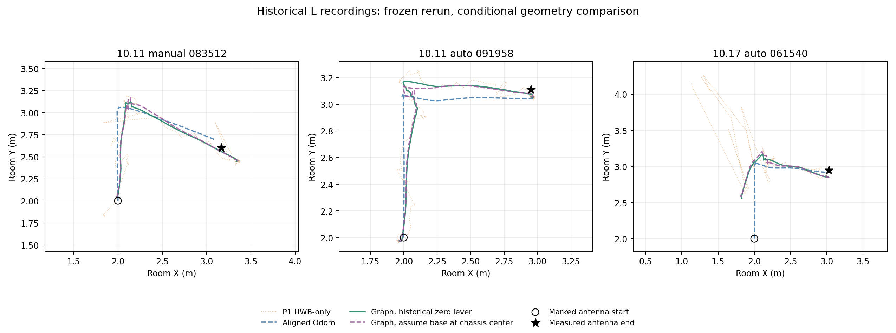

# 三个历史 L 型包：固定方案复跑结果

日期：2026-10-21。代码核查基线 main `ba16d58a08148531db136c4a96e289161dc9f1c4`。这是回顾性的跨录包开发验证。

计算后补充：用户确认 UWB 在车上的安装位置始终未改变，因此不再把“历史天线是否移动”列为未知。10.18 测量的是相对近似几何中心的偏移；仍需核实该中心与 Odom 车体参考点是否重合。详见 `MOUNT_USER_CONFIRMATION_20261021.md`。本次更新解释，原冻结方案与数值结果保留。

## 结论

三个包已完成全部 15 次图优化，均返回成功；7 项独立数值检查通过。新版核心求解器在保留历史零杆臂和相同偏置时，与旧版的全部状态逐数相同。重新核对全精度静态 P1 校正后，三个终点差约为 22.61、5.42、9.04 cm，未出现新的明显改善。

将相对几何中心量得的天线偏移作为 Odom 车体参考点到天线的杆臂，末尾窗口终点差约为 22.61、5.42、9.04 cm，同样没有明显改善。用户已确认安装未变；这组计算的剩余条件是两参考点重合。该关系未被独立核实，因此这些数值用于检验参考点假设的影响，不能据此宣布该外参正确。

这次结果说明：旧实验本来已经做过静态偏置校正；把同一标定方法重新运行，或者完善杆臂表达，并不会自动再次产生此前零偏置对照中那么大的收益。当前限制集中在跨位置/朝向的测距一致性、异常约束和未验证的几何前提，不能只靠末端数字或静止平滑程度判定问题已解决。

## 1. 主评价：严格保留历史末尾窗口

| 记录 | 旧归档融合/cm | 新版零杆臂/cm | 假设两中心重合/cm | 匹配纯UWB/cm | 对齐Odom/cm |
| --- | --- | --- | --- | --- | --- |
| 10.11 manual 083512 | 22.55 | 22.61 | 22.61 | 21.71 | 12.65 |
| 10.11 auto 091958 | 5.40 | 5.42 | 5.42 | 5.29 | 7.09 |
| 10.17 auto 061540 | 9.04 | 9.04 | 9.04 | 9.02 | 3.51 |

旧归档融合是历史静态校正图；新版零杆臂指 `G_P1`，使用该安装时期重新核对的全精度 P1 偏置，保留历史零水平杆臂近似。假设两中心重合指 `G_assumedL`，将几何中心到天线的 `[0.12,-0.08] m` 同时当作 Odom 车体参考点到天线的偏移。匹配纯 UWB 指 `U_P1`，在同一批关键帧与校正测距中位数上独立鲁棒求解，不用 Odom、终点或时间平滑。

对齐 Odom 使用标记起点和近似初始朝向，其结果依赖这些前提；起始误差为零是构造结果，不构成独立定位验证。新版图没有在三个包上稳定优于这一对照。图与纯 UWB 也没有一致的末端收益；图会使用整段未来信息，纯 UWB 不使用，不能据此声称同等信息条件下的普遍优势。

10.11 两包每个关键帧仅有 N10/N2/N3 三条可用测距，N8 没有被补造；10.17 每帧有四条。三个包分别为 117、176、132 个状态。旧报告的末尾五秒在这些关键帧上均只有 4 个状态，不能把它说成五次独立位置测量。

## 2. 补充评价：统一取最后运动停止后 [2,7)

| 记录 | 新版零杆臂/cm | 假设两中心重合/cm | 匹配纯UWB/cm | 对齐Odom/cm |
| --- | --- | --- | --- | --- |
| 10.11 manual 083512 | 21.08 | 21.19 | 24.89 | 12.65 |
| 10.11 auto 091958 | 4.45 | 4.30 | 4.72 | 7.09 |
| 10.17 auto 061540 | 9.88 | 9.81 | 8.63 | 3.51 |

该窗口由最后非零运动指令和随后零指令确定，每个包完整覆盖 5 个关键帧；没有按误差大小挑选。三个窗口内 Odom 路径和 yaw 变化为零，未出现非零运动指令；这些支持静止判断，仍不能代替独立物理真值。

两种评价窗口都会保留。10.11 自动包在两个窗口下约为 4–5 cm；手动包仍约 21–23 cm；10.17 仍约 9–10 cm。换成统一停止窗口也没有改变本轮主要判断。

## 3. 只看终点会漏掉什么

初始窗口相对标记天线起点的差值如下：

| 记录 | 旧版复跑/cm | 新版零杆臂/cm | 假设两中心重合/cm | 匹配纯UWB/cm |
| --- | --- | --- | --- | --- |
| 10.11 manual 083512 | 4.93 | 4.91 | 4.59 | 22.85 |
| 10.11 auto 091958 | 4.28 | 4.24 | 4.28 | 5.48 |
| 10.17 auto 061540 | 60.28 | 60.28 | 61.52 | 230.86 |

10.17 包末端约差 9 cm，但图的初始位置仍偏约 60 cm，因而不能把该包描述为全程达到 9 cm。假设历史杆臂后，初始差值约为 61.5 cm，未消除这个问题。10.11 手动包的图虽然初始位置较接近标记起点，终点仍出现约 22.6 cm 的偏差。

下表直接用初始窗口中的测距关键帧中位数减去标记天线起点对应的几何距离，使用本场次 P1 校正，独立于图优化输出：

| 记录 | 链路 | 初始关键帧数 | 校正测距减标记起点几何距离/m |
| --- | --- | --- | --- |
| 10.11 manual 083512 | node_10 | 2 | 0.060 |
| 10.11 manual 083512 | node_2 | 2 | 0.418 |
| 10.11 manual 083512 | node_3 | 2 | -0.109 |
| 10.11 manual 083512 | node_8 | 0 | 无该链路 |
| 10.11 auto 091958 | node_10 | 4 | 0.013 |
| 10.11 auto 091958 | node_2 | 4 | 0.051 |
| 10.11 auto 091958 | node_3 | 4 | 0.035 |
| 10.11 auto 091958 | node_8 | 0 | 无该链路 |
| 10.17 auto 061540 | node_10 | 4 | 2.066 |
| 10.17 auto 061540 | node_2 | 4 | -0.097 |
| 10.17 auto 061540 | node_3 | 4 | 0.011 |
| 10.17 auto 061540 | node_8 | 4 | 0.013 |

10.17 的 N10 初始超差约 +2.066 m，其余三链路接近标记几何；10.11 手动包 N2 初始约 +0.418 m。样本窗口短，标记起点的测量不确定度也未量化，这些是明显的不一致证据，不能仅凭此确认遮挡、朝向、设备或某一种故障原因。它们也表明静态固定偏置不足以覆盖全部运行条件。添加一个 14 cm 左右的假设水平杆臂，并不能解释/消除 2 m 量级的初始链路差。

## 4. 所有方法的主窗口结果

| 记录 | 方法 | 末尾窗终点差/cm | 末尾窗散布/cm | 状态数 |
| --- | --- | --- | --- | --- |
| 10.11 manual 083512 | A | 12.648 | 0.000 | 4 |
| 10.11 manual 083512 | U_raw | 62.070 | 2.390 | 4 |
| 10.11 manual 083512 | U_P1 | 21.714 | 3.211 | 4 |
| 10.11 manual 083512 | G_raw | 60.831 | 0.101 | 4 |
| 10.11 manual 083512 | G_old | 22.547 | 0.170 | 4 |
| 10.11 manual 083512 | G_new0 | 22.547 | 0.170 | 4 |
| 10.11 manual 083512 | G_P1 | 22.614 | 0.170 | 4 |
| 10.11 manual 083512 | G_assumedL | 22.610 | 0.173 | 4 |
| 10.11 auto 091958 | A | 7.087 | 0.000 | 4 |
| 10.11 auto 091958 | U_raw | 70.117 | 0.752 | 4 |
| 10.11 auto 091958 | U_P1 | 5.291 | 0.749 | 4 |
| 10.11 auto 091958 | G_raw | 69.698 | 0.009 | 4 |
| 10.11 auto 091958 | G_old | 5.401 | 0.017 | 4 |
| 10.11 auto 091958 | G_new0 | 5.401 | 0.017 | 4 |
| 10.11 auto 091958 | G_P1 | 5.422 | 0.017 | 4 |
| 10.11 auto 091958 | G_assumedL | 5.422 | 0.018 | 4 |
| 10.17 auto 061540 | A | 3.507 | 0.000 | 4 |
| 10.17 auto 061540 | U_raw | 57.116 | 0.708 | 4 |
| 10.17 auto 061540 | U_P1 | 9.024 | 0.265 | 4 |
| 10.17 auto 061540 | G_raw | 56.986 | 0.010 | 4 |
| 10.17 auto 061540 | G_old | 9.042 | 0.017 | 4 |
| 10.17 auto 061540 | G_new0 | 9.042 | 0.017 | 4 |
| 10.17 auto 061540 | G_P1 | 9.042 | 0.017 | 4 |
| 10.17 auto 061540 | G_assumedL | 9.042 | 0.017 | 4 |

`G_raw` 到 `G_P1` 是零偏置到静态校正的控制对照，表明校正仍然重要；这项收益历史上已经存在。`G_old` 与 `G_new0` 是完全相同输入和标定下的新旧代码等价对照；`G_P1` 只是将原 P1 舍入数值换回全精度。10.11 最大偏置舍入差约 0.343 mm，10.17 约 0.00051 mm，不能把这类小数变化当作算法提升。

散布是相对本窗口估计位置中位数的 RMS，不是位置真值误差。约 0.02 cm 的末端散布并不表示约 0.02 cm 的定位精度。

## 5. 轨迹图

只标出已有标记起点和人工终点，没有把计划 L 折线画成全程真值。全轨迹展示用于观察估计之间的差异，不能计算连续轨迹准确度。条件性杆臂会改变部分中间状态，即使末端差值近似不变。

## 6. 复现与检查

主分支 9 个源文件/配置/旧结果的 Git blob 字节核查通过。三个 L bag 与两个独立静态标定 bag 的哈希核对通过，10.11 与 10.17 使用各自的锚点和标定，未跨安装混用。

10.11 两个旧终点结果精确复现；10.17 旧终点最大复现差为 7.63e-10 m。10.17 原归档是 Python2/NumPy1.13.3/SciPy0.19.1，本轮是 Python3/NumPy2.3.5/SciPy1.17.0；该数值差不能当作算法收益。现代运行环境下，新旧求解器零杆臂的完整状态差为 0。

独立复核从普通 CSV 重建全部 48 条终点记录、72 条静止窗口、3,400 条轨迹状态及 7,035 条物理测距残差；物理残差重建的最大差为 8.88e-16 m。原算法的收敛停止不代表达到全局最优或统计模型正确。

`displacement_metrics.csv` 同时保留起终点位移向量差；`residual_by_link_window.csv` 保留所有链路在全程和各窗口的拟合残差，含缺失链路；`reference_range_residuals.csv` 保留已知参考点的测距差。所有组合都已保存，没有删去变差的假设或异常包。

## 7. 对下一步工作的影响

目前五个纯单车 L 形包已各有离线分析，用户确认天线安装未变。相对几何中心的天线偏移可按这一安装历史沿用，但几何中心与 Odom 车体参考点的关系仍未知，因此不能把五包直接称为完全验证了同一个已测量的 Odom—天线外参模型。

已有证据支持优先研究测距质量判断和异常约束管理：10.17 N10 的初始稳定大偏差、10.11 手动包的链路变化是应保留的困难样例。后续可以用事先冻结、与终点无关的规则做新对照，比较全程状态、起终点、缺测可用性及是否引入新的错误；这轮未新增门限或按终点挑规则。

同时补齐实际底盘 Odom/IMU 代码与车体参考点定义，确定几何中心到该参考点的变换。在线因果回放可以先做软件准备，但不能直接继承这轮批处理的准确度承诺。最终泛化评估仍需未用于选择的新数据与独立参考。本轮保持原始 bag、旧结果和默认配置，尚未发布新 PR。
