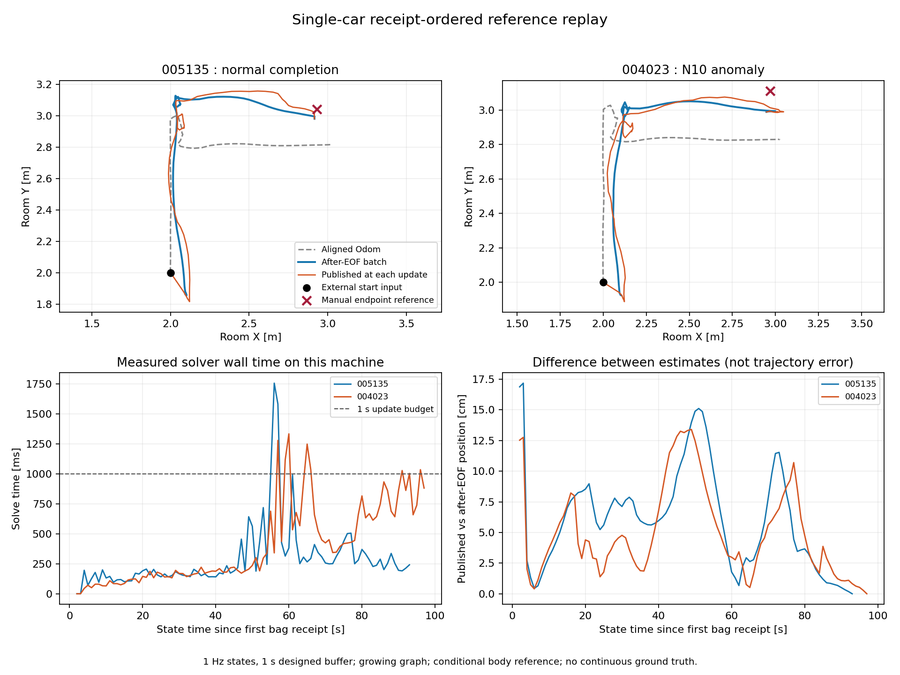

# 单车 Python 顺序回放基准

沿用冻结的 Odom＋UWB 模型，按记录接收时间持续更新；IMU 没有独立因子。
本实现保留全部历史，每次重新求解；没有固定窗口或实车实时性能验收。

| 包 | 当时发布终点差/cm | 整包离线终点差/cm | 对齐 Odom 终点差/cm | 图输出/全部 | 求解p95/ms |
|---|---:|---:|---:|---:|---:|
| 005135 | 4.827 | 5.650 | 24.567 | 90/92 | 684.040 |
| 004023 | 12.724 | 11.856 | 28.550 | 94/96 | 1033.962 |

评价使用原协议冻结的停止后 [2,7) 窗；终点只用于回放完成后的评价。
published.csv 保存当时发布的位置；final_smoothed.csv 是整包结束后的历史修正。
release_delay_s=1 是继承原 ±0.4s 统计窗的设计等待值，不是实测网络延迟。
时钟不作事后拟合，关闭的统计窗不被迟到消息重写。
没有连续轨迹真值；近似底盘几何中心与 Odom 参考点相同仍是假设。
计算统计来自本次机器上的未限速回放，不能替代车载计算机上的实时测速。
两个包已经用于开发，不属于独立未见测试集。

10 项行为与数值单元测试通过；184 次图更新成功，4 次启动预测；两包各 28 个历史输出通过 30 秒截断不变性复核。

顺序发布轨迹与整包离线轨迹的差异，在正常包和异常包的成功图状态中分别可达 15.11 cm 和 13.40 cm；这是两种估计的差，不是已知轨迹误差。终点接近不代表运动过程与离线结果相同。
