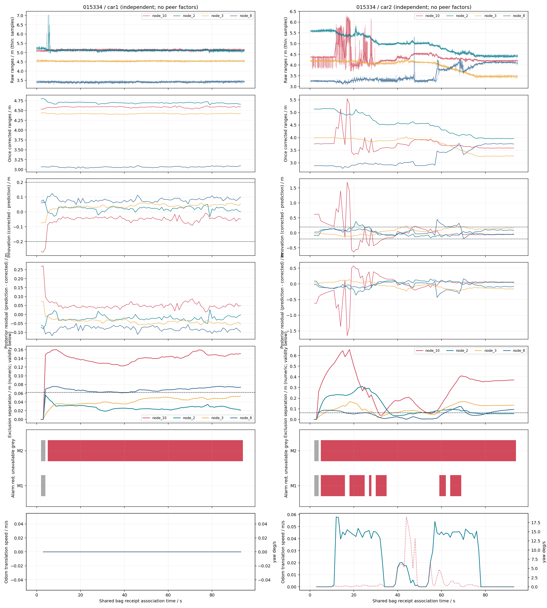
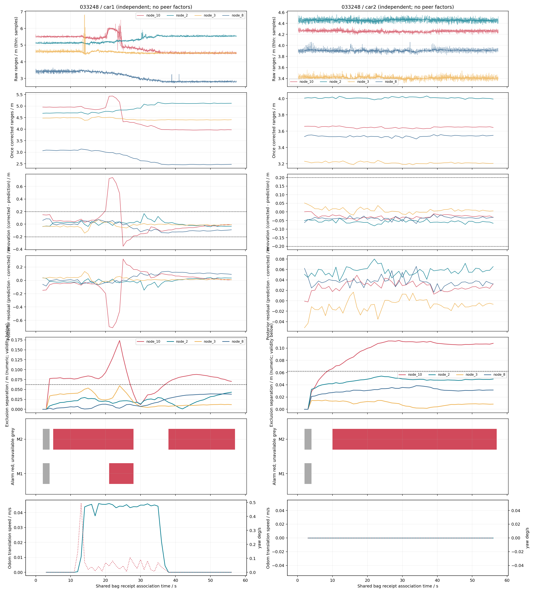
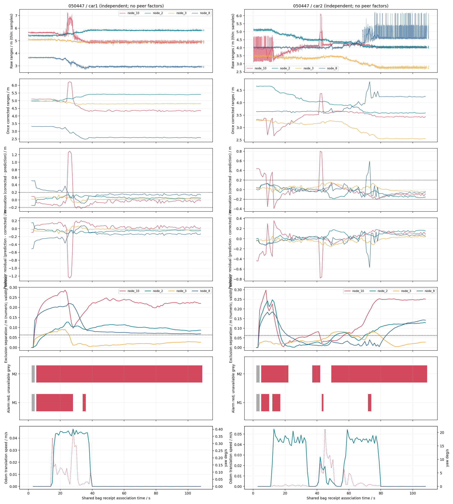

# 双车独立因果定位与完好性监测衔接：一页中文结论

三份历史双车包共六条分车回放已完成；没有加入车间测距、独立 IMU 或 PR39 两项策略。M1/M2 为旧阈值迁移诊断，报警不是已证实的真实故障。

|包 / 车|状态数 / 时刻s|M1 报警/可监测s|M2 报警/可监测s|冻结窗终点差cm|
|---|---:|---:|---:|---:|
|015334 / car1|92 / 2–93|0/90|89/90|18.95|
|015334 / car2|92 / 2–93|32/90|89/90|9.13|
|033248 / car1|55 / 2–56|7/53|42/53|9.09|
|033248 / car2|55 / 2–56|0/53|47/53|3.34|
|050447 / car1|107 / 2–108|25/105|104/105|18.81|
|050447 / car2|107 / 2–108|13/105|82/105|15.88|

报警比例的分母为可监测状态时长；启动无输出、启动不可用与其他不可用分别记录。单状态按 [t,t+1) 描述，末段裁到实际 bag EOF。

对应检查（同一 bag、车、链路、起终点窗口；最大排除项只表示敏感度，不能当作故障隔离）：

- 015334 car2 node_10 start：PR38 校正测距−人工几何 +0.617m；本轮重叠 4 状态中 M1/M2 报警 1/1，该锚为 M1/M2 最大项 4/4 次。
- 050447 car1 node_8 start：PR38 校正测距−人工几何 +0.509m；本轮重叠 4 状态中 M1/M2 报警 1/1，该锚为 M1/M2 最大项 4/2 次。
- 050447 car1 node_8 end：PR38 校正测距−人工几何 +0.195m；本轮重叠 5 状态中 M1/M2 报警 0/5，该锚为 M1/M2 最大项 5/0 次。
- 050447 car2 node_10 end：PR38 校正测距−人工几何 -0.212m；本轮重叠 5 状态中 M1/M2 报警 0/5，该锚为 M1/M2 最大项 0/5 次。

其余报警保留完整事件、运动阶段、四锚创新和排除解记录；没有连续位置真值与故障标签，无法判断真实误报/漏警，也无法把报警唯一归因于某个物理原因。新三包 N10 专项报告尚未发现，标记“待对照”。PR39 静态 N10 正负参考差来自其他静态包，不能当作本轮逐时刻故障标签。

人工终点只按事先冻结的 PR38 末五时刻评价；停止支持、实际覆盖和原始 Odom 速度另列。定位与旧整包独立/联合结果的信息范围不同，位置差不等于真实全程误差。两车共用接收时间不证明物理同步。

六条正式进程合计 13.053s；最大单条 2.818s。两车采用独立虚拟工作者，1秒等待、触发等待、计算、排队和当前输出写盘后的可获得时间单列；不据此宣称平台满足实时要求。

## 分车可用性、计算与边界

### 015334_car1

前端计数：`{"clock_events": 12392, "odom_events": 1908, "uwb_events": 4760, "late_packets_for_closed_bins": 0, "missing_odom_bracket": 0, "invalid_raw_ranges": 0, "nonpositive_corrected_ranges": 0, "bootstrap_skipped_deadlines": 0}`；缺链路状态：`{"node_10": 0, "node_2": 0, "node_3": 0, "node_8": 0}`。
预测回退 2，求解失败 0；启动无输出 2s。
M1/M2 启动不可用 2/2s，其他不可用 0/0s。
全量更新/M1/M2 计算累计 0.2812/0.0991/1.0990s；可获得结果年龄 `{"min": 1.0026675269976986, "median": 1.0232990875213908, "p95": 1.030699695343613, "max": 1.036123705017964}`。
冻结终点评价和停止支持：`{"frozen_times_s": [89.0, 90.0, 91.0, 92.0, 93.0], "actual_times_s": [89.0, 90.0, 91.0, 92.0, 93.0], "full_window_present": true, "all_graphs_accepted": true, "antenna_xy_m": [1.6270052512762054, 3.8593227654502686], "manual_reference_xy_m": [1.5, 4.0], "difference_to_manual_m": 0.18952682705171903, "odom_path_m": 0.0, "odom_total_yaw_deg": 0.0, "raw_odom_samples": 80, "max_recorded_linear_velocity_m_s": 0.0, "max_recorded_yaw_velocity_deg_s": 0.0, "strict_numerical_constant": true, "conditional_stop_supported": true}`。

### 015334_car2

前端计数：`{"clock_events": 12438, "odom_events": 1893, "uwb_events": 4729, "late_packets_for_closed_bins": 0, "missing_odom_bracket": 0, "invalid_raw_ranges": 0, "nonpositive_corrected_ranges": 0, "bootstrap_skipped_deadlines": 0}`；缺链路状态：`{"node_10": 0, "node_2": 0, "node_3": 0, "node_8": 0}`。
预测回退 2，求解失败 0；启动无输出 2s。
M1/M2 启动不可用 2/2s，其他不可用 0/0s。
全量更新/M1/M2 计算累计 0.3940/0.0974/1.4689s；可获得结果年龄 `{"min": 1.00264853701026, "median": 1.028122875985133, "p95": 1.0396141097487832, "max": 1.0460021350096227}`。
冻结终点评价和停止支持：`{"frozen_times_s": [89.0, 90.0, 91.0, 92.0, 93.0], "actual_times_s": [89.0, 90.0, 91.0, 92.0, 93.0], "full_window_present": true, "all_graphs_accepted": true, "antenna_xy_m": [3.040976089823181, 3.0318491430347887], "manual_reference_xy_m": [2.95, 3.04], "difference_to_manual_m": 0.09134049150723245, "odom_path_m": 0.0, "odom_total_yaw_deg": 0.008606038354228789, "raw_odom_samples": 79, "max_recorded_linear_velocity_m_s": 0.0, "max_recorded_yaw_velocity_deg_s": 0.17188734003335085, "strict_numerical_constant": false, "conditional_stop_supported": true}`。

### 033248_car1

前端计数：`{"clock_events": 7182, "odom_events": 1158, "uwb_events": 2888, "late_packets_for_closed_bins": 0, "missing_odom_bracket": 0, "invalid_raw_ranges": 0, "nonpositive_corrected_ranges": 0, "bootstrap_skipped_deadlines": 0}`；缺链路状态：`{"node_10": 0, "node_2": 0, "node_3": 0, "node_8": 0}`。
预测回退 2，求解失败 0；启动无输出 2s。
M1/M2 启动不可用 2/2s，其他不可用 0/0s。
全量更新/M1/M2 计算累计 0.1707/0.0551/0.6923s；可获得结果年龄 `{"min": 1.006597800008704, "median": 1.0269094910106276, "p95": 1.0465473199032056, "max": 1.1397440360106543}`。
冻结终点评价和停止支持：`{"frozen_times_s": [52.0, 53.0, 54.0, 55.0, 56.0], "actual_times_s": [52.0, 53.0, 54.0, 55.0, 56.0], "full_window_present": true, "all_graphs_accepted": true, "antenna_xy_m": [1.4440054042857806, 2.8893300367598247], "manual_reference_xy_m": [1.45, 2.98], "difference_to_manual_m": 0.09086791189276705, "odom_path_m": 0.0, "odom_total_yaw_deg": 0.0, "raw_odom_samples": 80, "max_recorded_linear_velocity_m_s": 0.0, "max_recorded_yaw_velocity_deg_s": 0.0, "strict_numerical_constant": true, "conditional_stop_supported": true}`。

### 033248_car2

前端计数：`{"clock_events": 7220, "odom_events": 1147, "uwb_events": 2861, "late_packets_for_closed_bins": 0, "missing_odom_bracket": 0, "invalid_raw_ranges": 0, "nonpositive_corrected_ranges": 0, "bootstrap_skipped_deadlines": 0}`；缺链路状态：`{"node_10": 0, "node_2": 0, "node_3": 0, "node_8": 0}`。
预测回退 2，求解失败 0；启动无输出 2s。
M1/M2 启动不可用 2/2s，其他不可用 0/0s。
全量更新/M1/M2 计算累计 0.1286/0.0549/0.5527s；可获得结果年龄 `{"min": 1.006631534986182, "median": 1.0229727709850778, "p95": 1.0418768779114396, "max": 1.1344954140022878}`。
冻结终点评价和停止支持：`{"frozen_times_s": [52.0, 53.0, 54.0, 55.0, 56.0], "actual_times_s": [52.0, 53.0, 54.0, 55.0, 56.0], "full_window_present": true, "all_graphs_accepted": true, "antenna_xy_m": [2.9239043766306225, 3.060843290571089], "manual_reference_xy_m": [2.95, 3.04], "difference_to_manual_m": 0.03339796881349616, "odom_path_m": 0.0, "odom_total_yaw_deg": 0.0, "raw_odom_samples": 80, "max_recorded_linear_velocity_m_s": 0.0, "max_recorded_yaw_velocity_deg_s": 0.0, "strict_numerical_constant": true, "conditional_stop_supported": true}`。

### 050447_car1

前端计数：`{"clock_events": 14809, "odom_events": 2211, "uwb_events": 5522, "late_packets_for_closed_bins": 0, "missing_odom_bracket": 0, "invalid_raw_ranges": 0, "nonpositive_corrected_ranges": 0, "bootstrap_skipped_deadlines": 0}`；缺链路状态：`{"node_10": 0, "node_2": 0, "node_3": 0, "node_8": 0}`。
预测回退 2，求解失败 0；启动无输出 2s。
M1/M2 启动不可用 2/2s，其他不可用 0/0s。
全量更新/M1/M2 计算累计 0.3855/0.1173/1.4596s；可获得结果年龄 `{"min": 1.005006493990424, "median": 1.02376796302174, "p95": 1.0605996099928714, "max": 1.7965128899882643}`。
冻结终点评价和停止支持：`{"frozen_times_s": [104.0, 105.0, 106.0, 107.0, 108.0], "actual_times_s": [104.0, 105.0, 106.0, 107.0, 108.0], "full_window_present": true, "all_graphs_accepted": true, "antenna_xy_m": [1.0451950512111934, 3.1564007825949214], "manual_reference_xy_m": [1.02, 2.97], "difference_to_manual_m": 0.1880958329084771, "odom_path_m": 0.0, "odom_total_yaw_deg": 0.0, "raw_odom_samples": 82, "max_recorded_linear_velocity_m_s": 0.0, "max_recorded_yaw_velocity_deg_s": 0.0, "strict_numerical_constant": true, "conditional_stop_supported": true}`。

### 050447_car2

前端计数：`{"clock_events": 14853, "odom_events": 2199, "uwb_events": 5490, "late_packets_for_closed_bins": 0, "missing_odom_bracket": 0, "invalid_raw_ranges": 0, "nonpositive_corrected_ranges": 0, "bootstrap_skipped_deadlines": 0}`；缺链路状态：`{"node_10": 0, "node_2": 0, "node_3": 0, "node_8": 0}`。
预测回退 2，求解失败 0；启动无输出 2s。
M1/M2 启动不可用 2/2s，其他不可用 0/0s。
全量更新/M1/M2 计算累计 0.3815/0.1158/1.5287s；可获得结果年龄 `{"min": 1.004976621003936, "median": 1.0248444370242744, "p95": 1.0610779392999685, "max": 1.8000121109867564}`。
冻结终点评价和停止支持：`{"frozen_times_s": [104.0, 105.0, 106.0, 107.0, 108.0], "actual_times_s": [104.0, 105.0, 106.0, 107.0, 108.0], "full_window_present": true, "all_graphs_accepted": true, "antenna_xy_m": [3.834494474498097, 2.8403234472373673], "manual_reference_xy_m": [3.91, 2.98], "difference_to_manual_m": 0.15877853687753596, "odom_path_m": 0.0, "odom_total_yaw_deg": 5.088887490341627e-14, "raw_odom_samples": 82, "max_recorded_linear_velocity_m_s": 0.0, "max_recorded_yaw_velocity_deg_s": 0.0, "strict_numerical_constant": true, "conditional_stop_supported": true}`。

## 图与表

states.csv 为逐状态结果/时间/运动状态，links.csv 保留四锚原始与一次修正中位数、创新、后验残差和支持数；exclusions.csv 为四个独立排除假设，events.csv 为连续报警/不可用事件；完整先验矩阵、偏移和历史链哈希在各运行 updates.jsonl。
sensor_provenance.jsonl 保留原始 header_ns、bag 接收 ns、关联时间及各原始观测；peer_diagnostic_only.csv 双向数据仅诊断。PR38_comparison.csv 只作因果/整包输出比较，correspondence.csv 覆盖全部48个起终点×车×墙锚窗口。
数值解分离曲线在不可用时仍可显示，不能作可信监测结论；有效性见灰色区间及 CSV available/reasons。原始创新为 corrected−prediction，后验残差为 prediction−corrected。
模型可获得时间排除 bag 解码、输入档案写盘和进程启动，这些均计入实际单条180秒预算。两车虚拟队列独立，正式进程串行执行；未测试真实并发平台。

