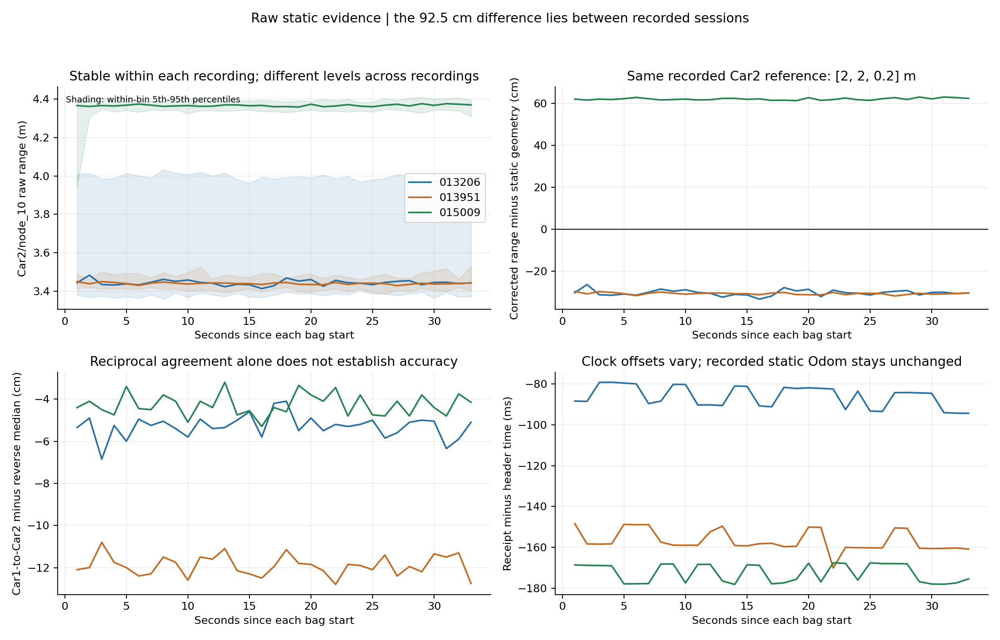
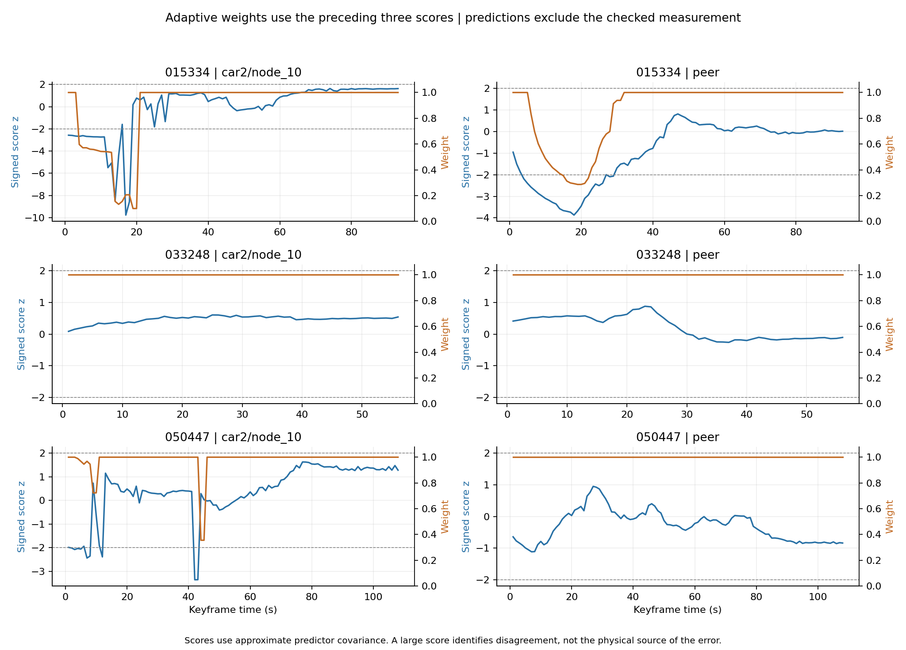
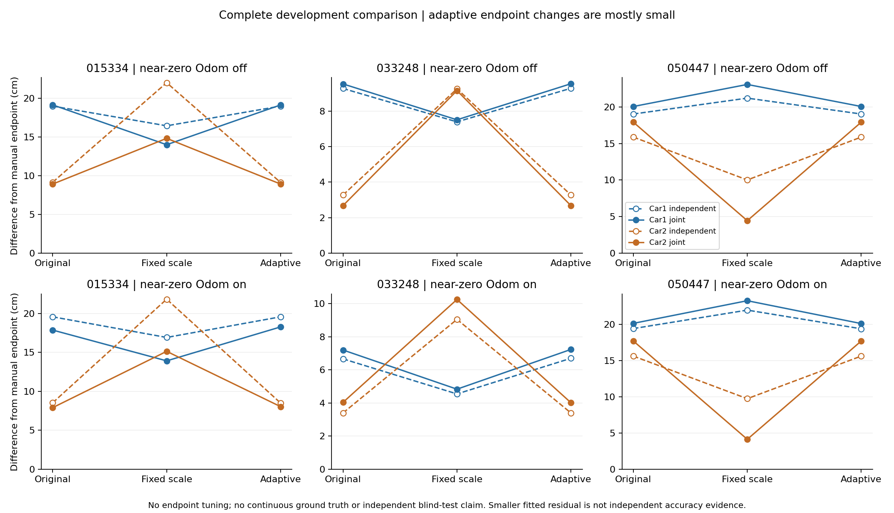

# 原始测距诊断与一种历史一致性降权策略

已完成用户授权的两步：七包原始诊断；一种冻结的留一链路预测/历史一致性降权，与原模型、固定降权及近零约束开关对照。
32 项相关测试通过；36 次实际图求解全部成功；PR39 四组配置的完整轨迹逐点复现差为 0。

## 约 92 cm 的差异位于录制之间

| 静态包 | Car2/node_10 原始中位数/m | 原修正后参考偏差/cm | 首五秒→末五秒原始中位数/m |
|---|---:|---:|---|
| 013206 | 3.446 | -30.00 | 3.446 → 3.448 |
| 013951 | 3.441 | -30.50 | 3.446 → 3.443 |
| 015009 | 4.366 | +62.00 | 4.366 → 4.373 |
| 020151 | 4.188 | -7.92 | 4.186 → 4.186 |

前三包 Car2 人工参考位置均为 [2,2,0.2] m，记录的 Odom XY 未变，013951 与 015009 的记录航向差约 0.0029°。
每包 1–33 秒的中位数曲线各自稳定；013951→015009 的全包原始中位数差为 92.5 cm。
现有包未覆盖两段录制之间的切换，无法给出切换发生的精确时刻或确定物理原因。020151 为不同的 Car2 位置，仅作对照。
七包共检查 194,573 个 quality 值，有限值为 0；没有可用于本轮判断的有效质量分数、RSSI/CIR 或独立 NLOS 标签。
嵌入消息定义为米，tag/anchor ID 和旧前端读数核对一致；包内 UWB header 未发现倒退。header/receipt 偏移随录制变化，但零 Odom 的整段中位数差不能仅靠小幅时间平移解释。
这些证据缩小了排查范围，尚不能排除摆位参考、遮挡、安装朝向或设备状态变化；不改写用户坐标来消除差异。

## 新策略及实际触发时段

对每条墙链路，用不包含它的三状态预测器处理 Odom 和其他墙测距；车间距离由不使用任何车间测距的两车预测器给出。
当前权重只读取前三个关键帧的标准化不一致分数：中位绝对分数超过 2 时逐步降权，下限 0.1。原修正值、先验、损失和因子数量不变。
预测器协方差为近似值，分数不是校准后的卡方检验；当前/未来被检测距不能影响当前权重，单条测距也不进入自身预测。

| 包 | 被降权信息 | 关键帧时段/s | 最小权重 |
|---|---|---|---:|
| 015009 | car2/node_10 | 4–33 | 0.520 |
| 015009 | peer | 7–33 | 0.253 |
| 015334 | car2/node_10 | 4–20 | 0.100 |
| 015334 | peer | 6–31 | 0.287 |
| 050447 | car2/node_10 | 4–10 | 0.723 |
| 050447 | car2/node_10 | 44–45 | 0.356 |

这里是算法触发的关键帧时段，不是独立标注的 NLOS 起止。所有链路详见 downweighted_intervals.csv。

## 原模型、固定降权、新策略：完整终点对照

每格为各自融合→联合融合，与人工终点差，单位 cm；末五个关键帧的天线坐标中位数。

| 包 | 近零约束 | 策略 | Car1/cm | Car2/cm |
|---|---|---|---:|---:|
| 015334 | 关 | original | 19.00 → 19.15 | 9.16 → 8.92 |
| 015334 | 关 | fixed | 16.45 → 14.01 | 22.02 → 14.83 |
| 015334 | 关 | adaptive | 19.00 → 19.15 | 9.13 → 8.92 |
| 015334 | 开 | original | 19.57 → 17.87 | 8.54 → 7.91 |
| 015334 | 开 | fixed | 16.92 → 13.92 | 21.84 → 15.14 |
| 015334 | 开 | adaptive | 19.57 → 18.28 | 8.50 → 8.04 |
| 033248 | 关 | original | 9.27 → 9.52 | 3.27 → 2.67 |
| 033248 | 关 | fixed | 7.39 → 7.51 | 9.25 → 9.15 |
| 033248 | 关 | adaptive | 9.28 → 9.54 | 3.27 → 2.67 |
| 033248 | 开 | original | 6.67 → 7.20 | 3.40 → 4.04 |
| 033248 | 开 | fixed | 4.55 → 4.84 | 9.05 → 10.26 |
| 033248 | 开 | adaptive | 6.70 → 7.24 | 3.40 → 4.02 |
| 050447 | 关 | original | 19.03 → 20.06 | 15.87 → 17.91 |
| 050447 | 关 | fixed | 21.20 → 23.08 | 10.01 → 4.44 |
| 050447 | 关 | adaptive | 19.03 → 20.06 | 15.87 → 17.91 |
| 050447 | 开 | original | 19.42 → 20.14 | 15.63 → 17.71 |
| 050447 | 开 | fixed | 21.97 → 23.27 | 9.74 → 4.13 |
| 050447 | 开 | adaptive | 19.39 → 20.11 | 15.62 → 17.71 |

新策略与相同近零开关下的原模型比较，最大终点变化约 0.41 cm，未形成明显且可靠的精度提升；人工参考误差尚未量化。
015334 静止 Car1 的联合轨迹在开启近零约束时从 6.79 cm 缩短到 4.98 cm，但其终点差从 17.87 cm 增至 18.28 cm。
033248 对应静止 Car2 轨迹为 3.02→2.98 cm；050447 的联合终点仍约 Car1 20.11 cm、Car2 17.71 cm。
所以只能说部分形变受到抑制，不能宣称稳定协同增益或全程轨迹更准确。

## 检出不一致仍不等于找到了错误源

015009 的车间测距中位数约 2.1255 m，人工三维参考约 2.0618 m，相差约 +6.37 cm；
但使用全部墙测距的预测器给出约 1.3107 m，于是车间信息在 27/33 个关键帧被降权，最低约 0.253。
只在预测端移除 Car2/node_10 后，车间预测中位数变为约 1.8331 m，车间降权次数降至 0；其余预测偏差仍存在。
这个反事实只用于诊断，没有回写本轮冻结权重、改变阈值或新增第二种融合策略。它支持“墙测距可污染预测端”的解释，也表明简单一致性门控不足以独立确定错误源。

## 本轮决策

新增方法保留为研究候选和可复现对照，不替换默认模型。现阶段更明确的成果是定位了跨录制持续差异、找出了原始质量字段缺失及预测端污染这一限制。
下一轮应研究有冗余支持的错误源区分，再决定对墙测距还是车间测距降权；避免只降低阈值追求更多触发。实验室仍需同点同朝向、改变遮挡、返回原点的独立重复记录。
三个动态包均为已知开发数据，静态预测以已知位置作外部起点先验，不是盲测。继承 ±0.4 秒居中统计窗和 Odom 插值；权重在关键帧序列上只取过去分数，但端到端仍是离线批量平滑。
没有双车在线/固定窗口或独立 IMU 因子。连续真值、原点外参与物理原因仍待补证。

