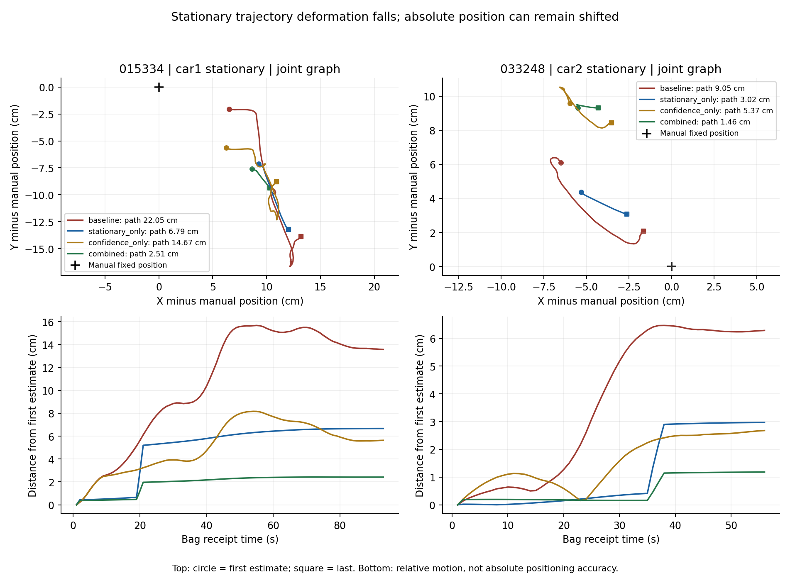
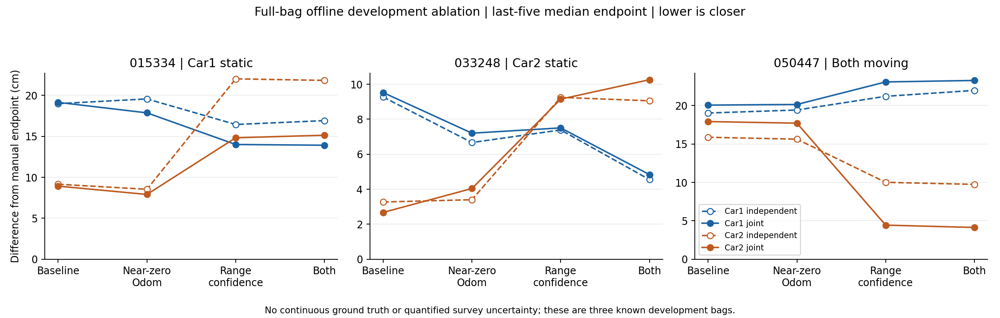
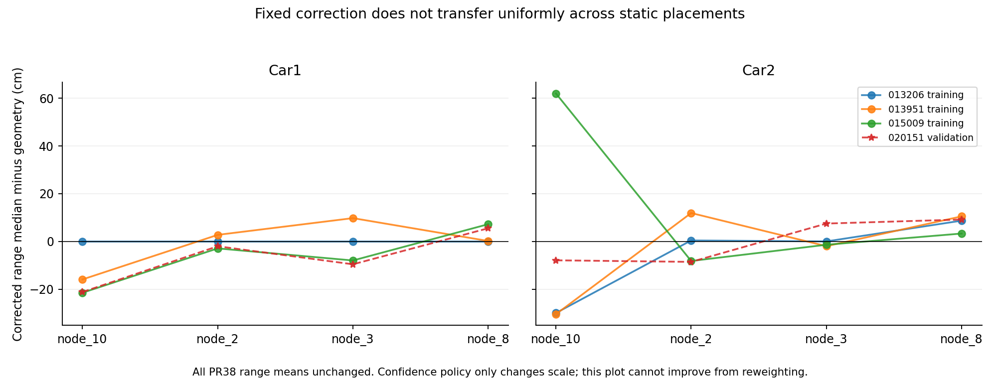

# 静止车拉动与测距可信度：冻结方案的第一轮开发试验

本轮完成三包 × 六配置 × 两方法，共 36 次全包离线求解；全部接受，最多 10 次函数评估。PR38 主基线逐点复现差为 0。
22 项数值与策略测试通过。四种主配置为：原基线、仅近零运动协方差、仅测距可信度、两项同时启用；另外保留两种人工整车墙测距缺失。

## 静止车辆的形变确实减少，但整体平移仍存在

| 包 / 静止车 | 原联合轨迹/cm | 仅近零运动/cm | 仅测距可信度/cm | 同时启用/cm |
|---|---:|---:|---:|---:|
| 015334 / car1 | 22.05 | 6.79 | 14.67 | 2.51 |
| 033248 / car2 | 9.05 | 3.02 | 5.37 | 1.46 |

这些数值是静止车辆的累计估计轨迹长度，不是定位误差、ATE 或两车间距误差。
仅近零运动策略分别使联合图的静止车轨迹缩短约 69% 和 67%；同时启用约 89% 和 84%。
策略只把已有 Odom 相对增量的标准差乘 0.1，保留原始均值和起点先验；没有把真实静止坐标锁入优化。
缺样/时间间隙处不启用加强约束，残余形变可能集中在这些边，详见 candidate_edge_deformation.csv。

## 终点并非全面改善

单位 cm；每格为各自融合 → 联合融合，与人工终点比较，采用最后五个关键帧天线坐标中位数。

| 包 | 配置 | Car1/cm | Car2/cm |
|---|---|---:|---:|
| 015334 | baseline | 19.00 → 19.15 | 9.16 → 8.92 |
| 015334 | stationary_only | 19.57 → 17.87 | 8.54 → 7.91 |
| 015334 | confidence_only | 16.45 → 14.01 | 22.02 → 14.83 |
| 015334 | combined | 16.92 → 13.92 | 21.84 → 15.14 |
| 033248 | baseline | 9.27 → 9.52 | 3.27 → 2.67 |
| 033248 | stationary_only | 6.67 → 7.20 | 3.40 → 4.04 |
| 033248 | confidence_only | 7.39 → 7.51 | 9.25 → 9.15 |
| 033248 | combined | 4.55 → 4.84 | 9.05 → 10.26 |
| 050447 | baseline | 19.03 → 20.06 | 15.87 → 17.91 |
| 050447 | stationary_only | 19.42 → 20.14 | 15.63 → 17.71 |
| 050447 | confidence_only | 21.20 → 23.08 | 10.01 → 4.44 |
| 050447 | combined | 21.97 → 23.27 | 9.74 → 4.13 |

同时启用时，050447 的 Car2 从基线联合 17.91 cm 降到 4.13 cm，但 Car1 从 20.06 cm 增到 23.27 cm；
015334 的移动 Car2 则从 8.92 cm 增到 15.14 cm，033248 的静止 Car2 从 2.67 cm 增到 10.26 cm。
不能据此宣称新配置整体优于基线、两车均受益或协同收益已稳定成立。静止形变减少与绝对定位改善是两个评价目标。

## 固定可信度为何仍会退步

保持 PR38 的每车墙测距修正和无车间偏置的策略；新尺度为 hypot(0.2 m, 训练静态包中该链路最大的绝对中位数参考偏差)。
013206、013951、015009 为尺度训练；020151 只验证。没有动态终点拟合，也没有新增位置修正函数。
Car2/node_10 的尺度由 0.2 m 增到 0.65146 m，车间尺度为 0.34897 m；损失仍是原 signed pseudo-Huber。
这会降低存在迁移问题的测距影响，但也会在该链路已经恢复正常时丢掉有用的信息，且不能消除物理测距偏差。

**偏差还不能单纯归因于位置。** 三个训练静态包的 Car2 人工参考位置均为 [2, 2, 0.2] m，
但 node_10 修正后参考偏差分别为 013206: -30.00 cm, 013951: -30.50 cm, 015009: +62.00 cm。
同一位置的差异约 92.50 cm。
这只能证明现有固定修正未充分描述数据与参考的差异，不能独自确定是遮挡、朝向、时间变化、设备状态还是参考记录问题。

## 人工整车墙测距缺失：完整保留反例

| 包 | 同时启用后移除观测 | Car1 各自→联合/cm | Car2 各自→联合/cm |
|---|---|---:|---:|
| 015334 | combined_no_car1_walls | 0.00 → 15.39 | 21.84 → 22.53 |
| 015334 | combined_no_car2_walls | 16.92 → 16.89 | 22.18 → 7.05 |
| 033248 | combined_no_car1_walls | 6.71 → 6.17 | 9.05 → 9.22 |
| 033248 | combined_no_car2_walls | 4.55 → 4.74 | 0.00 → 16.31 |
| 050447 | combined_no_car1_walls | 1.91 → 17.39 | 9.74 → 7.68 |
| 050447 | combined_no_car2_walls | 21.97 → 21.99 | 25.53 → 20.28 |

这是合成缺测，不能称为真实 NLOS 测试。静止车只靠正确外部起点和零 Odom 得到零终点差，不代表普遍零误差定位。
例如 033248 移除 Car2 墙测距后，联合图仍使其整体偏移约 16.31 cm，尽管轨迹形变已经很小。

## 当前决策与后续验证

近零运动协方差保留为可选候选：相对形变目标有正面证据，须验证推车、打滑、极低速、停车边界与掉帧。
静态统一测距尺度保留为实验对照，不替换默认模型，也不作为已解决空间偏差的结论。
下一轮优先检查随时间变化的多链路一致性/异常测距识别，并用独立留出数据评价；不继续依靠这三个终点调出漂亮数字。
实验室先核对 Odom 原点和安装外参/朝向，随后在同位置、不同朝向、交换遮挡和移动后返回原点的静态重复中记录卷尺参考，区分位置效应与状态变化。
近零检测中的 pose/twist 来自同一 Odom 消息，彼此不独立；即使两者为零，也不能证明真实车辆没有被推动或打滑。
所有结果仍是已知历史包的全包离线平滑，无连续真值、无盲测结论、无双车顺序回放或联合固定窗口，也无新增独立 IMU 因子。

