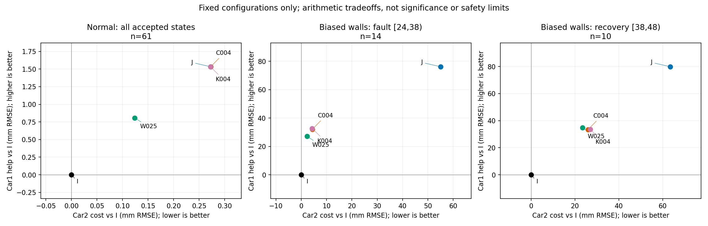
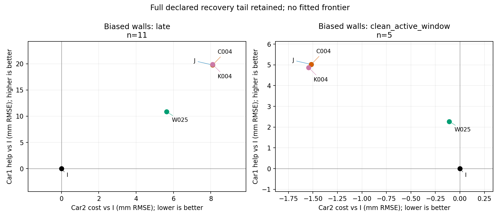

# 帮助—代价判定：已有配置的取舍，尚无可批准的代价数值

**本轮已完成两件事：从PR78的2,268行逐时刻导出重算帮助—代价关系；整理16项容差来源。结论是固定配置之间存在阶段性反转，不能据当前数据选出全局赢家，也不能倒推一个让候选通过的厘米阈值。** 没有新估计器运行、场景、seed、门限搜索或实包。仅一个已暴露seed101的正常/共同墙偏差配对，不是独立验证。

图横轴为Car2相对同输入独立I的XY RMSE增加（越小越好），纵轴为Car1的RMSE减少（越大越好）。保留负值，不按结果重分健康角色。这里是**相对I的RMSE差**，不是故障相对正常、逐时刻正损害均值、相对参照位移或绝对误差界。PAIRED_CONDITIONS另列同方法故障减正常，PER_CAR另列逐时刻正损害及其1秒离散累计。

| 固定方法 | 故障窗Car1帮助 / Car2代价（mm） | 恢复窗Car1帮助 / Car2代价（mm） |
|---|---:|---:|
| I独立 | 0 / 0 | 0 / 0 |
| J原联合 | 76.156 / 55.009 | 79.860 / 63.460 |
| W025缩权 | 27.078 / 2.258 | 34.855 / 23.441 |
| C004裁剪 | 32.093 / 4.435 | 33.402 / 26.026 |
| K004图内约束 | 32.672 / 4.330 | 33.480 / 27.028 |

故障窗14、恢复窗10个共同accepted时刻；正常全段61。all_finite另保留全部63个发布及2个启动unknown。全部既有方法无漏发布/失败/回退；这不是可用率风险的统计保证。

**哪些可以说，哪些不能说：**

- 故障窗K004比C004两车位置RMSE小约0.579/0.105mm，属于仅XY的算术支配；加入两车yaw，K004分别多1.506°/1.425°，就变成取舍。恢复窗K004又让Car2位置RMSE多1.001mm。不能只画XY局部放大图宣布优势。
- 恢复窗W025两车XY/yaw都低于C004/K004，构成该样本该窗口的算术支配。但59–63秒尾段C004/K004的XY/yaw又低于W025。固定缩权没有相对I的4cm硬预算，不能因此声称它满足裁剪合同。
- 同时纳入两条件和所有原阶段，五个主方法的十个配对均存在取舍；没有全阶段算术支配。1e-12仅消除舍入假差异，**不是实际等价容差**。单seed无重复性区间，因此“明确较差”只限指定指标/窗口的数值关系，不能推广成方法普遍较差。
- N/Nclip使用预知停止时刻；A0_4/A4_0使用不同预算，仅在单独诊断图中保留。它们不参与公平主排名。获得相同四墙线索的门控限幅尚未实现，不能宣称候选已超越该基线。

**代价判据现在能固定什么：** 同输入、同前缀、同分母、逐车XY及yaw、正常/故障/全部恢复阶段、unknown/回退/失败和成本必须列全；不采用团队加权总分，不用小残差替代真误差。最小有意义帮助、允许同伴退化、正常退化界、yaw界、恢复时限、可用率损失和部署deadline目前均无批准数值，在表中保持null。4cm仅为旧开发预算；1e-4仅为旧求解数值复核；2cm改善、5mm参考、1/3比例都是旧讨论示例/草案。

**下一步的具体门槛：** 先由独立用途/研究尺度规定值得分辨的效应，再核对配对参考和重复性是否能支撑；不能反过来把测不清的损害当作可接受。若尚无用途损害界，可继续报告帮助—代价取舍，但不声称“无害/等效/可接受”。现阶段不扩大图内硬约束实验。唯一可继续的资料核对是办公室恢复既有实际XYZ、安装和同步不确定度记录；没有就缩减真实精度主张，不自动采集。详见CRITERIA.md与TOLERANCE_SOURCES。

四个针对性算术测试通过；432行每车分阶段结果（864个XY/yaw RMSE）与旧表一致；源SHA、身份、同状态/同截止及分母检查通过。这只是导出读回与算术一致性，不是再次验证估计器或真实精度。

