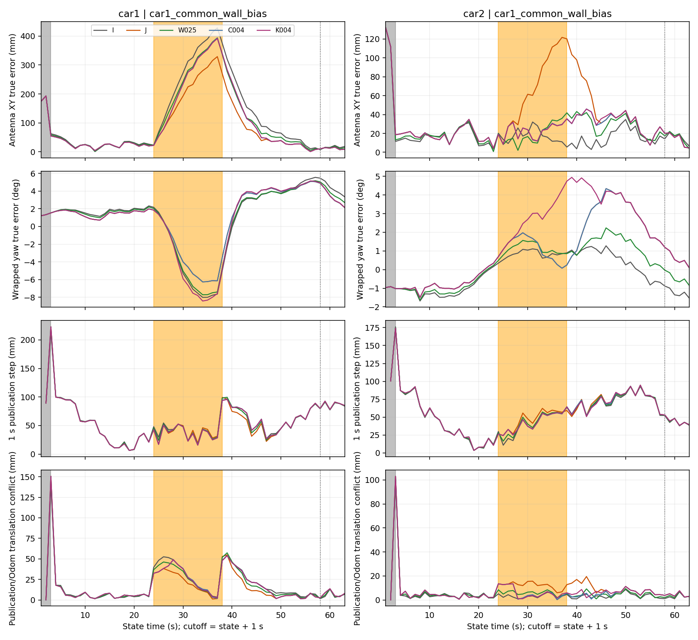
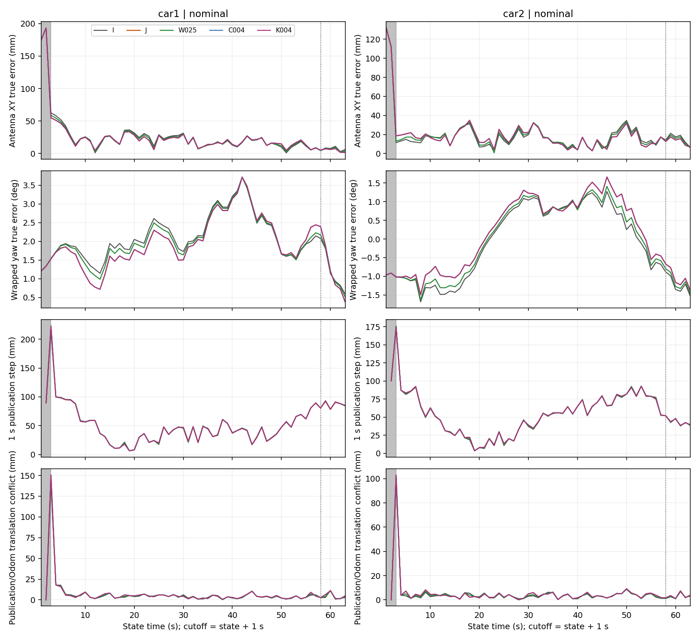
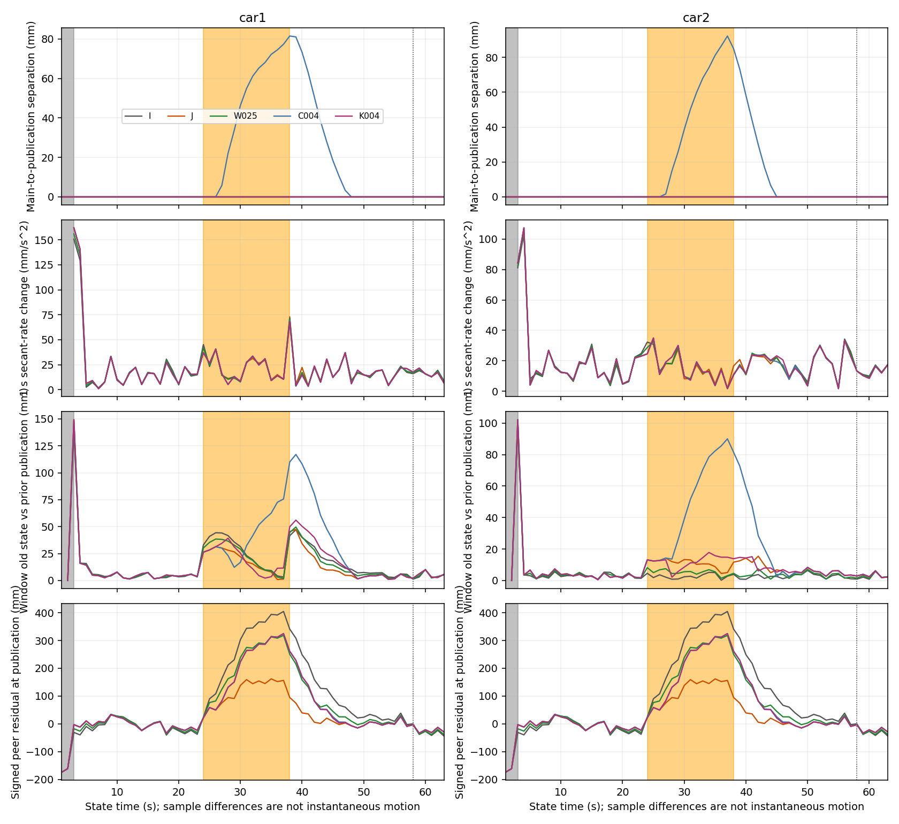
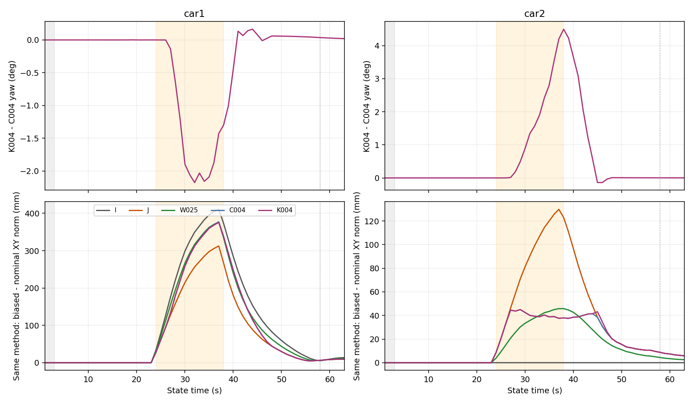
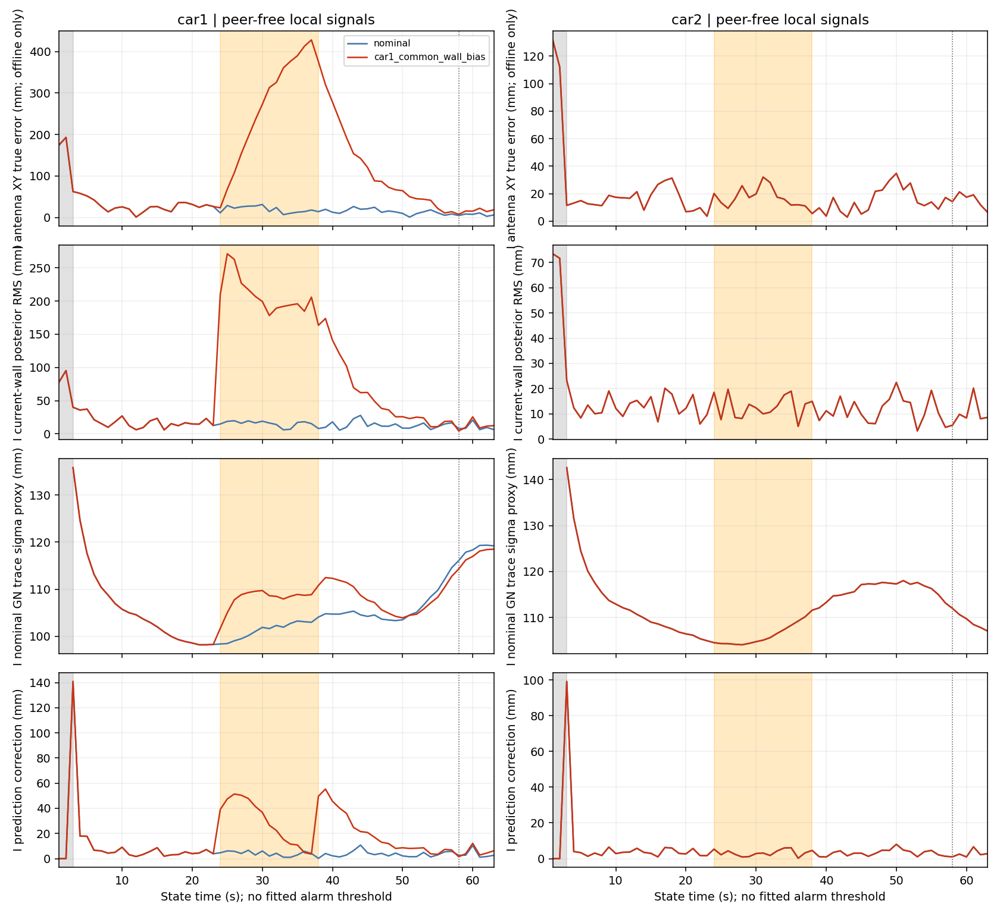

# 只读分析细节与反例

所有数值来自保留状态重算；耗时是原产物身份核对。研究对象是离线virtual发布sink写入`updates.jsonl.gz:pose`，不存在本轮实车发布/控制器消费记录。归档各run无另一个`published.csv`；这不是漏跑。本轮不导入或调用在线求解器。共享范围及SHA见[METHODS](METHODS.md)及[EVIDENCE_LEVELS](EVIDENCE_LEVELS.json)。

## 分母与对齐

原16单元1008个联合时刻，全部有限；976个参照accepted，32个启动unknown（各单元t=1,2）。本轮五方法×两条件×63时刻×两车=1260行。每个单元63个时刻、61个参照有效，连续参照有效相邻对60、三元组59。所有状态epoch与截止相同、截止=t+1秒，原始输入bin/接收前缀630次检查通过。未发布、失败、超时、回退均0。

故障输入C004的21次裁剪没有计作联合优化成功：40次normal_joint、21次post_clip、2次unknown；内部求解accepted仍61。其余联合方法61次normal_joint；I的61次为independent。两个条件不是两个种子，各车、链和时刻均相关。[逐单元分母](results/publication_counts.csv)

原pre=[3,24)，fault=[24,38)，recovery=[38,48)，late=[48,64)；另列recovery_0_20=[38,58)、recovery_20plus=[58,64)。全量all包含启动。CSV同时保留全部记录和参照有效连续对/三元组；不以丢掉启动改善平滑指标。

## 裁剪、yaw、几何与连续发布

126个联合时刻逐项核验：C004快照与J完全相同、内部main_pose与J发布相同、yaw与J相同；其天线XY等于I中心半径0.04m的径向投影，误差<2e−14m。K004的pose=main_pose=当前窗末帧；I的全历史peer因子集合为空。C/K协方差均null。C004的主图—发布分离在27–47秒出现；它是已声明的输出适配，没有伪造联合后验。[身份检查](results/snapshot_identity_checks.csv)

正常输入C/K天线差最大约0.0106mm；故障输入最大3.472/4.790mm。相比之下yaw差最大2.176°/4.497°，对应32/38秒；U−J的最大yaw差仅0.00459°。因此本例大的yaw差不能仅用更换SLSQP的数值路径解释，但也未将其归因为某一个残差项。[yaw求解器对照](results/yaw_solver_controls.csv)

|指标（故障输入，连续有效区间）|C004 Car1 / Car2|K004 Car1 / Car2|
|---|---:|---:|
|相邻天线位移RMS，mm（60对）|60.153 / 57.556|60.101 / 57.558|
|1秒割线速率变化RMS，mm/s²（59组三元组）|20.841 / 17.688|20.822 / 17.801|
|发布/Odom车体系平移冲突RMS，mm（60对）|21.157 / 5.803|21.069 / 6.046|
|当前窗上一帧与上次发布差RMS，mm（60对）|38.838 / 32.247|19.560 / 8.145|

最后一行含平滑器本来就会修正过去窗内状态的成分，不能全部叫“裁剪跳变”：K也非零。裁剪增加的输出/内部位置分离是直接证据；它导致实车物理失效不是已证事实。未找到可适用的独立硬件/控制限值，未据结果反向设线。[全部五方法描述统计](results/summary.csv)

图中的peer残差是同一个规定方向三维距离残差，在两车列重复展示以便同轴阅读，不能当两份独立证据。残差小不替代真实精度；逐时刻相对XY、三维间距真值误差在diagnostics.csv，分段汇总在method_comparison.csv。反向peer未作独立距离因子。

## 恢复与历史：三种口径分开

1. 输出模式：C004在48秒恢复normal_joint；不代表位置/yaw已经回到配对正常。K始终normal_joint也不代表真实无偏。
2. 同一故障输入下相对I：衡量协同帮助/代价。
3. 同一方法故障相对配对nominal：衡量输入扰动代价，不能用第2项冒充。

下面是第3项的**XY RMSE增量**，单位mm，各方法各车分别统计；0–20秒20帧，20秒后仅6帧，均有限且参照accepted。

|方法|0–20秒 Car1 / Car2|20秒后 Car1 / Car2|
|---|---:|---:|
|I|144.198 / ≈0|8.936 / ≈0|
|J|84.757 / 41.665|6.676 / 2.537|
|W025|117.916 / 15.000|8.097 / 1.789|
|C004|117.160 / 18.602|6.676 / 2.537|
|K004|117.094 / 19.155|6.833 / 2.515|

故障窗结束t=38的±0.4秒bin含前段故障消息。以实际配对bin差异识别24–38秒共15个改动bin、每bin四个Car1墙因子。58秒仍有38秒bin；59秒窗内改动bin为0，60个改动墙因子已消费到prior的来源链。I保留自身历史、联合方法保留跨车prior；K在63秒prior交叉信息范数51.666、仿射offset范数0.646。该范数不是污染大小或误差保证。

C/K在63秒相对各自正常条件的天线差为Car1 9.18/9.32mm、Car2 5.79/5.81mm；与前表“RMSE增量”不同。日志支持历史未按20秒归零；不能独立量化prior、活动状态初值和非线性求解路径各自的因果份额。[完整315行历史读回](results/history_readback.csv)

## 三类局部信号：能看到什么，不能说明什么

预登记在计算前已提交。构造函数只读取I/原始本车输入，没有真值/故障标签；标签只在另一个离线join出现。每类实际使用当前观测/历史/截止见METHODS。

- **墙一致性**：Car1故障窗14帧后验RMS 178–271mm，全部高于该车正常条件参照有效60帧（t≥4）的5.60–37.34mm范围。当前墙对预测的RMS也清楚增大。因此本例存在可用冲突线索，不能预设普通局部诊断无效。但线索本身没有给“墙、模型或预测谁错”的可靠判决。
- **覆盖/几何/信息量**：四条墙链保持；样本数、MAD等原始统计本身不能识别持续共同偏差。GN代理在故障14/14帧均落在正常98.17–124.64mm范围。37秒误差427.99mm、代理108.83mm；这是“正常规模的信息代理仍可伴随较大偏差”的反例，不是协方差覆盖概率的实验。原系统未发布协方差。
- **运动预测冲突**：起落段修正增大，但37秒修正仅3.584mm、误差427.99mm；故障14帧中5帧落在正常修正范围。预测继承本车偏置历史，小修正不说明绝对健康。

恢复54秒：Car1当前墙RMS10.760mm、预测墙RMS12.317mm、预测修正3.813mm、GN代理107.088mm、真误差41.662mm；同状态正常条件分别6.501/6.990/1.298/108.372/18.628mm。代理甚至略小，但误差更大。此例仅证明局部自洽不足以认证误差大小，并不证明41.662mm越过任何已批准用途限值。

[所有局部信号252行](results/local_signals.csv)、[独立离线真值join](results/local_signals_offline_join.csv)、[全部范围重叠计数](results/local_range_overlap.csv)、[完整列示见证时刻](results/local_witnesses.csv)。正常范围仅事后描述，无报警阈值拟合；另保留t≥3的61帧口径，避免隐藏首个accepted大修正。两个条件Car2的I局部信号几乎重合，微小数值停止差不能说成物理传播。

## 未知项和停止

无下游控制器消费记录、批准的物理限值、实测噪声标定、发布协方差或独立连续实车真值；未分离prior单独因果贡献，未重新求解。只有一个已暴露种子，不能对所有约束方法作普遍否定，也没有新算法贡献成立的证据。两项后续缺口仅列于A_FACTS，本轮停止，不追加场景、阈值搜索或实车补录。
