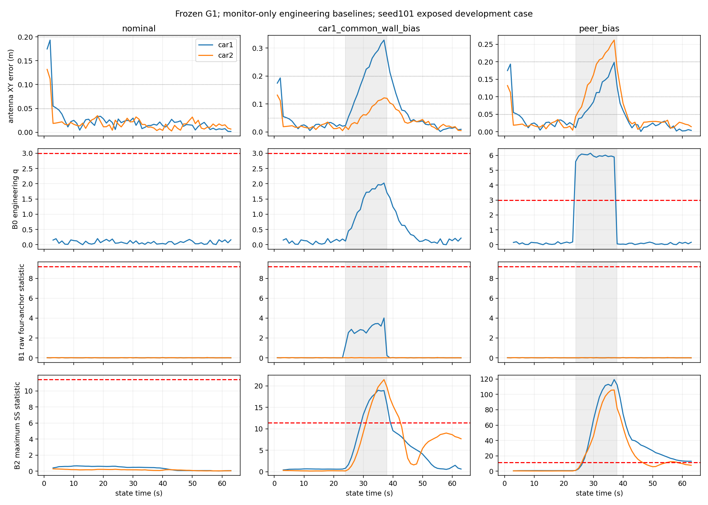

# 首轮结果：历史SS已能发现传播，暂不启动新方法

**本轮选择A，范围限定在“发现另一辆车受损并逐车报警”的机制层面。** 在原G1主轨迹完全相同的公平条件下，含独立历史、显式交叉相关的工程SS已能对Car1共同墙偏差给Car2造成的损害报警；不能再用“原q不触发”推出成熟强基线都无效。**这不等于三个AL下、两辆车、全时段完整性需求全部达标**：小AL、初始误差、恢复尾部和误警/可用性代价都仍存在；没有应用批准AL、已校准概率模型或独立验证，不能认证风险或据此挑一个最优阈值。

只用已暴露seed101的nominal、car1_common_wall_bias、peer_bias。数据为冻结生成器RAM受控复现，非原归档读回；无实包定位/视频/新seed/新候选。线上执行提交见RUN_INDEX，原计算核74fa210e…保持；main基准81fb509…保留，新增PR79仅报告差异。预登记阈值与所有敏感性点都早于故障计算。37个声明profile共用同一G1轨迹，不是37套定位器。

## 完成量与公平性

3主案例各63次联合发布，共189次/378车时刻，183次主图accepted、6次启动预测。另3次同输入原生G1无反馈控制及1次46秒接收前缀控制（44次发布），不是扩45/30单元矩阵。无求解失败、超时或新回退。每场景all为63秒、common_computable为61秒；启动1/2秒不可用，0–1秒无输出另外说明。缺测/失败/秩亏合同通过，未把未发生的故障路径当实测验证。

19个原核文件SHA匹配；配置、truth文件SHA精确等于登记值。事件gzip SHA不同，因此记录新gzip和canonical SHA，不声称旧raw逐字节一致；归档不在本机，不能判定差异只由压缩造成。与旧表对照的378条G0/G1发布位姿，最大分量差1.72e−15 m/rad；peer median最大4.45e−16m、q最大5.56e−15。包装器与同机原生G1的全部状态、快照、prior及消元常数精确一致，不把后端轨迹变化当监测收益。

四锚检验使用原始四距的普通平方 nuisance XY拟合，非联合后验残差。SS三组分别从起点排除Car1墙、Car2墙、peer；自己的初值/历史/完整prior。共享primitive噪声计算C_delta，不把全/子解当独立或真值。初始prior及Odom可信、地图/高度固定、鲁棒GN和冻结线性化等条件见[FROZEN_SPEC](FROZEN_SPEC.md)。所有χ²参考阈值均只是工程检验，非已校准NIS/PL或原论文概率风险保证。

## Car2全时段主对照

下表每项均以全部63个状态秒为分母；HMI是state域真天线XY误差>AL且声明available且未报警。启动unknown保留，另给common表；虚拟可获得延迟另报，不把state域指标包装成物理当前时刻闭环保证。AL均为用户指定假设敏感性，不是应用验收线。

|输入|监测|可用秒/63|报警秒|HMI秒 AL .05 / .10 / .20|
|---|---|---:|---:|---|
|nominal|B0 / 主B1 / 主B2|61|0|0 / 0 / 0|
|Car1共同墙偏差|B0|61|0|15 / 5 / 0|
|同上|主B1_local、主B1_network（sigma .2）|61|0|15 / 5 / 0|
|同上|B1_network（sigma .04, alpha .01，预设敏感性）|47|14|6 / 2 / 0|
|同上|主B2_local（尺度1, alpha .01）|49|12|3 / 0 / 0|
|同上|主B2_network|48|13|2 / 0 / 0|
|peer_bias|B0|47|14|4 / 2 / 0|
|同上|主B1_local / network|61|0|17 / 12 / 6|
|同上|主B2_local|38|23|2 / 0 / 0|
|同上|主B2_network|24|37|2 / 0 / 0|

共同墙故障期[24,38)只有14秒：主B2对Car2报警7秒，Car2三秒>.10m的状态都被覆盖；全时段另两秒>.10m在恢复期，也被覆盖。Car2报警31–42秒，首次>.10m在35秒：报警state onset提前4秒，不是35秒才首次报警。其物理可获得时间仅有“原1秒等待＋本机离线计算”的虚拟模型，不能称实车提前报警。

B0在直接peer偏差24–37秒全部报警，符合正对照；38秒混合bin恢复后即停报，但G1不被监测反馈改变，故仍可能在恢复期发生HMI。SS保留历史参照，可延续报警；它不需要知道38/39/59秒的预定干预时刻。没有重复PR78的停止peer或prior交叉替换。

## 另一辆车报警不等于两车全部合格

Car1共同墙偏差，主B2_local全时段HMI为13/6/0秒（AL .05/.10/.20），可用51/63秒；主B2_network为10/3/0秒，可用48/63。B0则23/16/9秒。主B2只检测到一定大小/方向的解分离，不保证本车每次真误差超小AL就触发。

nominal的Car1在AL=.05时，B0/主B1/主B2仍有2秒HMI，虽然无故障注入、无报警；它们不能把名义初始误差自动变成小AL精度保证。不能用“故障触发能检测”替代“所有时刻均满足AL”。Car2正常协同也非全指标收益：共同accepted 61时刻，G0→G1的XY RMSE为17.566→17.839mm；Car1为23.550→22.017mm。帮助与代价同列。

共同墙偏差故障期Car1/Car2 G1天线XY RMSE为.215389/.074059m，G0为.291545/.019049m；恢复期G1为.140976/.074600m，G0为.220835/.011140m。Car2故障/恢复/late的G1 yaw RMSE为1.286/2.899/2.410°，late XY仍约.025662m；没有把位置恢复或小残差解释为yaw/历史全部恢复。相对XY、底盘XY、yaw及三维间距误差在trajectory/全部指标中，不作轨迹对齐或择段删除。

## 完整敏感性与误警代价

[6660行完整敏感性表](results/ALL_SENSITIVITY_METRICS.csv)包含37 profile×两车×三AL×五时段×all/common×三场景。[37行Car2对照](results/SENSITIVITY_CAR2.csv)同时列两车nominal误警，防止只看受保护Car2。

例如alpha=.01的尺度.25 SS在共同墙偏差下，Car2三个AL的HMI均为0，但只可用23/63秒，38秒报警（含长期尾段）；网络OR只可用21秒。它是预先冻结的敏感性点，**不因此选为部署参数**。alpha=.05、同尺度时，nominal Car1报警22秒，网络把该22秒广播给Car2；median渐近B1在nominal两车本地误警分别2/1秒、网络3秒。全部阈值/噪声组合、零改善与代价都保留，没有只报告“正常零误警”的主项。

时间帧/链/重叠历史高度相关。误警是本次无注入仿真占用，不是罕见错误概率；单个已暴露seed不能估计长期误警或10^-5 HMI风险。没有“实测误报/漏报率”结论。

## 独立核验与开销

- 15项合同测试通过：非零旋转lever导数、原核路径、三源跨20秒历史排除、共享噪声相关差分、已知线性QR/批量协方差、缺测/秩亏、实际solver异常、CLI模块绑定和预先报警延迟读表。
- 独立reader只导入NumPy/标准库，不导入在线graph/Jacobian/质量判定。504次全部实际Schur H/g/常数核验；用信息形式独立传播B，与在线QR形成不同数值路径；96个完整窗口有限差分J与K核验。最大K分量差<7.8e−10、prior B差<3.0e−9。
- 1098个可计算SS分数、1134个四锚分数、13986条逐车报警/可用性声明独立重算；378个整数receive截止bin逐墙median及Odom记录绑定通过。完整列表含启动不可计算项，不把仅SHA匹配当逻辑通过。
- 真实nominal receive<=46秒前缀产生44次发布，主快照、全部子图历史、统计和声明与全流前缀精确相同，已跨边缘化。排除目标改变后，三种26帧合同均保持其状态/初值/缓存/prior及噪声列不变；实际共同墙与peer正对照另各63帧匹配对应排除图，主图确实变化。
- 8组另存内存语义损坏：分数、共享cross删除、四锚分数、startup可用、失败当accepted、目标重入prior、历史状态污染、未来receive，全部拒绝，原输出SHA不变。

每场景四图共享监测工作者，实测emit合计nominal/共同墙/peer为7.464/9.117/10.500秒，平均每发布118.5/144.7/166.7ms；最大182.8/261.6/445.5ms。包括图求解、敏感度、审计hash、四锚和所有声明；不是优化核纯CPU。端到端（含输入生成、同机控制、评价/写出；nominal还含前缀控制）分别15.04/12.32/13.58秒，不能作为方法间纯速度比。最大虚拟发布延迟分别1.183/1.262/1.446秒；不叫ROS/实车时延。完整raw生成器/独立读器/打包耗时不混进emit。

收尾增加缺Odom不可重发旧消元/初值记录，以及1秒primitive模型遇跨关键帧缺口时B2拒判的保护和两项测试。前述三场景没有Odom缺口，未重新执行；这两项属于原在线提交之后的工具健壮性修订，不冒称原执行版本。

开发失败全部保留：初始event gzip身份预检失败（未开估计器）；首个CLI同名evaluate导入冲突（未开估计器），已修复/测试；读表v3因JSON键排序改变CSV行顺序而字节比较失败，逐值/重复计数检查证实数值不变，v4通过。另修正预先报警时的延迟读表，只重读保存结果，不重跑三场景估计器。旧产物没有覆盖。

## 收敛与剩余边界

**A：成熟强基线已覆盖本轮传播检测机制，应收缩“需要新方法才能发现另一车损害”的主张。** 本轮不开发候选、不扩大矩阵。小AL余留并未证明新机制必要：已有预设敏感性点也会增加覆盖，同时付出误警/可用率代价；目前没有独立用途容差和正常校准/未暴露验证可决定哪种折中可接受。

原论文完整风险方法、故障先验/未监测风险、名义协方差和应用AL仍未具备，本轮只能交工程SS适配，不能交PL/认证。Hafez全文本次入口502，CIM只有官方摘要；阅读范围见LITERATURE，未假称全文已重新核对。

实测承接先引用[PR77 G3](../static_evidence_to_method_20261029/DECISION.md)：十静态包可用于检查测距变化和输入结构，不能可靠区分故障/摆位/朝向/环境，也无连续独立定位参考。本轮没有完成实测定位精度验证，不迁移旧P1，不消费整包留出。完整证据本机路径、SHA、实际可取得状态见ARTIFACTS；NAS不可达不伪称已备份。

