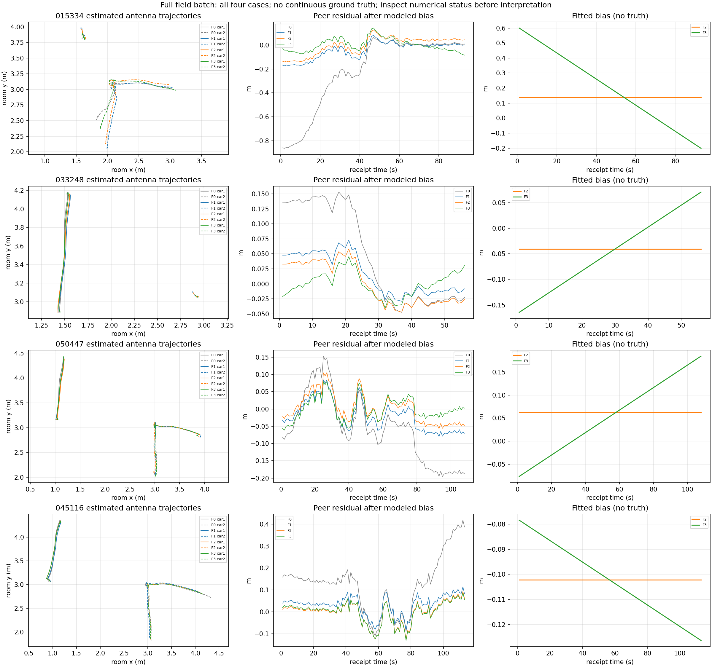

# 五包实测处理完成报告

本批五包的数据审计、四动态包全段四模型比较与数值恢复均已完成；16个全段最终结果中14个通过“求解器成功＋物理梯度≤1e-5＋局部满秩”，2个未通过，全部保留。处理完成不等于所有数值结果接受，更不等于具备连续真值。

## 实际完成

- 五包原bag与便携归档逐字段一致；33/93/56/108/113个固定网格时刻分别对应013206/015334/033248/050447/045116。原始消息、边界、方向缺测、插值跨度和时间差均有记录。
- 静态013206完成几何与方向差审计，因它参与过历史墙校正，不作为独立定位验证。其两方向原测距中位数比人工几何分别大0.26047m和0.31147m。
- 四动态包F0/F1/F2/F3全段对照完成，所有方法共享输入/校正/初始化。F2自由常偏差、F3自由线性趋势，均不读取故障标签。
- 旧六短窗统一继续一次后6/6通过梯度门槛，最大天线变化约0.103mm，主要是停止条件与验收不一致；旧端点仍保留。
- 原批38调用、统一恢复16调用，合计54，formal_runs=0。原批P1只有8/16接受，P2结果单列；没有把追加恢复伪装成原协议内执行。
- 每阶段独立残差算术与方向Jacobian、完整目标/梯度/数值状态、计数和来源哈希读回通过。最终零求解器复核残差最大差4.440892098500626e-15，方向Jacobian最大差3.618163724183887e-08。

## 全部最终状态（中断项仅列P1回退端点）

|包|方法|梯度无穷范数|展示端点评估次数|数值接受|peer扣偏差后RMS/m|
|---|---|---:|---:|---|---:|
|015334|F0|1.04e-05|1000|未通过|0.37528|
|015334|F1|3.4e-08|832|通过|0.08141|
|015334|F2|2.36e-08|347|通过|0.07368|
|015334|F3|0.00227|100|P2中断；P1未通过|0.05265|
|033248|F0|3.55e-07|503|通过|0.09344|
|033248|F1|1.17e-07|266|通过|0.03720|
|033248|F2|4.26e-09|293|通过|0.03469|
|033248|F3|1.43e-07|257|通过|0.02050|
|045116|F0|3.37e-08|11|通过|0.17468|
|045116|F1|9.99e-08|12|通过|0.05454|
|045116|F2|9.44e-08|11|通过|0.04902|
|045116|F3|3.5e-07|11|通过|0.04917|
|050447|F0|4.23e-08|9|通过|0.11057|
|050447|F1|8.96e-10|9|通过|0.04764|
|050447|F2|2.63e-08|10|通过|0.04210|
|050447|F3|4.73e-08|10|通过|0.03306|

残差RMS是拟合诊断，不是位置精度。方法自由度不同，较低残差也不直接代表更好预测或更高安全性。所有未接受项在CSV保留，不把误差填零。

## 数值与可辨识性

一静一动两包P1最弱信息方向超过99.9%集中在静止车yaw，缩放条件数约7.6e3—3.5e4；双动两包约1.2e3—1.4e3。短静态切片能呈现精确秩亏；全段噪声拟合产生的微小运动可能让机器阈值下满秩，但不形成强实测朝向信息。没有强加朝向先验掩盖该缺口。详见STATE_IDENTIFIABILITY及WEAK_MODES。

## 与以前相同和不同的条件

现在相同的是：来源可追溯、reference/measurements/estimates隔离、四模型配对、固定输入与求解预算、全部状态和失败可复算。不同的是：实测只有局部SE(2) odom/工程噪声/有限人工参考，Moon_1拥有受控轨迹与注入真值。实测全段目标移除了起点先验，且使用历史伪Huber测距；不能把两套数值横向混成同一统计试验。

安装原始记录明确odom原点对应待核实；系统时钟状态是三机先后读取。没有从这些文件补造外参或同步标定。045116便携reference不含可追溯数值起终点，本批不借用050447；只在另外三包最终评价读取旧人工末点。末点差不是全程RMSE、不是正式风险验证。

045116存在一个网格peer缺测，最大原odom间隔约1.637s/1.401s；本轮保留插值和缺测痕迹而非隐藏。两方向header/receipt差不是网络延迟或可直接应用的时钟修正。

## 完整图与交付

图保留所有方法，包含未接受项；应先看状态表再解释。F3的直线偏差只是模型假设，不是已证实真实故障趋势。

README给出零优化器解包和复核命令，DELIVERY记录归档与结果哈希、两个运行前冻结提交和版本。原始batch/recovery均只读；015334/F3的P2调用中断且无保存端点，保守计入预算、不重跑。该项仅展示P1最后可用端点并保持未接受，其余尝试具有结果回执。代码与历史结果未改写，无需再重复处理原bag。
