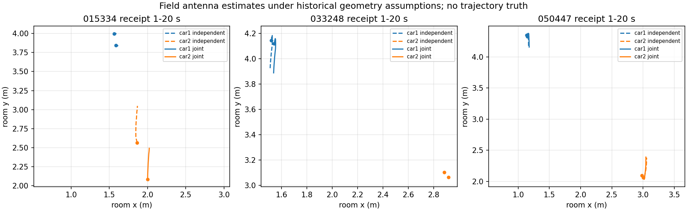

# 实测接入恢复结果

中断任务已恢复：PR128在2026-11-17 14:17 UTC已合并（7f02c403f513be70e64e90951bfe5633af356796），随后只建立独立分支与环境，留下四个空文件。此次在该分支完成实测适配、三包固定短窗和零优化器读回，没有改写Moon_1或其他窗口的历史成果。

## 结果与边界

三包原bag经原读取器与PR128便携归档经新适配器生成的输入完全相同；使用同一rosbags库，不声称独立二进制解码。六个初始点Jacobian中心差分最大差4.75e-9，均120/120带先验满秩；异常字段、时间、测距和评价标签拒绝检查通过，独立方法对peer值不变。端点数据项雅可比和含先验雅可比均120/120，但这不证明外参、时钟、校正或观测噪声模型正确。

|包|Car1方法间RMS位移/m|Car2方法间RMS位移/m|记录odom路程Car1/Car2/m|
|---|---:|---:|---|
|015334|0.15998|0.55956|0 / 0.42653|
|033248|0.03750|0.05548|0.31960 / 0|
|050447|0.01483|0.02323|0.21128 / 0.39226|

这里的方法间位移是同一时刻两种估计的距离，不是真值误差或协同收益。015334对peer约束更敏感，可能存在墙测距/peer/起点/外参等约束冲突；本轮不足以归因。不能把变化更小视为更准确。

实际6次优化器调用，6次有限且SciPy正常退出；物理梯度无穷范数约1.36e-4至7.36e-4，0/6满足额外的1e-5梯度诊断门槛。完整失败门槛记录保留，未追加继续求解或放宽标准。带先验秩满与SciPy成功都不替代严格驻点验收。不同方法残差维数不同，不能仅比较总cost判断质量。

图展示条件假设下的估计轨迹，无连续真值。固定1—20秒只覆盖早期短段，015334/033248中的静车状态从odom可见，双动包短段移动量也有限。没有依据图重新选窗。

## 接口与当前研究合流

Moon_1继续用于受控真值、偏差模型和高度假设研究；本入口接收真实局部SE(2) odom、原始UWB和历史设施/杆臂配置，输出同样可审计的measurements、estimates、数值状态、来源链。没有把实测odom改名为Moon_1全局XY真值增量，也没有将quality或实验角色作为权重。没有把实测残差反向拟合成月面已标定噪声。

013206只复用其历史静态校正；015334/033248/050447完成新短窗；045116保留PR128挑战证据，尚未做本轮估计。没有运行新M2/M3、完整bag矩阵、正式Monte Carlo或Isaac；formal_runs=0。

## 未解决的证据

odom的child_frame_id是base_footprint，但与人工近似底盘中心的实际偏移仍未核实；初始朝向沿用历史摆放假设。接收时间聚合不是同步采样保证；050447历史header方向差约45ms不能直接作为校正量。历史安装校正跨位置适用性和静态测量误差未量化。本轮未读动态终点进行估计，亦未把短窗末点与整包人工终点作错误比较。

因此最合适的下一步是核对外参与时钟契约，并对全部六个保存端点统一设计停止条件诊断；不是立即增加bag或扩充仿真矩阵。若要验证真实性能，还需要与这些包对应的独立连续参考，或另起明确有真值的数据入口。

## 执行回执与偏差

当前目录/home/ubuntu22/uwb-field-moon1-integration，分支research/field-moon1-integration，起点7f02c403f513be70e64e90951bfe5633af356796，origin=https://github.com/phyllis-TANG/uwb-coop-localization-ros1.git。启动时只有四个空文件、无该任务运行进程、磁盘可用约19GiB。独立环境Python 3.10、NumPy 2.2.6、SciPy 1.15.3，无新增GPU/系统依赖。未发现适用AGENTS.md。

执行前保存了CONFIG、PROTOCOL、验收、源码/输入SHA256清单，运行逐一核对；首次git commit因作者身份未配置而失败，但同一shell继续启动了六次调用。真实RUN中的freeze_commit因此为基线SHA，源码身份以嵌入FREEZE哈希为准。随后用Codex作者身份补交80ff0b91。这是提交顺序偏差，不能声称运行前Git冻结成功；未删除结果、未重跑，不将本批包装成预注册确认试验。后续复跑说明使用独立命令和set -e。

六次attempt均有对应端点；端点残差/Jacobian/代价/梯度、调用数及全部冻结哈希读回通过（0次新优化器调用）。正式计数见results/READBACK.json。便携archive完整保留RUN、attempts、measurements、estimates及COMPLETE，不含原始大bag。
