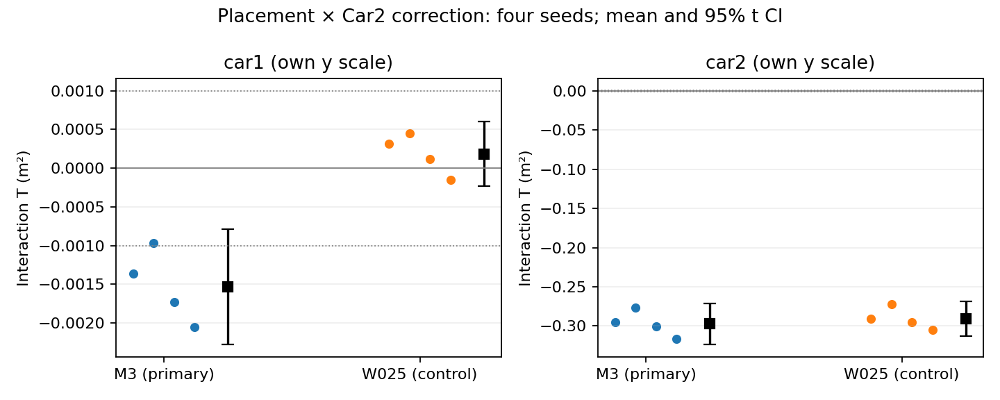

# 摆位×Car2墙距校正：48单元受控仿真

**预定主判断通过；现场同向判断未通过。** M3两车四个T均负，均值95% Student-t区间排除0且绝对均值≥.001m²；Car1与预定现场正向相反。W025只是固定对照，其Car1符号不一致、区间跨0。

| 方法/车 | 平均T (m²) | 四seed范围 | 95%均值t区间 |
|---|---:|---|---|
| M3 / Car1 | −.001530079 | [−.002056069, −.000969583] | [−.002276420, −.000783739] |
| M3 / Car2 | −.297352631 | [−.316674381, −.276880356] | [−.323421035, −.271284226] |
| W025 / Car1 | .000184336 | [−.000149703, .000452183] | [−.000230251, .000598923] |
| W025 / Car2 | −.290730779 | [−.305141232, −.272252734] | [−.312591249, −.268870308] |

PR91精确head `b7af016b09e5717b718d9251341706fc33aa6f46`，完整可运行源码及合同先提交`63701fee9067d3517c4db9dde93a15891fc8335e`，再生成20261101701–704的输入或结果。M2/M3/M3W025和8维内核/QR依赖复用，无估计内核改动。每种子同用全部随机primitive；G2只平移Car2完整轨迹(+1.49,+2.01)m。两处理独立使用前5秒观测重新初始化，因此结论是包含初始化的处理链总交互。

全部48单元DONE。每单元每车90个预定时刻中88 accepted、90有限、2 warmup、0求解失败；每seed/车的所有12配置共同mask都是t8..95，88/90=97.78%，未删掉t6/7分母。60随机数组、32车级初始化、48份因子/QR读回及独立CSV指标读回均PASS。通过接口检查本身不作科学结论。

- [完整报告：逐种子T、MSE校正分解、覆盖及论断边界](REPORT.md)
- [逐种子精确D/C/T及分解](results/PER_SEED_INTERACTIONS.csv) · [逐配置MSE/覆盖/失败](results/PER_CONFIGURATION.csv)
- [原冻结协议/种子及SHA](../geometry_correction_20261101_private/PROTOCOL.json) · [原源码逐项锁](../geometry_correction_20261101_private/SOURCE_LOCK.json) · [执行源码](../../../tools/geometry_correction_20261101/)
- [原运行清单、完整argv和输入/输出hash](results/RUN_INDEX.json) · [失败记录](results/FAILURES.json) · [全有限/unknown误差](results/ALL_FINITE_AND_UNKNOWN.jsonl.gz)
- [独立指标读回](checks/METRIC_READBACK.json) · [独立覆盖/字节绑定](checks/INDEPENDENT_COVERAGE_AND_BINDINGS.json)
- [本次公开分装独立读回](checks/PUBLISHED_ARCHIVE_READBACK.json) · [解包后独立指标复核](checks/PUBLISHED_METRIC_READBACK.json)
- [归档精确位置、每归档及每成员SHA](ARTIFACTS.json) · [可移植独立读回命令](COMMANDS.md) · [HANDOFF](HANDOFF.md)

用户先要求私有回报，后明确要求提交PR；本交付提交只发布既有产物、重分装及只读读回，0个新定位单元。原`_private`协议目录和归档内“未公开”记录描述原执行阶段，冻结字节不变；当前授权见[PUBLICATION.json](PUBLICATION.json)。不自动合并。

受控已知偏差向量不等于现场偏差已知。仅支持指定合成模型下的摆位交互，不声称在线检测、安全概率、自然NLOS规律或实车动态精度；未读新bag/A2/B2，未改现场脚本。有限矩阵已停止，不继续搜索。
