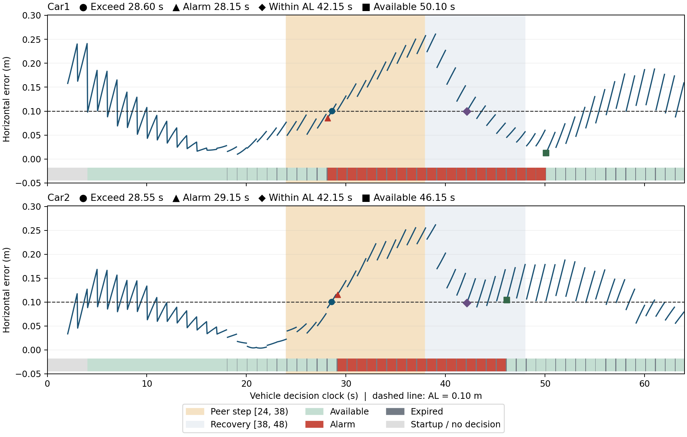

# 第二轮地面 B

首包位于 runtime/101_wall/。A 读取 geometry.json 和 events.jsonl.gz，字段与第一轮相同。起始调查先验对应 t=1 s，UWB 为原始斜距，odom 为各车局部坐标系中的累计基座位姿 [m,m,rad]。两类消息均保留原始源 ID、纳秒采样和接收时间，按接收顺序释放。包名仅用于选择输入。

从共同基准 f61c02e3aad26709a07940bd9900024ec9a93aa1 上的本分支执行（Python 3.10、NumPy 2.2.6、SciPy 1.15.3）。

```sh
python tools/ground_b_round2/export.py 101 wall
(cd docs/research/ground_b_round2/runtime/101_wall && sha256sum -c SHA256SUMS)
```

## A 的完整数据入口

首包提交 `5f016896d8d9443ec19eef0dab5f06a04aa073cb`；全部 12 个运行包提交 `85fbe8aca47f0b8d25b6b97107e91b8550737195`。每种子 101、2026111901、2026111902 各有 nominal、peer_step、peer_ramp、wall，均位于 runtime/{seed}_{scene}/。每包包含 5,124 帧与两文件的 SHA-256，合计 61,488 帧。A 可只复制任意单包的两个数据文件并按接收戳读取。[清单、文件哈希与来源归档哈希](PACKAGES.csv) · [第一轮字段说明](../ground_b_round1/runtime/README.md)

运行包中的 1 s 先验沿用该种子的调查值与扰动。真值留在 #143 的评价归档；注入定义在 [实验登记](protocol/PLAN.json)。同种子四场景的几何和时间线相同。逐帧核验包括所有字段、里程、反向 peer、非故障时段以及每个预定标量的精确差值。每种子相对正常包，阶跃改变 280 条、渐变改变 279 条（24 s 初值为零）、墙锚改变 1,120 条测量。101 正常包与 #145 的两个数据文件逐字节一致。

每包的 567 条斜距、126 个 UWB 帧 ID、63 个双车联合接收时刻均与 #143 相符。旧归档存储每对帧的较晚到达时刻；另据生成器的固定调度公式逐帧核对 5,124 个独立状态戳和接收戳。126 个整秒里程位姿与旧前端按相邻航向展开后的值相等。两个留出种子的 Car2 在 38 s 直接比较原始与展开航向时，相差至多 4.34×10⁻¹⁹ rad。核验按旧前端算术复算，运行包始终保存传感器原值。

## B2 的车辆时钟结果

两个留出种子 × 四场景 = 8/8 条轨迹，0 失败；两车各 1,280 个 20 Hz 时刻，共 20,480 行。两车共享扰动，独立重复单位为种子（n=2）。[逐车使用记录](evaluation/vehicle_ticks.csv) · [逐车越限事件及 TTA](evaluation/events_by_tta.csv) · [逐车时长和结果](evaluation/summary.csv) · [按场景、窗口和 TTA 的完整六分类](evaluation/scenario_tta.csv)

按原协调程序从原服务时间重建 FIFO 发布，并用当前时刻真值逐行复算误差。正常、墙锚两组与协调窗口第一轮已归档的事件、计数和墙故障延迟逐列匹配。误差首次可观察到 >0.10 m 时起算，首次可观察到 ≤0.10 m 时结束。过期无位置单列，事件保持开放至恢复观测或 64 s 截尾。若起点已报警，显示告警延迟为零，同时保留该决定更早的连续就绪时刻。逐时表可以读回每次中途过期、报警到达及重新可用。2 s 发布有效期以状态戳起算；TTA 是从事件起点量起的 1、2、5 s 研究期限。

全程、故障窗 [24,38)、恢复窗 [38,48) 分别报告。窗口时长按实际使用时钟切片；窗口事件按起点归属，并在原完整时间线上追踪至期限或结束。另列 overlap_episodes 以识别跨界事件。正常条件的两段时间仅作同期对照。下表单位为**事件数**，按两车、两种子合计。三元组依次对应 TTA=1/2/5 s；“期限时越限仍可用”与“没有按时报警”分列，后者还可能包括提前恢复等情况。

|场景|全程事件|全程按时报警|故障窗开始事件|故障窗按时报警|故障窗期限时越限仍可用|恢复窗开始事件|恢复窗按时报警|
|---|---:|---:|---:|---:|---:|---:|---:|
|正常|99|0/0/0|9|0/0/0|0/0/0|22|0/0/0|
|车间阶跃|78|13/14/14|6|4/5/5|1/0/0|13|9/9/9|
|车间渐变|92|0/1/2|9|0/1/2|4/3/2|16|0/0/0|
|Car1 四锚共同偏差|64|3/3/5|5|3/3/5|2/2/0|2|0/0/0|

Car1 墙故障中，2026111901 从 26.85 s 首次可观察越限到 31.15 s 显示报警，历时 **4.30 s**；2026111902 从 27.65 s 到 30.15 s，历时 **2.50 s**。二者起点均声明可用。在这两条轨迹上，Car2 窗内首次可观察越限时已经报警。[逐车墙故障复核](evaluation/wall_window.csv)



图为预登记的种子 2026111901，Car1 前向 peer 在 [24,38) 增加 0.60 m。点线断口表示缺位置，色带给出车辆当时能看到的状态。Car1 在 28.15 s 已报警，28.60 s 才首次观察到窗内越限；Car2 在 28.55 s 越限，29.15 s 显示报警。注入解除后，两车首次观察到误差回到 AL 内均在 42.15 s。Car1 到 50.10 s、Car2 到 46.15 s 才首次重新声明可用。此处“恢复”是首次观测，后续误差可再次越限。时间是模拟接收和计算时序。[图中窗口时刻](evaluation/window_markers.csv)

## 分辨率小对照

预登记种子 101、状态 30 s，仅比较同一 G1 发布点为中心的逐车外包半径。0.05 m 的三份完整输出均与 #143 证书相同。两种分辨率的投影角点半径均用固定 A 接口复算。正常条件 Car1/Car2 从 0.273020/0.277191 m 降至 0.257980/0.254880 m；车间阶跃从 0.272281/0.381683 m 降至 0.243674/0.350261 m。墙锚故障两次均返回空域。细分减小了这两个非空历元的外包半径，保留的联合盒对数分别由 5,474 增至 59,835、由 4,891 增至 52,124。本项没有建立精确可行集半径的下界。[全部逐车记录](evaluation/resolution.csv)

## 复现

使用 #143 锁定环境，绘图另需 Matplotlib 3.10.9。需要 Git 对象 #143 (`01e588021e7e3ddd918b1d1fc9561973373758c6`) 与半径函数的 #142 (`94e70e9d50011802d867c849d21fe7935f78ebc9`)。从本 PR 仓库根目录执行：

```sh
set -e
t=tools/ground_b_round2
for seed in 101 2026111901 2026111902; do
  for scene in nominal peer_step peer_ramp wall; do
    python "$t/export.py" "$seed" "$scene"
  done
done
python "$t/verify_inputs.py"
python "$t/evaluate.py"
python "$t/figure.py"
python "$t/resolution.py"
(cd docs/research/ground_b_round2 && sha256sum -c SHA256SUMS)
```

评价直接引用协调窗口 replay_tta.py 的 validate_ticks、excursions、classify 和 wall_window，并校验用到的 24 个源归档与固定 #143 Git 对象逐字节一致。分辨率对照单独记账。
