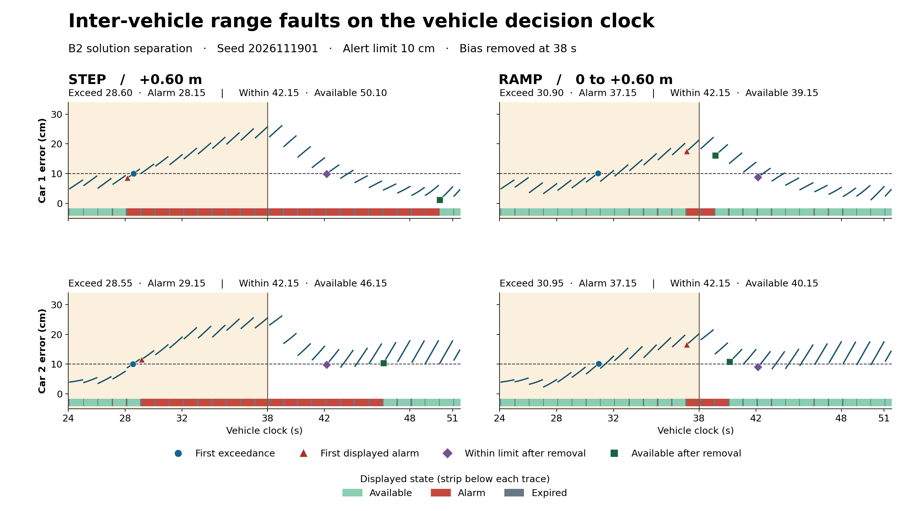

# 地面单历元保护半径与连续告警

种子 101、状态 30 s 的正常与车间阶跃场景中，两辆车都存在两个可行投影位置，相距至少 **0.328686–0.381430 m**。因此在这四个逐车问题上，即使允许自由选圆心，10 cm 半径也不足以覆盖观测模型允许的位置。此结论仅依赖各见证对的可行性。外包离最小覆盖半径还有多远，仍未确定。

## 半径界

单位 cm。前两列下界中的距离均向下取整；后两列是以同一 G1 发布点为圆心的认证外包半径。任意圆心下界来自两见证投影间距的一半，指定圆心下界来自两见证至 G1 的较大距离。

| 场景 | 车辆 | 两投影间距下界 | 任意圆心半径下界 | G1 半径下界 | G1 外包（5 cm 网格） | G1 外包（2.5 cm 网格） |
|---|---|---:|---:|---:|---:|---:|
| 正常 | Car1 | 34.0188 | 17.0094 | 22.1384 | 27.3020 | 25.7980 |
| 正常 | Car2 | 38.1430 | 19.0715 | 20.7313 | 27.7191 | 25.4880 |
| 车间阶跃 | Car1 | 32.8686 | 16.4343 | 20.7669 | 27.2281 | 24.3674 |
| 车间阶跃 | Car2 | 36.6167 | 18.3083 | 31.4922 | 38.1683 | 35.0261 |
| 墙锚共同偏差 | 两车 | — | — | — | 空域 | 空域 |

完整复算使用 #149 同一根域、阈值、G1 中心和两个网格，逐项匹配原分辨率表，包含空域对照。四项均有严格见证，本轮止于原登记分辨率。[逐项 CSV（m）](radius_bounds.csv)

### 可行性的独立回读

搜索只从归档保留的成对候选盒中心提名试点。给定目标车，先取筛选点中离 G1 最远的一点，再取离第一点最远的一点。见证记录的是这两个完整的四维位置，各车高取自固定观测。不同目标车的见证对可不同。

记八条锚距残差为观测减斜距，其残差平方和为 S；peer 的无偏差残差为 u。共同统计量为 (S + (u−b)²)/0.04²，阈值 26。当 S≤26×0.04² 时，该位置允许的完整偏差集合是 [−0.6,0.6] 与 [u−√(26×0.04²−S), u+√(26×0.04²−S)] 的交集。文件保存该集合的保守内、外区间，并从内区间选取一项具体偏差。各见证的九条残差均使用同一组双车坐标，偏差只作用于第九条。

归档浮点观测及 G1 发布点按原二进制浮点的精确有理值读取，见证坐标和偏差按有理数字符串读取。生成端用整数平方根按 10⁻¹² m 包住斜距，统计量上界再严格向上取至 10⁻⁹。独立脚本从固定 Git 对象读取原观测，用精确平方不等式检查每个残差端点，用有理二分重算偏差端点及其余量，并验证两个半径下界。8 份见证的严格统计量上界最大为 **25.770723804 < 26**。任一包含两投影的圆，其直径至少等于两点距离。这个论证不要求两组位置之间的连续路径可行，也没有辨识真实位置或测距偏差。

[完整见证与偏差区间](witnesses.json) · [72 条残差区间及统计量上界](witness_residuals.csv) · [独立检查器](../../../tools/ground_b_round3/check.py)

## 答辩图与讲解



[矢量 PDF](step_vs_ramp.pdf) · [四个面板的标记时刻](figure_times.csv) · [双种子事件分母](two_seed_events.csv) · [原 #149 单场景图](../ground_b_round2/evaluation/peer_step.png)

**English caption.** B2 solution separation under a 0.60 m peer-range step (left) and a ramp reaching the same amplitude (right), shown for seed 2026111901. Each trace compares the displayed position with the current antenna position on the vehicle decision clock. The dashed line marks the 10 cm alert limit. The shaded interval ends at fault removal (38 s). Markers identify the first observed exceedance and displayed alarm within the fault window, and the first observed return within the limit and available declaration after removal. Gaps indicate missing positions. Both columns extend past 48 s to show the later return to availability.

**中文讲解。** 左列 Car1 在 28.15 s 已经显示报警，28.60 s 才首次观察到越限；Car2 先在 28.55 s 越限，29.15 s 才报警。右列 Car1 与 Car2 最早的短暂越限分别始于 30.90 s、30.95 s，都在 31.10 s 回到限内。37.15 s 的报警出现在随后另一次越限中，不能把它算作第一个短事件的告警。38 s 解除注入后，四个面板首次观察到限内误差均在 42.15 s。阶跃条件两车在 50.10、46.15 s 才重新可用；渐变条件则已于 39.15、40.15 s 重新声明可用，当时误差仍超过 10 cm。图中的首次恢复不表示之后一直保持限内。

下表统计两种子（2026111901、2026111902）、两车，分母为首次可观察越限起点在 [24,38) s 的事件。研究告警时限为从事件开始起算 2 s，发布结果的 2 s 有效期独立计时。已在起点收到报警单独计数。

| 场景 | 事件数 | 起点已报警 | 后来在 2 s 内报警 | 期限前或恰在期限恢复 | 到期仍越限且可用 |
|---|---:|---:|---:|---:|---:|
| 阶跃 | 6 | 3 | 2 | 1 | 0 |
| 渐变 | 9 | 0 | 1 | 5 | 3 |

## 复算

从本 PR 仓库根目录，在 #149 的 Python 3.10、Matplotlib 3.10.9 环境执行一条命令。命令复现两档原外半径，再生成见证、独立核验并重建图表；外半径检查按原代码需要 Git 对象 94e70e9d50011802d867c849d21fe7935f78ebc9。仅做有理证书核验可单独运行 check.py（仅 Python 标准库）。

```sh
python tools/ground_b_round3/reproduce.py
```

共同基准与本地检出的主线均为 c7d53da2bb989f73514a6ce540813c379d698897，独立工作树 /home/ubuntu22/ground-b-round3。连续故障图重用 #149 的车辆时钟表、越限事件表与窗口标记；单历元半径见证与图中的轨迹使用不同登记种子。

[固定九条观测的偏差域与测距噪声敏感性实验：六例对照、英文图和第 6 章结果段](sensitivity/README.md)
