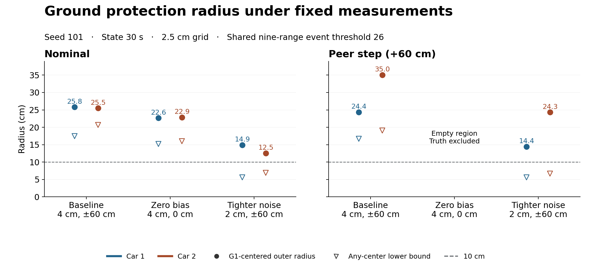

# 偏差范围和测距噪声对地面保护半径的影响

**中文结论：固定九条原始测距，正常场景约束零偏差可使两车外半径缩小 2.64–3.15 cm 且保留真值，阶跃场景的同一假设使联合区域为空；两场景单独将 σ 减半均保留真值，四个逐车外半径缩小 9.95–12.94 cm。**

协议先于执行推送，冻结提交为 `2335f9657779b46c7f8a8215c514a7fa4eb4e157`。种子 101，状态 30 s；每个场景三组共享测距向量、车高、锚点与原 G1 发布点，场景之间沿用各自的测距和 G1。全部六个联合搜索完成并独立读回，未结束 0 例。五个非空算例的每辆车都找到了经核验的联合可行见证对。唯一空例在遍历全部候选后保留 0 对联合盒，独立重建也得到 0 对。[预登记协议](PROTOCOL.md) · [逐车全精度表](results.csv)

|场景|假设（σ，偏差范围）|Car1 外半径 / 相对基线 Δ（cm）|Car2 外半径 / 相对基线 Δ（cm）|任意圆心下界 Car1 / Car2（cm）|联合真值相容|联合搜索（ms）|
|---|---|---:|---:|---:|---|---:|
|正常|4 cm，±60 cm|25.7980 / 0|25.4880 / 0|17.4599 / 20.6721|是|139.4|
|正常|4 cm，0|22.6493 / −3.1487|22.8511 / −2.6369|15.2033 / 16.0005|是|138.5|
|正常|2 cm，±60 cm|14.8909 / −10.9071|12.5481 / −12.9399|5.6044 / 6.9077|是|11.2|
|车间阶跃|4 cm，±60 cm|24.3674 / 0|35.0261 / 0|16.6955 / 19.0715|是|139.3|
|车间阶跃|4 cm，0|空域 / —|空域 / —|—|否|136.8|
|车间阶跃|2 cm，±60 cm|14.4202 / −9.9472|24.2929 / −10.7332|5.6044 / 6.6827|是|11.2|

每个耗时为本机单次两车联合搜索，包括根域、遍历、配对及投影；证书读回、寻找见证和评价另行执行。外半径以 G1 为圆心，基线逐车精确复现 #149 的 2.5 cm 网格结果。任意圆心下界为独立验证的两可行投影距离的一半，向下取至 0.0001 cm；本次从 2.5 cm 网格的可行候选中心选对，下界可与上轮采用的中心不同。正常与阶跃的 σ=2 cm 共四项，G1 外半径仍大于 10 cm，下界均不足 10 cm，**尚不能判定**能否用某个 10 cm 圆覆盖全部精确可行位置。其余非空项的下界均大于 10 cm。

搜索与见证归档全部生成后，才读取同戳真值，并在同一四维联合位置上解析消去有界偏差。真值的最小加权统计量经有理区间计算：两场景基线均在 [6.465196, 6.465197]，减半 σ 后均在 [25.860787, 25.860788]，仍低于阈值 26。零偏差下正常为 [6.465313, 6.465314]，阶跃为 [231.140911, 231.140912]。正常与阶跃的测量层噪声相同；允许偏差吸收了阶跃在该时刻的影响。收紧 σ 不涉及重新采样或提高测距精度。墙锚共同偏差仅引用 #149 原基线的严格空域对照，不计入六例。[墙锚基线记录](../../ground_b_round2/evaluation/resolution.csv)



[英文矢量图 PDF](radius_sensitivity.pdf)。实心点为 G1 外半径，空心三角为任意圆心半径下界，两者对应的圆心口径不同。

## Chapter 6 results

At the preregistered ground epoch (seed 101, 30 s), each comparison held the nine measured slant ranges, published G1 positions, geometry, joint threshold of 26, and 2.5 cm grid fixed within each scene. With a range standard deviation of 4 cm, fixing the peer bias to zero reduced the nominal G1-centered outer radii from 25.80 to 22.65 cm for Car1 and from 25.49 to 22.85 cm for Car2. The true joint position remained feasible. Applying the same zero-bias assumption to the 60 cm peer step produced a certified empty region. With the ±60 cm bias bound retained, halving the assumed standard deviation to 2 cm reduced the radii to 14.89 and 12.55 cm in the nominal scene and to 14.42 and 24.29 cm in the step scene. Both true joint positions remained feasible, with a profiled statistic of 25.861 against the threshold of 26. These reductions quantify sensitivity to the assumed noise scale on unchanged measurements. In the tighter-noise cases, the verified lower bounds were below 10 cm, leaving open whether a different center could cover the exact region with a 10 cm radius.

## 复算

从 PR 根目录运行。只读核验使用 Python 3.10+ 标准库，直接重建归档盒划分和候选配对、复算 G1 半径、回读见证及真值、核对全部 12 行。归档包含六份输入身份、搜索证书和见证；原始固定输入由 Git 对象 c7d53da2bb989f73514a6ce540813c379d698897 定位。已锁定的 A 半径函数需要 Git 对象 94e70e9d50011802d867c849d21fe7935f78ebc9。

```sh
python3 tools/ground_b_round3/sensitivity.py --readback
```

在空目录独立重算；结果相同，首次运行的计时单独保存在已提交结果中。重画英文图使用 Matplotlib 3.10.9。

```sh
python3 tools/ground_b_round3/sensitivity.py --out "$(mktemp -d)"
python tools/ground_b_round3/sensitivity_figure.py
```
