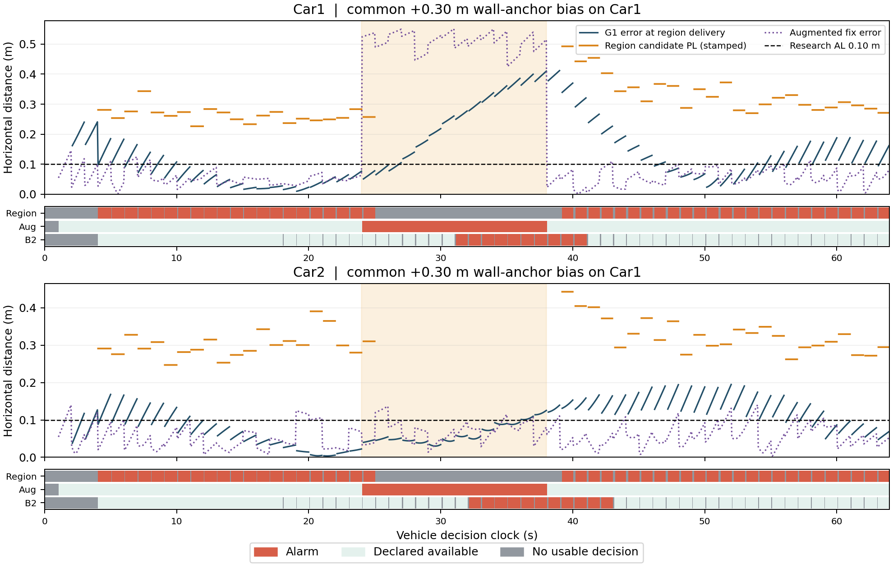

# 地面双车连续完好性回放

开发 4/4 条、留出 8/8 条、失败 0 条。每条 64 s 有 63 个整数秒发布。三种方法各覆盖 756 个联合历元，其中 504 个为留出；按独立种子计，留出 n=2。全部 756 个区域证书通过 B 用独立代码进行的全量重建。A #142 的精确半径函数已接入，地面同步整树的 A 验收仍缺适用接口。开发完成后的运行冻结为 `ecec5bfd976f166d937faf7ea28bf92d71d9c8fd`。基准、依赖和软件版本见 [SOURCES.json](SOURCES.json)。



图中两栏分别为 Car1 与 Car2，浅黄色背景为 Car1 四条墙锚距共同增加 0.30 m 的区间，种子 2026111901。横轴是车辆决定时钟，蓝线是区域决定对应的 G1 位置与当前天线真值的距离，紫线对应增广位置。橙线属于原状态历元。线条缺口表示该数值在当时不可显示。下方三条状态带分别给出各方法当时的声明，报警和灰色无有效决定均不可用。

## 可用于中期报告的结果

在两条留出噪声实现上，逐状态评价与车辆可获得决定时的评价给出了不同结果。以研究告警限 0.10 m 为例，正常场景中，解分离监测在两车各 61 s 的同戳可用时间内均未出现误差越限。按接收、计算和保持上一位置的实际决定顺序评价，Car1、Car2 平均分别有 14.025 s、18.400 s 在误差已经越限时仍声明可用，正常场景报警时长均为零。区域候选保护级给出了另一种代价。正常场景中已接受发布的逐车非空保护级范围为 0.213–0.428 m，两车在 0.10 m 下均无可用时段，平均 54.275 s 为超限告警，9.725 s 为启动、等待或过期等无可用决定。四场景在 0.20 m 下也均无区域可用时段。零次“越限且可用”由零可用时间解释。以上时间基于仿真接收时标与离线 CPU 服务时间，单历元区域的保护范围针对带时间戳的位置。

车间阶跃和渐变均位于预定偏差界内。两种条件下全部 252 个留出联合参考位置均满足消元后的原观测事件，并落入联合外包。解分离对阶跃的实际报警时间长于渐变。增广模型每个历元用一个自由参数拟合唯一前向 peer，其位置和残差判定在本实验的两种车间故障下给出与正常条件相同的主表时长。Car1 四锚共同偏差超出了区域模型，两个留出种子故障期全部 28 个联合历元返回空域，两车均撤销可用声明。这一结果不能用于辨识故障车辆。两种非区域监测均出现了误差越限仍可用的时间。

## 主表

决定到达视图，每列为每条 64 s 轨迹的留出均值（s），两种子配对。每格依次给出 **可用 / 报警 / 越限且可用**。后者是可用时长的子集，其余无可用决定时间为 64 减去前两项。主表完整精度、两套时标、无报警片段及分母见 [MAIN.csv](MAIN.csv)。

| 场景 | 车辆 | 解分离 B2 | 增广残差 | 区域 PL |
|---|---|---:|---:|---:|
| 正常 | Car1 | 57.625 / 0.000 / 14.025 | 61.950 / 1.000 / 3.700 | 0.000 / 54.275 / 0.000 |
| 正常 | Car2 | 57.625 / 0.000 / 18.400 | 61.950 / 1.000 / 6.075 | 0.000 / 54.275 / 0.000 |
| peer 阶跃 | Car1 | 36.375 / 19.900 / 13.000 | 61.950 / 1.000 / 3.700 | 0.000 / 53.425 / 0.000 |
| peer 阶跃 | Car2 | 42.325 / 13.950 / 18.500 | 61.950 / 1.000 / 6.075 | 0.000 / 53.425 / 0.000 |
| peer 渐变 | Car1 | 54.650 / 2.225 / 19.150 | 61.950 / 1.000 / 3.700 | 0.000 / 53.825 / 0.000 |
| peer 渐变 | Car2 | 54.200 / 2.675 / 25.525 | 61.950 / 1.000 / 6.075 | 0.000 / 53.825 / 0.000 |
| Car1 共同墙偏差 | Car1 | 47.275 / 9.600 / 21.350 | 48.450 / 14.500 / 3.050 | 0.000 / 41.525 / 0.000 |
| Car1 共同墙偏差 | Car2 | 46.375 / 10.500 / 18.075 | 48.450 / 14.500 / 4.725 | 0.000 / 41.525 / 0.000 |

## 失败复现及时延

种子 2026111901 的墙锚故障中，决定时钟 31.00 s 时，Car1 仍显示状态 29 s 的 B2 发布位置 (2.0507065, 4.1017722) m。就绪时刻为 30.104167 s，误差 0.260595 m，声明仍为 AVAILABLE。31.00 s 恰在该决定最后有效时刻。读回下列一行即可复核，无需求解。另存有同一故障内首条越限可用采样。[EXAMPLE.json](EXAMPLE.json)

```sh
d=docs/research/ground_continuous_b
gzip -dc "$d/runs/2026111901_wall/ticks.csv.gz" | awk -F, '$1=="delivery" && $2==31 && $3==1 && $4=="B2" && $5==0.1'
```

每条记录的 FIFO 时序均保留至小数秒。504 个留出联合历元中，区域决定迟于状态+2 s 的次数为 0；两次决定之间仍会出现旧决定已过期而新决定尚未就绪的间隙。留出区域搜索、B 重建及 A 半径检查的合计服务时间中位数 43.23 ms，B2 历史图及其包装器为 88.82 ms，增广为 1.01 ms。区域还需等待 G1 发布。旧 #140 的平面 P4 含独立 A 树核验和归档，为 2.246040 s；原 2 s 准入失败、随机 0/240 单独保留。

[逐种子结果](ALL.csv) 包含三档 AL 和两个时钟。[分时段表](PHASE.csv) 保留启动、故障及恢复段。[故障窗延迟](WINDOW_DELAY.csv) 是补充描述，给出固定 [24,38) 内首次可观测越限至下一实际报警的时延，并区分窗口结束仍无报警和未观察到越限。各运行的 episodes.csv 另保留预定的连续越限片段、首次报警和未报警次数，失去位置会截断片段。以墙故障两条留出轨迹为例，B2 在决定到达视图下 Car1 有 59/80、Car2 有 46/62 个越限片段全程无报警。片段受过期间隙影响，不能作为独立重复。若固定整个墙故障窗并跨过这些间隙，Car1 的 B2 首次可观察越限至告警延迟在两个留出种子分别为 4.30 s、2.50 s。

## 输入与证据复核

正常开发轨迹第 25 秒，Car1 的 node_10 原始斜距为 4.659309 m，原窗口 17 个样本的中位数为 4.655277 m。同一时刻前向 peer 原始值为 1.868795 m，窗口中位数为 1.869908 m。归档给出所有实际窗口计数，旧 B2 的三组排源影响协方差按原定义使用。开发正常与墙场景的全部 252 个车时刻重新核对历史天线 XY、误差及三项解分离布尔声明。生成器按种子共享初始扰动、里程和测距噪声；九条原始观测在四场景间的逐项差值已按预定注入核验。根据生成定义，研究参考只用于事后评价与合成观测。

每条运行的 records.json.gz 包含两车原始 ID、九条斜距、坐标、时间、窗口观测、两套位置、解分离统计、偏差和残差、根域、候选叶与联合索引。truth.json.gz 为独立评价参考，audit.csv 分列参考点消元事件和联合外包命中。publications.csv 给出 A 所需的发布、时间、身份与半径字段。A 半径从已保留的矩形独立计算；B 全量重建逐一核对候选叶、全部合法配对和参考命中。固定 A 高度检查器对真实地面帧返回 UNSUPPORTED_FRAME_OR_DOMAIN，其同时要求两车源时标相差 5 s。交接入口可导出同一历元的完整输入、证书和 A 字段，供扩展整树接口时直接验收。师兄 HCPL 未取得核实实现，比较分母为三种方法。

## 复现

从普通完整克隆的本 PR 提交运行。需要 Python 与 [锁定版本](SOURCES.json)，以及下列三个 Git 对象。只读复核及报告重建可在现有结果上运行。

```sh
git fetch origin refs/pull/142/head
git fetch origin refs/pull/139/head
git fetch origin refs/pull/140/head
export OPENBLAS_NUM_THREADS=1 OMP_NUM_THREADS=1
t=tools/ground_continuous_b
d=docs/research/ground_continuous_b
(cd "$d" && sha256sum -c SHA256SUMS)
python "$t/handoff.py" 2026111901 wall 29 p > /tmp/ground-epoch-29.json
python "$t/test_evidence.py"
python "$t/audit.py" 2026111901 wall
python "$t/report.py"
```

全流程重算使用空结果目录，以下从当前交付提交建立一次性独立工作树。run_b 拒绝覆盖已有试次。重新计时会改变决定时钟的采样边界，原始计时保留在 PR 中。

```sh
git worktree add --detach --no-checkout ../ground-b-reproduction HEAD
cd ../ground-b-reproduction
git restore --source=HEAD --worktree -- . ':(exclude)docs/research/ground_continuous_b/runs/**'
python3 -m venv .venv
. .venv/bin/activate
pip install numpy==2.2.6 scipy==1.15.3 matplotlib==3.10.9
export OPENBLAS_NUM_THREADS=1 OMP_NUM_THREADS=1
t=tools/ground_continuous_b
for seed in 101 2026111901 2026111902; do
  for scene in nominal peer_step peer_ramp wall; do
    python "$t/run_b.py" "$seed" "$scene" && python "$t/timeline.py" "$seed" "$scene" && python "$t/audit.py" "$seed" "$scene" || exit 1
  done
done
python "$t/report.py"
```

[冻结协议](PROTOCOL.md) · [配置](config.json) · [服务时长](SERVICE.csv) · [结果哈希](SHA256SUMS)
