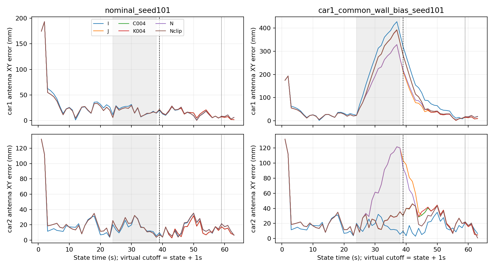

# 第一轮最小开发：历史作用已分离，尚未建立新方法必要性

**结论：值得保留“退出后历史仍影响输出”这个机制问题；本轮不支持继续扩张图内硬约束贡献，也不启动新矩阵。** 仅已暴露seed101、正常/Car1四墙共同偏差配对。复用I/J/W025/C004/K004的10个归档单元；实际新增2次停止新peer回放、8次59秒快照解及1次前缀合同。没有新实包、seed、门限选择或IMU变量。一个配对seed不代表独立验证。

**1. 从历史相关性推进到受控归因。** N在39秒起停止新peer；之前38个完整快照与归档J逐项相同。59秒窗口内已没有peer因子，38个历史peer全部纳入完整prior。固定同一当前因子集，交叉替换同条件I/N prior及初值，结果如下。数值是更换prior引起的实际天线XY移动，不是精度收益：

| 59秒条件 | Car1移动 | Car2移动 | yaw移动绝对值（Car1/2） |
|---|---:|---:|---:|
| 正常 | 0.121mm | 0.422mm | 0.064° / 0.100° |
| 共同墙偏差 | 3.204mm | 8.387mm | 0.521° / 1.876° |

同prior换初值，当前XY最大差仅0.000230mm；全窗口最大标量差4.47e-7 m/rad，低于预登记1e-4。重求原解的sham也通过。因此这个快照差异主要由所换prior包决定，不是两种初值的求解路径差异。**归因对象是整个prior包，含历史线性化与鲁棒权重，不能称为单独peer项的纯贡献。** Iprior本身仍保留Car1有偏墙历史。

**2. 历史作用存在，但不能一概叫损害。** 故障条件59秒由Nprior换Iprior，Car1/2位置误差从17.256/22.099mm降至15.732/21.305mm；yaw绝对误差却由4.599°/0.885°升至5.120°/0.991°。正常条件亦有一车帮助、一车代价。当前cross-information非零不是误差界。下面是故障输入恢复窗[38,48)的天线XY RMSE，38秒仍含故障尾部聚合；均为同一10个时刻：

| 处理 | Car1（mm） | Car2（mm） |
|---|---:|---:|
| I独立（复用） | 220.835 | 11.140 |
| J联合（复用） | 140.976 | 74.600 |
| W025固定缩权（复用） | 185.980 | 34.581 |
| C004裁剪（复用） | 187.433 | 37.166 |
| K004图内约束（复用） | 187.355 | 38.168 |
| N停止新peer（新算） | 147.181 | 64.647 |
| N再裁剪（派生） | 187.402 | 33.691 |

N相对J使Car2恢复窗位置RMSE减9.953mm，但Car1增6.205mm；Car2 yaw RMSE从0.05060升到0.06190rad。N裁剪相对C004的Car2位置好3.476mm，yaw仍更差。停止时刻来自预登记故障安排，**这是离线归因干预，不是同信息在线算法胜出**。正常尾段[59,64) N相对J两车位置RMSE增加约2.067/2.926mm，丢失了部分有用协同。时间窗变干净不等于应清除历史。

**3. 发布层非对称并不需要新图内方法。** 两个固定索引预算(0,.04)/(.04,0)都计算，不按健康标签选择。令Car2预算为0、Car1为.04，可以使Car2发布天线XY等于I，同时保留Car1裁剪帮助；反向分配也完整保留。零XY预算仍保留J的yaw，且内部图/prior不变。这证明的是廉价输出处理的表达能力，既不证明在线知道保护谁，也不实现内部定向信息隔离或一致后验。

**决定与下一步：** 此轮到此停止。若论文主张仅为双方相对参照的XY位移合同，保留独立参照＋成熟缩权/限幅即可作为基础，现有结果没有显示必须用更重硬约束；这不等于证明所有简单方法已足够。若继续研究，应先明确一个独立于结果的实际用途要求：为何只限制输出XY仍不够，是否需要yaw/相对几何或历史恢复合同，并给同信息简单基线同等机会。PR77的实测角色不可区分问题仍未解决；不因本轮仿真归因而声称可信车识别成功。不再以换seed或扫预算寻找赢家。

全部方法每条件63个有限发布，61个共同accepted时刻，2个启动unknown，无失败/超时/回退；派生裁剪不计作联合优化成功。四个合同测试、126次接收bin读回、122个目标函数、84次完整Schur H/g/常数及8快照目标复核通过；前缀44个发布完全一致。测试通过不等于真实定位精度通过。N每次回放总耗时约0.76/0.91s；历史K004主图约35/36s只作旧成本引用，不作跨时机器加速比，virtual截止不是ROS实时延迟。

[指标与分母](METRICS.csv)、[两种配对口径](CONTRASTS.csv)、[快照对照](SNAPSHOT_CONTRASTS.csv)、[逐时刻记录](TIMESERIES.csv)、[独立核验](CHECKS.json)。

