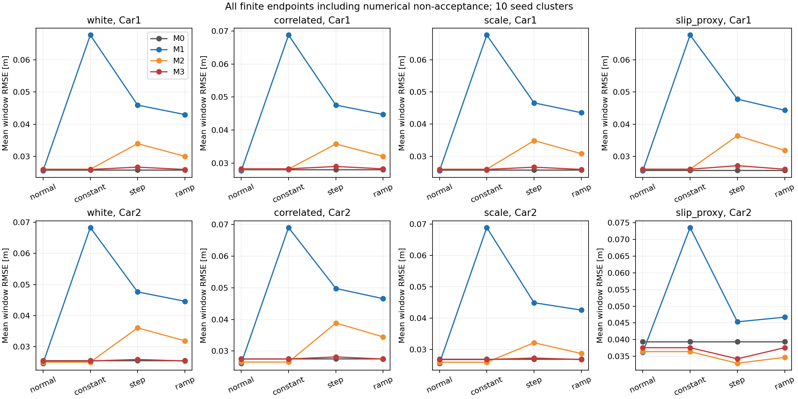
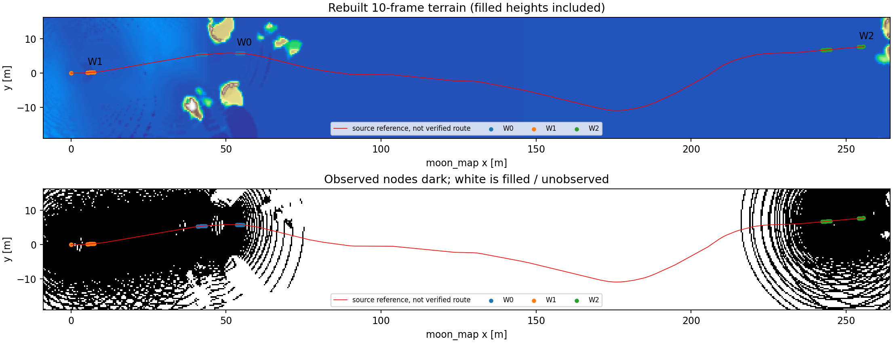
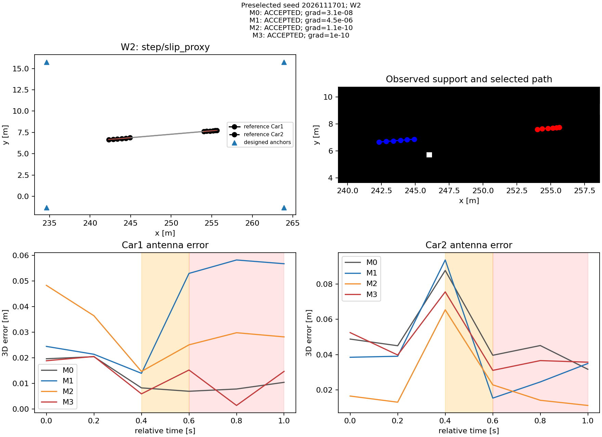

# 本轮研究报告

已完成 CPU 观测层仿真、资产扩充审计、冻结评价、独立归档读回和运动学场景导出；没有执行 Isaac 渲染或月壤接触动力学。结论限定于同一 LuSNAR Moon_1 序列三个窗口、人工锚点、错时双车和明确假设的观测误差。

## 执行与全分母

冻结提交 `9f7fb56d68b0f45394e7443159f0270fccb75426`；开发基线 `3ad69c8137183c1986012e354857b73527978c48`。10帧LiDAR共468702点、GT1094行/120.0641064s。3窗口（21、1、113s）、540份共享观测、2160次方法运行，无缩减、无重试、无第三阶段。

|阶段|方法数|有限|数值通过|未驻点|异常失败/中断/未执行|优化器调用|
|---|---:|---:|---:|---:|---|---:|
|开发，两批独立于评价|96|96|92|4|0/0/0|192|
|核心|1920|1920|1886|34|0/0/0|3840|
|敏感性|240|240|237|3|0/0/0|480|
|评价合计|2160|2160|2123|37|0/0/0|4320|

正式评价数值未通过总计37，不与异常FAILED=0混淆。全有限不等于通过；不删除失败只展示收益。全部状态见[PROGRESS](PROGRESS.json)、[失败账本](FAILURE_LEDGER.json)，逐车逐方法完整4320行见[FULL_RESULTS](FULL_RESULTS.csv)。包含开发共2256方法/4512调用，等于冻结调用上限；总评价墙钟177.43s（含账本I/O与批间时间），加开发优化耗时约177.71s，低于21600s。实际求解函数计时合计7.22s，不能把它等同端到端耗时；见[BUDGET_ACCOUNTING](BUDGET_ACCOUNTING.json)。

全部缩放J满秩，M0/M1=24、M2=25、M3=26；这依赖每车每时刻四个设计锚点及初位置先验，不能推导真实静止SE2系统满秩。评价nfev合计25766，单方法最长约.00519s，最大梯度3.8934e-5；37项因梯度超过1e-5保留NOT_STATIONARY。每项两次调用，无预算耗尽。弱方向、奇异值及条件GN协方差对角存于归档端点；[LOCAL_COVARIANCE](LOCAL_COVARIANCE.csv)单列诊断，不命名PL/HCPL。

## 主要定位与残差结果

以下先在每seed内平均三个窗口的每车RMSE，再平均10个seed；是 mean-window-RMSE，非合并MSE开方。三窗/方法/六时刻均不是独立实验。表为全有限端点，包括数值未通过项；完整接受seed子集在SUMMARY单独保存，不在主表悄悄删掉。每车p50、p95、max见FULL_RESULTS；[RESIDUALS](RESIDUALS.csv)区分每车锚距与peer残差。

|peer / motion|方法|Car1 RMSE(m)|Car2 RMSE(m)|接受/30|完整接受seed簇/10|
|---|---|---:|---:|---:|---:|
|normal/white|M0|0.025766|0.025617|30/30|10/10|
|normal/white|M1|0.025535|0.024698|30/30|10/10|
|normal/white|M2|0.026024|0.025050|30/30|10/10|
|normal/white|M3|0.025933|0.025422|30/30|10/10|
|constant/white|M0|0.025766|0.025617|30/30|10/10|
|constant/white|M1|0.067653|0.068337|30/30|10/10|
|constant/white|M2|0.026024|0.025050|30/30|10/10|
|constant/white|M3|0.025933|0.025422|30/30|10/10|
|ramp/white|M0|0.025766|0.025617|30/30|10/10|
|ramp/white|M1|0.042977|0.044637|30/30|10/10|
|ramp/white|M2|0.030011|0.031925|27/30|7/10|
|ramp/white|M3|0.025933|0.025422|30/30|10/10|
|step/white|M0|0.025766|0.025617|30/30|10/10|
|step/white|M1|0.045909|0.047637|27/30|7/10|
|step/white|M2|0.033953|0.036076|30/30|10/10|
|step/white|M3|0.026663|0.025923|30/30|10/10|
|normal/correlated|M0|0.028063|0.027520|30/30|10/10|
|normal/correlated|M1|0.027703|0.026148|30/30|10/10|
|normal/correlated|M2|0.028222|0.026535|30/30|10/10|
|normal/correlated|M3|0.028289|0.027487|30/30|10/10|
|ramp/correlated|M0|0.028063|0.027520|30/30|10/10|
|ramp/correlated|M1|0.044732|0.046554|30/30|10/10|
|ramp/correlated|M2|0.032068|0.034479|29/30|9/10|
|ramp/correlated|M3|0.028289|0.027487|29/30|9/10|
|ramp/scale|M0|0.025766|0.026963|28/30|8/10|
|ramp/scale|M1|0.043535|0.042581|30/30|10/10|
|ramp/scale|M2|0.030822|0.028710|30/30|10/10|
|ramp/scale|M3|0.025932|0.026791|30/30|10/10|
|ramp/slip_proxy|M0|0.025766|0.039413|28/30|8/10|
|ramp/slip_proxy|M1|0.044354|0.046720|30/30|10/10|
|ramp/slip_proxy|M2|0.031928|0.034687|30/30|10/10|
|ramp/slip_proxy|M3|0.026060|0.037579|30/30|10/10|
|step/slip_proxy|M0|0.025766|0.039413|28/30|8/10|
|step/slip_proxy|M1|0.047808|0.045320|30/30|10/10|
|step/slip_proxy|M2|0.036433|0.032915|28/30|8/10|
|step/slip_proxy|M3|0.027159|0.034238|28/30|8/10|

正协同收益定义为 RMSE(M0)−RMSE(Mk)；M3对M2另定义为RMSE(M2)−RMSE(M3)，正值改善。[PAIRS](PAIRS.csv)保留每对是否双方通过，[PAIRED_SUMMARY](PAIRED_SUMMARY.csv)保留全部有限和所有三窗双方通过的完整seed簇。未使用bootstrap或显著性检验；没有把10个seed当罕见风险证据。

|peer/motion|Car2 M3相对M2收益(m)，全有限|双方通过pair/30|完整接受seed簇/10|接受完整簇收益(m)|
|---|---:|---:|---:|---:|
|normal/white|-0.000373|30/30|10/10|-0.000373|
|ramp/white|+0.006502|27/30|7/10|+0.007159|
|ramp/correlated|+0.006992|28/30|8/10|+0.007935|
|ramp/scale|+0.001919|30/30|10/10|+0.001919|
|ramp/slip_proxy|-0.002892|30/30|10/10|-0.002892|
|step/slip_proxy|-0.001324|26/30|6/10|-0.002875|

1. **M2/M3何时改善，何时只降低残差？** constant/white 下M2恢复接近normal精度，明显优于不估偏差的M1。ramp/white 下Car2 M3比M2改善6.50mm，完整接受7/10簇改善7.16mm；但normal/white下M3比M2恶化.373mm，虽整体测距残差RMS从.036395降至.036259m。加入自由度不保证定位更好。ramp/slip_proxy下Car2 M3比M2恶化2.89mm，30/30配对都通过；整体测距残差仍从.048346降至.040270m。这是残差下降与定位收益分离的直接例子，不能以残差代替真实精度。[SUMMARY、PAIRED_SUMMARY、RESIDUALS]

2. **运动失配是否被peer偏差错误吸收？** 在真实peer偏差为零、配对相同测距噪声时，Car2 5%尺度误差使M3趋势估计在W0/W2平均增加约.03774/.03752m/s；W1近静止车仅约2.0e-6m/s。短时.15m异常使三个窗口趋势分别增加约.04882/.05227/.05020m/s；AR1相对白噪声的趋势绝对变化均值约.0188–.0236m/s，而b0变化较小。说明额外趋势状态可吸收运动观测失配，不能把b1直接解释成真实UWB漂移。[MOTION_ABSORPTION](MOTION_ABSORPTION.csv)

3. **静止朝向弱信息有什么影响？** PR130实测和解析杆臂检查表明δp=−R S l δψ可使天线位置一阶不变，单个静止天线约束不确定车体朝向。W1的Car2近静止，但当前M方法直接估天线XY、给定高度，没有yaw状态，所以本轮不能量化未估朝向对真实小车的协同代价，更不能宣称消除了弱方向。需要后续SE2局部运动/杆臂状态与独立朝向证据；没有加入无来源yaw先验。[SOURCE_MAP、DEVELOPMENT、OBSERVATION_CONTRACT]

4. **时间/外参误差会伪装成UWB偏差吗？** +.05s的peer Car2时间偏移在W0/W2令M2 b0相对控制约−.134/−.129m，负偏移则约+.133/+.129m；W1近静止影响约1e-5m。M2/M3位置可能基本不变，但偏差状态已吸收时间错误。±.15m供给高度导致b0约毫米级改变，不能据此声称高度不重要：这里报告3D天线误差，Car2被固定错高.15m，RMSE直接上升到约.15m。PR125主要XY指标与本轮3D指标需区分；高度敏感性不是高度融合。[SENSITIVITY_BIAS](SENSITIVITY_BIAS.csv)、SUMMARY

5. **哪些跨窗口复现？** ramp/white时Car2 M3对M2在W0/W1/W2分别改善7.61/8.47/3.43mm；ramp/correlated也均改善。ramp/slip_proxy在三个窗口分别恶化1.61/1.61/5.46mm；ramp/scale在W2恶化4.19mm、另两窗改善，不能概括成普遍提升。窗口同时改变运动、局部地形及锚点布局，不能做单因素因果归因。尚无第二独立序列证据。[PER_WINDOW](PER_WINDOW.csv)

6. **最优先改变什么？** 优先改变运动观测模型：在固定输入上显式区分运动相关/尺度/短时异常与peer偏差，检查趋势状态吸收现象是否减少；再用带独立参考的同步采集约束参数。暂不继续堆叠peer趋势自由度，也不把当前GN诊断直接输出为安全区域。[DECISION_MEMO](DECISION_MEMO.md)

## 场景与展示

[scene_export/lunar_kinematic.usda](scene_export/lunar_kinematic.usda)包含三块局部地形、观测/填补颜色、人工锚点、双车程序示意车与天线、参考/估计轨迹、动态车间连线及条件元数据。另有W0/W1代表图，均来自冻结预选条件，不按效果选择。CPU USD重新打开核对Z-up、米单位、5Hz时间码成功；图是Matplotlib输出，不是Isaac截图。现有IsaacSim6.2/Lab3.0因CUDA不可用未实际启动渲染/物理，未改变系统驱动。模式为运动学timeSamples导出；没有轮地碰撞/接触/滑移执行证据。[SCENE_EXECUTION](SCENE_EXECUTION.json)

## 独立核验与证据边界

实际解包便携归档，逐项核对输入身份、哈希、显式循环残差、差分Jacobian、梯度/秩、每车指标、状态与调用数；不导入或调用优化器。首次读回7575个文件、2160端点全部通过，最大cost差1.92e-13、梯度差3.95e-9。最终扩充报告的归档会再次核验，以[INDEPENDENT_CHECK](INDEPENDENT_CHECK.json)为最终收据。

PR130仅提供真实接口、杆臂/弱方向/异步缺测问题和工程参数依据线索；未拿拟合轨迹作真值、未从无连续真值残差声称噪声校准，也未重跑既有实测/PR125优化。查证解决了版本匹配的求解终止、USD尺度及GPU能力边界；来源与失败的许可全文访问均见RESEARCH_LOG。

仍需真实标定：连续独立位置/朝向参考、传感器时间基准与延迟、车体/天线外参、局部SE2里程计尺度/相关结构/异常、UWB LOS/NLOS与异方差；本轮AR1、5%、.15m短时代理及偏移幅度都是假设。地形支持不保证车辆可通行；预设丢测不是真实传播；零异常进程失败不是罕见风险验证。A/B只交付[接口与证据映射](AB_INTERFACE.md)，未触碰其任务，也未创建认证区域。
