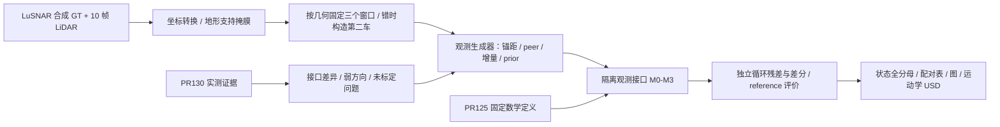

# 来源与完整链路

|身份|固定来源|本轮用途与限制|
|---|---|---|
|真实实验|PR130 `1c7e6d14ce65ff1bb41ff2fa36b920eb18c3e4cb` field_completion 的 README、REPORT、OBSERVATION_CONTRACT、DECISION_MEMO、HANDOFF|读取接口、杆臂、弱方向、缺测和异步证据；无连续真值，不输出实测全程 RMSE|
|合成来源|LuSNAR 作者仓库 https://github.com/zqyu9/LuSNAR-dataset ，论文 https://arxiv.org/abs/2407.06512 |Unreal/AirSim 生成背景；本地只有 Moon_1 一个序列，不能声称跨独立序列复现|
|历史仿真|PR125 `2049084cd58588fd33fecccf5c965e9810a2ed26` moon1_trend_height_eval 五份契约报告|未假设合入 main；保存单个数学源文件快照，开发数值对照四种方法，无旧优化重跑|
|扩充记录|本地 uwb-moon1-representativeness，代码 e8b6a49b；supplement001 四帧收据|历史 6 帧加后段 4 帧全部重新融合到新目录；逐文件哈希见 INPUT_SOURCES|
|第二车|同一个 GT 路径：Car1=t+5 s、Car2=t|人工错时，不是两台独立采集车辆；不声称动态可行性|
|参考轨迹|GT XY + 本轮地形高度 + 世界竖直杆高 1.16 m|只有生成和评价端读取；用于合成实验真值，不是实测拟合轨迹|
|噪声/故障|PR125 .04/.02/.5 m 与 .3 m 历史研究设置，新增 AR1/尺度/短时代理假设|条件扫描，未知发生概率，无真实标定|

PR130 的具体证据：局部 SE(2) 增量与测距接口、Car1 水平杆臂(.08,-.06)m/高度.17m，Car2(.12,-.08)m/.20m；静止车朝向弱信息；缺测间隔与 header/receipt 不等价于时钟校准。其 .2m 测距及 .03m/√s、2°/√s 运动权重是工程设置，不由无连续真值残差反推真实噪声。本轮未把这些车辆外参替换成 LuSNAR 的 1.16m 世界竖直天线；保留两种模型身份。

实测与合成分开：PR130 历史 fullbag 16 项、14 项数值接受，只作为历史引用；本轮正式 2160 项全部是合成数据。PR130 的拟合轨迹没有进入本轮生成器或评价器。
