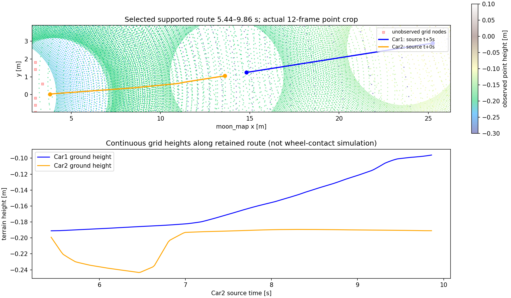
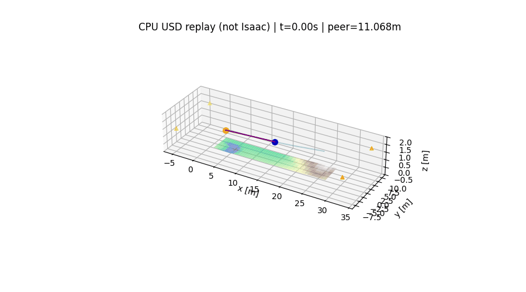

# Moon_1 连续双车路线（PR132续作）

起点591354134e4390812a1e8fad71873d5b13d75fc9。原研究和结果原样保留，本目录为独立续作。

密采样协议：每0.02秒，车体0.8×0.6m范围内0.1m网格（63点/车），沿用Car1=t+5s、Car2=t。四邻观测比例≥0.75、最近观测节点≤0.4m；帧重叠格高差≤0.25m、相邻采样高度变化≤0.15m作为本轮场景一致性筛选，不是物理通行认证。筛选规则写于定位前，不按定位效果调整。

原10帧检查和定向补取2帧后的结果分别保留。补帧未延长通过段，主段5.44–9.86s（Car1源10.44–14.86s），备用最长109.66–114s。无法宣称完整5–14s无缺口。初段和末段有覆盖缺口，中间两处帧间高度差超预设筛选界，详见DENSE_COVERAGE和覆盖图。

连续USD为单地形网格、两个程序车体、天线、人工锚点及连续时间样本。车体保持世界竖直、采用原GT的yaw，未冒充原始6自由度刚体或真实底盘；天线相对车体中心[0,0,0.96]m，地形到天线1.16m。位置与轨迹均在moon_map米制Z-up。地形为LuSNAR合成点云，非实测月壤。

CPU OpenUSD 26.8已执行443次时间查询，核对222关键帧和中间插值、世界天线位置、杆臂和车间距离。CPU图片/GIF不冒充Isaac截图。Isaac6.2/Lab3.0探测GPU不可用；启动入口和阻塞状态保留。没有改驱动，没有执行轮地接触或月壤动力学。

定位方案冻结在PROTOCOL.json：4条件×10配对种子×M0/M2/M3=120次。ramp总幅度0.30m，段长4.42s，斜率0.0678733m/s；24采样时刻。短时异常只对Car2的一个运动增量加0.15m。额外AR(1)对照只在主任务完成后执行，匹配rho=0.8或对白噪声失配；参数全部是仿真设定。

## 完成交付

主对照120/120完成（119接受、1未驻点）；AR1额外30/30完成并接受。全部150端点独立读回通过，未重试。详见[报告](REPORT.md)、[复核入口](HANDOFF.md)、[便携核验](PORTABLE_READBACK.json)。

