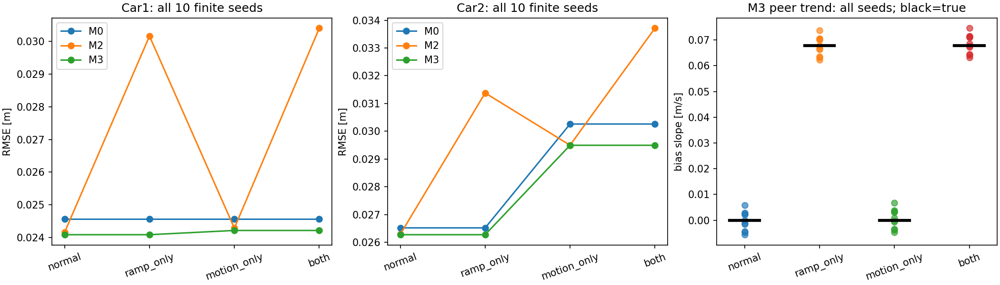
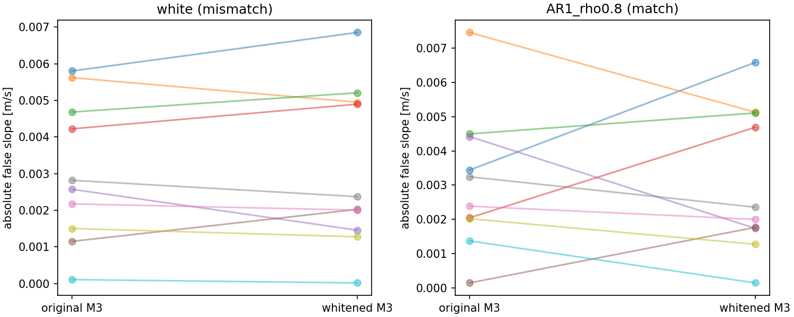

# 连续路线定位对照报告

冻结SHA：4d9003de7a9320d25374948f9093557b3364c3a3。主矩阵120/120完成，119 ACCEPTED、1 NOT_STATIONARY；主读回120条PASS。扩展实际新增30次、40条方法比较记录（复用主矩阵10条）；全部状态见EXECUTION_COUNTS，非接受项见FAILURE_LEDGER。无追加重试，没有重跑主矩阵计时。

## 路线与回放

主路线Car2源5.44–9.86s，Car1源10.44–14.86s，长4.42s。原计划5–14s未整体通过；补2帧后的最长段未变化。备用109–114s的最长通过段109.66–114s（4.34s），仍优先选主路线最长段。GAP_SEGMENTS给出每车具体断点，DENSE_COVERAGE列所有采样。0.02s/0.1m密采样不是连续空间数学保证，也不是地形可通行/轮地接触保证。

CPU实际重新打开单一连续USD、逐时读取组合变换：222关键帧及221个中间插值，共443次PASS；天线位置/车间距离最大差为0（本次浮点输出）。姿态为世界竖直程序车的GT yaw，不是完整真实车体姿态。CPU_REPLAY.csv与5张关键帧/GIF可复核；IsaacGPU探测失败，渲染和动力学未执行，阻塞及命令见HANDOFF。缺口不被当作通路，原始帧高差未被平滑隐藏。

## 主矩阵：逐车位置

24时刻，dt=4.42/23≈0.192174s；单次整个路线联合估计天线XY，公开输入提供地形导出的固定高度，因此3D位置误差的高度分量为0，不能据此声称实现高度融合。所有测距均按3D天线位置生成。人工锚点在评价前固定，两车/各方法/种子共享布局。位置先验含0.5m噪声，测距0.04m、运动增量0.02m为仿真假设。

|条件|方法|Car1平均RMSE / 全seed最大峰值m|Car2平均RMSE / 全seed最大峰值m|数值接受|
|---|---|---:|---:|---:|
|normal|M0|0.024573 / 0.066463|0.026518 / 0.099668|10/10|
|normal|M2|0.024161 / 0.061405|0.026286 / 0.095623|10/10|
|normal|M3|0.024088 / 0.061239|0.026272 / 0.095250|10/10|
|ramp_only|M0|0.024573 / 0.066463|0.026518 / 0.099668|10/10|
|ramp_only|M2|0.030158 / 0.059633|0.031378 / 0.106184|10/10|
|ramp_only|M3|0.024088 / 0.061239|0.026272 / 0.095250|10/10|
|motion_only|M0|0.024573 / 0.066463|0.030260 / 0.099126|10/10|
|motion_only|M2|0.024288 / 0.061108|0.029497 / 0.095355|10/10|
|motion_only|M3|0.024218 / 0.060982|0.029494 / 0.094855|10/10|
|both|M0|0.024573 / 0.066463|0.030260 / 0.099126|10/10|
|both|M2|0.030398 / 0.059494|0.033711 / 0.105880|9/10|
|both|M3|0.024218 / 0.060982|0.029494 / 0.094855|10/10|

主表保留全部有限结果，包含未驻点项；PAIRS逐条标识双方接受，不隐去分母。误差由与求解器隔离保存的参考轨迹计算，参考和注入标签不进入求解器API。锚点/高度是明示仿真观测合同，不是由优化结果反标定。

## 真实零偏差时的虚假趋势

M0不使用peer、不估偏差；M2仅常偏差，斜率固定0；M3的一个peer斜率由两车共享，不能拆成两车独立传感器偏差。逐车锚距残差RMS及残差斜率另列FULL_RESULTS；peer残差和bias slope为共享量。ramp从0到0.30m，斜率0.067873303m/s，不能沿用旧1秒窗口的0.30m/s。运动异常只在Car2中段一个增量施加沿yaw的0.15m，不修改参考轨迹，不是月壤动力学。

|条件|真实斜率m/s|M3平均估计斜率|M3平均绝对斜率|配对运动异常引起的平均斜率变化|
|---|---:|---:|---:|---:|
|normal|0.000000|-0.000391|0.003065|+0.000000|
|ramp_only|0.067873|0.067482|0.067482|+0.000000|
|motion_only|0.000000|0.000510|0.003044|+0.000901|
|both|0.067873|0.068383|0.068383|+0.000901|

运动异常的配对有符号趋势变化约+0.000901m/s；平均绝对趋势略降不等于没有失配吸收。正常与异常都保留所有10个seed，不按趋势符号选择。

normal与motion_only的真实bias严格为0；表中非零趋势是噪声/失配吸收，不可解释成真实UWB漂移。TREND_DIAGNOSTICS保留每个种子的符号、绝对量、总漂移和配对变化。不事后设置一个有利的“虚假趋势告警”阈值，也不以10种子作罕见风险保证。

## 小型AR(1)对照

在相同输入上比较原M3和M3W。预设运动协方差Σij=0.02²×0.8^|i−j|，四个运动分量互相独立；M3W仅白化运动残差及其Jacobian，不白化测距，也不改bias参数。白噪声输入为协方差失配，AR1输入为完全匹配，两种情况真实peer偏差都为0。每类10配对种子；40条方法记录中10条原M3白噪声来自主矩阵，不重计时，新增30次。

|输入|原M3平均绝对虚假斜率m/s|白化后|Car1 RMSE收益m|Car2 RMSE收益m|平均单次总成本增量ms|
|---|---:|---:|---:|---:|---:|
|white|0.003065|0.003106|-0.001279|-0.001107|-0.589|
|AR1_rho0.8|0.003104|0.003080|+0.002116|+0.002048|-0.374|

匹配时虚假斜率平均绝对量只下降约0.000024m/s，失配时略增；本小样本没有给出普遍抑制虚假趋势的证据。

收益为原M3−白化M3，正数才是改善。单次wall含检查点和评价，结果JSON最终写盘另在阶段墙钟中；毫秒级差异受运行环境影响，只有一次预定测量，没有选最快重跑。该小实验只能说明指定协方差下的匹配/失配表现，参数不是实物标定。配对详细分母在AR1_PAIRS，不能将单车RMSE改善自动解释为虚假趋势减少。

## 来源和边界

点云与gt.txt来自LuSNAR作者的Moon_1合成序列；Car1与Car2来自同一轨迹相隔5秒，不是两条独立实测轨迹。原10帧及新增2帧各自SHA256在CONTINUOUS_SOURCES；新增帧还做ZIP CRC检查。人工四角锚点来自冻结的路线中心/跨度规则，不来自LuSNAR设施。车体、天线与其杆臂是程序示意，未标定真实车辆。世界转换、旧LiDAR外参假设、栅格处理和GPU版本见README/RESEARCH_LOG。

轮地接触、月壤力学和真实NLOS传播属于后续独立实验。本轮优先交付点云支持范围、连续运动学资产与透明的观测层定位对照，未将填补区或模拟参数包装成真实月球通行证据。
