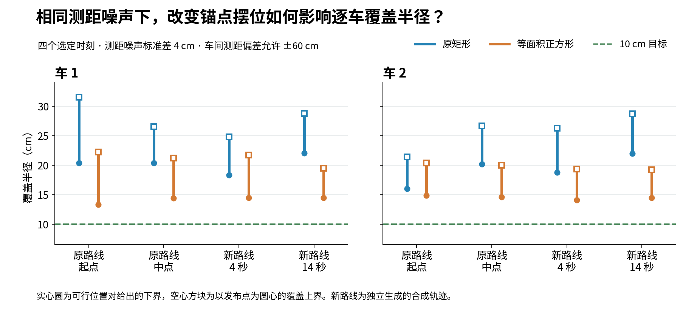

# 锚点布局与车间测距的逐车配对试验

**本轮结论**：原矩形与同中心同面积的正方形布局、开发及留出路线共 8 组联合输入。固定同一个九/八维平方残差预算 q=26 时，若车间偏差可在 ±0.60 m 内取值，则 8/8 组的第九条测距都无法进一步排除任何锚距已允许的双车位置。将原矩形改为方形后，3/8 个逐车布局对照可严格证明最小覆盖半径下降，另外 5 项上下界重叠。32 项主要比较都排除 10 cm，全部真实位置符合误差事件。该发现针对本次布局、噪声、单时刻和偏差范围。



## 设计

- 基准提交 [c7d53da](https://github.com/phyllis-TANG/uwb-coop-localization-ros1/tree/c7d53da2bb989f73514a6ce540813c379d698897)。预先写定的 [PROTOCOL.md](PROTOCOL.md) SHA-256 为 `e17b685ecb431baf9834bc5b19a530fbdea1617802074b8d1f7e48274072ea31`。
- 开发采用 [主段起点与中点原始输入](https://github.com/phyllis-TANG/uwb-coop-localization-ros1/tree/c7d53da2bb989f73514a6ce540813c379d698897/docs/research/lunar_end_to_end/round2_radius/inputs/zero)，按位复得九条观测和原发布点。开发“0、11”为原路线的历元索引。新留出路线和新噪声为本轮预先定义的二维合成轨迹、一个新种子，并非独立月表实采序列。时刻 4 s 和 14 s 共同使用这条测试轨迹，独立抽样规模不足以据此估计超限概率。
- 原矩形 37.44 m × 18.85 m，正方形边长 26.57 m。变更保留中心、面积、锚点高度、车辆真值和生成噪声，根据新几何重新生成测距。每一布局的全部方法共用同一个八锚距发布点。
- 每种布局 2 + 1 项：八锚距；八锚距加车间距（未知偏差 ±0.60 m）；补充诊断为已知车间偏差为零。均使用 4 cm 标准差、同一 q=26、已知天线高度与 5 cm 最大未决叶宽。固定 q 是为隔离观测信息，不代表相同的尾部概率。
- [upstream_solver.py](upstream_solver.py) 来自冻结提交的 [radius_resolution/solver.py](https://github.com/phyllis-TANG/uwb-coop-localization-ros1/blob/c7d53da2bb989f73514a6ce540813c379d698897/tools/lunar_end_to_end/radius_resolution/solver.py)。原函数 N4 的观测数调节门槛为 24。运行适配器验证原函数行，再把 P4、N4 都置于方案指定的 26；其余切分、精确有理数距离区间及全局搜索逻辑复用原函数。5 cm 表示末端四维盒宽，与此前归因表的 2.5 cm 分辨率不同。

## 结果

主比较无车间距及未知偏差车间距共 16 棵联合树、32 项逐车；零偏差诊断再加 8 棵树、16 项逐车。独立读回了全部 24 棵树的 264,010 个节点、48 个逐车外半径和 96 个可行联合状态。逐节点分支无遗漏，未处理队列为零。每项真值均在对应集合内；各联合输入及方法的真值统计量在 1.78–8.34。

| 相同条件下的布局比较 | 原布局可证明下界（cm） | 方形布局可保证上界（cm） | 最小覆盖半径至少缩小（cm，向下保留两位） |
|---|---:|---:|---:|
| 开发索引 11，车 2 | 20.15 | 20.01 | 0.13 |
| 留出 14 s，车 1 | 22.03 | 19.48 | 2.54 |
| 留出 14 s，车 2 | 21.97 | 19.22 | 2.74 |

这里的最小覆盖半径是允许自由选圆心的几何量。下界来自同一观测容许的两个联合状态在本车投影的间距之半；上界取实际发布点至外包最远角。只有旧下界大于新上界的案例才据此认定真正改进。主要结果在有无车间测距下都成立。对开发起点、留出 4 s 等其余案例，有限的两端数值不足以比较精确最小覆盖半径。

无车间距的完整树每个保留叶都对双车斜距进行区间运算。8/8 组的全部可能斜距都在观测车距 ±0.60 m 以内，最小余量 0.113686 m。每个锚距可行状态都能选择一个允许的偏差使第九项残差为零，因而前后四维集合严格相同。相同结论不是通过比较四舍五入外半径得到的。[逐组冗余证明](results/redundancy.csv)

规定车间偏差精确为零时，16 个诊断项仍全部排除 10 cm。在 6/16 个案例中计算外半径缩小，最大约 4.22 cm。外包缩小量不立即给出真实最小半径缩小量。10 cm 为研究阈值；本轮不评价动态告警和实际罕见故障率。

## 复算

本次运行 Python 3、NumPy 2.3.5、SciPy 1.17.0；原始输入、真实轨迹与噪声、每个布局的新观测、全部见证和完整压缩树均随附。绝大多数使用情形只需标准库复核。可在本目录运行：

```sh
python verify.py 4
```

重跑全部搜索和可行点搜索：

```sh
python run.py 4
python verify.py 4
```

- [完整逐车结果](results/rows.csv)；`redundant_60cm` 是运行端先用整车投影包围盒做的快速充分检验。`False` 表示该粗判未证明冗余；独立检查器保留联合叶配对，`redundancy.csv` 是最终结论。
- [留出解析轨迹及全部噪声](results/holdout_route.json)，[冻结原始输入](inputs)，[逐布局观测](results/observations)，[可行点坐标与区间](results/certificates)，[完整分支类型](results/trees)，[独立检查结果](verify.log)。

绘图命令为 `python plot_paired.py results/rows.csv paired_layouts.png`。另一份只用 Python 标准库的检查器可用 `python check_peer_redundancy.py . /tmp/layout_peer_redundancy.csv` 读取八棵锚距搜索树。归档的检查结果见 [peer_redundancy.csv](peer_redundancy.csv)。
