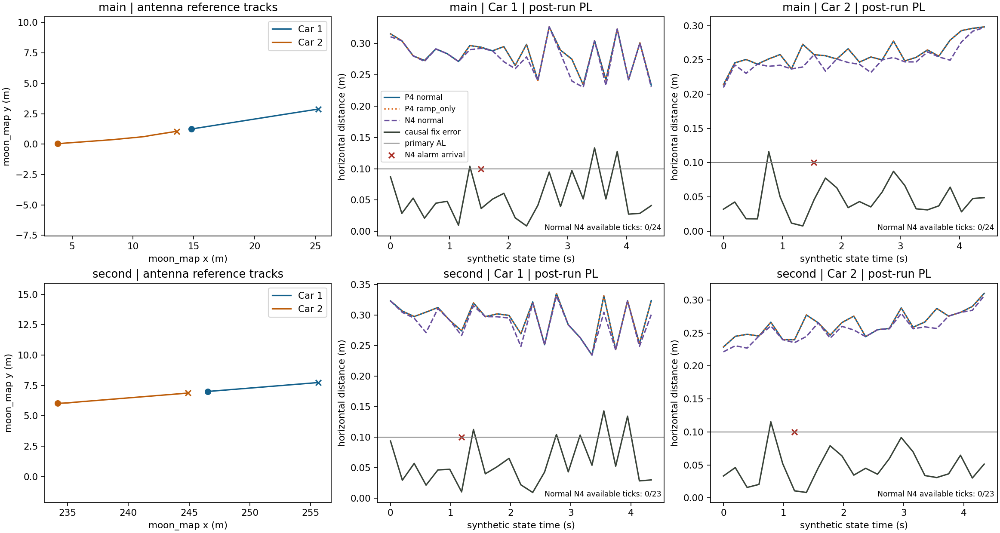

# Moon_1 逐车候选水平保护级与交付时序

两段同源路线的 188/188 个单历元区域通过已知高度合同且达到 0.05 m。相对实际发布的天线 XY，事后误差在候选 PL 内的记录为 376/376。在主 AL=0.10 m 下，发布节拍查询的可用记录为 **0/376**。按各结果自己的到达时刻评估，368 条已过期，另外 8 条及时到达但 PL 超限。AL=0.05 和 0.20 m 同样各有 0/376 可用。分母包含路线、条件、方法、车与时间的配对记录，并不代表独立样本数。



[逐车汇总与 PL 范围](summary.csv) · [全量位置、状态、逐车 PL、真实误差、时钟和原因](availability.csv) · [发布节拍的最新可用记录查询](delivery_ticks.csv) · [六个旧时刻的重算对照](replication.csv) · [同门槛解释实验](threshold_diagnostic.csv)

## 运行对象与时间合同

固定种子 2026111801。按原输入完整时间网格取第一段 24 点、第二段 23 点；各段从首点到末点全取。两段各用 normal 和 ramp_only，分别执行 P4(26)、N4(24)。优先重算两段各首、中、末的 24 项，重建求解输入与 #141 对象严格相等，证书除耗时等成本字段外逐项一致，联合命中、逐车投影、分辨率均一致。其余 164 项随后执行。诊断另行搜索 12 次 N4(26)。

|路线|Car 2 源时间 s|Car 1 源时间 s|合成状态时间 s|节拍 s|主 AL 到达判定（过期 / 超限 / 可用）|
|---|---|---|---|---:|---|
|主段|5.44–9.86|10.44–14.86|0–4.42|0.19217|188 / 4 / 0|
|第二段|109.66–114.00|114.66–119.00|0–4.34|0.19727|180 / 4 / 0|

对合成历元 t，令 s=s₀+t。Car 1 和 Car 2 分别取原 Moon_1 同一轨迹在 s+5 和 s 的位置与地形高度。生成器在同一行计算这对天线三维点的欧氏斜距，然后加该行偏差与噪声。帧为 moon_map、米、Z 向上。直立代理车的水平杆臂为零，天线高度为地形高加 1.16 m。[逐时刻源时间、合成状态时间、观测到达时间与发布 XY](events.json)。设所有九个测距与两项给定高度在合成 t 同步可得，无另加传输延迟。A 的 height 接口以该车源时间校验状态标记，调用前将状态、就绪、查询、截止等所有时钟整体平移到对应车的源时标。跨车排队与画图统一使用合成时间。

#137 的 M0/M2/M3 同时拟合整段位置和运动增量，较早状态受后续观测约束，仅作离线轨迹结果。本轮重新发布每车的当前锚距解：在给定天线高度下，将四条斜距平方，以第一锚为基准作差，用三个线性方程最小二乘解水平 XY。该点只读取当前锚点、四条当前锚距及当前高度，因此正常和渐变条件在相同锚距下共享同一发布位置。peer 仅进入 P4 区域。搜索和发布函数均无真值参数，冻结的参考天线 XY 仅在计算命中、真实误差和绘图时使用。

## 从证书到可用判定

每个保留二维矩形计算距**该车实际发布点**最远的角点，在全部保留矩形上取最大值，按 A 合同向上开方。主段的事后 PL 范围为 0.210–0.327 m、最大真实误差 0.133 m；第二段为 0.221–0.335 m、最大误差 0.143 m。图中曲线按状态发生时间绘制。两条件重叠处源于相同锚距和本轮 peer 偏差域。area、hit 和 PL 的证据均基于天线水平位置。

沿用地面窗口的 AL=0.05/0.10/0.20 m 及含端点的 2 s 截止与有效期。位置在观测可得并完成发布解后发布。每条路线、条件和方法各自模拟一台 FIFO 区域处理器，单项服务耗时为实测的适配输入、构造根、搜索、压缩写读、独立树核验与两车半径计算。服务起点为该位置发布与上一项完成的较晚者。就绪时执行 AL 比较；离线重复验收和事后评价不计入服务。跨方案以四个进程并行测时，因此 1.161–5.255 s 是本机这次负载条件下的服务时间。排队是以上服务时间的时间轴回放。所有区域服务均超过单个采样间隔。

表中 PL 为发布规则当时可提供的 PL；retrospective_PL_m 为对该历元完成验收后可计算的候选值。过期行的接口 PL 为空。到达时超限的 8 条全部来自两段 N4 首历元，正常与渐变条件各自两车均产生超限告警。P4 本次没有及时到达的判定。两个 ramp 都从首点零偏差爬升至末点 0.30 m，仍在 P4 假设的 ±0.60 m 偏差域内；记录在爬升末端结束。没有故障解除、恢复段或专用故障检出截止试验，首历元的告警也出现在正常条件。单历元结果的 2 s 交付截止可直接观测。

## 为什么加 peer 后逐车外包会变大

P4 和 N4 的正式噪声事件门槛不同。固定同一事件根、同一 0.05 m 网格，在六个旧时刻 × 两条件增加纯锚距 q=26 的解释组。单独用 A 的高度区间算术复验该组完整树、叶标签、严格分割和终止宽度。正式 N4 仍使用 q=24。

同门槛下 P4 的目标是锚距残差加上最优有界偏差下的非负 peer 项，因此其精确可行集包含于 N4(26) 的精确可行集。按共同分割树比较，12/12 个 P4(26) 有限联合外包均包含于相应 N4(26) 外包，两组的外包四维体积和逐车投影并集面积在本批相同。例如主段首历元 Car 1 的 N4(24)、N4(26)、P4(26) 面积分别为 0.10310、0.11308、0.11308 m²。第二段中点分别为 0.09810、0.10861、0.10861 m²。这批观测中的边缘面积增加在放宽锚距门槛时已经出现。

[解释实验表](threshold_diagnostic.csv) 分列 INSIDE 盒并集与包含 UNDECIDED 盒的外包。主段首历元 N4(26) 的 Car 1 内、外面积为 0.02162、0.11308 m²，四维内、外体积为 0.000241、0.005767 m⁴。这个夹区间量化有限盒分辨率留下的不确定性。外包相同不足以断定连续精确可行集完全相等。

## 适用范围与复现

结果支持在两段 LuSNAR 月面类比轨迹上，对同历元合成双车斜距、给定高度、当前锚距发布点及指定排队策略进行候选 PL 时序复核。两车是同一条源轨迹的错时构造，只有一个种子；路线、配对条件、方法及时间点共享信息。376 个命中不能推导任务级风险或实际月面可用率。地形、高度、人工锚点及同步观测均按给定值处理。此处未估计高度误差、实车时钟延迟或传播故障分布。

|来源|实际 SHA|
|---|---|
|#137 轨迹结果|f0b457c5788de15f0fb693a37a7fe79201b43d44|
|#139 PR 头 / 已知高度检查器实现|ce33e7f09bf9f9abdf8336ab15191d83037c0873 / da852740689113529b38815e1eb81f949ff5a8c6|
|#141 最终提交 / 正式运行冻结|af844589dc41d38f50b329b6baee3efb25eca208 / 9a6d58f2d3db982af1b4fc01de5b0d84f4084e45|
|A 逐车发布接口实现|f823013b4d96579b5c2ec622fb6ed30848721514|
|地面窗口 AL 和时钟策略|ecec5bfd976f166d937faf7ea28bf92d71d9c8fd|

仓库根目录使用 Python 3.10+。浅克隆先获取所需源对象。读回仅需标准库。

```sh
git fetch origin refs/pull/141/head
git fetch origin refs/pull/139/head
git fetch origin research/per-car-integrity-a
t=tools/lunar_end_to_end/moon_monitor
python3 "$t/readback.py"
python3 "$t/evaluate_monitor.py"
python3 "$t/diagnostic.py"
python3 "$t/figure.py"  # Matplotlib
```

在单独的干净输出位置重新搜索时，使用本分支的新工作树，先将其 moon_monitor 结果目录移到备份位置并重建空目录，再执行 `python3 "$t/monitor.py"`，随后执行上述四步。冻结的旧输入和首次产物保留供比对；新测的服务耗时与相应 FIFO 结果会随机器负载改变。每项证据中的 original 和 certificate 可直接交给 A 的高度检查器，逐车发布字段及原输入哈希见 availability.csv。

[供 A 独立读回的 1,128 条发布请求和判定](publication_decisions.json.gz) 采用标准 JSON，含 publication、decision 和相对证书路径。每条的 publication 可直接交给固定接口 decide；source_times 的两车时间差由独立读回逐例检查。[来源文件哈希](SOURCE_LOCK.json) 与 SHA256SUMS 提供完整性核对。
