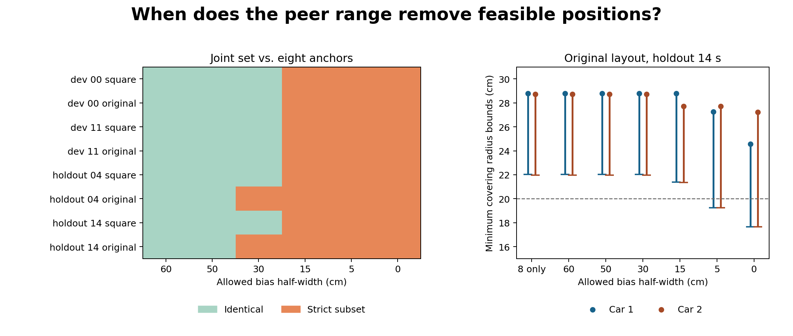

# 车间测距从哪个偏差档开始排除位置？

固定 #156 的八组观测后，**±50 cm 在全部八组中仍然冗余**。两个留出时刻的原矩形布局在 ±30 cm 已排除位置；其余六组在 ±30 cm 仍与八锚距集合完全相同，到 ±15 cm 才在已测档中首次证实排除。**没有一项证明某辆车的精确最小覆盖半径严格下降。** 新增三档的 48 条逐车比较中，12 条因集合相同而半径相同，另 36 条的半径变化未定。各档真值均通过联合事件检验。



## 各输入的转折区间

表内为对称偏差的半宽，单位 cm。两列之间尚未定位精确转折点。开发的 0、11 是原路线历元索引，留出的 4、14 是同一条合成轨迹的秒数。

| 输入 | 布局 | 仍证冗余的最窄已测档 | 开始排除的最宽已测档 |
|---|---|---:|---:|
| 开发 0 | 原矩形 / 等面积方形 | 30 / 30 | 15 / 15 |
| 开发 11 | 原矩形 / 等面积方形 | 30 / 30 | 15 / 15 |
| 留出 4 s | 原矩形 / 等面积方形 | 50 / 30 | 30 / 15 |
| 留出 14 s | 原矩形 / 等面积方形 | 50 / 30 | 30 / 15 |

逐项相对同输入的八锚距基线。各行含 8 个联合输入或 16 个逐车投影；这些时刻与布局是配对条件，不能按 16 次独立重复解读。

| 偏差半宽（cm） | 集合相同 / 严格缩小 / 未定 | 精确最小半径相同 / 严格下降 / 未定 | 发布点外包上界变小 | 20 cm 排除 / 保证 / 未定 |
|---:|---:|---:|---:|---:|
| 八锚距基线 | 8 / 0 / 0 | 16 / 0 / 0 | 0 | 5 / 3 / 8 |
| 60 | 8 / 0 / 0 | 16 / 0 / 0 | 0 | 5 / 3 / 8 |
| 50 | 8 / 0 / 0 | 16 / 0 / 0 | 0 | 5 / 3 / 8 |
| 30 | 6 / 2 / 0 | 12 / 0 / 4 | 0 | 5 / 3 / 8 |
| 15 | 0 / 8 / 0 | 0 / 0 / 16 | 2 | 5 / 3 / 8 |
| 5 | 0 / 8 / 0 | 0 / 0 / 16 | 4 | 2 / 4 / 10 |
| 0 | 0 / 8 / 0 | 0 / 0 / 16 | 6 | 0 / 6 / 10 |

每档 16/16 项的见证下界均超过 10 cm。20 cm 的“排除”使用 L>20 cm，“保证”使用 U≤20 cm。上下界和结论均逐输入保留，未定项计入分母。[逐车 L、U、10/20 cm 判定与外包变化](by_car.csv) · [逐输入真值、全域界与排除见证](by_input.csv) · [转折区间](thresholds.csv)

## 留出 14 s 原矩形

在 ±30 cm，一个八锚距可行的完整双车状态为 Car1 (13.098476254, 5.024400770) m、Car2 (12.298531570, −2.234750838) m（显示值取近似，CSV 保存精确有理坐标）。八锚距统计量的严格数值上界低于 25.999999001；即使为这个位置选取最有利的允许偏差，九链统计量下界仍高于 27.3357879，超过 26。真值在同一档仍相容。此时两车外包上界与八锚距基线相同，约 28.79、28.71 cm。到 ±5 cm，两上界分别降至 27.26、27.73 cm，仍高于基线见证下界 22.03、21.97 cm（显示取近似），故精确最小半径下降仍未获证。图中圆点为同一发布中心的外包上界，短横线为任意圆心下界。

## 证据及复算

起点 `3787e3a4b61aac969a46ab8245c37f5ed1199d92`，配置登记提交 `7e218e9d356c1a331ef20012017ede799ae0a9ee`。[冻结配置与源文件 SHA-256](config.json) · [协议](PROTOCOL.md) · [原观测](../layout_peer_pilot/results/observations) · [新增树、可行点对与回执](cases)。原始记录内同时含事后参考位置。搜索模型只接收原始斜距、锚点、天线高度、方差和偏差域；原发布点用于外包半径与见证搜索初始化，参考位置用于单独的真值评分。全部使用 σ=0.04 m、q=26、5 cm 分辨率。

- 全局等价证明使用八锚距联合树的全部保留四维盒。对于 ±50 cm，仅需这些盒给出的车间斜距界；八组中最坏的绝对偏离上界小于 48.64 cm，每个八锚距可行点都可用偏差完全吸收第九项。由此直接沿用八锚距证书的 L、U，未新增 ±50 cm 搜索。
- 在 ±30 cm 的五个粗盒不足以证明相同的等价案例中，继续二分八锚距保留盒，仅用于全域证明。每个子盒须证明车距完全在偏差带内、整盒满足九链事件，或整盒不可能满足八锚距事件。脚本在全部子盒均获得证据后才判相同。标准求解和证书的末端分辨率仍为 5 cm。
- 严格缩小的完整位置由数值优化提名。独立脚本按原输入重算八项上界和九项下界，其中 peer 残差在整段允许偏差内解析最小化。两个不等式分别通过后才判排除。见证和两个分数在 by_input.csv 的 exclusion 列。真值评分同样保留上下界，56 行（含八锚距参照）全部相容。
- 逐车 L 来自两个已证可行联合位置的目标车投影间距之半；U 由该车发布点至全部配对保留盒的最远角保证。比较使用精确有理平方量；CSV 中 cm 数字供显示。所有新增档及零偏差均未出现 U 新值低于八锚距基线 L 的情形。
- 新增 24/24 棵联合树、269,456 个节点、48 条逐车结果，未处理队列全部为空。另独立读回原 24 棵树，总计 48 棵；±50 cm 的 8 行依赖全域证明。所有已测物理偏差档的集合判定共 48 项，未定 0 项；逐车精确半径比较共 96 项，未定 52 项。八锚距基线单列。

在本目录执行。常规复核只需 Python 3 标准库，以两个进程重建完整树，验证每个排除、可行见证、真值及所有 CSV。

```sh
python3 readback.py --verify
```

重新生成时用 Python 3.10、NumPy 2.2.6、SciPy 1.15.3，绘图使用 Matplotlib 3.10.9。sweep.py 默认两个 worker，按算例写入临时目录，完成后原子发布。重复执行会验证回执并跳过完成项；中断后的首条恢复命令为 `python sweep.py`。在新工作副本中将 cases 目录移至备份路径后可从零运行。

```sh
python sweep.py
python propose.py
python readback.py
python plot.py
```
