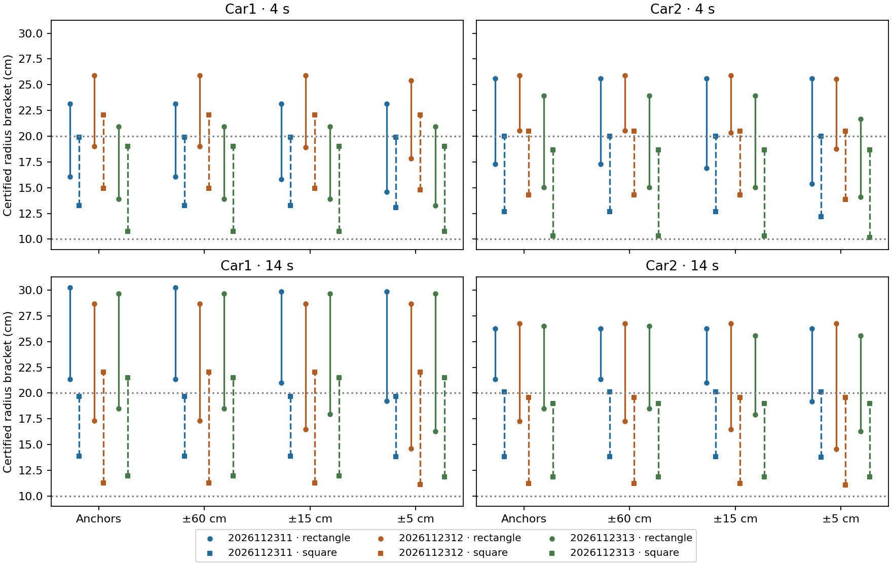

# 双车同向 parallel 合成路线的三种子留出复验

在两个评价时刻、两种布局和三个固定噪声种子构成的 12 组输入中，加入允许 ±60 cm 偏差的车间测距，12/12 组的联合可行集合保持相同。偏差收紧至 ±15 cm 或 ±5 cm 时，各有 12/12 组严格缩小（均相对于只用锚距）。但这些结果无法指定某一辆车的精确最小保护半径必然下降。单独比较布局时，可以证明两辆车都曾因改用等面积正方形而受益；具体车辆与时刻随种子变化。



## 逐项复核

|问题|分母与结果|
|---|---|
|可行性与树|48/48 次联合求解完成；独立复核 446,604 个节点、96 个发布点外半径、192 个用于半径下界的联合见证（计重复），真值相容 48/48，预算未决队列全部为零。5 cm 是末端盒宽。|
|10 cm 与 20 cm|96/96 条逐车结果均严格排除 10 cm；20 cm 得到保证 24、排除 9、未定 63。|
|布局对任意圆心最小半径的作用|48 个逐车配对中 8 个严格下降。种子尾号 11 的 14 s，两车在仅锚距、±60、±15 cm 三种模式下降；尾号 12 的 4 s，车 2 在仅锚距、±60 cm 两种模式下降。其余 40 项界重叠，包含尾号 13 的全部布局比较。|
|车间距对逐车半径的作用|±60 cm 时联合集合相等，两车投影及其最小覆盖半径也相等。相对于仅锚距，±15、±5 cm 各 24 项逐车比较均未得到严格半径下降证明。±5 cm 的外包上界在车 1 的 2/12、车 2 的 3/12 项下降，最大降幅分别约 0.47、2.27 cm。|

**证明口径。** 保留无车间距树中每个联合叶及全部待处理叶，对其车间斜距作向外舍入。若所有叶的斜距都在观测值加减偏差界内，则每个锚距可行状态均能选偏差使新增项为零，因而集合相同。严格缩小的证书是一个四维点，其八锚距得分上界 ≤26，而含车间距的消元得分下界 >26。由于新增项非负，其余方向的包含自动成立。逐车半径下界取两个可行点在该车投影间距之半，上界取该布局实际发布点到全部保留投影最远角；严格下降仅在新上界平方小于旧下界平方时认定。上下界重叠表示当前证据不能判定严格改善。

[逐车结果和输入哈希](results/rows.csv) · [36 个集合比较及精确依据](results/relations.csv) · [120 个逐车比较及有理平方界](results/radius_comparisons.csv) · [布局输入与共用发布点](results/observations) · [逐车证书](results/certificates) · [完整压缩树](results/trees)。树按广度优先排列，以最大宽度轴二分；P 标记随队列落盘，若耗尽预算仍纳入上界。输入哈希覆盖观测记录、模式、偏差界、阈值、方差、分辨率和预算，定义见 verify_results.py。

## 范围和复算

[配置](protocol.json) 在首次求解前已提交。每个种子的完整 23×9 噪声矩阵见 results/noise_*.npy，文件 SHA-256 保存在对应观测 JSON 中。仅使用预定 4、14 s。两种布局分别重算斜距和八锚距发布点，每个布局内部四个模式共用中心，两布局配对使用同一噪声行。三种子重复的是这条合成路线上的固定 q=26 几何结论，无法由此估计实车风险或覆盖率。

本目录下，Python 3、NumPy 用于独立读回；重新求解另需 SciPy，绘图需 Matplotlib。运行端沿用相邻 layout_peer_pilot 的原求解器及八锚距发布算法。核验器继承其独立分数区间读回算法，支持三种非零偏差、队列标签、输入与表格身份，不调用求解器。请使用默认 Python 断言。

```sh
python3 verify_results.py       # 只读重建 48 棵树，逐项比对两张 CSV
python3 comparisons.py         # 从证书精确平方界重建配对表和图
```

重新计算可复制此目录及同级 layout_peer_pilot 到空工作目录，仅保留本目录的脚本和 protocol.json，再执行以下命令。experiment.py 以两个 worker 按算例保存树、证书及完成标记；在已有结果目录执行可跳过完整算例。

```sh
export OPENBLAS_NUM_THREADS=1
python3 experiment.py
python3 extra_witness.py
python3 verify_results.py --write
python3 comparisons.py
```
