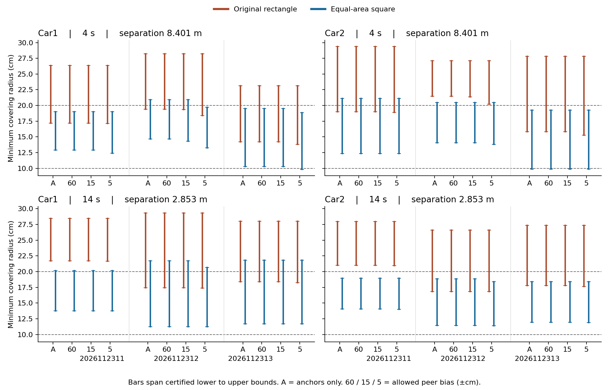

# crossing_offset 双车 UWB 合成路线留出复验（C 窗）

两车从 4 秒时相距 8.401 m，到 14 秒时已在 x 方向交错，相距 2.853 m。两个时刻，允许 ±60 cm 偏差的车间测距均对联合可行集合冗余，收紧至 ±5 cm 后均可排除一部分联合位置。方形布局在较近时刻有一个种子的两辆车都能证明最小覆盖半径下降；同一布局单独加入车间测距，现有逐车半径界均未分离。



图中 A 表示八锚距，60、15、5 表示加入第九条测距所允许的偏差半宽（cm）。每条竖线连接该车最小覆盖半径的证书下界与上界。每个种子的两种颜色使用同一真值和同一行噪声。

## 配对结果

| 时刻 | Car2 − Car1 的水平位移（m） | 真实斜距（m） | ±60 cm 联合集合 | ±15 cm 联合集合 | ±5 cm 联合集合 |
|---|---|---:|---|---|---|
| 4 s | (+7.80, +3.12) | 8.400881 | 6/6 相同 | 6/6 缩小 | 6/6 缩小 |
| 14 s | (−2.70, +0.92) | 2.852508 | 6/6 相同 | 5/6 缩小，1 未定 | 6/6 缩小 |

每格比较同种子、同布局下加入车间距前后的集合。相同的证明覆盖八锚距树的所有保留叶。如果每个叶内的斜距都落在观测值允许的偏差带内，则每个原可行点都能令第九项残差为零。缩小的证明给出同一四维点在八锚距模型下的分数上界 ≤26、加车间距后的分数下界 >26。新增项非负，因此这是严格子集。14 秒、矩形、种子 2026112312 的 ±15 cm 项中，全域斜距包围超出偏差带，候选点也未给出严格反例。[逐项证明与反例索引](results/sets.csv)

**逐车最小半径**采用自由圆心。旧模型中一对可行联合状态在该车投影上的间距之半给出下界 L，新模型的全体叶盒相对发布点的最远角给出上界 U。用精确平方量比较，只有旧 L > 新 U 才报告严格改善。下表为矩形换成方形后可证明的最小缩小量，向下取至 0.01 cm。其余布局对照的界均重叠。[全部 48 个布局对照和 72 个车间距对照](results/radius_comparisons.csv)

| 种子 | 时刻 | 车 | 八锚距 | ±60 cm | ±15 cm | ±5 cm |
|---:|---:|---|---:|---:|---:|---:|
| 2026112312 | 4 s | Car2 | 0.97 | 0.97 | 0.91 | 未证 |
| 2026112311 | 14 s | Car1 | 1.54 | 1.54 | 1.54 | 1.50 |
| 2026112311 | 14 s | Car2 | 2.05 | 2.05 | 2.05 | 2.02 |

单独加入 ±5 cm 车间距后，每个时刻各有两项方形布局的逐车外半径缩小。4 秒时，种子 2026112312 的 Car1 上界从 20.9 cm 降至 19.7 cm，获得 20 cm 保证。14 秒的两项上界缩小均未改变 20 cm 判定。三个噪声种子均保留；两个时刻使用不同噪声行，方向和间距也同时变化，无法单独归因于间距。

## 配置、数量与证书

- [运行前提交的配置](config.json) 以 PR #156 的固定提交 3787e3a4b61aac969a46ab8245c37f5ed1199d92 为基准。t 取整数 0…22。Car1 为 (5+0.60t, 1+0.12t, 0.97)，Car2 为 (17−0.45t, 5−0.10t, 0.95)，单位 m。[逐秒真值](results/route.json)
- 每种子单独初始化 PCG64，一次生成 23×9 标准正态数并乘 0.04，列依次为 Car1 的 a0…a3、Car2 的 a0…a3、车间距，注入偏差为零。每个文件记录完整矩阵及小端 float64 按行字节的 SHA-256，可直接跨路线比对。[三个种子的原始矩阵](results/noise)
- 用原矩形和同中心同面积正方形计算三维斜距，每个布局独立生成八锚距发布点并供四种模式共用。观测 JSON 以有理数记录输入与发布点，CSV 的 input_hash 为该 JSON 文件字节的 SHA-256。[12 组配对输入](results/observations)
- 计划和实跑均为 3 种子 × 2 时刻 × 2 布局 × 4 模式 = 48 棵联合树、96 项逐车结果。复用同级 pilot 的计算，σ=4 cm、q=26、最大未决叶宽 5 cm，每树 150000 节点和 240 秒预算。完整回放 423260 节点、192 个可行见证，pending 合计 0。若达到预算，树中 P 标签保留队列中的盒，复核上界同样纳入这些盒。[完整树](results/trees) · [逐车证书](results/certificates)
- 所有 48 次联合求解的真值相容，真值分数为 4.7172–16.2493。阈值判定使用精确平方量：L 超阈值为排除，U 不超阈值为保证，其余为未定。10 cm 共 91 项排除、5 项未定；20 cm 共 25 项保证、12 项排除、59 项未定。rows.csv 中 redundant_60cm 是沿用的粗包围盒诊断，最终集合结论见 sets.csv。[完整逐车 CSV](results/rows.csv)

## 复算与独立检查

在本目录运行。求解使用 NumPy 2.2.6、SciPy 1.15.3，绘图使用 Matplotlib 3.10.9。check_inputs.py 独立重建路线、噪声、布局与观测，用线性最小二乘核对发布点。verify.py 仅用 Python 标准库，独立重建全局根盒与完整分支，检查删盒、见证分数、上下界、阈值、输入哈希以及两份比较表。

```sh
python3 check_inputs.py
python3 verify.py
```

重跑或续跑使用下列命令。run.py 固定两个 worker，每个算例在证书和树落盘后原子写入 completed 标记，重启时复用相同输入哈希的已完成算例。要从零重算，可在独立的新 checkout 中先将 results 移到旁边备份。

```sh
python3 run.py
python3 peer_witnesses.py
python3 check_inputs.py
python3 verify.py --write
python3 verify.py
python3 plot.py
```
