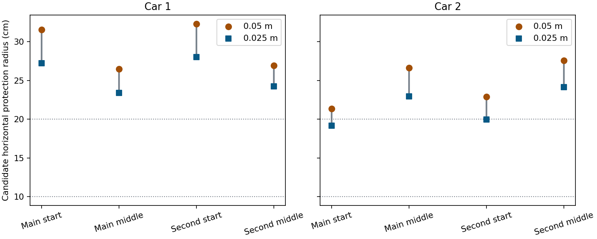

# 四个历元的逐车候选保护半径

固定 P4(26)、原发布点和测距输入后，8 个车/历元配对中 8 个半径收紧，幅度为 2.22–4.32 cm。0.10 m 半径线有 0 个判定从超限转为满足，0.20 m 线有 2 个，分别为主段首点车2、第二段首点车2。粗、细半径均覆盖全部八个同戳真实误差。

|历元|车|0.05 m 半径 cm|0.025 m 半径 cm|缩小 cm|真实误差 cm|距 0.20 m 仍超出 cm¹|
|---|---|---:|---:|---:|---:|---:|
|主段首点|p|31.54|27.23|4.32|8.70|+7.23|
|主段首点|s|21.38|19.15|2.22|3.21|-0.85|
|主段中点|p|26.50|23.38|3.12|2.16|+3.38|
|主段中点|s|26.63|22.92|3.70|3.44|+2.92|
|第二段首点|p|32.30|28.03|4.27|9.37|+8.03|
|第二段首点|s|22.88|19.95|2.93|3.33|-0.05|
|第二段中点|p|26.92|24.22|2.70|2.19|+4.22|
|第二段中点|s|27.56|24.16|3.40|3.45|+4.16|

¹ 正数表示仍超出，负数表示已有余量。1/2 号车对应 p/s。[逐车配对 CSV](paired.csv) 包含 0.10 m 与 0.20 m 两条线的逐项判定和有符号差距，差值列 change_cm 定义为细减粗。

