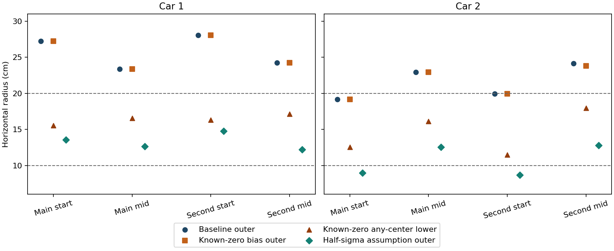

# Moon_1 四历元保护半径归因

在原发布点，把车间偏差从 ±0.60 m 固定为零，八个候选外半径中七个相同，一个缩小 0.35 cm。八项都有联合可行点见证，证明即使重新选圆心也无法达到 10 cm。保持旧观测、只将九链 σ 从 4 cm 改为 2 cm，外半径缩小 10.17–13.66 cm；四个历元全部超出新的九链噪声事件，两个首历元甚至排除了真实联合位置。唯一两个落在 10 cm 内的外半径都来自这两个失效历元。



|历元|车|基准外半径 cm|精确零偏差外半径 cm|零偏差：任意圆心下界¹ cm|旧观测、半 σ 外半径 cm|半 σ 真值可行|
|---|---|---:|---:|---:|---:|---|
|主段首点|1|27.23|27.23|15.52|13.57|否|
|主段首点|2|19.15|19.15|12.56|8.99|否|
|主段中点|1|23.38|23.38|16.55|12.64|是|
|主段中点|2|22.92|22.92|16.13|12.54|是|
|第二段首点|1|28.03|28.03|16.31|14.79|否|
|第二段首点|2|19.95|19.95|11.46|8.70|否|
|第二段中点|1|24.22|24.22|17.13|12.18|是|
|第二段中点|2|24.16|23.82|17.97|12.77|是|

¹ 展示值四舍五入。证明和限值判定直接比较精确有理数平方。[八项归因 CSV](attribution.csv) · [零偏差完整搜索](zero.csv) · [收紧假设及逐车上下界](tight.csv) · [新传感器配对合成结果](matched.csv)

## 固定比较对象

工作基准 f61c02e3aad26709a07940bd9900024ec9a93aa1。先从 #146 的四个正常历元归档（00145cb01a809b325a928b3735ef1d9d62edf23a）执行 --verify；#148 的 moon_certified_radius.py 重算的八行与共同基准收录的复核表逐字节相同。两个路段各取索引 0、11，种子 2026111801。保留实际天线发布点、原九条已知高度斜距、q=26 和 1/40 m 未决叶分辨率。每个变体独立封存输入、发布点及输入哈希；正式搜索预算均为 300000 节点 / 240 秒。事件根域由固定高度合同从该变体的观测和方差重建，仍覆盖该变体原问题，不人为裁剪。见 [预登记](plan.json)、[输入](inputs/)、[全部证书、队列和时间收据](runs/)。

## 零偏差证明与半径变化

在已验收旧树的 INSIDE 叶中取四维中点，先按浮点几何挑选方向上相距远的候选，再对实际采用的点把九条斜距逐条用有理区间计算，取加权残差平方和上界。每个点的上界均 ≤26，且所用车间偏差确实是 0。对每车取两个联合可行点的本车投影；其精确距离平方均大于 1/25 m²，任意覆盖圆的半径必大于 1/10 m。该结论也适用于包含零的更宽偏差区间。[原始见证](witnesses/) 包含旧树路径、完整有理四维坐标、各项上下界、总上界及精确距离平方。独立读回核对旧 INSIDE 叶的中点身份，并用固定 A 高度算术从原输入重新核验九项之和。实现未读取其他窗口的临时筛查。

零偏差完整搜索进一步量化外半径：仅第二段中点车 2 缩小约 3.45 mm。0.025 m 有限盒上的外半径受有界偏差收紧影响很小；该数值不代表整个四维联合可行集也几乎没有变化。原发布点下 10 cm 全部被可行点否证，20 cm 为两项外包满足、六项有超限点。

## 收紧旧观测的噪声假设

所有方差改为 1/2500 m²，偏差恢复为 ±0.60 m。利用归档真值重算九条斜距：已知注入 b=0 时检查原噪声事件，再对允许偏差区间剖面化，检查是否存在某个 b 使同一真实联合位置可行。两段由于同一种子和相同索引共享噪声样本。

|同戳索引|新事件统计量（注入 b=0）|对 b 最小化后真值统计量|q=26 下的结论|
|---|---:|---:|---|
|0，两段|33.3524|31.4287|事件不成立，真实位置被排除，假设失效|
|11，两段|28.1265|14.4183|事件不成立，但存在偏差可容纳真实位置|

精确区间和逐车构造点见 [bounds/tight](bounds/tight/)。对原发布点，两项外半径 ≤10 cm、八项 ≤20 cm。其余六项的**外半径超过** 10 cm，但可行点下界低于 10 cm，因此对真实连续可行集能否装进该圆仍为 UNRESOLVED。对任意圆心，证实某一发布点外包 ≤AL 即给出一个可行圆心；否证所有圆心则使用直径下界。两者在 CSV 的 pl10/pl20 和 any10/any20 中分列。WITHIN 表示外包足够，EXCEEDS 表示下界已否证，UNRESOLVED 表示上下界尚未夹到同一侧。每个下界都附带完整四维可行点，经独立区间算术确认；优化器只用于寻找候选点。assumption_failure 字段标记真实位置被排除，noise_event 字段单列四例均不满足实际噪声事件。

## 新传感器反事实

另外四次搜索沿用相同几何、相同标准化噪声和 b=0 的注入，先验证 noiseless + 原噪声逐值等于旧观测，再生成 noiseless + 原噪声/2。用 #144 的当前锚距发布算法重算两车 XY，求解器仅收到新的观测合同。四个历元的新噪声事件和真值可行性全部通过。八个外半径为 10.68–16.43 cm：20 cm 八项均满足，10 cm 无一项由外包证实；六项有可行点对排除任意圆心 10 cm，其余两项未知。这个结果单列于 matched.csv。两种噪声对照的区别在于观测和发布点是否随传感器变化。σ=2 cm 尚无设备标定；四个固定历元、一个种子不能支持硬件性能概率或车辆可用时长结论。

## 计数和复核

#146 四对搜索及八项 #148 半径基准已读回。零偏差两点判定 8/8 证明成功，未知 0。零偏差、收紧假设、同步改进传感器各 4/4 个完整搜索通过 A 检查，失败、未决队列和未运行各 0。四历元的搜索、保存及独立树验收合计分别约 82.86、10.30 和 15.51 秒；单项耗时在各 CSV 中，两辆车引用同一次联合运行。未重建交付时钟。

在仓库根目录用 Python 3.10+ 执行。浅克隆先获取 #144、#142、#139、#141 的完整对象。低成本复核无需优化器、SciPy 或重跑搜索：

```sh
t=tools/lunar_end_to_end/round2_radius
python3 "$t/check.py"
```

完整读回（零搜索，逐树验收）及重算下界表、绘图：

```sh
python3 tools/lunar_end_to_end/radius_resolution/run.py --verify
python3 docs/research/midterm_sim_review/round1/moon/moon_certified_radius.py --repo . --output /tmp/moon-baseline.csv
for v in zero tight matched; do python3 "$t/study.py" "$v" --verify; done
OPENBLAS_NUM_THREADS=1 python3 "$t/analyze.py"   # NumPy、SciPy
python3 "$t/figure.py"                          # Matplotlib
```

从新输出目录复现或恢复：独立工作树中先备份已提交的 runs/，执行 study.py prepare、study.py witness，再顺序执行 study.py tight、matched、zero（每次一个参数）。已有证书及收据会先验收，只有缺少的案例才新开搜索。各变体的原始输入 x 与事后评价字段并列保存，搜索接口只传入 x。完整树保留队列；只有显式清空且所有 UNDECIDED 叶达到宽度门槛才记完成。
