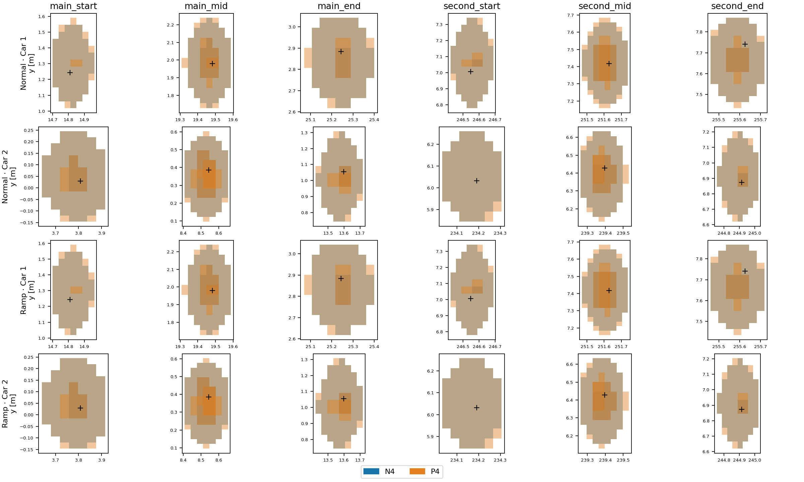

# Moon_1 单历元固定高度斜距区域

计划 24 项，实际执行 24 项，A 发布的独立检查器通过 24 项，达到 0.05 m 搜索分辨率 24 项，预算停止 0 项。按有限投影矩形的并集面积衡量，第二段中点两车的相对变化均最大。P4 相对 N4，Car1 从 0.09810 增至 0.10861 m²（+10.71%），Car2 从 0.09507 增至 0.10224 m²（+7.55%）。第一段起点 Car1 也增加 9.68%。正常与仅渐变条件得到相同的逐车面积。以上为描述性排序。



[矢量图](regions.pdf) · [24项完整结果](LEDGER.csv) · [逐车变化](AREA_CHANGE.csv) · [精确面积与原事件读回](READBACK.csv)。图中每列使用该历元的地图坐标与局部刻度；表中面积、半径单位分别为 m²、m。节点数含分割节点和叶节点。原始树、投影矩形、根盒、A 接口输入、逐项验收回执和运行收据在 results/ 下，目录名与结果表对应。

原有 [#137 轨迹结果](../interface/CHAPTER_7.md) 比较整段 M0/M2/M3 定位误差。本次仅使用同一合成路线的单个历元，不向区域搜索提供运动增量或轨迹先验。P4 使用两车各四条锚距和一条 peer 斜距，在 B=[−0.6,0.6] m 上消去单历元偏差；N4 使用八条锚距。方差为 1/625 m²，完整联合门槛分别为 26 与 24。较大的九维门槛及有界偏差允许逐车外包增大。不能用外包面积差推出精确可行集面积差，也不能从两条边缘命中推出四维联合命中。

## 输入和搜索域

原种子 2026111801，累计 ramp 为 0→0.30 m。两路段各取首、中、末，偶数样本取较早的中间索引，沿用 #137。12 个计划输入分别给两种方法；两个路段的起点正常/ramp 均有相同完整求解输入，所以完整输入有 10 个不同哈希。全部六对条件的锚距、布局与高度分别相同，N4 的有效观测只有六组。计划中的重复照常执行并保留。[来源、历元及哈希](INPUT_MANIFEST.json)记录求解与评价的不同路径。斜距、高度及锚点以原 IEEE 数值的精确整数比保存，月面坐标已从源坐标经 diag(1,−1,−1) 转至米制 Z-up，Car1 源时刻比 Car2 晚 5 秒。

没有独立任务地图硬边界。采用 A 发布的 event_root：联合事件约束每条无偏锚距的预测上界为观测上端加 sqrt(26 Rii)，扣除给定高差的平方后向上开方，得到水平半径，取四锚轴向外界的交。两方法共用 q=26 的根界，因 q8≤26 也包含 N4。条件为给定高度与锚点正确、前八条无偏、原观测及正方差符合合同。根域只从公开几何与锚距构造。正常/ramp 两组评价真值均在求解和独立树检查之后读取。

## 证书、成本及交接

- 输入冻结 3b68bcf0df9de496cf7353f3cd506a06e5a6f40c。
- A READY 完整 SHA a554e925eae93fcfc1a7622298fefa14f17ad57a，READY 中的 8 项哈希已核验。[来源锁](A_LOCK.json)
- 正式实现冻结 9a6d58f2d3db982af1b4fc01de5b0d84f4084e45。开发通过等高回归、#137 两个边界反例、独立合成输入和 A 开发接口验收。
- 首个完整证书提交 1880aab1b55f9064c50b0398a0fead3ec1693c20，全量证据提交 944f44aecac84042fe181ff3aca9a3e6a5844d59。通过指运行端调用锁定的 A 检查器并逐树零搜索读回通过，另一个工作端的人工作业状态由 A 自行发布。
- 每次最多处理 50000 盒或搜索 30 秒。分辨率判定检查每个未决叶的四轴宽度；已认证内部盒可提前停止。所有节点通过独立包含检查。每项墙钟 1.09–4.95 s，自读取求解输入到证书压缩写盘、重开、独立核验与命中评价，最终收据和账本写盘、进程启动另计。
- LEDGER 的面积为检查器验证的保守上界。READBACK 另用有理数扫描各投影矩形的并集，避免相交部分重复计面积。首次账本以原冻结的生成噪声判断事件，读回另从原始观测、参考位置和实际注入 b 计算事件的有理数上下界，24 项判定一致。四维联合命中逐个检查同一保留叶覆盖四个坐标，逐车命中分别检查二维投影。24 项均满足原事件且四维联合、两个逐车投影均命中。

## Chapter 7 results

At six fixed epochs of two synthetic Moon_1 route segments, both methods produced independently verified outer regions for all twelve scheduled observation sets. All 24 searches reached the 0.05 m unresolved-box resolution within budget. The original noise event held in each method evaluation, and the saved four-dimensional outer region contained the paired reference position in every case. The largest relative increases in projected outer area occurred at the midpoint of the second segment: including the peer range with bounded bias (P4) increased the finite projection union by 10.71% for Car 1 and 7.55% for Car 2 relative to anchor-only N4. The two methods use distinct joint-event thresholds. The normal and ramp conditions produced the same marginal areas at these epochs. These observations describe fixed-input feasibility at one seed; random coverage and mission-level availability require separate experiments.

## 零搜索复核

在仓库根目录运行，A 只需固定提交，无需合并。

```bash
git fetch origin research/fixed-height-contract-a
mkdir -p /tmp/moon-fixed-a
git archive a554e925eae93fcfc1a7622298fefa14f17ad57a tools/midterm_dual_robot_contract_a docs/research/midterm_dual_robot_contract_a/height_v1 | tar -x -C /tmp/moon-fixed-a
python3 tools/lunar_end_to_end/slant/analyze.py /tmp/moon-fixed-a
python3 tools/lunar_end_to_end/slant/figure.py
```

绘图需 Matplotlib。开发检查入口为同目录 develop.py；正式输出目录已存在时执行器拒绝覆写。24 项与地面 240 次随机试验独立记账。
