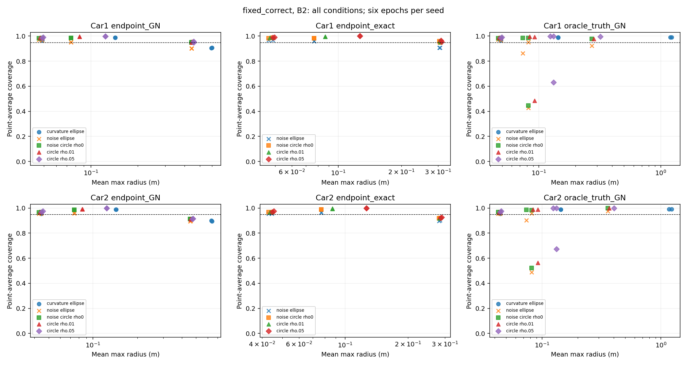
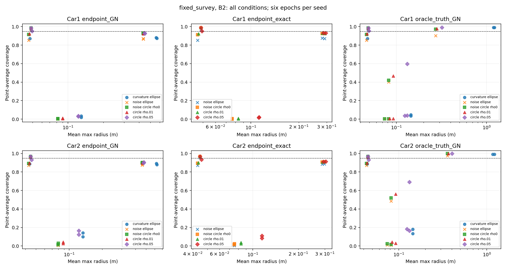
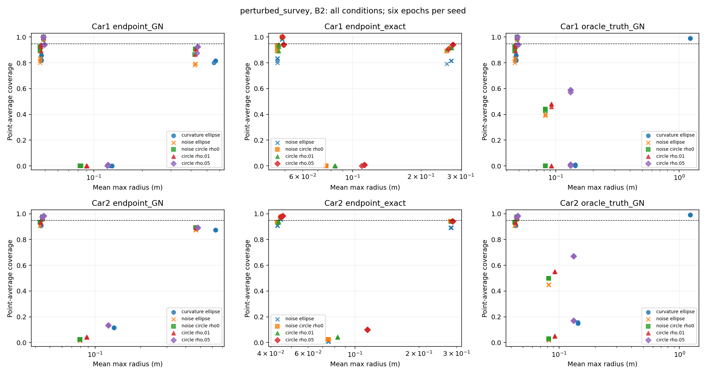

# 固定偏移集合与随机波动：离线候选区域报告

## 本轮结论

可以形成**具有明确线性模型假设的候选区域**：把固定四维中心偏移集合经T传播，与由实际测距/运动噪声灵敏度G构造的Gaussian椭圆作Minkowski和，再用圆保守外包。线性、固定设计、Gaussian噪声且实际偏移在给定集合内时有点态概率结论；当前非线性端点上的G/T只是候选近似，不是已校准风险保证。

固定rho=0/.01/.05m没有根据覆盖结果改变。加入偏移项后圆扩大，若可用性相同覆盖不下降，但是否恢复到名义水平依赖条件。good强先验survey的B2覆盖有所改善；weak/near错误强先验仍严重不足。正确中心weak/near弱先验也有Car2覆盖低于名义值的观察，无法只用“集合没包含偏移”解释。

formal_runs=0，**真实优化器调用数=0**。未重放旧实验，未修改旧运行器、历史输入/结果、报告正文或中期正文。

## 来源、冻结与分母

来源PR111 `704842930f78da60836c7cf56d7a4fdb71b4aa39`；已在检查时的origin/main历史中，无需合并或等待。冻结分析提交 `e843fb0cb494cd46fd853010119301b787c7f371`，先完成数学/恢复测试并提交推送，再计算本轮覆盖。

便携归档2160条PAIR去除重复基准引用后，复用**3360个唯一方法终点、1680个配对输入**。其中正确中心1200、原survey1200、PR111小扰动survey960；每旧条件100seed，每小扰动条件20seed。总独立seed只来自原批次100个已暴露seed；不因rho、方法、车辆、时刻或多条件重复使用增加样本量。

3360终点均有限可用，3334数值接受，26未驻点（B0为7、B2为19），全部保留。10080个全局局部矩阵检查均可用；564480条逐点候选记录中，554240可用、10240因**oracle真值弱几何首时刻边缘噪声协方差奇异**而不可用。它们来自1280弱几何终点×2车×4种噪声/组合候选，不能称10240个独立失败。曲率边缘仍可用，不能用它替换缺失的固定先验噪声区域。

## 恢复组件

新入口recovery.py在调用前以唯一attempt ID持久化身份，文件和父目录fsync，阶段锁覆盖整个过程。attempt存在而结果缺失即拒绝自动重试；结果已落盘却缺DONE时核验身份/哈希后补完成标记，不调用求解器。失败结果亦不可覆盖。12项临时目录/假求解器测试通过，含真实双进程锁冲突，见RECOVERY_TESTS与RECOVERY.md。

PR111旧入口仅按结果文件存在判断恢复，STAGE_START不足以阻止“已调用未落盘”的重复调用；本轮明确此限制，不追溯改写旧记录。新组件给后续接入，不能据此声称旧运行器已经具备相同保证。保守恢复可能停止在实际上尚未调用的attempt，这是防重复与自动继续之间的明确取舍。

## 数学与测试

白化数据Jacobian A不包含先验行。GN与精确H分别给G=H⁻¹Aᵀ、T=H⁻¹Eᵀ/σp²，随机协方差为GGᵀ；绝不以精确H逆替代协方差。固定未知偏移Tδc与随机波动分开，均值外积不是中心协方差。

逐车逐时刻选取F，P=FGGᵀFᵀ、B=FT。q=χ²₂(.95)，支持函数h(a)=sqrt(q aᵀPa)+rho||Bᵀa||₂；全方向外包圆半径R=sqrt(q λmax(P))+rho||B||₂。证明见MATH.md，方向采样仅作交叉检查。

解析仿射例独立QR均值误差约1.43e−17；噪声梯度差分最大差约1.44e−8。rho0、m→cm单位转换、支持函数等号方向、奇异信息/边缘及非正定H处理通过。精确H下的噪声协方差与固定线性例一致，且不同于H逆。

rho0圆只是噪声椭圆的外包圆，不是一般等于该椭圆；因此将原曲率椭圆、固定先验噪声椭圆、噪声圆、加偏移圆全部分列。点平均覆盖与六时刻全覆盖也分列，没有轨迹级95%保证。

## 实际偏移是否在集合内

正确中心1200终点的实际δc=0，全部在三个球内。其余2160终点的四维偏移范数范围约**0.41677–0.45826m**，均不在5cm球内，更不在1cm或零球内。该标记只用于离线分层，没有进入候选区域的计算或rho选择。

因此survey组候选改善只说明区域扩张捕获了一部分误差，不证明集合前提成立，也不能通过事后扩大rho把这些结果包装成确认。rho依旧没有实车计量依据。

## 全部旧矩阵的主要比较

以下每行100seed，B2，覆盖是每seed六时刻点平均（百分比）。GN的curve/noise分别为曲率/固定先验噪声椭圆；各圆均中心在原估计。尺寸为平均最大半轴或圆半径，单位m。完整B0、1cm、oracle、接受子集、置信区间与新增小扰动结果在表中保留。

|条件|车|曲率椭圆%|GN噪声椭圆%|GN噪声圆%|GN+5cm圆%|精确噪声圆%|精确+5cm圆%|精确圆半径0→5cm(m)|
|---|---|---:|---:|---:|---:|---:|---:|---|
|good-0.5-fixed_correct|1|96.67|96.67|98.50|98.50|98.67|98.67|0.0487 → 0.0488|
|good-0.5-fixed_correct|2|95.33|95.33|96.67|96.67|96.67|96.67|0.0446 → 0.0446|
|good-0.05-fixed_correct|1|97.17|97.00|98.17|99.00|98.33|99.00|0.0466 → 0.0496|
|good-0.05-fixed_correct|2|96.33|95.33|96.50|97.67|96.67|97.67|0.0430 → 0.0455|
|weak-0.5-fixed_correct|1|90.67|90.17|94.83|95.00|95.00|95.50|0.3064 → 0.3123|
|weak-0.5-fixed_correct|2|89.50|89.50|91.17|91.33|91.83|92.00|0.2813 → 0.2867|
|weak-0.05-fixed_correct|1|98.83|95.17|98.50|99.83|98.33|100.00|0.0767 → 0.1267|
|weak-0.05-fixed_correct|2|98.83|95.83|98.50|100.00|98.83|100.00|0.0768 → 0.1263|
|near-0.5-fixed_correct|1|90.50|90.17|95.17|95.67|96.00|96.33|0.3035 → 0.3092|
|near-0.5-fixed_correct|2|90.00|89.67|91.00|91.50|92.17|92.50|0.2847 → 0.2902|
|near-0.05-fixed_correct|1|98.67|95.17|98.50|99.83|98.33|100.00|0.0767 → 0.1267|
|near-0.05-fixed_correct|2|98.83|96.17|98.50|100.00|98.83|100.00|0.0769 → 0.1263|
|good-0.5-fixed_survey|1|96.67|96.67|98.50|98.50|98.67|98.67|0.0487 → 0.0488|
|good-0.5-fixed_survey|2|95.50|95.50|96.67|96.67|96.67|96.67|0.0446 → 0.0446|
|good-0.05-fixed_survey|1|87.00|85.33|91.50|95.17|91.33|95.17|0.0464 → 0.0494|
|good-0.05-fixed_survey|2|88.67|87.00|89.17|93.17|89.50|93.33|0.0430 → 0.0456|
|weak-0.5-fixed_survey|1|87.33|86.50|92.17|92.50|92.50|93.00|0.2901 → 0.2952|
|weak-0.5-fixed_survey|2|87.83|87.50|89.67|89.67|90.83|91.00|0.2882 → 0.2938|
|weak-0.05-fixed_survey|1|1.83|0.17|0.33|2.83|0.17|1.67|0.0762 → 0.1123|
|weak-0.05-fixed_survey|2|10.00|0.67|1.50|12.33|1.33|8.33|0.0754 → 0.1148|
|near-0.5-fixed_survey|1|88.00|87.00|92.83|93.17|92.67|93.17|0.2802 → 0.2851|
|near-0.5-fixed_survey|2|89.17|88.50|90.33|90.50|91.00|91.17|0.2982 → 0.3042|
|near-0.05-fixed_survey|1|3.33|0.33|0.50|3.33|0.50|2.17|0.0762 → 0.1125|
|near-0.05-fixed_survey|2|14.17|1.50|3.00|16.50|2.50|11.17|0.0754 → 0.1148|

### 改善与仍不足的条件

good、sigma=.05、survey：B2的GN噪声圆两车覆盖91.50%/89.17%，加5cm项后95.17%/93.17%；精确传播约91.33%/89.50%→95.17%/93.33%。这是部分改善，Car2仍低于名义值，且实际偏移在集合外。不能归因为“已正确覆盖先验误差”。

weak、sigma=.05、survey：GN噪声圆仅0.33%/1.50%，加5cm后2.83%/12.33%；精确传播0.17%/1.33%→1.67%/8.33%。near同类也严重不足。该组完全缺失集合包含前提；固定错误强先验的系统偏移仍占主导，不能据此否定线性集合公式，也不能声称改用精确H就解决问题。

weak、sigma=.5、正确中心：GN+5cm圆两车95.00%/91.33%，精确+5cm圆95.50%/92.00%。Car2 GN点平均覆盖的seed bootstrap逐项95%区间约[85.67%,96.00%]，精确约[86.50%,97.00%]；区间包含95%，不宣称本批已统计确证欠覆盖。接受子集Car2约91.16%/91.84%，说明观察到的差异不能仅由2个未接受终点解释。此时δc=0，集合已包含实际偏移，需继续分离非线性、分支、局部随机灵敏度与有限样本。

正确中心weak强先验加5cm圆接近或达到本批全覆盖，不能因此声称罕见风险保证。固定偏移原本为0，额外偏移项只是保守扩张，不代表实际发现了5cm误差。

### 旧解/真值参照不偷换

没有用另一旧解作为区域中心或替代当前端点。correct与survey各自在自身保存终点计算。oracle_truth_GN单列：使用真值处Jacobian构造候选宽度，但仍评价原非线性估计误差；它不是本轮新求解的线性估计器。

例如weak、sigma=.5、正确中心B2 Car2，oracle固定先验噪声圆仅500/600点可用（首时刻100点奇异），可用点覆盖52.20%，全计划覆盖计数下界43.50%；加5cm后可用点67.20%、全计划下界56.00%。不能删除首时刻后冒充完整覆盖，更不能把曲率椭圆99.17%视为固定先验噪声传播已经正确。

### 小扰动组与B0

PR111新面板是survey附近±0.1mm/+5cm扰动，并非“真实中心附近”的集合内试验。960目标终点全部仍在本轮假设球外。B0和B2的精确+5cm圆在这些条件的逐条件逐车覆盖范围都为0%–100%；范围不能替代每条件结果，完整48个车-条件摘要与图一并提供。B0旧correct组范围92.83%–100%、旧survey组1.50%–98.50%，同样没有统一改善保证。

## 可用性、失败和统计解释

主表包含全部有限终点；26个未驻点结果保留，并提供accepted子集。矩阵全局可用不等于边缘可用；10240条奇异边缘不加ridge，尺寸/覆盖留空。全计划下界只是覆盖计数除以计划点数，不是把缺失状态填零后伪造的经验覆盖率。六时刻全部可用才进入六时刻覆盖率及相应seed区间；oracle弱几何存在首时刻缺失，因此其该类全轨迹比例不虚构。

区域扩张的主要配对比较固定为rho.01/.05减rho0噪声圆，避免把圆外包和偏移项混淆。2000次bootstrap按seed、逐项95%，无家族保证。原输入被方法、视图、rho及车辆时刻重复使用不增加独立样本量。所有结果是已读旧证据后的离线探索，不称新的独立确认。

## 决策

本轮形成候选表达与可审计实现，但没有形成部署区间。下一轮若要评价集合内的非线性表现，需要新的受控非线性输入，因为现有survey组都在集合外。建议只做good/weak、两sigma、中心相对truth的0/±.01/±.05m Car1Y方向，固定survey积分初始化、同观测配对，B2为主，20条件×30新seed=600方法运行；配同输入真值仿射直接解作诊断，仍不增加独立样本量。此为后续建议，本轮不执行，不对整个4维球声称验证。

独立复核通过10080组局部矩阵、564480条逐点记录及94080条逐seed记录；另核对8064行汇总及864行配对差。详见results/VERIFIED.json、TABLE_CHECKS.json和HANDOFF。图中纵轴是可用点覆盖，oracle弱几何的缺失首时刻不计入该纵轴，完整分母和下界必须同时读表，不能从图宣称全计划覆盖。

